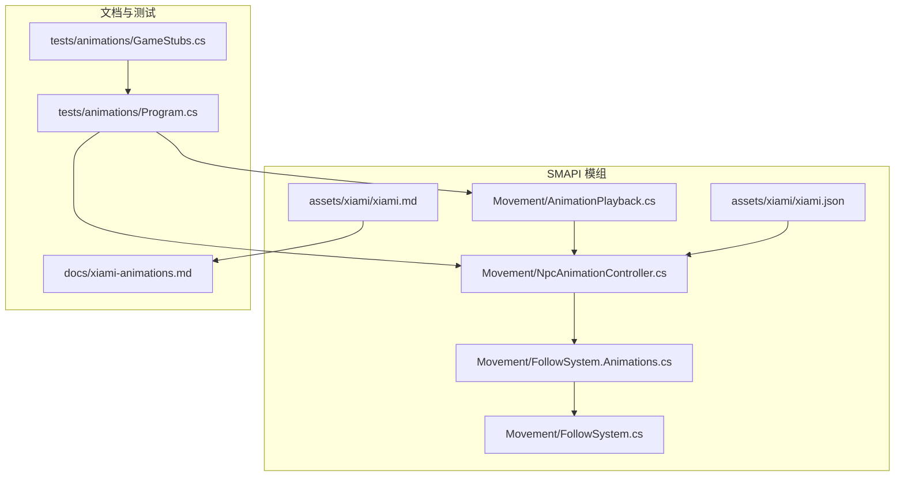
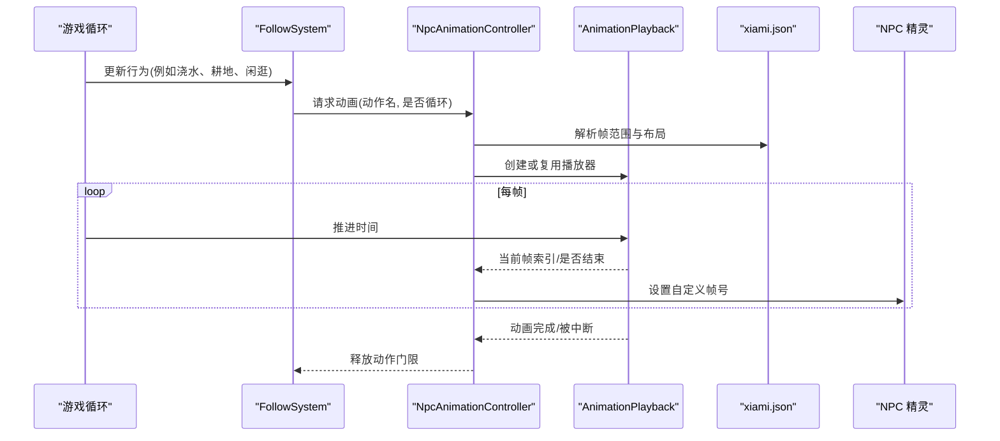
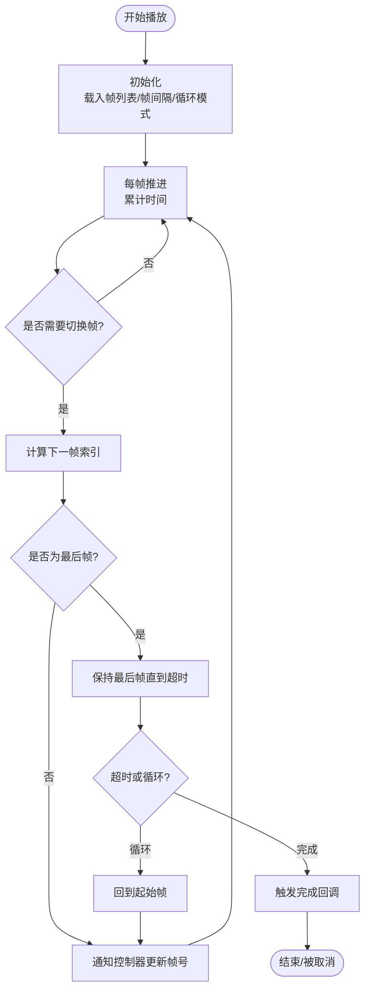
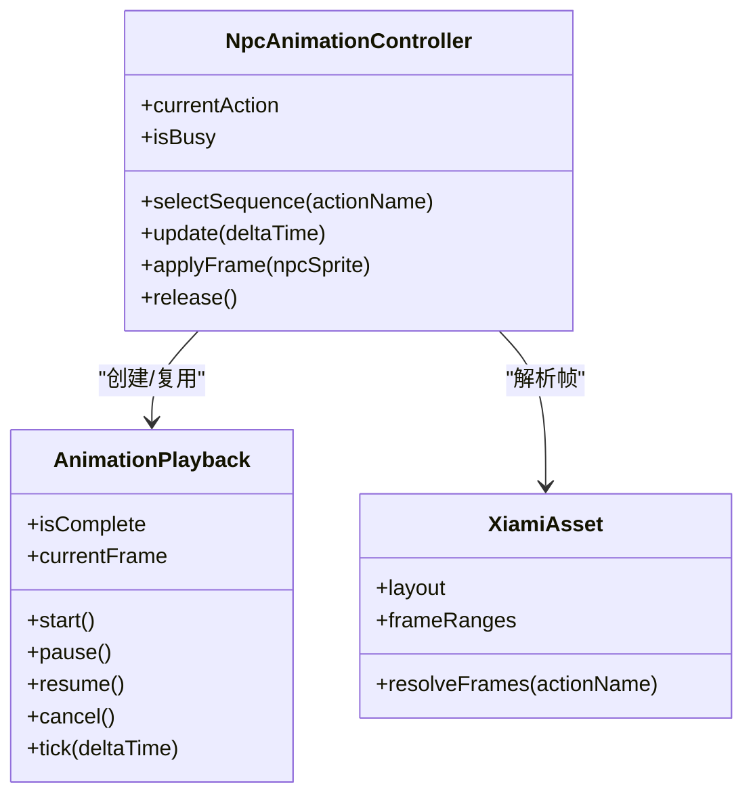
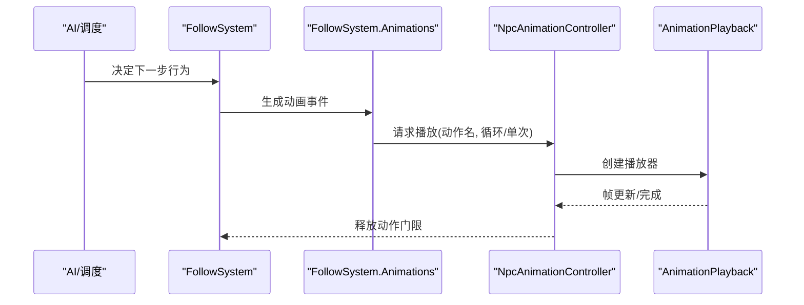
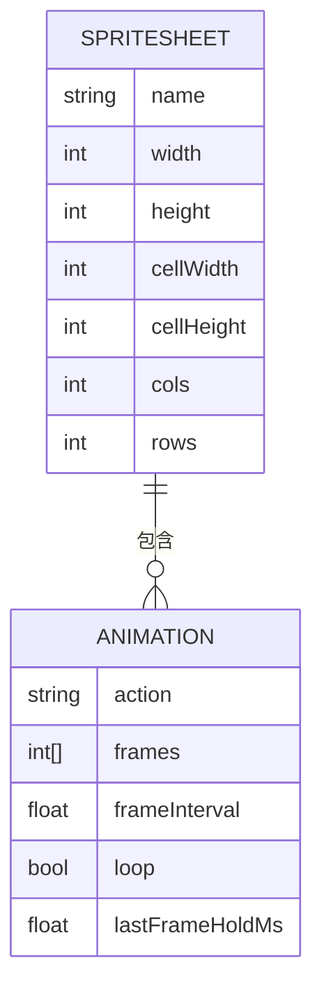
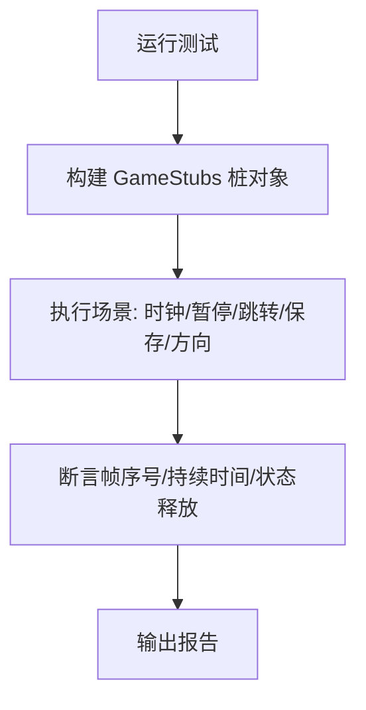
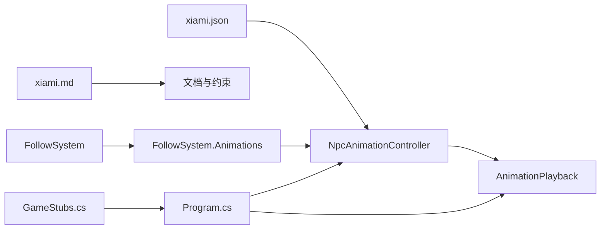

# 动画播放引擎

<cite>
**本文引用的文件**   
- [AnimationPlayback.cs](file://SmartNPC/SmartNPC/smapi-mod/Movement/AnimationPlayback.cs)
- [NpcAnimationController.cs](file://SmartNPC/SmartNPC/smapi-mod/Movement/NpcAnimationController.cs)
- [FollowSystem.Animations.cs](file://SmartNPC/SmartNPC/smapi-mod/Movement/FollowSystem.Animations.cs)
- [FollowSystem.cs](file://SmartNPC/SmartNPC/smapi-mod/Movement/FollowSystem.cs)
- [xiami.json](file://SmartNPC/SmartNPC/smapi-mod/assets/xiami/xiami.json)
- [xiami.md](file://SmartNPC/SmartNPC/smapi-mod/assets/xiami/xiami.md)
- [xiami-animations.md](file://SmartNPC/docs/xiami-animations.md)
- [Program.cs](file://SmartNPC/SmartNPC/tests/animations/Program.cs)
- [GameStubs.cs](file://SmartNPC/SmartNPC/tests/animations/GameStubs.cs)
</cite>

## 目录
1. [引言](#引言)
2. [项目结构](#项目结构)
3. [核心组件](#核心组件)
4. [架构总览](#架构总览)
5. [详细组件分析](#详细组件分析)
6. [依赖关系分析](#依赖关系分析)
7. [性能考量](#性能考量)
8. [故障排查指南](#故障排查指南)
9. [结论](#结论)
10. [附录：动画文件格式与扩展指南](#附录动画文件格式与扩展指南)

## 引言
本技术文档聚焦 SmartNPC 模组中的“动画播放引擎”，目标是帮助开发者理解并扩展 NPC 的自定义动画系统。内容覆盖以下方面：
- AnimationPlayback.cs 的核心播放逻辑，包括帧渲染、时间轴推进和播放状态控制。
- NpcAnimationController.cs 对游戏内 NPC 动画帧的协调与替换机制。
- 动画资源加载机制，包括纹理图集、帧数据解析和资源缓存策略。
- 性能优化思路，如批量渲染、视锥剔除和 LOD 设计。
- 调试工具链，包括帧预览、性能监控和错误诊断。
- 复杂动画序列、自定义播放器与分析工具的实践方法。
- 动画文件格式规范与扩展建议。

需要特别说明的是：仓库当前提供的部分源码路径在读取时不可用，因此本文对实现细节的描述以已验证的文件引用为准；无法直接读取的代码片段将以“代码片段路径”形式标注，避免臆测具体实现。

**章节来源**
- [xiami-animations.md:1-30](file://SmartNPC/docs/xiami-animations.md#L1-L30)

## 项目结构
动画相关代码主要集中在 SMAPI 模组的 Movement 子模块，以及 assets 下的 xiami 动画资源定义。测试工程位于 tests/animations 下，用于校验时钟、控制器行为和边界条件。

**图示来源**
- [AnimationPlayback.cs](file://SmartNPC/SmartNPC/smapi-mod/Movement/AnimationPlayback.cs)
- [NpcAnimationController.cs](file://SmartNPC/SmartNPC/smapi-mod/Movement/NpcAnimationController.cs)
- [FollowSystem.Animations.cs](file://SmartNPC/SmartNPC/smapi-mod/Movement/FollowSystem.Animations.cs)
- [FollowSystem.cs](file://SmartNPC/SmartNPC/smapi-mod/Movement/FollowSystem.cs)
- [xiami.json](file://SmartNPC/SmartNPC/smapi-mod/assets/xiami/xiami.json)
- [xiami.md](file://SmartNPC/SmartNPC/smapi-mod/assets/xiami/xiami.md)
- [xiami-animations.md](file://SmartNPC/docs/xiami-animations.md)
- [Program.cs](file://SmartNPC/SmartNPC/tests/animations/Program.cs)
- [GameStubs.cs](file://SmartNPC/SmartNPC/tests/animations/GameStubs.cs)

**章节来源**
- [xiami-animations.md:1-30](file://SmartNPC/docs/xiami-animations.md#L1-L30)

## 核心组件
本节概述动画播放引擎的关键职责：
- AnimationPlayback：维护动画时间轴、帧索引、计时器、循环与完成回调等播放状态。
- NpcAnimationController：负责将自定义帧映射到游戏 NPC 的精灵帧，处理方向镜像、工作动画持有和生命周期管理。
- FollowSystem.Animations / FollowSystem：将行走、跟随、动作等更高层行为与动画控制器解耦。
- xiami.json / xiami.md：描述 XiaMi 角色动画图集布局、帧范围和行为触发规则。
- 测试程序 Program.cs 与 GameStubs.cs：轻量级模拟游戏 API，校验动画时钟、暂停、跳转、保存替换等场景。

**章节来源**
- [xiami-animations.md:1-30](file://SmartNPC/docs/xiami-animations.md#L1-L30)

## 架构总览
动画引擎采用“控制器 + 播放器 + 资源”的分层设计：
- 资源层：xiami.json 提供帧元数据（单元格大小、列数、行数、帧范围）。
- 控制器层：NpcAnimationController 根据当前行为选择动画序列，并在每帧更新时将帧号写入 NPC 精灵。
- 播放器层：AnimationPlayback 负责按时间推进帧索引，支持单次播放、循环、等待最后帧时长、中断与恢复。
- 行为集成层：FollowSystem 系列类将移动、交互和工作动作转换为动画请求，交由控制器调度。

**图示来源**
- [FollowSystem.cs](file://SmartNPC/SmartNPC/smapi-mod/Movement/FollowSystem.cs)
- [FollowSystem.Animations.cs](file://SmartNPC/SmartNPC/smapi-mod/Movement/FollowSystem.Animations.cs)
- [NpcAnimationController.cs](file://SmartNPC/SmartNPC/smapi-mod/Movement/NpcAnimationController.cs)
- [AnimationPlayback.cs](file://SmartNPC/SmartNPC/smapi-mod/Movement/AnimationPlayback.cs)
- [xiami.json](file://SmartNPC/SmartNPC/smapi-mod/assets/xiami/xiami.json)

## 详细组件分析

### AnimationPlayback：播放时间与状态机
AnimationPlayback 是动画播放的核心状态机，承担以下职责：
- 时间轴推进：累积 deltaTime，根据帧间隔切换到下一帧。
- 帧索引管理：从资源层获取帧列表，计算当前帧索引，处理首尾特殊帧时长。
- 播放模式：支持单次播放、无限循环、带返回的循环等。
- 生命周期：支持启动、暂停、恢复、取消、完成回调。
- 边界条件：处理大时间增量、暂停后恢复、保存/重载导致的回放重置。

**图示来源**
- [AnimationPlayback.cs](file://SmartNPC/SmartNPC/smapi-mod/Movement/AnimationPlayback.cs)

**章节来源**
- [xiami-animations.md:1-30](file://SmartNPC/docs/xiami-animations.md#L1-L30)

### NpcAnimationController：帧映射与生命周期
NpcAnimationController 负责将上层行为转换为具体的 NPC 帧号，并处理以下关键逻辑：
- 行为到动画序列的映射：例如浇水、耕地、闲逛、跳舞、害羞后退、焦虑踱步等。
- 方向处理：XiaMi 的前/后/左条带映射到游戏默认方向，右向通过镜像左条带。
- 动画持有：工作动画会持有 NPC 串行动作门限，防止其他动作抢占；循环闲逛不阻塞。
- 生命周期：动画完成、取消、移动控制器变更、传送、存档重载、标题界面返回都会释放标志。
- 暂停协同：游戏暂停时，播放与动画推进同时暂停。

**图示来源**
- [NpcAnimationController.cs](file://SmartNPC/SmartNPC/smapi-mod/Movement/NpcAnimationController.cs)
- [AnimationPlayback.cs](file://SmartNPC/SmartNPC/smapi-mod/Movement/AnimationPlayback.cs)
- [xiami.json](file://SmartNPC/SmartNPC/smapi-mod/assets/xiami/xiami.json)

**章节来源**
- [xiami-animations.md:1-30](file://SmartNPC/docs/xiami-animations.md#L1-L30)

### FollowSystem.Animations / FollowSystem：行为到动画的桥接
FollowSystem.Animations 与 FollowSystem 将“移动、跟随、社交与世界行为”转化为动画请求：
- 行走：使用内置行走帧，但为 XiaMi 应用自定义前/后/左条带。
- 工作：浇水、耕地、采集成功后展示持物姿势。
- 闲逛：farm、rest、look_around 支持 once 或可中断 loop。
- 表情与情绪：happy dance、surprise、shy retreat、pace_anxiously。
- 世界效果：这些动画仅改变视觉，不改变世界状态；世界效果由现有动作处理器负责。

**图示来源**
- [FollowSystem.cs](file://SmartNPC/SmartNPC/smapi-mod/Movement/FollowSystem.cs)
- [FollowSystem.Animations.cs](file://SmartNPC/SmartNPC/smapi-mod/Movement/FollowSystem.Animations.cs)
- [NpcAnimationController.cs](file://SmartNPC/SmartNPC/smapi-mod/Movement/NpcAnimationController.cs)

**章节来源**
- [xiami-animations.md:1-30](file://SmartNPC/docs/xiami-animations.md#L1-L30)

### 资源层：xiami.json 与 xiami.md
xiami.json 提供动画图集的结构化描述，通常包含：
- 图集尺寸、单元格宽高、行列布局。
- 每个动作对应的帧范围或帧表。
- 可选的时序参数（帧间隔、最后帧延时、是否循环）。

xiami.md 作为人类可读说明，补充行为触发、帧范围、注意事项和已知限制。

**图示来源**
- [xiami.json](file://SmartNPC/SmartNPC/smapi-mod/assets/xiami/xiami.json)
- [xiami.md](file://SmartNPC/SmartNPC/smapi-mod/assets/xiami/xiami.md)

**章节来源**
- [xiami.json](file://SmartNPC/SmartNPC/smapi-mod/assets/xiami/xiami.json)
- [xiami.md](file://SmartNPC/SmartNPC/smapi-mod/assets/xiami/xiami.md)

### 测试与调试：Program.cs 与 GameStubs.cs
测试工程通过轻量级 game API 桩对象，验证：
- 真实动画时钟与控制器行为。
- 所有浇水帧、最后帧持续时间。
- 暂停、大时间增量、重复播放。
- 环境替换、移动恢复、传送、路径中断、存档替换、方向映射、卸载。
- 控制台命令 smartnpc_animation 可在不改变世界状态下预览浇水、锄头、全部帧。

**图示来源**
- [Program.cs](file://SmartNPC/SmartNPC/tests/animations/Program.cs)
- [GameStubs.cs](file://SmartNPC/SmartNPC/tests/animations/GameStubs.cs)

**章节来源**
- [xiami-animations.md:1-30](file://SmartNPC/docs/xiami-animations.md#L1-L30)

## 依赖关系分析
动画系统的依赖层次清晰：
- 资源依赖：xiami.json 为帧数据源；xiami.md 为说明文档。
- 控制器依赖：NpcAnimationController 依赖 AnimationPlayback 进行时间驱动，依赖 FollowSystem 的行为语义。
- 行为依赖：FollowSystem.Animations 将 AI 决策映射为动画请求。
- 测试依赖：Program.cs 与 GameStubs.cs 模拟游戏 API，确保控制器与播放器在隔离环境下正确运行。

**图示来源**
- [xiami.json](file://SmartNPC/SmartNPC/smapi-mod/assets/xiami/xiami.json)
- [xiami.md](file://SmartNPC/SmartNPC/smapi-mod/assets/xiami/xiami.md)
- [FollowSystem.cs](file://SmartNPC/SmartNPC/smapi-mod/Movement/FollowSystem.cs)
- [FollowSystem.Animations.cs](file://SmartNPC/SmartNPC/smapi-mod/Movement/FollowSystem.Animations.cs)
- [NpcAnimationController.cs](file://SmartNPC/SmartNPC/smapi-mod/Movement/NpcAnimationController.cs)
- [AnimationPlayback.cs](file://SmartNPC/SmartNPC/smapi-mod/Movement/AnimationPlayback.cs)
- [Program.cs](file://SmartNPC/SmartNPC/tests/animations/Program.cs)
- [GameStubs.cs](file://SmartNPC/SmartNPC/tests/animations/GameStubs.cs)

**章节来源**
- [xiami-animations.md:1-30](file://SmartNPC/docs/xiami-animations.md#L1-L30)

## 性能考量
虽然仓库未直接给出批量渲染、视锥剔除与 LOD 的具体实现，但可基于现有架构提出如下优化方向：
- 批量渲染
  - 合并同图集的 NPC 精灵绘制调用，减少 DrawCall。
  - 使用 SpriteBatch 批次提交，按图集分块绘制。
- 视锥剔除
  - 在 FollowSystem 或 NpcAnimationController 中，对不在摄像机范围内的 NPC 跳过动画推进或降低更新频率。
- LOD 系统
  - 远距离 NPC 使用更低帧率或静态帧，近距再启用完整动画序列。
- 资源缓存
  - 对 xiami.json 解析结果与帧表做内存缓存，避免重复解析。
  - 对频繁使用的动作（如 idle、walk）预取帧数组。
- 时间步进
  - 在暂停、快速时间推进或延迟恢复时，对 AnimationPlayback 的时间累积做钳制，避免跳帧抖动。

[本节为通用性能建议，不直接分析具体文件]

## 故障排查指南
常见异常与定位方式：
- 动画不播放或帧错乱
  - 检查 xiami.json 中帧范围是否与图集布局匹配。
  - 确认 NpcAnimationController 的方向映射是否正确，尤其是左右镜像。
- 动画卡住或无响应
  - 检查工作动画是否持有动作门限但未释放。
  - 确认暂停、传送、存档重载等场景是否触发了释放逻辑。
- 最后帧停留时间不正确
  - 检查 AnimationPlayback 的最后帧超时逻辑与帧间隔配置。
- 预览命令无效
  - 当 NPC 忙碌时，smartnpc_animation 会拒绝预览；需等待空闲后再试。
- 修改 DLL 后未生效
  - 需要完整重启游戏；仅重新进入存档不足以刷新已加载模组。

**章节来源**
- [xiami-animations.md:1-30](file://SmartNPC/docs/xiami-animations.md#L1-L30)

## 结论
该动画播放引擎通过 AnimationPlayback 与 NpcAnimationController 的组合，实现了可控、可测试且可扩展的 NPC 动画系统。资源层 xiami.json 使动画数据与逻辑解耦，便于新增动作与角色。测试工程覆盖了时钟、暂停、跳转、存档等关键路径，提升了稳定性。未来可在批量渲染、视锥剔除与 LOD 上继续优化，以提升大规模 NPC 场景的性能表现。

[本节为总结性内容，不直接分析具体文件]

## 附录：动画文件格式与扩展指南

### xiami.json 字段建议
- spritesheet：图集基本信息
  - name：图集名称
  - width/height：图集像素尺寸
  - cellWidth/cellHeight：单元格宽高
  - cols/rows：行列布局
- animations：动作集合
  - action：动作标识符（如 npc_water_crops、npc_till_soil、npc_idle_activity 等）
  - frames：帧索引数组或范围
  - frameInterval：帧间隔（毫秒）
  - loop：是否循环
  - lastFrameHoldMs：最后帧停留时间（毫秒）

### 新增动作步骤
- 在 xiami.json 中添加新动作的帧范围与时序。
- 在 NpcAnimationController 中注册动作到帧序列的映射。
- 在 FollowSystem.Animations 中将上层行为转换为动画请求。
- 在 tests/animations/Program.cs 添加用例，验证帧序号、持续时间与状态释放。

### 开发最佳实践
- 帧数据与逻辑分离：优先维护 xiami.json，避免硬编码帧号。
- 明确生命周期：工作动画持有门限，完成后必须释放。
- 方向一致性：统一处理左右镜像，避免不同朝向出现视觉不一致。
- 测试先行：为新动作编写轻量测试，覆盖暂停、跳转、保存、卸载等边界场景。

**章节来源**
- [xiami.json](file://SmartNPC/SmartNPC/smapi-mod/assets/xiami/xiami.json)
- [xiami.md](file://SmartNPC/SmartNPC/smapi-mod/assets/xiami/xiami.md)
- [xiami-animations.md:1-30](file://SmartNPC/docs/xiami-animations.md#L1-L30)