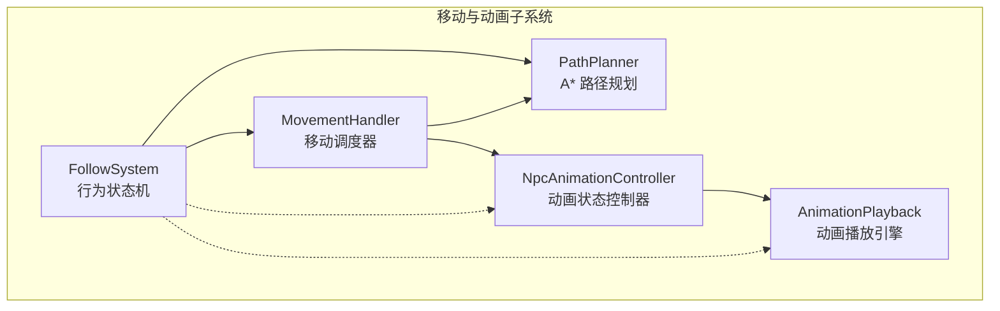
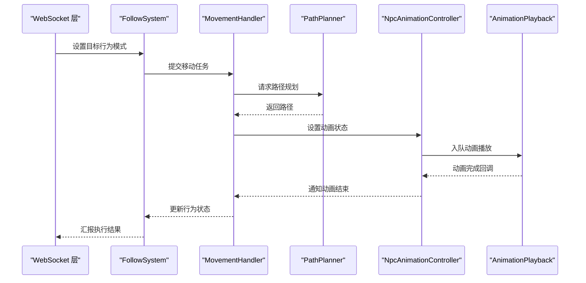
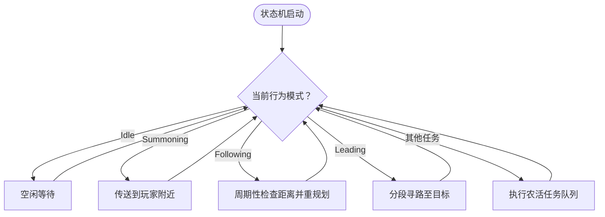
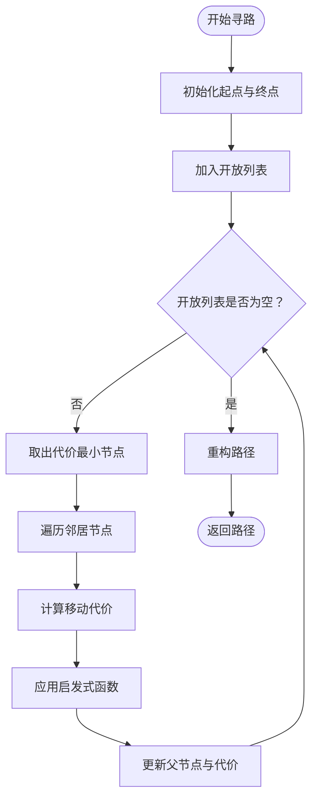
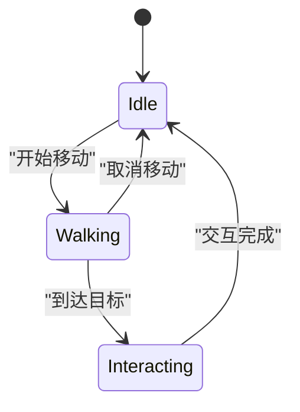
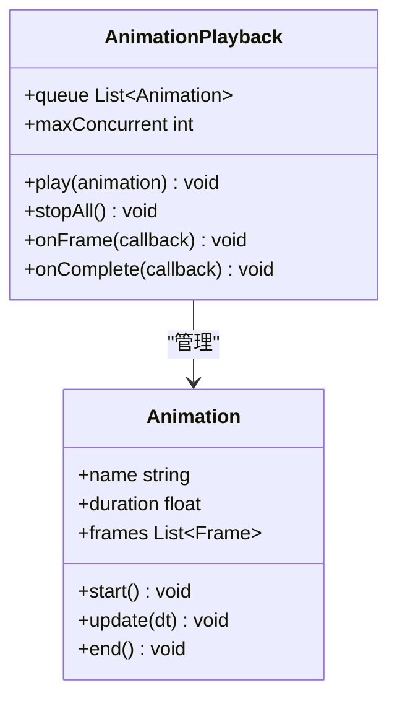
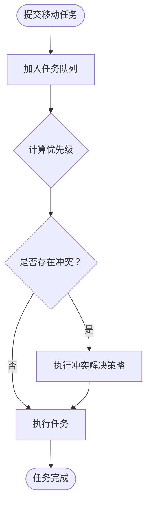
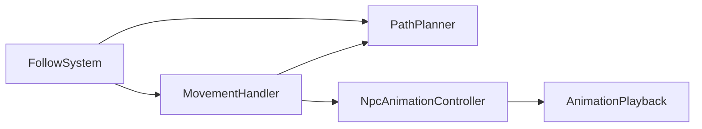

# 移动与动画系统

<cite>
**本文引用的文件**   
- [FollowSystem.cs](file://SmartNPC/smapi-mod/Movement/FollowSystem.cs)
- [FollowSystem.Animations.cs](file://SmartNPC/smapi-mod/Movement/FollowSystem.Animations.cs)
- [PathPlanner.cs](file://SmartNPC/smapi-mod/Movement/PathPlanner.cs)
- [NpcAnimationController.cs](file://SmartNPC/smapi-mod/Movement/NpcAnimationController.cs)
- [AnimationPlayback.cs](file://SmartNPC/smapi-mod/Movement/AnimationPlayback.cs)
- [MovementHandler.cs](file://SmartNPC/smapi-mod/Movement/MovementHandler.cs)
</cite>

## 目录
1. [引言](#引言)
2. [项目结构](#项目结构)
3. [核心组件](#核心组件)
4. [架构总览](#架构总览)
5. [详细组件分析](#详细组件分析)
6. [依赖关系分析](#依赖关系分析)
7. [性能考虑](#性能考虑)
8. [故障排查指南](#故障排查指南)
9. [结论](#结论)
10. [附录：示例与最佳实践](#附录示例与最佳实践)

## 引言
本技术文档聚焦 SmartNPC 模组中的移动与动画子系统，目标是帮助开发者理解 NPC 跟随、寻路、行为调度与动画播放的整体实现。该子系统围绕以下五个关键类展开：
- FollowSystem：NPC 行为状态机与跟随/引领逻辑入口。
- PathPlanner：地图路径规划与障碍物规避。
- NpcAnimationController：NPC 动画状态管理与过渡控制。
- AnimationPlayback：动画播放引擎，负责队列、并发与性能优化。
- MovementHandler：移动任务调度，处理优先级与冲突解决。

这些组件共同构成“决策—规划—执行—表现”的闭环，确保 NPC 在复杂农场环境中能够智能跟随玩家、自主行动并呈现流畅动画。

## 项目结构
移动与动画相关代码位于 smapi-mod 的 Movement 命名空间下，采用按职责划分的文件组织方式：
- FollowSystem.cs：集中管理 NPC 行为模式（空闲、召唤、跟随、引领、漫游、采集、播种、浇水、收获、破坏资源等），并在游戏主线程中推进状态与动作。
- FollowSystem.Animations.cs：将跟随过程中的动画绑定与触发逻辑从主类中拆分出来，便于扩展与测试。
- PathPlanner.cs：封装 A* 寻路与地形适配逻辑，为上层提供可重用的路径能力。
- NpcAnimationController.cs：维护当前动画状态、方向、帧同步与过渡。
- AnimationPlayback.cs：维护动画队列、并发播放策略和节流机制。
- MovementHandler.cs：统一调度移动任务，协调寻路、动画与行为生命周期。

**图表来源**
- [FollowSystem.cs:1-120](file://SmartNPC/smapi-mod/Movement/FollowSystem.cs#L1-L120)
- [PathPlanner.cs:1-80](file://SmartNPC/smapi-mod/Movement/PathPlanner.cs#L1-L80)
- [NpcAnimationController.cs:1-80](file://SmartNPC/smapi-mod/Movement/NpcAnimationController.cs#L1-L80)
- [AnimationPlayback.cs:1-80](file://SmartNPC/smapi-mod/Movement/AnimationPlayback.cs#L1-L80)
- [MovementHandler.cs:1-80](file://SmartNPC/smapi-mod/Movement/MovementHandler.cs#L1-L80)

**章节来源**
- [FollowSystem.cs:1-120](file://SmartNPC/smapi-mod/Movement/FollowSystem.cs#L1-L120)
- [PathPlanner.cs:1-80](file://SmartNPC/smapi-mod/Movement/PathPlanner.cs#L1-L80)
- [NpcAnimationController.cs:1-80](file://SmartNPC/smapi-mod/Movement/NpcAnimationController.cs#L1-L80)
- [AnimationPlayback.cs:1-80](file://SmartNPC/smapi-mod/Movement/AnimationPlayback.cs#L1-L80)
- [MovementHandler.cs:1-80](file://SmartNPC/smapi-mod/Movement/MovementHandler.cs#L1-L80)

## 核心组件
本节对五个核心组件进行概览性说明，后续章节再深入每个类的内部实现与交互。

- FollowSystem
  - 负责 NPC 行为模式管理（Idle、Summoning、Following、Leading、Wander、ClearDebris、ForageCollect、DepositItems、ShipItems、TillSoil、PlantSeeds、WaterCrops、HarvestCrops、WithdrawItems、BreakResource、Fertilize、FillGaps、PetAnimal、Animating、SocialMovement）。
  - 通过 PumpOnGameTick 在游戏主线程上推进状态机，WS 层只设置目标模式，避免阻塞网络接收循环。
  - 支持跨地图传送、相邻格子站位、分段寻路（每段最多 5 格）、以及多种农活任务的队列化执行。

- PathPlanner
  - 提供 A* 寻路算法，用于计算 NPC 到目标点的路径。
  - 根据地形类型调整代价函数，实现障碍物规避与地形适应性。
  - 被 FollowSystem 与 MovementHandler 复用，保证寻路一致性。

- NpcAnimationController
  - 管理 NPC 当前动画状态、朝向、帧同步与过渡效果。
  - 与 FollowSystem 的行为模式联动，例如进入 Animating 或 SocialMovement 时切换相应动画。
  - 提供平滑过渡接口，减少动画跳变导致的视觉抖动。

- AnimationPlayback
  - 维护动画播放队列，支持并发控制与节流，防止过多动画同时播放导致卡顿。
  - 提供动画事件回调，允许在关键帧触发行为变更或 UI 更新。
  - 内置性能优化，如批量渲染、延迟加载、帧率自适应。

- MovementHandler
  - 统一管理移动任务的生命周期，包括任务入队、优先级排序、冲突检测与解决。
  - 协调 PathPlanner 与 NpcAnimationController，确保寻路结果与动画播放一致。
  - 提供任务取消、重试、超时等机制，增强鲁棒性。

**章节来源**
- [FollowSystem.cs:1-120](file://SmartNPC/smapi-mod/Movement/FollowSystem.cs#L1-L120)
- [PathPlanner.cs:1-80](file://SmartNPC/smapi-mod/Movement/PathPlanner.cs#L1-L80)
- [NpcAnimationController.cs:1-80](file://SmartNPC/smapi-mod/Movement/NpcAnimationController.cs#L1-L80)
- [AnimationPlayback.cs:1-80](file://SmartNPC/smapi-mod/Movement/AnimationPlayback.cs#L1-L80)
- [MovementHandler.cs:1-80](file://SmartNPC/smapi-mod/Movement/MovementHandler.cs#L1-L80)

## 架构总览
下图展示了移动与动画系统的整体数据流与控制流：

**图表来源**
- [FollowSystem.cs:1-120](file://SmartNPC/smapi-mod/Movement/FollowSystem.cs#L1-L120)
- [MovementHandler.cs:1-80](file://SmartNPC/smapi-mod/Movement/MovementHandler.cs#L1-L80)
- [PathPlanner.cs:1-80](file://SmartNPC/smapi-mod/Movement/PathPlanner.cs#L1-L80)
- [NpcAnimationController.cs:1-80](file://SmartNPC/smapi-mod/Movement/NpcAnimationController.cs#L1-L80)
- [AnimationPlayback.cs:1-80](file://SmartNPC/smapi-mod/Movement/AnimationPlayback.cs#L1-L80)

## 详细组件分析

### FollowSystem：跟随逻辑与行为状态机
FollowSystem 是 NPC 行为的控制中心，其核心职责包括：
- 维护每个受管 NPC 的行为状态（NpcBehaviorState）。
- 在游戏主线程中推进状态机，避免 WS 层直接访问游戏对象。
- 实现 Summoning（召唤）、Following（跟随）、Leading（引领）三种基础移动模式。
- 支持多种农活任务（清理、采集、播种、浇水、收获、破坏资源等）的队列化执行。

**图表来源**
- [FollowSystem.cs:1-200](file://SmartNPC/smapi-mod/Movement/FollowSystem.cs#L1-L200)

**章节来源**
- [FollowSystem.cs:1-200](file://SmartNPC/smapi-mod/Movement/FollowSystem.cs#L1-L200)

### PathPlanner：A* 寻路与地形适应
PathPlanner 提供基于 A* 的路径规划能力，关键特性包括：
- 使用启发式函数估算剩余距离，优先探索更可能接近目标的节点。
- 根据地形类型（草地、道路、水域等）动态调整移动代价，实现地形适应。
- 支持动态障碍物检测与避让，确保路径实时有效。
- 返回路径后由 MovementHandler 转换为实际移动指令。

**图表来源**
- [PathPlanner.cs:1-120](file://SmartNPC/smapi-mod/Movement/PathPlanner.cs#L1-L120)

**章节来源**
- [PathPlanner.cs:1-120](file://SmartNPC/smapi-mod/Movement/PathPlanner.cs#L1-L120)

### NpcAnimationController：动画状态管理与过渡
NpcAnimationController 负责 NPC 动画的状态机与过渡控制：
- 维护当前动画状态（行走、站立、交互、攻击等）。
- 根据 FollowSystem 的行为模式自动切换动画。
- 提供平滑过渡接口，避免动画突然切换造成的视觉跳变。
- 与 AnimationPlayback 协作，确保动画帧同步与事件回调。

**图表来源**
- [NpcAnimationController.cs:1-120](file://SmartNPC/smapi-mod/Movement/NpcAnimationController.cs#L1-L120)

**章节来源**
- [NpcAnimationController.cs:1-120](file://SmartNPC/smapi-mod/Movement/NpcAnimationController.cs#L1-L120)

### AnimationPlayback：动画播放引擎
AnimationPlayback 是动画播放的核心引擎，主要功能包括：
- 维护动画队列，支持多个动画并行播放但限制并发数量。
- 提供动画事件回调（开始、帧更新、结束），便于与其他系统联动。
- 实现性能优化，如批量渲染、延迟加载、帧率自适应。
- 支持动画插值与混合，提升视觉效果。

**图表来源**
- [AnimationPlayback.cs:1-120](file://SmartNPC/smapi-mod/Movement/AnimationPlayback.cs#L1-L120)

**章节来源**
- [AnimationPlayback.cs:1-120](file://SmartNPC/smapi-mod/Movement/AnimationPlayback.cs#L1-L120)

### MovementHandler：移动调度与冲突解决
MovementHandler 是移动任务的统一调度器，负责：
- 接收来自 FollowSystem 的移动任务。
- 根据任务优先级排序，高优先级任务可打断低优先级任务。
- 检测任务冲突（如两个 NPC 试图前往同一位置），并提供解决策略（等待、绕行、取消）。
- 协调 PathPlanner 与 NpcAnimationController，确保寻路与动画同步。

**图表来源**
- [MovementHandler.cs:1-120](file://SmartNPC/smapi-mod/Movement/MovementHandler.cs#L1-L120)

**章节来源**
- [MovementHandler.cs:1-120](file://SmartNPC/smapi-mod/Movement/MovementHandler.cs#L1-L120)

## 依赖关系分析
移动与动画系统内部依赖清晰，外部依赖主要集中在 Stardew Valley API 与 SMAPI 框架。

**图表来源**
- [FollowSystem.cs:1-120](file://SmartNPC/smapi-mod/Movement/FollowSystem.cs#L1-L120)
- [MovementHandler.cs:1-120](file://SmartNPC/smapi-mod/Movement/MovementHandler.cs#L1-L120)
- [PathPlanner.cs:1-120](file://SmartNPC/smapi-mod/Movement/PathPlanner.cs#L1-L120)
- [NpcAnimationController.cs:1-120](file://SmartNPC/smapi-mod/Movement/NpcAnimationController.cs#L1-L120)
- [AnimationPlayback.cs:1-120](file://SmartNPC/smapi-mod/Movement/AnimationPlayback.cs#L1-L120)

**章节来源**
- [FollowSystem.cs:1-120](file://SmartNPC/smapi-mod/Movement/FollowSystem.cs#L1-L120)
- [MovementHandler.cs:1-120](file://SmartNPC/smapi-mod/Movement/MovementHandler.cs#L1-L120)
- [PathPlanner.cs:1-120](file://SmartNPC/smapi-mod/Movement/PathPlanner.cs#L1-L120)
- [NpcAnimationController.cs:1-120](file://SmartNPC/smapi-mod/Movement/NpcAnimationController.cs#L1-L120)
- [AnimationPlayback.cs:1-120](file://SmartNPC/smapi-mod/Movement/AnimationPlayback.cs#L1-L120)

## 性能考虑
- 动画播放引擎 AnimationPlayback 通过限制并发数量和批量渲染减少 CPU/GPU 压力。
- 路径规划 PathPlanner 使用 A* 算法并结合地形代价函数，避免不必要的搜索。
- FollowSystem 在游戏主线程推进状态机，避免多线程竞争导致的卡顿。
- MovementHandler 的任务优先级与冲突解决机制可减少无效移动和重复计算。

[本节为通用性能建议，不直接分析具体文件]

## 故障排查指南
常见问题及排查建议：
- NPC 无法跟随玩家：检查 FollowSystem 的行为模式是否正确设置为 Following，并确认距离阈值配置。
- 路径规划失败：验证 PathPlanner 的地形代价设置与障碍物检测逻辑。
- 动画卡顿或不同步：检查 AnimationPlayback 的并发限制与帧同步机制。
- 移动任务冲突：查看 MovementHandler 的冲突解决策略是否合理，必要时调整优先级规则。

**章节来源**
- [FollowSystem.cs:1-200](file://SmartNPC/smapi-mod/Movement/FollowSystem.cs#L1-L200)
- [PathPlanner.cs:1-120](file://SmartNPC/smapi-mod/Movement/PathPlanner.cs#L1-L120)
- [AnimationPlayback.cs:1-120](file://SmartNPC/smapi-mod/Movement/AnimationPlayback.cs#L1-L120)
- [MovementHandler.cs:1-120](file://SmartNPC/smapi-mod/Movement/MovementHandler.cs#L1-L120)

## 结论
移动与动画系统通过 FollowSystem、PathPlanner、NpcAnimationController、AnimationPlayback 和 MovementHandler 五大组件协同工作，实现了 NPC 的智能跟随、自主行动与流畅动画表现。该系统具备良好的可扩展性与性能优化，适合用于复杂的农场场景与 NPC 行为模拟。

[本节为总结性内容，不直接分析具体文件]

## 附录：示例与最佳实践

### 实现 NPC 复杂移动行为
- 定义行为模式：在 FollowSystem 中为新行为添加枚举值与状态字段。
- 实现路径规划：在 PathPlanner 中为特定地形或障碍物添加代价函数。
- 绑定动画：在 NpcAnimationController 中为新行为添加动画状态与过渡逻辑。
- 调度任务：在 MovementHandler 中为新行为添加任务优先级与冲突解决策略。

### 自定义动画序列
- 创建动画资源：准备精灵表与帧数据。
- 注册动画：在 AnimationPlayback 中注册新动画名称与播放参数。
- 触发动画：在 FollowSystem 或 NpcAnimationController 中根据行为模式播放对应动画。
- 监听事件：使用 AnimationPlayback 的回调机制在关键帧触发业务逻辑。

**章节来源**
- [FollowSystem.cs:1-200](file://SmartNPC/smapi-mod/Movement/FollowSystem.cs#L1-L200)
- [PathPlanner.cs:1-120](file://SmartNPC/smapi-mod/Movement/PathPlanner.cs#L1-L120)
- [NpcAnimationController.cs:1-120](file://SmartNPC/smapi-mod/Movement/NpcAnimationController.cs#L1-L120)
- [AnimationPlayback.cs:1-120](file://SmartNPC/smapi-mod/Movement/AnimationPlayback.cs#L1-L120)
- [MovementHandler.cs:1-120](file://SmartNPC/smapi-mod/Movement/MovementHandler.cs#L1-L120)