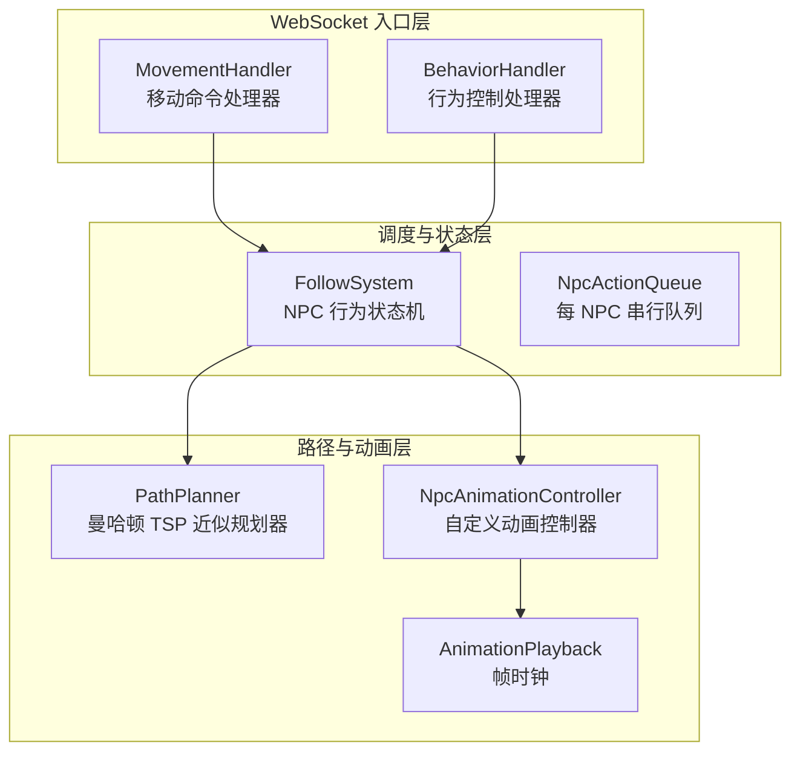
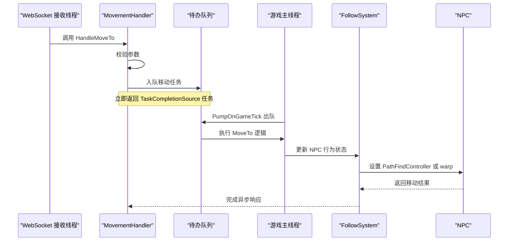
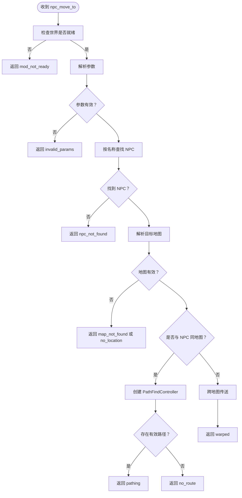
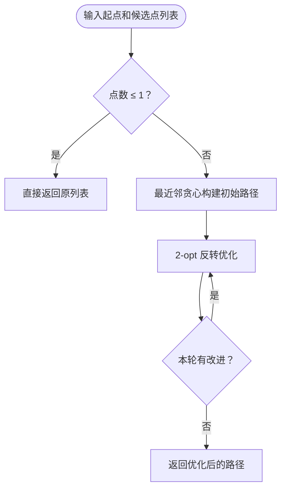
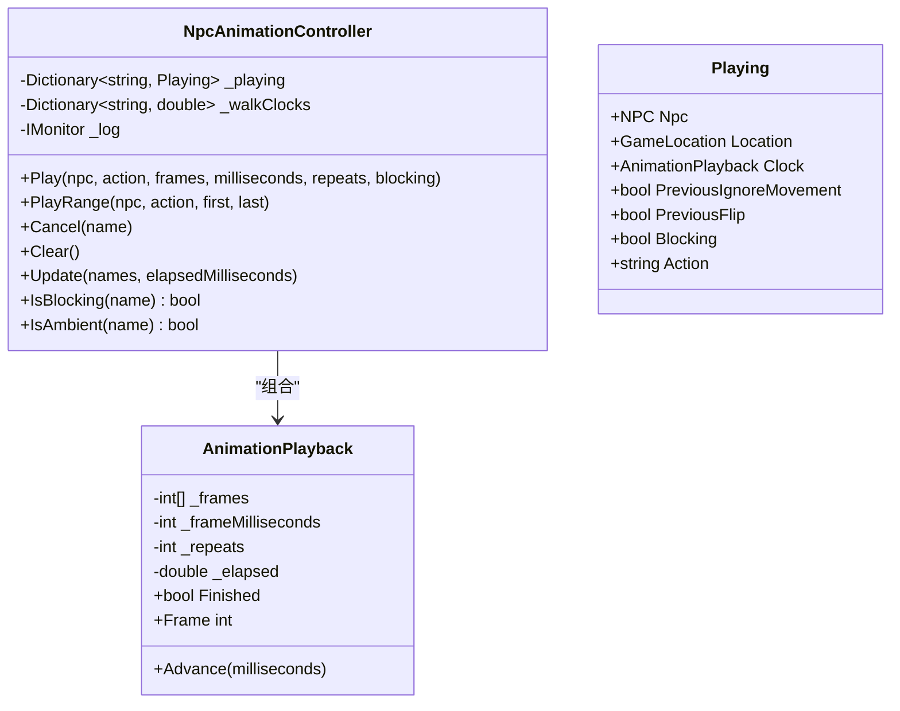
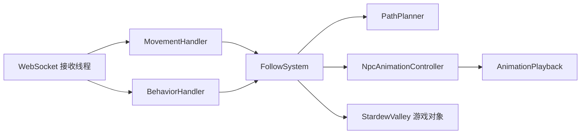
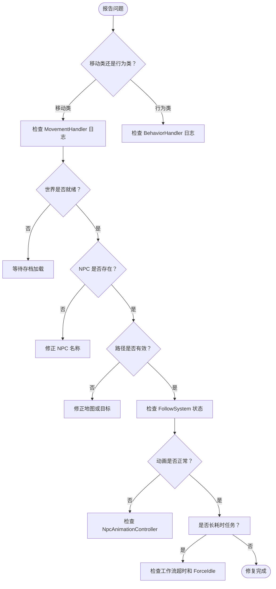

# 移动调度器

<cite>
**本文引用的文件**   
- [MovementHandler.cs](file://SmartNPC/smapi-mod/Movement/MovementHandler.cs)
- [FollowSystem.cs](file://SmartNPC/smapi-mod/Movement/FollowSystem.cs)
- [FollowSystem.Animations.cs](file://SmartNPC/smapi-mod/Movement/FollowSystem.Animations.cs)
- [PathPlanner.cs](file://SmartNPC/smapi-mod/Movement/PathPlanner.cs)
- [NpcAnimationController.cs](file://SmartNPC/smapi-mod/Movement/NpcAnimationController.cs)
- [AnimationPlayback.cs](file://SmartNPC/smapi-mod/Movement/AnimationPlayback.cs)
- [BehaviorHandler.cs](file://SmartNPC/smapi-mod/Movement/BehaviorHandler.cs)
- [TurnQueue.cs](file://SmartNPC/smapi-mod/NPC/TurnQueue.cs)
</cite>

## 目录
1. [引言](#引言)
2. [项目结构](#项目结构)
3. [核心组件](#核心组件)
4. [架构总览](#架构总览)
5. [详细组件分析](#详细组件分析)
6. [依赖关系分析](#依赖关系分析)
7. [性能与调度策略](#性能与调度策略)
8. [故障排查指南](#故障排查指南)
9. [结论](#结论)

## 引言
本文聚焦 SmartNPC 模组中的移动调度子系统，围绕以下目标展开：
- 解释 MovementHandler.cs 的移动任务调度逻辑，包括线程安全、任务队列、参数校验和响应封装。
- 描述 FollowSystem 的 NPC 行为状态机，包括召唤、跟随、引导、漫游及多种农场工作模式。
- 说明多 NPC 移动任务的优先级、冲突检测与资源竞争处理方式。
- 阐述移动任务的注册、生命周期、状态跟踪和异常处理机制。
- 解释取消、中断与动态行为切换能力。
- 给出复杂移动编排、任务链执行和行为树集成的实践建议。
- 提供调度策略配置要点与性能监控方法。

## 项目结构
移动调度相关代码集中在 `SmartNPC/smapi-mod` 中，关键文件分布如下：

**图示来源**
- [MovementHandler.cs:1-200](file://SmartNPC/smapi-mod/Movement/MovementHandler.cs#L1-L200)
- [BehaviorHandler.cs:1-159](file://SmartNPC/smapi-mod/Movement/BehaviorHandler.cs#L1-L159)
- [FollowSystem.cs:1-200](file://SmartNPC/smapi-mod/Movement/FollowSystem.cs#L1-L200)
- [PathPlanner.cs:1-120](file://SmartNPC/smapi-mod/Movement/PathPlanner.cs#L1-L120)
- [NpcAnimationController.cs:1-109](file://SmartNPC/smapi-mod/Movement/NpcAnimationController.cs#L1-L109)
- [AnimationPlayback.cs:1-41](file://SmartNPC/smapi-mod/Movement/AnimationPlayback.cs#L1-L41)

**章节来源**
- [MovementHandler.cs:1-200](file://SmartNPC/smapi-mod/Movement/MovementHandler.cs#L1-L200)
- [FollowSystem.cs:1-200](file://SmartNPC/smapi-mod/Movement/FollowSystem.cs#L1-L200)
- [PathPlanner.cs:1-120](file://SmartNPC/smapi-mod/Movement/PathPlanner.cs#L1-L120)
- [NpcAnimationController.cs:1-109](file://SmartNPC/smapi-mod/Movement/NpcAnimationController.cs#L1-L109)
- [AnimationPlayback.cs:1-41](file://SmartNPC/smapi-mod/Movement/AnimationPlayback.cs#L1-L41)

## 核心组件
- **MovementHandler**：解析并执行 `npc_move_to`、`npc_face_direction`、`npc_get_position` 等移动指令。所有涉及游戏状态的调用都通过 `ConcurrentQueue<Action>` 排队到游戏线程执行，并通过 `TaskCompletionSource` 返回异步结果。
- **BehaviorHandler**：负责表情、行为查询等行为控制命令，同样使用挂起队列跨线程安全地访问游戏对象。
- **FollowSystem**：维护每个受管 NPC 的行为状态，驱动召唤、跟随、引导、漫游、清理、采集、种植、浇水、收割、存取物品、破坏资源、施肥、补地、宠物互动、社交移动等多种模式。
- **PathPlanner**：为长耗时工作项（如清理、收割、种植）提供近优的访问顺序，减少折返行走。
- **NpcAnimationController / AnimationPlayback**：管理 XiaMi 自定义精灵帧播放，确保动画不被原生行走覆盖，并提供可阻塞或环境型动画语义。
- **TurnQueue**：预留的多 NPC 对话串行队列，用于未来并发场景下的发言轮转。

**章节来源**
- [MovementHandler.cs:1-324](file://SmartNPC/smapi-mod/Movement/MovementHandler.cs#L1-L324)
- [BehaviorHandler.cs:1-159](file://SmartNPC/smapi-mod/Movement/BehaviorHandler.cs#L1-L159)
- [FollowSystem.cs:1-200](file://SmartNPC/smapi-mod/Movement/FollowSystem.cs#L1-L200)
- [PathPlanner.cs:1-120](file://SmartNPC/smapi-mod/Movement/PathPlanner.cs#L1-L120)
- [NpcAnimationController.cs:1-109](file://SmartNPC/smapi-mod/Movement/NpcAnimationController.cs#L1-L109)
- [AnimationPlayback.cs:1-41](file://SmartNPC/smapi-mod/Movement/AnimationPlayback.cs#L1-L41)
- [TurnQueue.cs:1-92](file://SmartNPC/smapi-mod/NPC/TurnQueue.cs#L1-L92)

## 架构总览
移动调度采用“命令处理器 + 状态机 + 路径规划 + 动画控制器”的分层设计：

**图示来源**
- [MovementHandler.cs:1-200](file://SmartNPC/smapi-mod/Movement/MovementHandler.cs#L1-L200)
- [FollowSystem.cs:200-556](file://SmartNPC/smapi-mod/Movement/FollowSystem.cs#L200-L556)

该架构的核心约束是：**只有游戏主线程才能修改游戏状态**。WebSocket 接收线程只负责参数校验、任务入队和等待响应；实际游戏对象操作在 `PumpOnGameTick` 中被串行执行。

**章节来源**
- [MovementHandler.cs:1-200](file://SmartNPC/smapi-mod/Movement/MovementHandler.cs#L1-L200)
- [BehaviorHandler.cs:1-159](file://SmartNPC/smapi-mod/Movement/BehaviorHandler.cs#L1-L159)

## 详细组件分析

### MovementHandler：移动任务调度器
MovementHandler 暴露三类移动命令：

| 命令 | 输入字段 | 主要行为 | 典型错误码 |
|---|---|---|---|
| `npc_move_to` | `npc`、`x`、`y`、可选 `map` | 同地图使用 `PathFindController`；跨地图直接传送 | `mod_not_ready`、`invalid_params`、`npc_not_found`、`map_not_found`、`no_location`、`pathfind_error`、`handler_error` |
| `npc_face_direction` | `npc`、`direction` | 将 NPC 朝向设置为 up/down/left/right | `mod_not_ready`、`invalid_params`、`npc_not_found`、`handler_error` |
| `npc_get_position` | `npc` | 返回坐标、地图、朝向、是否正在移动 | `mod_not_ready`、`invalid_params`、`npc_not_found`、`handler_error` |

#### 调度与线程模型
- 使用 `ConcurrentQueue<Action>` 保存待执行动作。
- WebSocket 线程创建 `TaskCompletionSource<Response>`，入队后立即返回未完成任务。
- 游戏线程调用 `PumpOnGameTick` 逐个执行队列中的委托，并通过 `TrySetResult` 完成异步任务。
- 所有异常被捕获并包装为失败响应，避免未处理异常破坏游戏循环。

#### 移动决策
- 如果目标地图为空，默认使用 NPC 当前地图。
- 如果 NPC 和目标在同一地图，则构造 `PathFindController`，并根据是否有有效路径返回 `pathing` 或 `no_route`。
- 如果目标在不同地图，则使用 `Game1.warpCharacter` 直接传送，返回 `warped`。

**图示来源**
- [MovementHandler.cs:1-200](file://SmartNPC/smapi-mod/Movement/MovementHandler.cs#L1-L200)
- [MovementHandler.cs:201-324](file://SmartNPC/smapi-mod/Movement/MovementHandler.cs#L201-L324)

**章节来源**
- [MovementHandler.cs:1-324](file://SmartNPC/smapi-mod/Movement/MovementHandler.cs#L1-L324)

### BehaviorHandler：行为控制与状态查询
BehaviorHandler 主要负责：
- 将 MCP 工具传入的表情类型映射到 SDV 原生表情编号。
- 通过挂起队列调用 `npc.doEmote`。
- 读取 FollowSystem 中已注册的 NPC 行为模式。
- 提供 `PumpOnGameTick` 消费队列。

其设计原则与 MovementHandler 一致：**WebSocket 线程不直接访问游戏对象**，而是把动作交给游戏线程执行。

**章节来源**
- [BehaviorHandler.cs:1-159](file://SmartNPC/smapi-mod/Movement/BehaviorHandler.cs#L1-L159)

### FollowSystem：NPC 行为状态机
FollowSystem 是整个移动调度器的核心状态机。它维护一个以 NPC 名称为键的状态字典，每个状态包含：
- 当前模式，例如 Idle、Summoning、Following、Leading、Wander、ClearDebris、ForageCollect、DepositItems、ShipItems、TillSoil、PlantSeeds、WaterCrops、HarvestCrops、WithdrawItems、BreakResource、Fertilize、FillGaps、PetAnimal、Animating、SocialMovement。
- 各工作模式的队列、目标、库存、计数、路径失败次数、气泡文本、起始时间戳等。
- 重规划间隔、最大路径失败次数、最大动作持续时间、跟随半径、引导分段长度等常量。

#### 状态机生命周期

```mermaid
stateDiagram-v2
    [*] --> Idle
    Idle --> Summoning : "Summon"
    Idle --> Following : "StartFollow"
    Idle --> Leading : "LeadTo"
    Idle --> Wander : "StartWander"
    Idle --> ClearDebris : "StartClearDebris"
    Idle --> ForageCollect : "StartForageCollect"
    Idle --> DepositItems : "StartDepositItems"
    Idle --> ShipItems : "StartShipItems"
    Idle --> TillSoil : "StartTillSoil"
    Idle --> PlantSeeds : "StartPlantSeeds"
    Idle --> WaterCrops : "StartWaterCrops"
    Idle --> HarvestCrops : "StartHarvestCrops"
    Idle --> WithdrawItems : "StartWithdrawItems"
    Idle --> BreakResource : "StartBreakResource"
    Idle --> Fertilize : "StartFertilize"
    Idle --> FillGaps : "StartFillGaps"
    Idle --> PetAnimal : "StartPetAnimal"
    Idle --> Animating : "StartPose / StartIdleActivity"
    Idle --> SocialMovement : "StartSocialMovement"
    Summoning --> Idle : "到达玩家附近"
    Following --> Idle : "StopFollow"
    Leading --> Idle : "到达目标"
    Wander --> Idle : "StopFollow"
    ClearDebris --> Idle : "队列完成或超时"
    ForageCollect --> Idle : "队列完成"
    DepositItems --> Idle : "全部存入"
    ShipItems --> Idle : "全部投递"
    TillSoil --> Idle : "全部耕作"
    PlantSeeds --> Idle : "全部播种"
    WaterCrops --> Idle : "全部浇水"
    HarvestCrops --> Idle : "全部收割"
    WithdrawItems --> Idle : "全部取出"
    BreakResource --> Idle : "全部破坏"
    Fertilize --> Idle : "全部施肥"
    FillGaps --> Idle : "全部填缝"
    PetAnimal --> Idle : "互动完成或宠物不可用"
    Animating --> Idle : "动画结束或取消"
    SocialMovement --> Idle : "社交移动结束"
```

**图示来源**
- [FollowSystem.cs:1-200](file://SmartNPC/smapi-mod/Movement/FollowSystem.cs#L1-L200)
- [FollowSystem.cs:200-556](file://SmartNPC/smapi-mod/Movement/FollowSystem.cs#L200-L556)
- [FollowSystem.Animations.cs:1-120](file://SmartNPC/smapi-mod/Movement/FollowSystem.Animations.cs#L1-L120)

#### 任务冲突与资源竞争解决
FollowSystem 通过以下方式降低多个 NPC 之间的冲突风险：

1. **每 NPC 独立状态**  
   每个 NPC 拥有独立的 `NpcBehaviorState`，避免共享可变状态导致交叉干扰。

2. **游戏线程串行化**  
   所有修改 NPC、地图、路径控制器的操作都通过 `PumpOnGameTick` 进入游戏线程执行，避免多线程同时修改游戏对象。

3. **路径失败退避**  
   对不可达目标记录连续失败次数，达到阈值后跳过目标或转为 Idle，防止无限重试。

4. **动作时长上限**  
   对部分长耗时动作设置最大持续时间，超过时限强制回到 Idle，并由外部工作流重新调度。

5. **序列化动作队列**  
   每个 NPC 有独立的动作队列，避免同一 NPC 的多个工具调用互相抢占。

6. **动画与行走互斥**  
   自定义动画播放时暂停原生行走动画，并在更新时检测 NPC 是否被移动或传送，自动取消锁定姿态。

7. **社交移动临时中断**  
   社交移动会清空现有控制器并生成短序列目标点，完成后恢复 Idle。

**章节来源**
- [FollowSystem.cs:200-556](file://SmartNPC/smapi-mod/Movement/FollowSystem.cs#L200-L556)
- [FollowSystem.cs:1200-1566](file://SmartNPC/smapi-mod/Movement/FollowSystem.cs#L1200-L1566)
- [FollowSystem.cs:1800-2136](file://SmartNPC/smapi-mod/Movement/FollowSystem.cs#L1800-L2136)
- [FollowSystem.cs:2400-2714](file://SmartNPC/smapi-mod/Movement/FollowSystem.cs#L2400-L2714)
- [FollowSystem.Animations.cs:1-120](file://SmartNPC/smapi-mod/Movement/FollowSystem.Animations.cs#L1-L120)

### PathPlanner：任务访问顺序优化
PathPlanner 的目标是让 NPC 在处理多个目标时少走回头路。它实现的是开放路径变体的近似 TSP：

1. **最近邻贪心**：从起点开始，每次选择距离最近的未访问目标。
2. **2-opt 局部优化**：尝试反转任意子段，若边界边拼接后总曼哈顿距离更短，则接受反转。
3. **最多固定迭代次数**：保证复杂度可控。

时间复杂度大致为 O(n²)，适用于小批量工作项；空间复杂度为 O(n)。

**图示来源**
- [PathPlanner.cs:1-120](file://SmartNPC/smapi-mod/Movement/PathPlanner.cs#L1-L120)

注意：PathPlanner 使用曼哈顿距离作为启发式，不是真实寻路代价；但它能显著改善相邻目标之间的相对顺序。

**章节来源**
- [PathPlanner.cs:1-120](file://SmartNPC/smapi-mod/Movement/PathPlanner.cs#L1-L120)

### NpcAnimationController 与 AnimationPlayback：动画调度
NpcAnimationController 负责：
- 仅对 XiaMi 角色应用自定义帧数据。
- 记录每个播放动画的 NPC、位置、时钟、是否阻塞、原始翻转状态等。
- 在游戏帧更新时推进动画时钟，并将帧应用到 Sprite。
- 检测保存重载、地图传送或控制器重建，自动取消旧动画。
- 根据行走状态切换行走帧偏移。

AnimationPlayback 是一个无游戏依赖的帧时钟：
- 支持固定重复次数。
- 重复次数为 0 表示无限循环，直到显式取消。
- 动画结束时保留最后一帧，便于所有者恢复空闲姿态。

**图示来源**
- [NpcAnimationController.cs:1-109](file://SmartNPC/smapi-mod/Movement/NpcAnimationController.cs#L1-L109)
- [AnimationPlayback.cs:1-41](file://SmartNPC/smapi-mod/Movement/AnimationPlayback.cs#L1-L41)

**章节来源**
- [NpcAnimationController.cs:1-109](file://SmartNPC/smapi-mod/Movement/NpcAnimationController.cs#L1-L109)
- [AnimationPlayback.cs:1-41](file://SmartNPC/smapi-mod/Movement/AnimationPlayback.cs#L1-L41)
- [FollowSystem.Animations.cs:1-120](file://SmartNPC/smapi-mod/Movement/FollowSystem.Animations.cs#L1-L120)

### TurnQueue：预留的对话轮转队列
TurnQueue 目前标注为脚手架，尚未接入任何消费者，但其设计已经体现调度思想：
- FIFO 队列。
- 最小间隔限制，模拟真实对话轮转。
- 容量上限，超出时丢弃最旧条目。
- 线程安全的入队和尝试出队。

它适合作为未来多 NPC 并发行为的输出节流器。

**章节来源**
- [TurnQueue.cs:1-92](file://SmartNPC/smapi-mod/NPC/TurnQueue.cs#L1-L92)

## 依赖关系分析
移动调度系统的依赖方向清晰且单向为主：

**图示来源**
- [MovementHandler.cs:1-200](file://SmartNPC/smapi-mod/Movement/MovementHandler.cs#L1-L200)
- [BehaviorHandler.cs:1-159](file://SmartNPC/smapi-mod/Movement/BehaviorHandler.cs#L1-L159)
- [FollowSystem.cs:1-200](file://SmartNPC/smapi-mod/Movement/FollowSystem.cs#L1-L200)
- [PathPlanner.cs:1-120](file://SmartNPC/smapi-mod/Movement/PathPlanner.cs#L1-L120)
- [NpcAnimationController.cs:1-109](file://SmartNPC/smapi-mod/Movement/NpcAnimationController.cs#L1-L109)
- [AnimationPlayback.cs:1-41](file://SmartNPC/smapi-mod/Movement/AnimationPlayback.cs#L1-L41)

关键观察：
- MovementHandler 和 BehaviorHandler 是薄封装层，主要职责是协议解析和线程迁移。
- FollowSystem 是真正的业务中枢，聚合路径、动画、库存、地图交互。
- PathPlanner 是无副作用的工具类，适合单元测试。
- NpcAnimationController 与 FollowSystem 配合，但不反向依赖 FollowSystem 的具体行为模式。

**章节来源**
- [MovementHandler.cs:1-324](file://SmartNPC/smapi-mod/Movement/MovementHandler.cs#L1-L324)
- [BehaviorHandler.cs:1-159](file://SmartNPC/smapi-mod/Movement/BehaviorHandler.cs#L1-L159)
- [FollowSystem.cs:1-200](file://SmartNPC/smapi-mod/Movement/FollowSystem.cs#L1-L200)
- [PathPlanner.cs:1-120](file://SmartNPC/smapi-mod/Movement/PathPlanner.cs#L1-L120)

## 性能与调度策略

### 任务优先级
当前代码没有全局优先级队列，而是采用以下隐式优先级：

1. **高优先级：即时控制命令**  
   `npc_move_to`、`npc_face_direction`、`npc_emote` 等命令会立即入队并在下一次 `PumpOnGameTick` 中执行。

2. **中优先级：状态机驱动的移动**  
   FollowSystem 在每个 tick 评估是否需要重新寻路，但遵循重规划间隔，避免每帧频繁重建路径。

3. **低优先级：长耗时工作项**  
   清理、采集、耕作、播种、浇水、收割、存取物品、破坏资源、施肥、补地等工作项按队列顺序推进。

如果需要显式优先级，可在 MovementHandler 和 BehaviorHandler 的挂起队列之上增加带优先级的任务包装，或在 FollowSystem 的动作队列中加入优先级字段。

### 任务冲突检测
- 同一 NPC 的多个动作通过各自状态和队列隔离。
- 新动作通常会先取消旧动画或重置控制器，从而中断之前的移动。
- 路径失败计数器避免反复尝试不可达目标。

### 资源竞争解决
- 所有游戏状态修改都在游戏线程串行执行。
- 动画播放前暂停原生行走，避免帧被覆盖。
- 动画更新时检测 NPC 是否仍属于预期位置和控制器，否则取消旧动画。
- 长耗时动作有超时保护，避免工作流超时后仍在后台运行。

### 调度策略配置建议
| 配置项 | 当前值或含义 | 调整建议 |
|---|---|---|
| 跟随半径 | 约 3 格 | 增大可提高跟随稳定性，减小可提高灵活性 |
| 重规划间隔 | 约 30 tick | 高频地图变化时可缩短，CPU 紧张时可延长 |
| 最大路径失败次数 | 5 | 复杂地形可适当提高，但会增加无效重试 |
| 引导分段长度 | 5 格 | 长距离引导可分段提升路径质量 |
| 清理垃圾最大时长 | 约 15 秒 | 大地图可增加，但需配合外部超时 |
| NPC 移动速度 | 高于默认步行速度 | 可提升效率，但可能影响自然感 |
| 动画间隔 | 不同动作不同帧间隔 | 过短会显得机械，过长会卡顿 |

### 性能监控方法
- 使用 MovementHandler 和 BehaviorHandler 的日志输出观察命令入队、执行和异常。
- 关注 FollowSystem 中大量 Debug/Info/Warn 日志，尤其是路径失败、传送失败、超时和 Idle 转换。
- 监控动画播放是否出现“锁住姿态未释放”的情况，这通常由保存重载或地图传送引起。
- 对于长耗时动作，结合外部工作流上下文的生命周期进行观测，避免依赖内部 `MaxActionTicks`（当前为禁用状态）。
- 如需自动化监控，可封装 FollowSystem 的公开 API，统计状态切换次数、路径重建次数、动画播放次数和动作完成时间。

[本节为通用指导，不直接分析具体代码片段，因此不提供“章节来源”]

## 故障排查指南

### 常见问题与定位思路

| 现象 | 可能原因 | 排查步骤 |
|---|---|---|
| NPC 不移动 | 世界未就绪、NPC 不存在、路径无效 | 检查 `mod_not_ready`、`npc_not_found`、`pathfind_error`、`no_route` |
| 跨地图传送失败 | 目标地图名无效 | 检查 `map_not_found`、`no_location` |
| NPC 停在半路 | 路径被中断、控制器被替换、地图变化 | 查看 FollowSystem 日志中的路径失败和地图切换 |
| NPC 一直跟随玩家但跳图后掉线 | 玩家换图事件未触发或 NPC 延迟 | 检查 Cross-map warp 分支和 `LastPathTick` |
| 动画卡住 | 保存重载、地图传送、控制器重建 | 检查 NpcAnimationController 的更新逻辑和 Cancel 调用 |
| 多个 NPC 同时说话 | 对话轮转未启用 | 检查 TurnQueue 是否接入消费者 |
| 长耗时动作卡死 | 工作流超时但未停止动作 | 检查外部工作流上下文和 ForceIdle 调用时机 |

### 推荐诊断流程

**图示来源**
- [MovementHandler.cs:1-324](file://SmartNPC/smapi-mod/Movement/MovementHandler.cs#L1-L324)
- [BehaviorHandler.cs:1-159](file://SmartNPC/smapi-mod/Movement/BehaviorHandler.cs#L1-L159)
- [FollowSystem.cs:200-556](file://SmartNPC/smapi-mod/Movement/FollowSystem.cs#L200-L556)
- [NpcAnimationController.cs:1-109](file://SmartNPC/smapi-mod/Movement/NpcAnimationController.cs#L1-L109)

**章节来源**
- [MovementHandler.cs:1-324](file://SmartNPC/smapi-mod/Movement/MovementHandler.cs#L1-L324)
- [BehaviorHandler.cs:1-159](file://SmartNPC/smapi-mod/Movement/BehaviorHandler.cs#L1-L159)
- [FollowSystem.cs:200-556](file://SmartNPC/smapi-mod/Movement/FollowSystem.cs#L200-L556)
- [NpcAnimationController.cs:1-109](file://SmartNPC/smapi-mod/Movement/NpcAnimationController.cs#L1-L109)

## 结论
SmartNPC 的移动调度系统以 MovementHandler 和 BehaviorHandler 作为协议入口，以 FollowSystem 作为行为中枢，以 PathPlanner 作为路径顺序优化器，以 NpcAnimationController 和 AnimationPlayback 作为视觉表现层。其核心优势在于：

- 清晰的线程边界：WebSocket 线程只负责调度，游戏线程负责状态变更。
- 可扩展的状态机：新增 NPC 行为只需扩展模式、状态字段和 Tick 逻辑。
- 稳健的错误处理：命令级失败码、路径失败退避、动作超时保护。
- 良好的动画一致性：自定义动画与原生行走解耦，异常情况自动恢复。

对于未来增强，建议：
- 引入显式任务优先级队列，支持紧急中断普通任务。
- 增加全局 NPC 活动视图，便于调试多 NPC 冲突。
- 将 TurnQueue 接入对话输出通道，实现多 NPC 并发发言轮转。
- 为 FollowSystem 增加结构化遥测，统计状态切换、路径重建、动画播放和动作耗时。
- 在工作流层提供更丰富的移动编排 DSL，支持条件分支、并行子任务和超时补偿。

[本节为总结性内容，不直接分析具体文件，因此不提供“章节来源”]