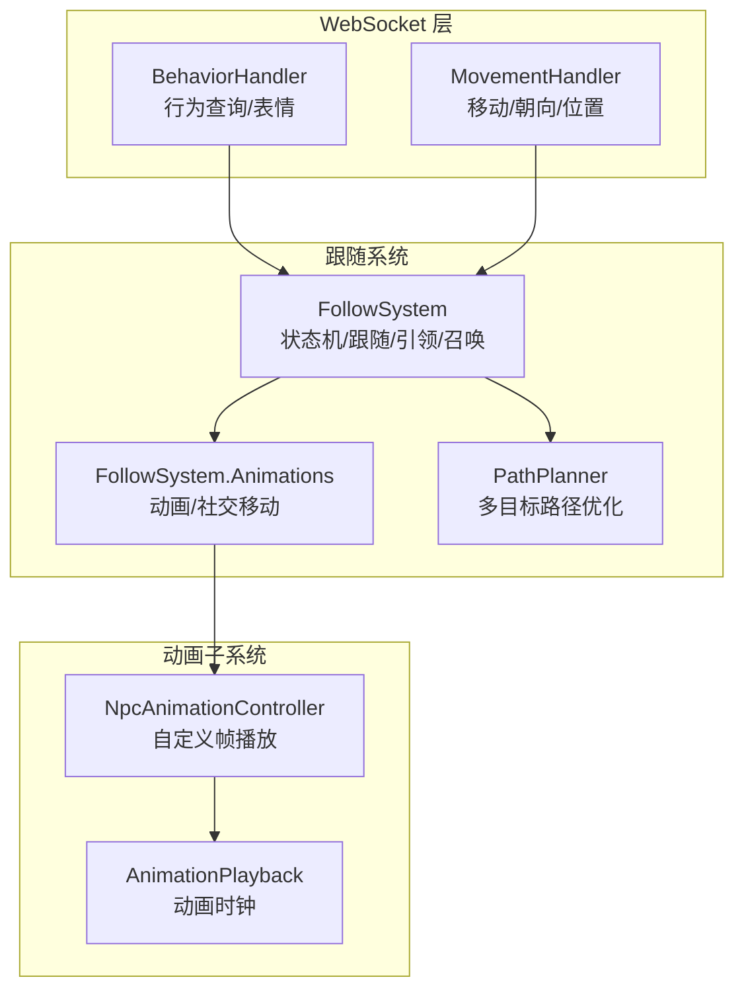
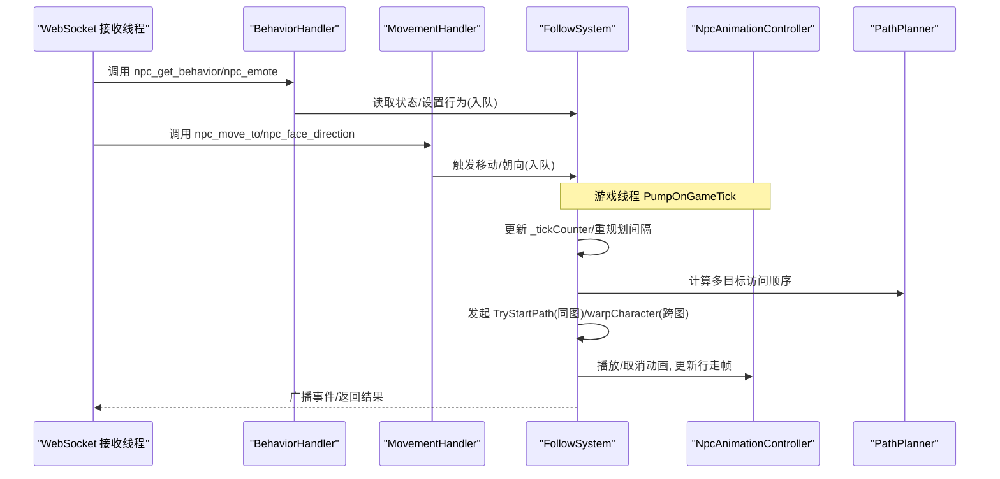
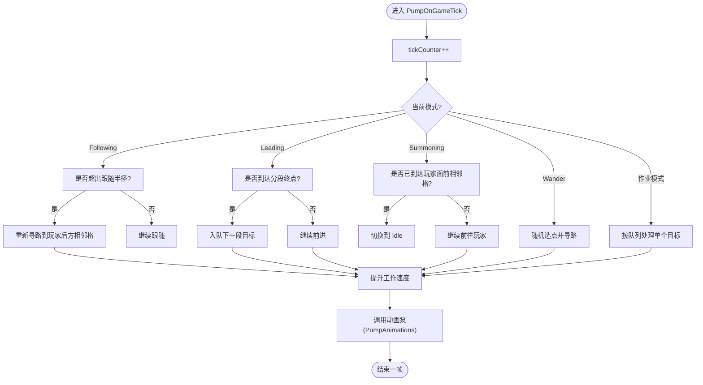
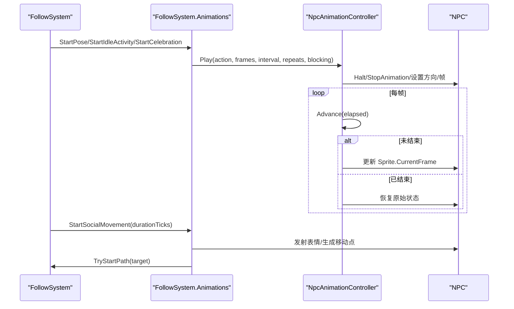
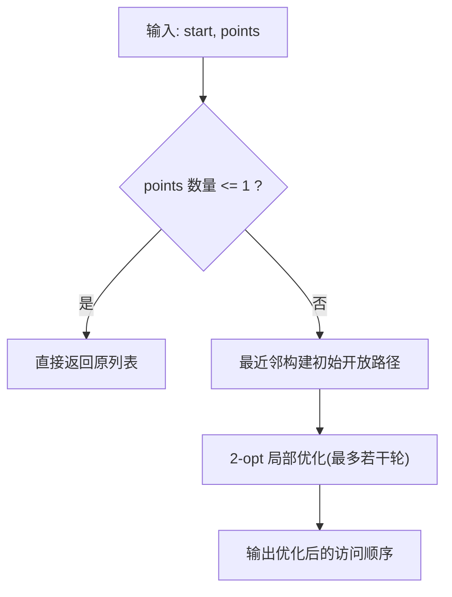
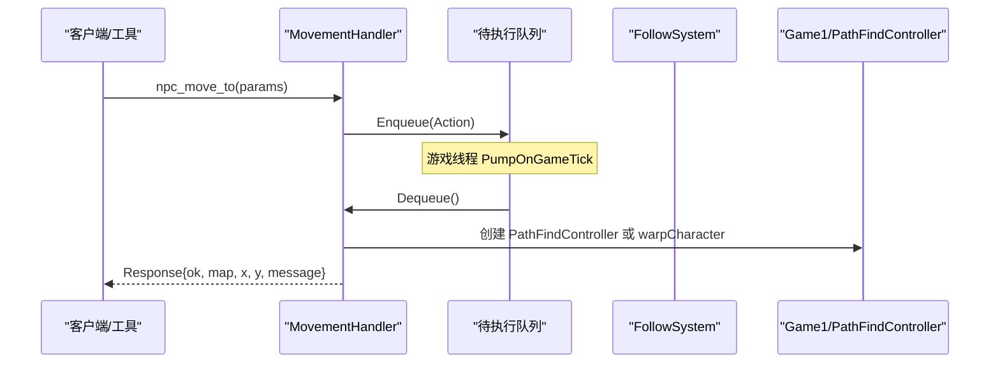
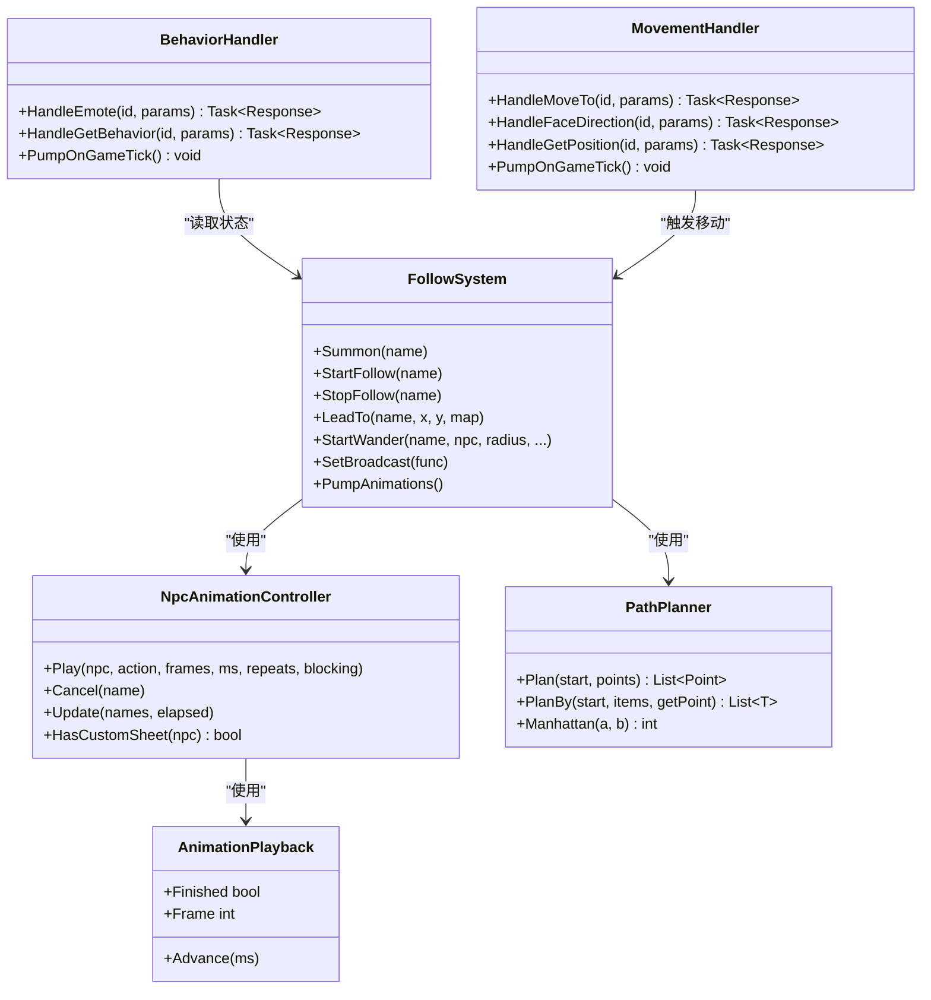

# 跟随系统

<cite>
**本文引用的文件**   
- [FollowSystem.cs](file://SmartNPC/smapi-mod/Movement/FollowSystem.cs)
- [FollowSystem.Animations.cs](file://SmartNPC/smapi-mod/Movement/FollowSystem.Animations.cs)
- [PathPlanner.cs](file://SmartNPC/smapi-mod/Movement/PathPlanner.cs)
- [NpcAnimationController.cs](file://SmartNPC/smapi-mod/Movement/NpcAnimationController.cs)
- [AnimationPlayback.cs](file://SmartNPC/smapi-mod/Movement/AnimationPlayback.cs)
- [BehaviorHandler.cs](file://SmartNPC/smapi-mod/Movement/BehaviorHandler.cs)
- [MovementHandler.cs](file://SmartNPC/smapi-mod/Movement/MovementHandler.cs)
</cite>

## 目录
1. [引言](#引言)
2. [项目结构](#项目结构)
3. [核心组件](#核心组件)
4. [架构总览](#架构总览)
5. [详细组件分析](#详细组件分析)
6. [依赖关系分析](#依赖关系分析)
7. [性能考虑](#性能考虑)
8. [故障排查指南](#故障排查指南)
9. [结论](#结论)
10. [附录：配置与调优](#附录配置与调优)

## 引言
本技术文档聚焦 SmartNPC 模组中的“跟随系统”，围绕 FollowSystem.cs 的核心逻辑展开，解释目标 NPC 追踪、距离控制、状态机生命周期、路径重规划、动画集成以及与其他 Movement 模块的协作方式。同时给出可操作的实现示例、配置参数说明和性能调优建议，帮助读者在不直接阅读源码的情况下也能理解并扩展该功能。

## 项目结构
跟随系统位于 smapi-mod 的 Movement 子模块中，由多个职责清晰的文件组成：
- FollowSystem.cs：行为状态机、目标选择、路径触发、跟随/引领/召唤/漫步等模式驱动。
- FollowSystem.Animations.cs：跟随流程中的动画启停、社交移动、动作气泡同步。
- PathPlanner.cs：面向多目标的近似最短路径排序（曼哈顿距离 + 最近邻 + 2-opt）。
- NpcAnimationController.cs：游戏线程上的自定义帧播放、行走帧更新、阻塞/非阻塞控制。
- AnimationPlayback.cs：独立于游戏的动画时钟。
- BehaviorHandler.cs / MovementHandler.cs：WebSocket 侧的行为查询、表情与位移指令，通过队列迁移到游戏线程执行。

图表来源
- [BehaviorHandler.cs:1-159](file://SmartNPC/smapi-mod/Movement/BehaviorHandler.cs#L1-L159)
- [MovementHandler.cs:1-200](file://SmartNPC/smapi-mod/Movement/MovementHandler.cs#L1-L200)
- [FollowSystem.cs:201-556](file://SmartNPC/smapi-mod/Movement/FollowSystem.cs#L201-L556)
- [FollowSystem.Animations.cs:1-120](file://SmartNPC/smapi-mod/Movement/FollowSystem.Animations.cs#L1-L120)
- [PathPlanner.cs:1-120](file://SmartNPC/smapi-mod/Movement/PathPlanner.cs#L1-L120)
- [NpcAnimationController.cs:1-109](file://SmartNPC/smapi-mod/Movement/NpcAnimationController.cs#L1-L109)
- [AnimationPlayback.cs:1-41](file://SmartNPC/smapi-mod/Movement/AnimationPlayback.cs#L1-L41)

章节来源
- [FollowSystem.cs:1-200](file://SmartNPC/smapi-mod/Movement/FollowSystem.cs#L1-L200)
- [FollowSystem.Animations.cs:1-120](file://SmartNPC/smapi-mod/Movement/FollowSystem.Animations.cs#L1-L120)
- [PathPlanner.cs:1-120](file://SmartNPC/smapi-mod/Movement/PathPlanner.cs#L1-L120)
- [NpcAnimationController.cs:1-109](file://SmartNPC/smapi-mod/Movement/NpcAnimationController.cs#L1-L109)
- [AnimationPlayback.cs:1-41](file://SmartNPC/smapi-mod/Movement/AnimationPlayback.cs#L1-L41)
- [BehaviorHandler.cs:1-159](file://SmartNPC/smapi-mod/Movement/BehaviorHandler.cs#L1-L159)
- [MovementHandler.cs:1-200](file://SmartNPC/smapi-mod/Movement/MovementHandler.cs#L1-L200)

## 核心组件
- FollowSystem：维护每个受管 NPC 的行为状态（Idle/Summoning/Following/Leading/Wander/ClearDebris/ForageCollect/DepositItems/ShipItems/TillSoil/PlantSeeds/WaterCrops/HarvestCrops/WithdrawItems/BreakResource/Fertilize/FillGaps/PetAnimal/Animating/SocialMovement），并在每帧或固定 tick 间隔驱动状态转换、路径发起、速度控制和退出策略。
- FollowSystem.Animations：在处理器之后运行，确保自定义姿势不被原版行走覆盖；提供 StartPose、StartIdleActivity、StartCelebration、ShowCollectedItem、StartSocialMovement 等能力。
- PathPlanner：为长任务（采集、浇水、清理、耕地、种植、破坏资源、施肥、填坑）提供近似最优访问顺序，减少折返走位。
- NpcAnimationController：在游戏线程上安全地播放自定义帧，管理行走帧、阻塞/非阻塞动画、方向翻转和恢复原状态。
- AnimationPlayback：无游戏依赖的动画计时器，支持循环和结束保持最后一帧。
- BehaviorHandler / MovementHandler：将 WebSocket 调用安全地迁移到游戏线程执行，避免跨线程访问 Game1 的风险。

章节来源
- [FollowSystem.cs:1-200](file://SmartNPC/smapi-mod/Movement/FollowSystem.cs#L1-L200)
- [FollowSystem.Animations.cs:1-120](file://SmartNPC/smapi-mod/Movement/FollowSystem.Animations.cs#L1-L120)
- [PathPlanner.cs:1-120](file://SmartNPC/smapi-mod/Movement/PathPlanner.cs#L1-L120)
- [NpcAnimationController.cs:1-109](file://SmartNPC/smapi-mod/Movement/NpcAnimationController.cs#L1-L109)
- [AnimationPlayback.cs:1-41](file://SmartNPC/smapi-mod/Movement/AnimationPlayback.cs#L1-L41)
- [BehaviorHandler.cs:1-159](file://SmartNPC/smapi-mod/Movement/BehaviorHandler.cs#L1-L159)
- [MovementHandler.cs:1-200](file://SmartNPC/smapi-mod/Movement/MovementHandler.cs#L1-L200)

## 架构总览
跟随系统的控制流遵循“WS 接收线程仅设置目标，Game 线程完成所有与游戏状态的交互”的原则。FollowSystem 暴露公开 API（如 Summon、StartFollow、StopFollow、LeadTo、StartWander 等），由上层调度器或 WS 层调用；每帧通过 PumpOnGameTick 推进状态、触发路径、更新动画。

图表来源
- [BehaviorHandler.cs:1-159](file://SmartNPC/smapi-mod/Movement/BehaviorHandler.cs#L1-L159)
- [MovementHandler.cs:1-200](file://SmartNPC/smapi-mod/Movement/MovementHandler.cs#L1-L200)
- [FollowSystem.cs:201-556](file://SmartNPC/smapi-mod/Movement/FollowSystem.cs#L201-L556)
- [PathPlanner.cs:1-120](file://SmartNPC/smapi-mod/Movement/PathPlanner.cs#L1-L120)
- [NpcAnimationController.cs:1-109](file://SmartNPC/smapi-mod/Movement/NpcAnimationController.cs#L1-L109)

## 详细组件分析

### FollowSystem：目标追踪、距离控制与状态机
- 状态机模式
  - Idle：默认空闲态，可被其他行为抢占。
  - Summoning：召唤玩家，最终寻路到玩家面前相邻格后回到 Idle。
  - Following：跟随玩家，超过跟随半径则重新寻路到玩家后方一格。
  - Leading：分段引导至目标格，每段不超过固定格子数，完成后继续下一段，到达终点回 Idle。
  - Wander：随机漫步，带中心+最大距离或矩形区域约束。
  - 其他作业模式：ClearDebris、ForageCollect、DepositItems、ShipItems、TillSoil、PlantSeeds、WaterCrops、HarvestCrops、WithdrawItems、BreakResource、Fertilize、FillGaps、PetAnimal、Animating、SocialMovement。
- 目标选择与距离控制
  - 跟随半径：当 NPC 与玩家距离大于阈值时触发重规划，目标是玩家后方相邻格。
  - 引领分段：按固定段长切分路径，每段独立寻路，保证稳定推进。
  - 漫步范围：支持半径、中心+最大曼哈顿距离、矩形边界多种约束，失败多次后记录日志并放弃。
- 路径与防抖
  - 重规划间隔：约 30 tick 检查一次，降低频繁寻路开销。
  - 路径失败计数：连续失败超过阈值时跳过不可达目标，避免无限重试。
  - 行动超时保护：超长任务会强制回 Idle 并清空队列，防止卡死。
- 速度控制
  - 工作速度：Agent 驱动时提高移动速度。
  - 默认速度：回归 Idle 时恢复基础速度。

图表来源
- [FollowSystem.cs:201-556](file://SmartNPC/smapi-mod/Movement/FollowSystem.cs#L201-L556)

章节来源
- [FollowSystem.cs:1-200](file://SmartNPC/smapi-mod/Movement/FollowSystem.cs#L1-L200)
- [FollowSystem.cs:201-556](file://SmartNPC/smapi-mod/Movement/FollowSystem.cs#L201-L556)

### FollowSystem.Animations：动画集成与社交移动
- 动画泵
  - 在世界就绪且时间推进时更新动画状态，避免原版行走覆盖自定义姿势。
- 姿势与活动
  - StartPose：指定帧序列与间隔，支持循环或非阻塞。
  - StartIdleActivity：内置“耕作/休息/环顾/手持南瓜/作物/花/鸡”等空闲动作。
  - StartCelebration：庆祝或惊讶表情，附带跳跃和表情气泡。
  - ShowCollectedItem：根据物品类型选择手持帧。
- 社交移动
  - StartSocialMovement：基于时长生成短序列移动点，使用 TryStartPath 进行碰撞校验。
  - TickSocialMovement：按截止时间、路径状态和目标队列推进，结束时停止并复位。

图表来源
- [FollowSystem.Animations.cs:1-120](file://SmartNPC/smapi-mod/Movement/FollowSystem.Animations.cs#L1-L120)
- [NpcAnimationController.cs:1-109](file://SmartNPC/smapi-mod/Movement/NpcAnimationController.cs#L1-L109)

章节来源
- [FollowSystem.Animations.cs:1-120](file://SmartNPC/smapi-mod/Movement/FollowSystem.Animations.cs#L1-L120)
- [NpcAnimationController.cs:1-109](file://SmartNPC/smapi-mod/Movement/NpcAnimationController.cs#L1-L109)

### PathPlanner：智能路径优化
- 算法思路
  - 最近邻贪心：从起点开始依次选择最近的未访问目标，形成初始开放路径。
  - 2-opt 局部优化：反转任意区段，若拼接后总边长更短则接受反转，限制迭代次数以控制复杂度。
- 适用场景
  - 清理碎片、采集掉落物、耕地、浇水、种植、破坏资源、施肥、填坑等多目标作业。
- 复杂度
  - O(n²) 初始化 + O(passes·n²) 优化，典型框内目标数量较小，毫秒级完成。

图表来源
- [PathPlanner.cs:1-120](file://SmartNPC/smapi-mod/Movement/PathPlanner.cs#L1-L120)

章节来源
- [PathPlanner.cs:1-120](file://SmartNPC/smapi-mod/Movement/PathPlanner.cs#L1-L120)

### NpcAnimationController：动画播放控制器
- 播放与取消
  - Play：设置自定义帧序列，暂停原版行走动画，记录原始状态以便恢复。
  - Cancel：恢复 ignoreMovementAnimation、flip、Sprite 状态，清除行走时钟。
- 更新逻辑
  - Update：遍历受管 NPC，若仍在播放则推进动画时钟并更新帧；否则恢复行走帧并根据移动状态滚动行走偏移。
- 行走帧映射
  - 根据面向方向选择对应起始帧，并应用水平翻转。

章节来源
- [NpcAnimationController.cs:1-109](file://SmartNPC/smapi-mod/Movement/NpcAnimationController.cs#L1-L109)
- [AnimationPlayback.cs:1-41](file://SmartNPC/smapi-mod/Movement/AnimationPlayback.cs#L1-L41)

### BehaviorHandler / MovementHandler：WS 到游戏线程的安全桥接
- 设计原则
  - WS 接收线程只解析参数并排队 Action，实际修改 Game1 状态由 PumpOnGameTick 统一执行。
- 行为接口
  - HandleEmote：映射表情字符串到游戏表情 ID，调用 doEmote。
  - HandleGetBehavior：读取 FollowSystem 的当前模式并返回。
- 移动接口
  - HandleMoveTo：同地图用 PathFindController 寻路；跨地图直接 warpCharacter。
  - HandleFaceDirection：设置面向方向。
  - HandleGetPosition：读取 NPC 位置（后续代码片段省略）。

图表来源
- [MovementHandler.cs:1-200](file://SmartNPC/smapi-mod/Movement/MovementHandler.cs#L1-L200)
- [BehaviorHandler.cs:1-159](file://SmartNPC/smapi-mod/Movement/BehaviorHandler.cs#L1-L159)

章节来源
- [MovementHandler.cs:1-200](file://SmartNPC/smapi-mod/Movement/MovementHandler.cs#L1-L200)
- [BehaviorHandler.cs:1-159](file://SmartNPC/smapi-mod/Movement/BehaviorHandler.cs#L1-L159)

## 依赖关系分析
- FollowSystem 依赖：
  - NpcAnimationController：用于播放自定义动画和行走帧。
  - PathPlanner：对多目标进行访问顺序优化。
  - MovementHandler：间接依赖，WS 层通过它触发移动。
  - BehaviorHandler：间接依赖，WS 层通过它查询行为。
- NpcAnimationController 依赖：
  - AnimationPlayback：提供独立的动画时钟。
  - XiaMiData：提供帧常量（帧号、表情等）。
- WS 层依赖：
  - StardewValley.Pathfinding.PathFindController：同图寻路。
  - Game1：世界状态、地图切换、角色操作。

图表来源
- [FollowSystem.cs:201-556](file://SmartNPC/smapi-mod/Movement/FollowSystem.cs#L201-L556)
- [NpcAnimationController.cs:1-109](file://SmartNPC/smapi-mod/Movement/NpcAnimationController.cs#L1-L109)
- [AnimationPlayback.cs:1-41](file://SmartNPC/smapi-mod/Movement/AnimationPlayback.cs#L1-L41)
- [PathPlanner.cs:1-120](file://SmartNPC/smapi-mod/Movement/PathPlanner.cs#L1-L120)
- [BehaviorHandler.cs:1-159](file://SmartNPC/smapi-mod/Movement/BehaviorHandler.cs#L1-L159)
- [MovementHandler.cs:1-200](file://SmartNPC/smapi-mod/Movement/MovementHandler.cs#L1-L200)

## 性能考虑
- 重规划频率
  - Following/Leading 每约 30 tick 评估一次，避免每帧重复寻路。
- 路径失败退避
  - 连续失败达到阈值后跳过目标，避免无效重试造成卡顿。
- 动画更新节流
  - 仅在 world ready 且时间推进时更新动画，避免空转。
- 动画时钟
  - AnimationPlayback 使用累积毫秒值，避免浮点误差累积导致异常。
- 多目标优化
  - PathPlanner 的 2-opt 限制最大迭代次数，保证小 n 下快速收敛。
- 速度控制
  - Agent 驱动时提高移动速度，Idle 时恢复默认速度，平衡响应与真实感。

[本节为通用性能讨论，不直接分析具体代码行]

## 故障排查指南
- WS 调用未生效
  - 确认 ModEntry 已将 WS 回调注入 FollowSystem.SetBroadcast。
  - 检查 Context.IsWorldReady，未加载存档时 WS 接口会返回失败。
- NPC 无法寻路
  - 观察 PathFailCount 是否持续增长；检查地形 passable 与障碍物。
  - 跨地图移动时确认 Map 名称唯一性与存在性。
- 动画不播放或卡住
  - 确认 NPC 是否为 XiaMi（HasCustomSheet），非 XiaMi 不会应用自定义帧。
  - 检查 Blocking 与非阻塞动画是否冲突；必要时调用 Cancel 或 ResetAnimations。
- 社交移动异常
  - 确认 durationTicks 在有效范围内；检查 SocialTargets 是否为空或已耗尽。
  - 注意 SocialDeadline 到期后会强制停止。

章节来源
- [MovementHandler.cs:1-200](file://SmartNPC/smapi-mod/Movement/MovementHandler.cs#L1-L200)
- [BehaviorHandler.cs:1-159](file://SmartNPC/smapi-mod/Movement/BehaviorHandler.cs#L1-L159)
- [FollowSystem.Animations.cs:1-120](file://SmartNPC/smapi-mod/Movement/FollowSystem.Animations.cs#L1-L120)
- [NpcAnimationController.cs:1-109](file://SmartNPC/smapi-mod/Movement/NpcAnimationController.cs#L1-L109)

## 结论
跟随系统通过清晰的状态机、严格的线程边界划分与动画控制器，实现了稳定可靠的 NPC 跟随、引领与行为动画。PathPlanner 提供的多目标路径优化进一步提升了作业的流畅度与效率。配合 WS 层的桥接机制，上层工具可以安全地驱动 NPC 行为，并在需要时进行精细化的动画与移动控制。

[本节为总结，不直接分析具体代码行]

## 附录：配置与调优
- 关键常量
  - ReplanIntervalTicks：跟随/引领重规划间隔（tick）。
  - WorkSpeed：Agent 驱动时的移动速度。
  - DefaultSpeed：Idle 时的默认速度。
  - MaxPathFailures：路径失败容忍次数。
  - MaxActionTicks：单条行动的最大持续时间（默认关闭，由 Go 侧工作流上下文接管）。
  - ClearDebrisMaxTicks：清理碎片的时限（tick）。
  - FollowRadiusTiles：跟随半径（格）。
  - LeadSegmentTiles：引领分段长度（格）。
- 调优建议
  - 提高 ReplanIntervalTicks 可降低寻路压力，但会延迟跟随响应。
  - 增大 FollowRadiusTiles 可减少频繁重规划，但跟随松散度增加。
  - 调整 WorkSpeed 影响移动节奏；过大可能显得突兀。
  - 针对复杂地形适当提高 MaxPathFailures，避免过早放弃。
  - 在多目标作业场景中启用 PathPlanner 以获得更自然的访问顺序。
- 最佳实践
  - 始终通过 FollowSystem 的公开 API 改变状态，不要直接操纵 Game1。
  - 动画播放前确认 NPC 类型，避免误用自定义帧。
  - 对长时间任务设置合理上限，结合工作流上下文进行生命周期管理。

章节来源
- [FollowSystem.cs:201-556](file://SmartNPC/smapi-mod/Movement/FollowSystem.cs#L201-L556)
- [PathPlanner.cs:1-120](file://SmartNPC/smapi-mod/Movement/PathPlanner.cs#L1-L120)
- [NpcAnimationController.cs:1-109](file://SmartNPC/smapi-mod/Movement/NpcAnimationController.cs#L1-L109)