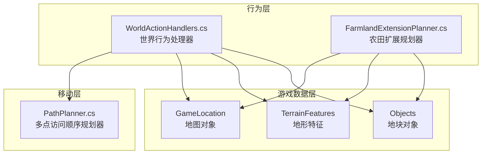
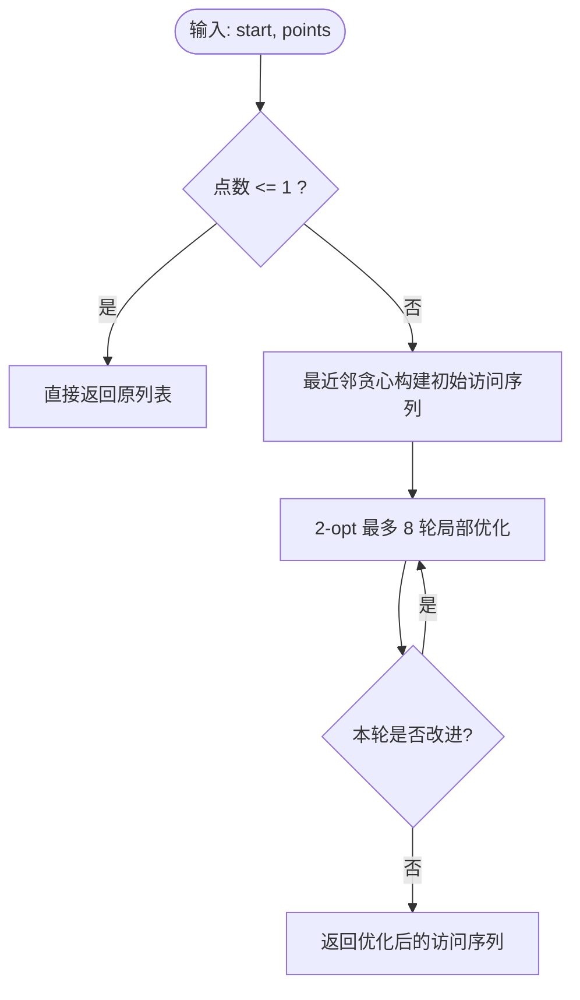
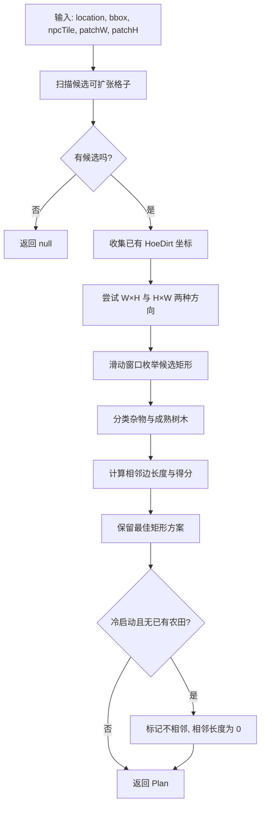
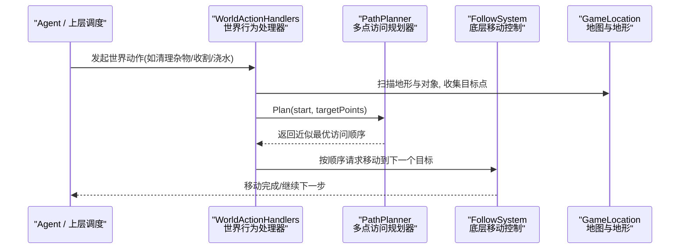
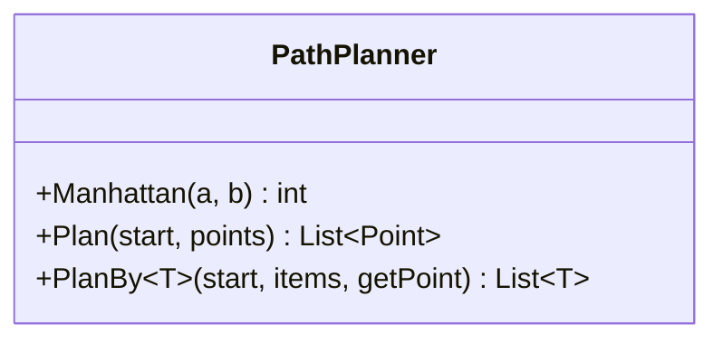
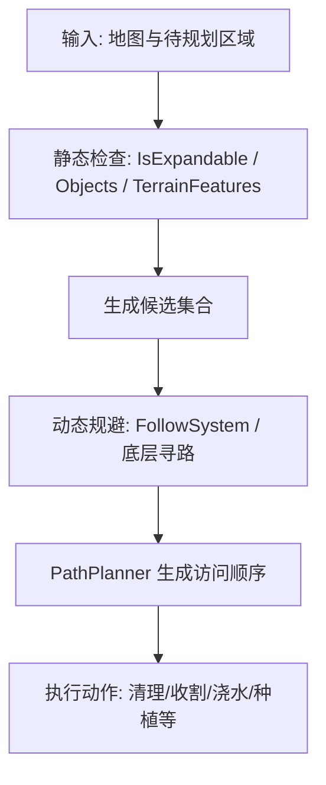
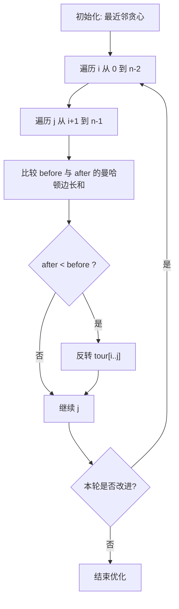
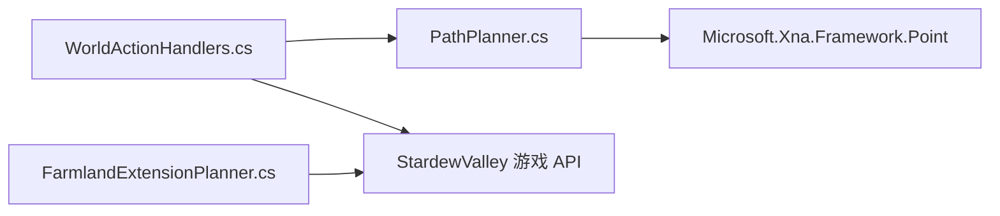

# 路径规划器

<cite>
**本文引用的文件**   
- [PathPlanner.cs](file://SmartNPC/smapi-mod/Movement/PathPlanner.cs)
- [WorldActionHandlers.cs](file://SmartNPC/smapi-mod/Behavior/WorldActionHandlers.cs)
- [FarmlandExtensionPlanner.cs](file://SmartNPC/smapi-mod/Behavior/FarmlandExtensionPlanner.cs)
</cite>

## 目录
1. [简介](#简介)
2. [项目结构](#项目结构)
3. [核心组件](#核心组件)
4. [架构总览](#架构总览)
5. [详细组件分析](#详细组件分析)
6. [依赖关系分析](#依赖关系分析)
7. [性能与内存优化](#性能与内存优化)
8. [故障排查指南](#故障排查指南)
9. [结论](#结论)
10. [附录：典型使用场景](#附录典型使用场景)

## 简介
本技术文档聚焦 SmartNPC 模组中的“路径规划器”相关实现，重点围绕以下目标展开：
- 解释 `PathPlanner.cs` 的近似 TSP（旅行商问题）路径排序算法及其曼哈顿距离启发式。
- 说明该规划器如何被世界行为处理器调用，用于对多个任务点进行近优访问顺序规划。
- 描述障碍物检测、静态障碍处理、动态障碍规避与地形特征识别在扩展模块中的体现。
- 阐述路径优化手段，包括贪心邻域选择、2-opt 局部优化以及面向农地扩展的矩形规划。
- 提供多目标路径规划与缓存机制的使用建议，并给出复杂地形、动态障碍和路径重规划的实践思路。
- 给出运行时复杂度分析与内存使用优化建议。

需要特别说明的是：仓库中的 `PathPlanner` 并非传统 A* 网格寻路实现；它是一个基于曼哈顿距离的“多点访问顺序规划器”，为长耗时工具动作（收割、浇水、除草、翻地、采集、种植、破坏、施肥等）生成近似最优的点序列。真正的逐格 A* 寻路通常由底层游戏引擎或 FollowSystem 完成，而本规划器负责“选点顺序”。

## 项目结构
与路径规划相关的代码主要分布在 Movement 与 Behavior 两个子模块中：
- Movement.PathPlanner：负责将一组目标坐标排序成一条从 NPC 出发、访问每个目标一次的路径序列。
- Behavior.WorldActionHandlers：将高层意图（如清理杂物、漫游、世界交互）转化为具体操作，并在需要时调用 PathPlanner。
- Behavior.FarmlandExtensionPlanner：针对农田扩展的矩形区域规划器，负责识别可扩张区域、已有作物地、需清理/破坏的地形与障碍物。

图表来源
- [PathPlanner.cs:1-120](file://SmartNPC/smapi-mod/Movement/PathPlanner.cs#L1-L120)
- [WorldActionHandlers.cs:1-200](file://SmartNPC/smapi-mod/Behavior/WorldActionHandlers.cs#L1-L200)
- [FarmlandExtensionPlanner.cs:1-200](file://SmartNPC/smapi-mod/Behavior/FarmlandExtensionPlanner.cs#L1-L200)

章节来源
- [PathPlanner.cs:1-120](file://SmartNPC/smapi-mod/Movement/PathPlanner.cs#L1-L120)
- [WorldActionHandlers.cs:1-200](file://SmartNPC/smapi-mod/Behavior/WorldActionHandlers.cs#L1-L200)
- [FarmlandExtensionPlanner.cs:1-200](file://SmartNPC/smapi-mod/Behavior/FarmlandExtensionPlanner.cs#L1-L200)

## 核心组件
### PathPlanner：近似 TSP 多点访问规划器
PathPlanner 的核心职责是：给定起点和若干目标点，输出一个从起点开始、依次访问所有目标点的序列，使总曼哈顿距离尽量小。它不返回逐格移动路径，而是返回“访问顺序”。

关键能力：
- 曼哈顿距离启发式：`Manhattan(a, b)` 计算两格之间的轴对齐距离。
- 最近邻贪心构建初始路径：从当前点选择最近未访问点，直到全部访问。
- 2-opt 局部优化：尝试反转任意区间，若边界边总长度减小则接受反转。
- 泛型变体 `PlanBy<T>`：允许携带额外元数据（例如物品 ID、预览信息），通过投影函数获取位置。

图表来源
- [PathPlanner.cs:1-120](file://SmartNPC/smapi-mod/Movement/PathPlanner.cs#L1-L120)

章节来源
- [PathPlanner.cs:1-120](file://SmartNPC/smapi-mod/Movement/PathPlanner.cs#L1-L120)

### FarmlandExtensionPlanner：农田扩展矩形规划器
FarmlandExtensionPlanner 解决的是“如何在现有农田旁边扩展规则矩形田地”的问题。其输入包括地图、搜索框、NPC 当前位置和期望矩形尺寸；输出是一个 Plan，包含矩形范围、是否与已有农田相邻、相邻边长度、需要清理的杂物点和需要砍伐的成熟树木点。

关键流程：
1. 扫描候选集：找出搜索范围内可扩张的格子。
2. 收集已有农田坐标集合，用于相邻性评分。
3. 同时尝试 (W,H) 与 (H,W) 两种方向，选择得分最高的矩形。
4. 对每个候选矩形，分类其中的杂物与成熟树木，并计算与已有农田的相邻边长度。
5. 冷启动（地图上无农田）时退化为离 NPC 最近的候选矩形。

图表来源
- [FarmlandExtensionPlanner.cs:1-200](file://SmartNPC/smapi-mod/Behavior/FarmlandExtensionPlanner.cs#L1-L200)

章节来源
- [FarmlandExtensionPlanner.cs:1-200](file://SmartNPC/smapi-mod/Behavior/FarmlandExtensionPlanner.cs#L1-L200)

### WorldActionHandlers：世界行为处理器与 PathPlanner 的协作
WorldActionHandlers 定义了 NPC 的世界级行为，例如漫游、清理杂物等。其中：
- 漫游行为会解析半径、中心点、最大距离和矩形区域约束，然后交给 FollowSystem 执行连续随机移动。
- 清理杂物行为会在农场地图上进行两次扫描：先定位已耕地范围，再根据 extend 参数向外扩展，以清理田地边缘的杂物。
- 当需要批量处理多个目标点时，WorldActionHandlers 可以调用 PathPlanner 对目标点排序，从而避免 NPC 出现“就近但方向不一致”导致的折返走位。

章节来源
- [WorldActionHandlers.cs:1-200](file://SmartNPC/smapi-mod/Behavior/WorldActionHandlers.cs#L1-L200)

## 架构总览
下图展示了高层行为如何通过 PathPlanner 生成访问顺序，再由底层移动系统驱动 NPC 实际行走：

图表来源
- [PathPlanner.cs:1-120](file://SmartNPC/smapi-mod/Movement/PathPlanner.cs#L1-L120)
- [WorldActionHandlers.cs:1-200](file://SmartNPC/smapi-mod/Behavior/WorldActionHandlers.cs#L1-L200)

## 详细组件分析

### PathPlanner 算法深度解析
#### 数据结构与复杂度
- 曼哈顿距离计算为 O(1)。
- 最近邻贪心阶段：每次从剩余点中选择最近点，整体为 O(n²)。
- 2-opt 优化阶段：外层最多 8 轮，内层比较所有区间端点组合，整体为 O(passes·n²)。
- 空间复杂度：O(n)，用于维护 tour 和 pool。

#### 开放列表管理
PathPlanner 并未使用优先队列或显式的“开放列表/关闭列表”，而是用两个 List：
- pool：尚未访问的目标点池。
- tour：已确定的访问顺序。

每次迭代从 pool 中线性扫描选择最近点，因此时间复杂度受 n 影响明显。对于较大规模目标点，建议使用优先队列或预先剪枝。

#### 启发式函数设计
启发式为曼哈顿距离，符合网格地图的轴对称移动特性。注释也明确指出：该距离是真实 PathFindController 成本的严格下界，但在存在障碍时可能低估；不过作为相对排序依据仍足够稳定。

#### 错误处理与边界条件
- 空输入或单点输入直接返回。
- 2-opt 中 j+1 越界时只比较前两条边，避免数组越界。
- 未提供显式异常抛出，逻辑上依赖输入合法性与游戏上下文保证。

图表来源
- [PathPlanner.cs:1-120](file://SmartNPC/smapi-mod/Movement/PathPlanner.cs#L1-L120)

章节来源
- [PathPlanner.cs:1-120](file://SmartNPC/smapi-mod/Movement/PathPlanner.cs#L1-L120)

### 障碍物检测机制
虽然 PathPlanner 本身不判断障碍，但与其配合的行为与农田规划器实现了完整的静态与动态障碍处理能力：

#### 静态障碍物处理
- 在农田扩展规划中，只有满足 IsExpandable 条件的格子才会进入候选集，从而排除不可通行的地形。
- 已有 HoeDirt 不参与新矩形覆盖，确保不会重复耕种。
- 对象层 Objects 与地形层 TerrainFeatures 分别检查杂物、成熟树木等静态障碍。

#### 动态障碍物规避
- WorldActionHandlers 支持漫游行为，通过 FollowSystem 进行实时移动；动态障碍（其他 NPC、玩家、临时对象）应由 FollowSystem 或底层寻路系统处理。
- PathPlanner 仅决定访问顺序，不保证每步移动避开动态实体，这是调用方的责任。

#### 地形特征识别
- 农田扩展规划器识别 HoeDirt、Tree、可清除杂物等。
- 清理杂物处理器区分 terrainFeatures 与 objects，并根据 ClearDebrisHandler.IsDebris 与 IsTerrainDebris 进行分类。

图表来源
- [WorldActionHandlers.cs:1-200](file://SmartNPC/smapi-mod/Behavior/WorldActionHandlers.cs#L1-L200)
- [FarmlandExtensionPlanner.cs:1-200](file://SmartNPC/smapi-mod/Behavior/FarmlandExtensionPlanner.cs#L1-L200)

章节来源
- [WorldActionHandlers.cs:1-200](file://SmartNPC/smapi-mod/Behavior/WorldActionHandlers.cs#L1-L200)
- [FarmlandExtensionPlanner.cs:1-200](file://SmartNPC/smapi-mod/Behavior/FarmlandExtensionPlanner.cs#L1-L200)

### 路径优化算法
PathPlanner 的优化分为两层：
1. 最近邻贪心：快速构建初始解，适合小 n 场景。
2. 2-opt 局部优化：反转任意区间，仅在边界边总长度减少时接受。

这种设计避免了全局搜索的高成本，同时在多数农场场景中能获得稳定且直观的顺序。

图表来源
- [PathPlanner.cs:1-120](file://SmartNPC/smapi-mod/Movement/PathPlanner.cs#L1-L120)

章节来源
- [PathPlanner.cs:1-120](file://SmartNPC/smapi-mod/Movement/PathPlanner.cs#L1-L120)

### 多目标路径规划与路径缓存
#### 多目标路径规划
PathPlanner 天然支持多目标：传入多个 Point 即可生成访问顺序。泛型变体 `PlanBy<T>` 更适合携带额外信息的任务项，例如：
- 每个目标对应不同作物类型。
- 每个目标附带掉落预览、所需工具、优先级等元数据。

#### 路径缓存机制建议
仓库未提供内置路径缓存。可考虑如下策略：
- 基于 (start, sortedTargetsKey) 缓存访问顺序。
- 当地图状态变化（新增/移除障碍、收获完成）时失效相关缓存。
- 使用 LRU 缓存限制内存占用。
- 对频繁重复的区域（如固定农田块）设置长期缓存。

章节来源
- [PathPlanner.cs:1-120](file://SmartNPC/smapi-mod/Movement/PathPlanner.cs#L1-L120)

## 依赖关系分析
PathPlanner 依赖 XNA 的 Point 类型；WorldActionHandlers 依赖 StardewValley 的游戏对象模型；FarmlandExtensionPlanner 依赖 TerrainFeatures 与 Objects 的数据结构。三者共同构成“高层行为 → 多点顺序规划 → 底层移动”的链路。

图表来源
- [PathPlanner.cs:1-120](file://SmartNPC/smapi-mod/Movement/PathPlanner.cs#L1-L120)
- [WorldActionHandlers.cs:1-200](file://SmartNPC/smapi-mod/Behavior/WorldActionHandlers.cs#L1-L200)
- [FarmlandExtensionPlanner.cs:1-200](file://SmartNPC/smapi-mod/Behavior/FarmlandExtensionPlanner.cs#L1-L200)

章节来源
- [PathPlanner.cs:1-120](file://SmartNPC/smapi-mod/Movement/PathPlanner.cs#L1-L120)
- [WorldActionHandlers.cs:1-200](file://SmartNPC/smapi-mod/Behavior/WorldActionHandlers.cs#L1-L200)
- [FarmlandExtensionPlanner.cs:1-200](file://SmartNPC/smapi-mod/Behavior/FarmlandExtensionPlanner.cs#L1-L200)

## 性能与内存优化
### 时间复杂度
- 最近邻贪心：O(n²)。
- 2-opt 优化：O(passes·n²)，passes 上限为 8。
- 农田扩展规划：滑动窗口枚举矩形，复杂度取决于 bbox 大小与候选集密度。

### 内存使用
- PathPlanner 使用 List<Point> 与 List<T>，额外开销较小。
- FarmlandExtensionPlanner 使用 HashSet<Point> 存储候选与已有农田坐标，随地图规模增长。
- 建议：
  - 对超大地图分块扫描。
  - 复用候选集合与临时 List，避免频繁分配。
  - 限制单次规划的最大目标数，必要时拆分批次。

### 进一步优化建议
- 使用优先队列替代线性扫描最近点，降低贪心阶段复杂度。
- 对热点区域缓存访问顺序，结合地图变更事件失效。
- 对 2-opt 增加早停条件，例如达到最小改善阈值即停止。
- 将曼哈顿距离替换为加权距离，以反映地形代价（例如沼泽、陡坡）。

章节来源
- [PathPlanner.cs:1-120](file://SmartNPC/smapi-mod/Movement/PathPlanner.cs#L1-L120)
- [FarmlandExtensionPlanner.cs:1-200](file://SmartNPC/smapi-mod/Behavior/FarmlandExtensionPlanner.cs#L1-L200)

## 故障排查指南
常见问题与定位方法：
- NPC 折返严重：检查目标点是否过多或未使用 PathPlanner 排序。
- 农田扩展失败：确认 IsExpandable 条件、Objects 与 TerrainFeatures 是否包含障碍。
- 清理杂物范围过大：检查 radius、extend 与 farmlandFound 分支逻辑。
- 动态障碍碰撞：确认 FollowSystem 或底层寻路是否正确处理动态实体。

建议日志关键字：
- `[npc_wander]`：漫游行为参数与状态。
- `[npc_clear_debris]`：清理杂物的前后农田边界与 farmlandFound。

章节来源
- [WorldActionHandlers.cs:1-200](file://SmartNPC/smapi-mod/Behavior/WorldActionHandlers.cs#L1-L200)

## 结论
PathPlanner 并非传统 A* 寻路，而是一个高效的近似 TSP 访问顺序规划器。它与 WorldActionHandlers 和 FarmlandExtensionPlanner 协同工作，形成从高层行为到多点访问顺序再到实际移动的完整链路。该实现以曼哈顿距离为启发式，采用最近邻贪心与 2-opt 局部优化，在小规模目标点上表现良好。真正的逐格 A* 寻路与动态障碍规避通常由 FollowSystem 或底层游戏寻路系统承担。

对于更复杂的地图与更多目标，建议引入优先队列、路径缓存、权重化距离与分块扫描，以提升可扩展性与稳定性。

## 附录：典型使用场景

### 复杂地形处理
- 使用 FarmlandExtensionPlanner 识别可扩张区域，排除静态障碍。
- 对不可通行地形设置 IsExpandable=false，避免候选污染。
- 结合 WorldActionHandlers 的 extend 参数扩大清理范围，确保边缘整洁。

章节来源
- [FarmlandExtensionPlanner.cs:1-200](file://SmartNPC/smapi-mod/Behavior/FarmlandExtensionPlanner.cs#L1-L200)
- [WorldActionHandlers.cs:1-200](file://SmartNPC/smapi-mod/Behavior/WorldActionHandlers.cs#L1-L200)

### 动态障碍与路径重规划
- 动态障碍由 FollowSystem 处理；PathPlanner 仅提供访问顺序。
- 当动态障碍导致阻塞时，上层应触发重试或重新规划。
- 可在 Action 层记录失败次数与时间戳，超过阈值后回退到次优目标或等待。

章节来源
- [WorldActionHandlers.cs:1-200](file://SmartNPC/smapi-mod/Behavior/WorldActionHandlers.cs#L1-L200)

### 代码示例引用路径
由于本文遵循不直接粘贴源码的原则，以下为关键实现位置的引用路径：
- 曼哈顿距离与 PlanBy 泛型规划入口：[PathPlanner.cs:1-120](file://SmartNPC/smapi-mod/Movement/PathPlanner.cs#L1-L120)
- 农田扩展候选集与矩形评分：[FarmlandExtensionPlanner.cs:1-200](file://SmartNPC/smapi-mod/Behavior/FarmlandExtensionPlanner.cs#L1-L200)
- 世界行为参数解析与日志输出：[WorldActionHandlers.cs:1-200](file://SmartNPC/smapi-mod/Behavior/WorldActionHandlers.cs#L1-L200)