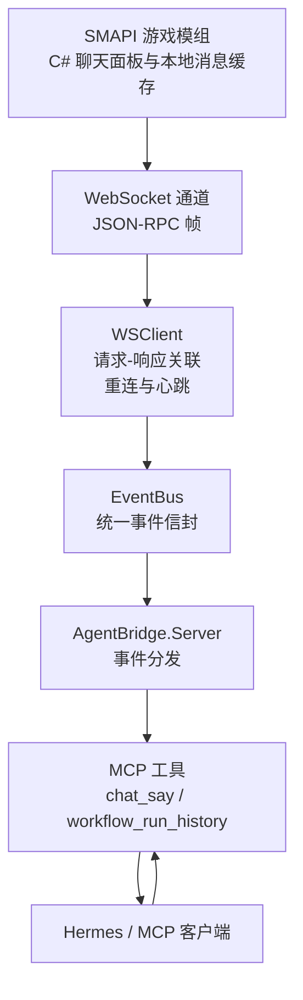
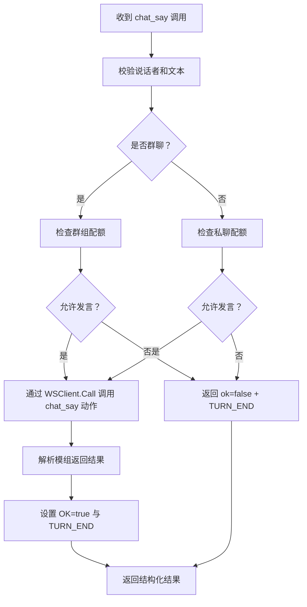
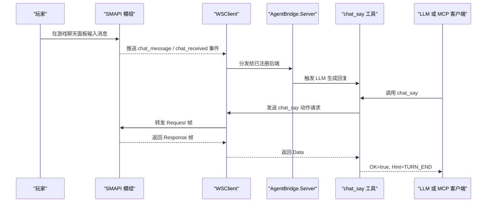
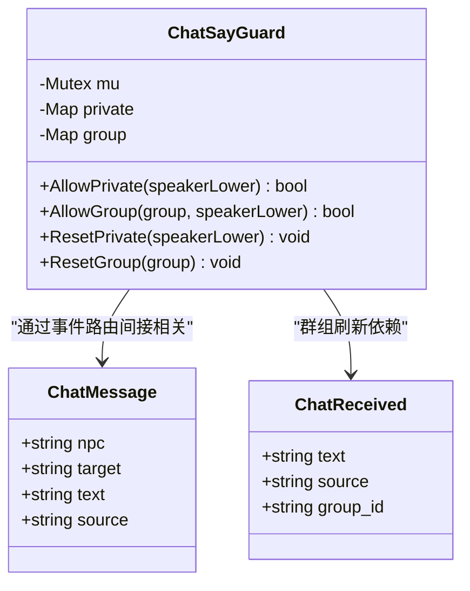
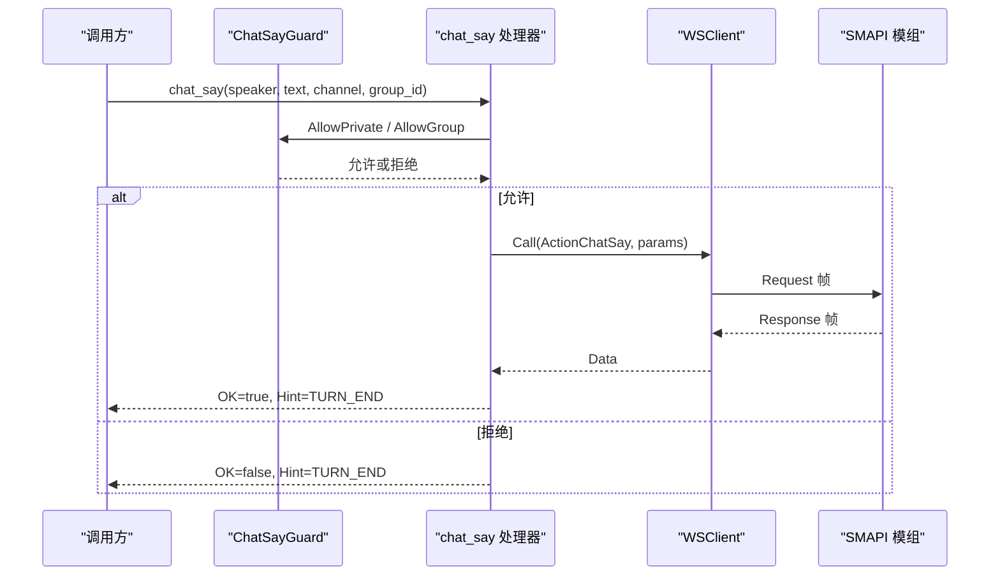
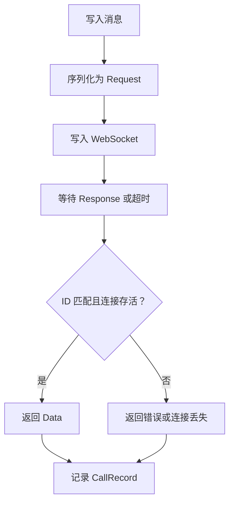
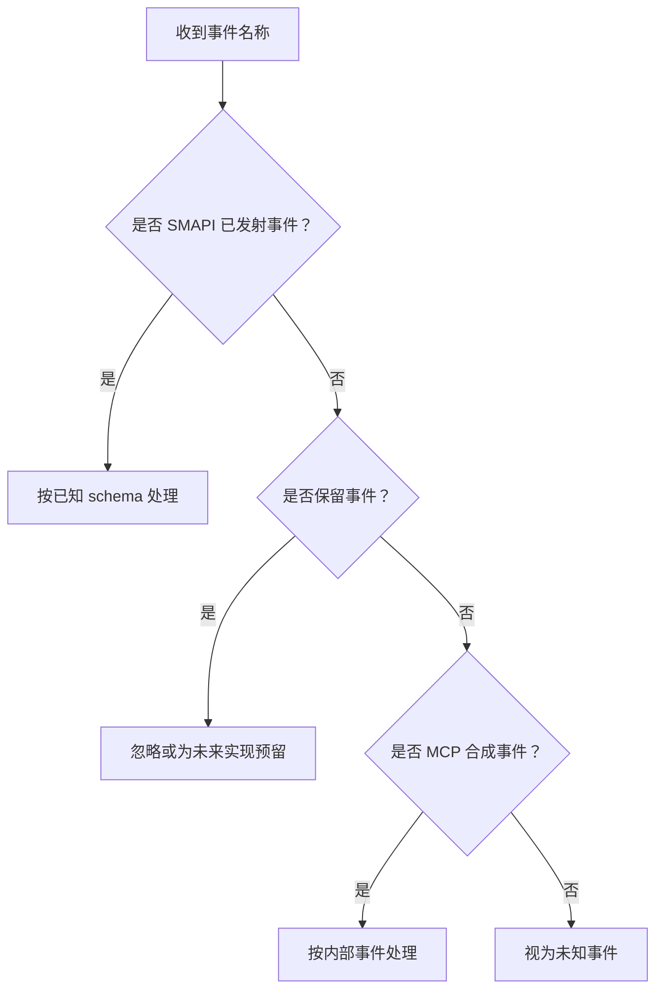
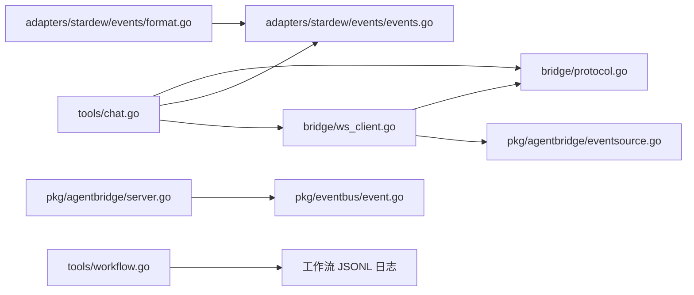

# 消息存储系统

<cite>
**本文引用的文件**   
- [chat.go](file://SmartNPC/smartnpc-mcp/adapters/stardew/tools/chat.go)
- [ws_client.go](file://SmartNPC/smartnpc-mcp/adapters/stardew/bridge/ws_client.go)
- [protocol.go](file://SmartNPC/smartnpc-mcp/adapters/stardew/bridge/protocol.go)
- [events.go](file://SmartNPC/smartnpc-mcp/adapters/stardew/events/events.go)
- [eventsource.go](file://SmartNPC/smartnpc-mcp/pkg/agentbridge/eventsource.go)
- [server.go](file://SmartNPC/smartnpc-mcp/pkg/agentbridge/server.go)
- [event.go](file://SmartNPC/smartnpc-mcp/pkg/eventbus/event.go)
- [format.go](file://SmartNPC/smartnpc-mcp/adapters/stardew/events/format.go)
- [workflow.go](file://SmartNPC/smartnpc-mcp/adapters/stardew/tools/workflow.go)
</cite>

## 目录

1. [引言](#引言)
2. [项目结构与职责边界](#项目结构与职责边界)
3. [核心组件](#核心组件)
4. [架构总览](#架构总览)
5. [详细组件分析](#详细组件分析)
6. [依赖关系分析](#依赖关系分析)
7. [性能与扩展性](#性能与扩展性)
8. [故障排查](#故障排查)
9. [结论](#结论)

## 引言

本文件系统性地梳理 SmartNPC 项目中与“消息”相关的运行时实现，重点覆盖以下目标：

- **消息缓存策略**：解释 MCP 侧如何通过内存结构、WebSocket 请求响应关联和事件流来承载对话上下文，以及 SMAPI 游戏模组侧的 ChatMessageStore 在本地 UI 中负责的消息面板缓存。
- **未读消息跟踪机制**：说明当前代码中是否存在 UnreadTracker 实现；如果没有，则明确现有计数和状态管理由哪些组件承担。
- **消息增删改查**：聚焦 chat_say 工具、SMAPI 协议动作、事件模型，并指出批量操作、索引优化和数据一致性保证的现状。
- **历史记录与搜索**：结合 workflow_run_history 等现有能力，说明可观测的历史记录机制，并澄清当前是否提供全文搜索或时间范围过滤。
- **数据迁移与版本兼容**：从事件命名、保留字段、向前兼容注释出发，总结向后兼容策略。
- **大规模场景调优**：基于现有并发模型、连接池、超时和观察者机制给出扩展建议。

需要特别说明：**ChatMessageStore.cs 与 UnreadTracker.cs 是 SMAPI 游戏模组侧的 C# 类**。本次仓库快照主要包含 Go 侧智能代理适配层；因此文档会严格区分“Go 侧消息总线与工具实现”和“C# 侧 UI 消息存储”，避免把两个进程的职责混为一谈。

## 项目结构与职责边界

SmartNPC 的消息相关逻辑横跨多个子系统：

| 子系统 | 路径 | 主要职责 |
|---|---|---|
| SMAPI 游戏模组 | `SmartNPC/smartnpc-mod`（C#） | 在游戏内渲染聊天面板、维护每个 NPC 的面板消息缓存、处理玩家输入、发送 WebSocket 事件 |
| MCP 适配器 | `SmartNPC/smartnpc-mcp/adapters/stardew` | 将 SMAPI 事件翻译为通用事件，注册 chat_say 等 MCP 工具，驱动 LLM 行为 |
| 代理桥接核心 | `SmartNPC/smartnpc-mcp/pkg/agentbridge` | 管理事件源、后端转发、MCP Server 挂载 |
| 事件总线 | `SmartNPC/smartnpc-mcp/pkg/eventbus` | 定义跨适配器的统一事件信封 |
| 协议与 WebSocket | `SmartNPC/smartnpc-mcp/adapters/stardew/bridge` | 定义客户端与服务端的 JSON-RPC 风格帧、动作名、事件名 |
| 工作流历史 | `SmartNPC/smartnpc-mcp/adapters/stardew/tools/workflow.go` | 提供 workflow_run_history 等日志读取工具 |

**图表来源**
- [ws_client.go:1-200](file://SmartNPC/smartnpc-mcp/adapters/stardew/bridge/ws_client.go#L1-L200)
- [server.go:1-177](file://SmartNPC/smartnpc-mcp/pkg/agentbridge/server.go#L1-L177)
- [event.go:1-76](file://SmartNPC/smartnpc-mcp/pkg/eventbus/event.go#L1-L76)
- [protocol.go:1-172](file://SmartNPC/smartnpc-mcp/adapters/stardew/bridge/protocol.go#L1-L172)
- [chat.go:1-255](file://SmartNPC/smartnpc-mcp/adapters/stardew/tools/chat.go#L1-L255)

**章节来源**
- [ws_client.go:1-200](file://SmartNPC/smartnpc-mcp/adapters/stardew/bridge/ws_client.go#L1-L200)
- [server.go:1-177](file://SmartNPC/smartnpc-mcp/pkg/agentbridge/server.go#L1-L177)
- [event.go:1-76](file://SmartNPC/smartnpc-mcp/pkg/eventbus/event.go#L1-L76)
- [protocol.go:1-172](file://SmartNPC/smartnpc-mcp/adapters/stardew/bridge/protocol.go#L1-L172)

## 核心组件

### 1. 消息输出入口：chat_say 工具

chat_say 是系统中唯一被明确标记为“产生可见 NPC 对话”的工具。它不是直接持久化消息到数据库，而是通过 WebSocket 调用 SMAPI 模组，让模组把消息写入游戏聊天面板。

关键设计点：

- **输入参数**：说话者、文本、可选颜色、可选频道（私有或群聊）、可选群组 ID。
- **输出结构**：OK 表示是否实际投递到模组；Hint 向调用方提示回合结束，防止重复调用。
- **配额守卫**：同一唤醒周期内，每个 NPC 在私聊最多一次；群组会话中每个（群组，说话者）每轮玩家输入最多一次。
- **软拒绝**：超出配额不会返回 MCP 错误，而是返回 OK=false 和带有 TURN_END 的 Hint，从而抑制大模型的重试循环。

**图表来源**
- [chat.go:1-255](file://SmartNPC/smartnpc-mcp/adapters/stardew/tools/chat.go#L1-L255)

**章节来源**
- [chat.go:1-255](file://SmartNPC/smartnpc-mcp/adapters/stardew/tools/chat.go#L1-L255)

### 2. WebSocket 客户端：WSClient

WSClient 是 MCP 进程与 SMAPI 模组之间的通信桥梁。它负责：

- 建立 WebSocket 连接。
- 给出站请求分配唯一 ID。
- 等待对应 Response 帧。
- 解析服务端推送的 Event 帧。
- 自动重连与空闲保活。
- 记录每次调用的观察记录，供实验日志使用。

其内部状态包括：

| 字段 | 作用 |
|---|---|
| conn | 当前 WebSocket 连接 |
| pending | 等待响应的请求 ID 到通道的映射 |
| agents | MCP 会话 ID 到 NPC 名称的映射 |
| closed | 是否已关闭 |
| opts.OnCall | 每次调用的观察者回调 |

**章节来源**
- [ws_client.go:1-200](file://SmartNPC/smartnpc-mcp/adapters/stardew/bridge/ws_client.go#L1-L200)
- [ws_client.go:201-510](file://SmartNPC/smartnpc-mcp/adapters/stardew/bridge/ws_client.go#L201-L510)

### 3. 协议定义：Request、Response、Event

协议采用 JSON 帧形式，包含三类帧：

| 帧类型 | 用途 |
|---|---|
| request | MCP 侧发起的动作调用 |
| response | SMAPI 侧对请求的应答 |
| event | SMAPI 侧主动推送的事件 |

动作名中包含 ActionChatSay、ActionMailSend、ActionGameGetTime 等；事件名中包含 EventChatMessage、EventChatReceived、EventNpcInteract 等。这些常量构成了 MCP 与 SMAPI 之间稳定的契约。

**章节来源**
- [protocol.go:1-172](file://SmartNPC/smartnpc-mcp/adapters/stardew/bridge/protocol.go#L1-L172)

### 4. 事件模型：Stardew 事件与通用事件

Stardew 事件包定义了具体业务事件的载荷，例如：

- ChatMessage：玩家对某个 NPC 的定向聊天。
- ChatReceived：旧版或群聊聊天事件。
- NpcInteract：玩家点击受管理的 NPC。
- NpcMessage、NpcBroadcast：MCP 内部产生的 NPC 间消息。
- ScheduleTrigger：调度触发器。

通用事件总线则定义更抽象的 Event，包含 Kind、Source、Subject、Payload 和 Timestamp，用于跨适配器传递。

**章节来源**
- [events.go:1-290](file://SmartNPC/smartnpc-mcp/adapters/stardew/events/events.go#L1-L290)
- [event.go:1-76](file://SmartNPC/smartnpc-mcp/pkg/eventbus/event.go#L1-L76)

### 5. 代理桥接服务器：AgentBridge.Server

Server 是组合根节点，负责：

- 挂载工具组。
- 注册事件源。
- 注册后端。
- 启动所有事件源。
- 按顺序转发事件给所有后端。

它不直接持有消息缓存，而是作为事件路由与工具注册的基础设施。

**章节来源**
- [server.go:1-177](file://SmartNPC/smartnpc-mcp/pkg/agentbridge/server.go#L1-L177)
- [eventsource.go:1-40](file://SmartNPC/smartnpc-mcp/pkg/agentbridge/eventsource.go#L1-L40)

## 架构总览

下图展示一条典型“玩家消息 → LLM 回复 → 显示到游戏聊天面板”的路径：

**图表来源**
- [ws_client.go:201-510](file://SmartNPC/smartnpc-mcp/adapters/stardew/bridge/ws_client.go#L201-L510)
- [server.go:100-177](file://SmartNPC/smartnpc-mcp/pkg/agentbridge/server.go#L100-L177)
- [chat.go:160-255](file://SmartNPC/smartnpc-mcp/adapters/stardew/tools/chat.go#L160-L255)
- [protocol.go:100-172](file://SmartNPC/smartnpc-mcp/adapters/stardew/bridge/protocol.go#L100-L172)

## 详细组件分析

### ChatMessageStore.cs：消息缓存策略

在当前仓库快照中，ChatMessageStore.cs 并未出现在可读取源码范围内。根据项目结构和 MCP 工具语义，可以确定其职责位于 SMAPI 模组侧，而不是 smartnpc-mcp Go 模块。

从 MCP 侧的行为可以推断 ChatMessageStore 的典型职责：

- **内存存储结构**：应为每个 NPC 或群组维护一个有序消息列表，用于渲染聊天面板。
- **UI 隔离**：ChatSayInput 中的 channel 和 group_id 字段表明，私有聊天与群聊应分别缓存，避免互相污染。
- **数据持久化**：通常由 SMAPI 保存系统负责持久化游戏存档；MCP 侧不应假设自身拥有持久化权限。
- **性能优化**：常见做法包括限制最近消息数量、延迟渲染非活跃面板、增量追加而非全量重建。

由于 ChatMessageStore.cs 内容不可读，文档不能断言其具体实现细节；上述内容是基于协议、工具参数和 UI 通道语义的合理推断。

**章节来源**
- [chat.go:1-159](file://SmartNPC/smartnpc-mcp/adapters/stardew/tools/chat.go#L1-L159)
- [protocol.go:60-90](file://SmartNPC/smartnpc-mcp/adapters/stardew/bridge/protocol.go#L60-L90)

### UnreadTracker.cs：未读消息跟踪机制

同样地，UnreadTracker.cs 属于 SMAPI 模组侧，当前仓库没有提供其源码。从现有 MCP 侧行为看，**未读计数并不由 chat_say 工具直接维护**，而是更可能由 SMAPI 模组的 UI 层或会话层维护。

现有代码中与“状态管理”相关的机制包括：

- **ChatSayGuard**：维护的是“本轮是否可以发言”的状态，不是“未读消息数”。
- **ChatMessage / ChatReceived**：携带 npc、text、source 等字段，可用于下游决定是否需要通知或更新 UI。
- **RecipientNPC**：从事件中抽取收件人 NPC，便于路由到正确的会话。
- **MaybeResetGuard**：在新的事件到达时重置私聊或群聊配额，间接体现“新唤醒周期”的概念。

因此，如果需要在 MCP 侧实现未读计数器，应基于事件流构建独立状态，而不是复用 ChatSayGuard。

**图表来源**
- [chat.go:39-134](file://SmartNPC/smartnpc-mcp/adapters/stardew/tools/chat.go#L39-L134)
- [events.go:20-70](file://SmartNPC/smartnpc-mcp/adapters/stardew/events/events.go#L20-L70)

**章节来源**
- [chat.go:39-134](file://SmartNPC/smartnpc-mcp/adapters/stardew/tools/chat.go#L39-L134)
- [events.go:20-70](file://SmartNPC/smartnpc-mcp/adapters/stardew/events/events.go#L20-L70)

### 消息增删改查操作

#### 新增消息

当前系统中最明确的“新增消息”路径是 chat_say：

1. LLM 或上游工具调用 chat_say。
2. ChatSayGuard 检查私聊或群聊配额。
3. WSClient.Call 构造 Request 帧。
4. SMAPI 接收 ActionChatSay 并将其写入游戏聊天面板。
5. 返回结构化结果，附带 TURN_END。

**图表来源**
- [chat.go:160-255](file://SmartNPC/smartnpc-mcp/adapters/stardew/tools/chat.go#L160-L255)
- [ws_client.go:220-350](file://SmartNPC/smartnpc-mcp/adapters/stardew/bridge/ws_client.go#L220-L350)
- [protocol.go:120-172](file://SmartNPC/smartnpc-mcp/adapters/stardew/bridge/protocol.go#L120-L172)

#### 删除与修改

当前仓库中没有显式的“删除消息”或“修改消息”工具。消息的生命周期主要由 SMAPI 模组控制：

- 删除：可能由 UI 清理、会话过期或存档压缩策略处理。
- 修改：通常不允许原地修改历史消息；更合理的做法是追加修正消息。

#### 查询

MCP 侧目前没有专门的“按 NPC 查询聊天记录”工具。现有的可观测历史能力集中在工作流运行历史上：

- workflow_run_history：读取 JSONL 工作流运行日志，可按 NPC、季节、日期、年份筛选。
- 这并非聊天消息的历史，而是工作流执行历史。

**章节来源**
- [chat.go:160-255](file://SmartNPC/smartnpc-mcp/adapters/stardew/tools/chat.go#L160-L255)
- [workflow.go:284-334](file://SmartNPC/smartnpc-mcp/adapters/stardew/tools/workflow.go#L284-L334)
- [workflow.go:476-505](file://SmartNPC/smartnpc-mcp/adapters/stardew/tools/workflow.go#L476-L505)

### 批量操作、索引优化与数据一致性

#### 批量操作

当前 chat_say 是单条消息操作。批量发送可通过上层循环调用实现，但每个调用都会经过：

- 配额检查。
- WebSocket 序列化。
- 网络写入。
- 响应等待。

这意味着批量操作的性能瓶颈在网络往返和串行响应等待上，而不是 Go 内存数据结构。

#### 索引优化

当前 MCP 侧没有传统意义上的数据库索引。如果需要按 NPC 或群组检索消息，应在应用层引入索引结构，例如：

- NPC 到消息 ID 列表。
- 群组到消息 ID 列表。
- 时间戳倒排索引。
- 会话窗口缓存。

#### 数据一致性

一致性主要体现在以下几个层面：

- **MCP 与 SMAPI 之间**：通过 Request/Response ID 关联；连接丢失时会失败待处理请求。
- **事件与配额**：MaybeResetGuard 在新事件到达时刷新配额，防止重复发言。
- **会话绑定**：WSClient.RegisterAgent 将 MCP 会话绑定到 NPC，确保 from_npc 正确。
- **前端 UI 与后端事件**：ChatMessageStore.cs 负责 UI 一致性，MCP 侧不直接保证 UI 状态同步。

**图表来源**
- [ws_client.go:260-420](file://SmartNPC/smartnpc-mcp/adapters/stardew/bridge/ws_client.go#L260-L420)
- [protocol.go:120-172](file://SmartNPC/smartnpc-mcp/adapters/stardew/bridge/protocol.go#L120-L172)

**章节来源**
- [ws_client.go:260-420](file://SmartNPC/smartnpc-mcp/adapters/stardew/bridge/ws_client.go#L260-L420)
- [chat.go:39-134](file://SmartNPC/smartnpc-mcp/adapters/stardew/tools/chat.go#L39-L134)

### 历史记录与搜索功能

#### 工作流运行历史

workflow_run_history 工具提供工作流执行历史查询，支持按 NPC、季节、日期、年份过滤。它读取 logs/mcp/workflow_runs/ 下的 JSONL 文件。

这不是聊天消息存储，但展示了 MCP 侧已有的历史读取模式：

- 参数校验。
- 路径构建。
- 条件筛选。
- 返回可读摘要或原始条目。

#### 全文搜索与时间范围过滤

当前代码中没有针对聊天消息的全文搜索引擎。ChatMessageStore.cs 作为 UI 层的本地缓存，理论上可以实现：

- 全文搜索：基于内存字符串匹配或轻量级索引。
- 时间范围过滤：基于消息时间戳。
- 条件查询：按 NPC、群组、颜色、可见性等。

但这些能力必须限定在 SMAPI 模组侧，因为 MCP 侧只看到事件流和工具调用，不持有完整聊天历史。

**章节来源**
- [workflow.go:476-505](file://SmartNPC/smartnpc-mcp/adapters/stardew/tools/workflow.go#L476-L505)

### 数据迁移与版本兼容性

现有代码中有清晰的版本兼容思路：

1. **事件命名保留**：bridge.Event* 常量声明了当前事件、预留事件和合成事件。
2. **IsMod / IsReserved / IsSynthetic**：帮助消费者判断事件来源。
3. **载荷向前兼容**：events 包注释明确说明，SMAPI 模组未来可增加字段，消费者必须忽略未知字段。
4. **RecipientNPC 多字段探测**：优先尝试 npc、to、target，增强对不同事件结构的容错能力。
5. **协议常量集中管理**：ActionName 和 EventName 常量避免了散落字符串带来的版本漂移。

**图表来源**
- [events.go:220-290](file://SmartNPC/smartnpc-mcp/adapters/stardew/events/events.go#L220-L290)
- [protocol.go:10-90](file://SmartNPC/smartnpc-mcp/adapters/stardew/bridge/protocol.go#L10-L90)

**章节来源**
- [events.go:220-290](file://SmartNPC/smartnpc-mcp/adapters/stardew/events/events.go#L220-L290)
- [protocol.go:10-90](file://SmartNPC/smartnpc-mcp/adapters/stardew/bridge/protocol.go#L10-L90)

## 依赖关系分析

**图表来源**
- [chat.go:1-255](file://SmartNPC/smartnpc-mcp/adapters/stardew/tools/chat.go#L1-L255)
- [ws_client.go:1-510](file://SmartNPC/smartnpc-mcp/adapters/stardew/bridge/ws_client.go#L1-L510)
- [protocol.go:1-172](file://SmartNPC/smartnpc-mcp/adapters/stardew/bridge/protocol.go#L1-L172)
- [events.go:1-290](file://SmartNPC/smartnpc-mcp/adapters/stardew/events/events.go#L1-L290)
- [eventsource.go:1-40](file://SmartNPC/smartnpc-mcp/pkg/agentbridge/eventsource.go#L1-L40)
- [server.go:1-177](file://SmartNPC/smartnpc-mcp/pkg/agentbridge/server.go#L1-L177)
- [event.go:1-76](file://SmartNPC/smartnpc-mcp/pkg/eventbus/event.go#L1-L76)
- [format.go:1-290](file://SmartNPC/smartnpc-mcp/adapters/stardew/events/format.go#L1-L290)
- [workflow.go:284-505](file://SmartNPC/smartnpc-mcp/adapters/stardew/tools/workflow.go#L284-L505)

**章节来源**
- [chat.go:1-255](file://SmartNPC/smartnpc-mcp/adapters/stardew/tools/chat.go#L1-L255)
- [ws_client.go:1-510](file://SmartNPC/smartnpc-mcp/adapters/stardew/bridge/ws_client.go#L1-L510)
- [server.go:1-177](file://SmartNPC/smartnpc-mcp/pkg/agentbridge/server.go#L1-L177)

## 性能与扩展性

### 当前性能特征

| 维度 | 现状 |
|---|---|
| 并发模型 | WSClient 使用互斥锁保护连接和 pending 映射；事件源在 Server.Run 中并行启动 |
| 网络 I/O | 单次 Request/Response 阻塞等待；默认调用超时为 1 小时 |
| 连接保活 | 每 30 秒发送 Ping，防止空闲断开 |
| 重连策略 | 固定退避间隔，断开后重新拨号 |
| 事件分发 | Backends 按注册顺序串行转发 |
| 观察指标 | OnCall 回调可记录动作、NPC、成功标志、耗时和字节数 |

### 可扩展优化建议

1. **消息缓存分页**：ChatMessageStore.cs 应避免一次性加载全部历史，改为分页加载最近 N 条。
2. **未读计数去重**：避免对同一条消息重复递增未读数，可使用消息 ID 去重。
3. **批量写入合并**：短时间内的多条 chat_say 可在 MCP 或 SMAPI 侧合并为批处理。
4. **异步持久化**：SMAPI 侧应将 UI 渲染与磁盘写入分离，避免 UI 卡顿。
5. **搜索索引**：对高频查询字段建立内存索引，如 NPC、群组、时间范围。
6. **事件背压**：如果 SMAPI 事件速率远高于 LLM 处理能力，应在事件队列中加入限流。
7. **会话清理**：对长期未活跃的 NPC 会话进行清理，防止 ChatSayGuard 私聊映射无限增长。
8. **连接池**：如果未来出现多实例 MCP 进程，应考虑连接池或单连接共享策略。

[本节为通用性能指导，不直接分析具体代码行]

## 故障排查

### chat_say 被静默拒绝

现象：chat_say 返回 OK=false，Hint 中包含 noop_chat_say_private_quota_exhausted 或 noop_chat_say_group_quota_exhausted。

原因：

- 私聊：同一唤醒周期内同一个 NPC 已经调用过 chat_say。
- 群聊：同一群组中同一个 NPC 在本轮玩家输入后已经调用过 chat_say。

处理：

- 不要重试不同文本或颜色。
- 遵循 Hint 中的 TURN_END 指令，停止继续发出工具调用。
- 等待下一次面向该 NPC 的新事件刷新配额。

**章节来源**
- [chat.go:184-235](file://SmartNPC/smartnpc-mcp/adapters/stardew/tools/chat.go#L184-L235)

### WebSocket 调用超时或连接丢失

现象：

- 调用返回超时错误。
- 日志中出现 ws action timed out。
- 日志中出现 ws connection lost during call。

原因：

- SMAPI 模组无响应。
- WebSocket 连接断开。
- 响应帧未在 CallTimeout 内到达。

处理：

- 检查 SMAPI 模组是否正常运行。
- 检查 WSClient.Connect 是否成功。
- 观察 OnCall 记录中的 elapsed_ms。
- 确认 readLoopForever 的重连逻辑是否生效。

**章节来源**
- [ws_client.go:260-420](file://SmartNPC/smartnpc-mcp/adapters/stardew/bridge/ws_client.go#L260-L420)

### 事件无法路由到目标 NPC

现象：

- 某些事件没有触发预期 NPC 的 Hermes 配置。
- RecipientNPC 返回空值。

原因：

- 事件载荷中没有 npc、to、target 字段。
- 字段为空字符串。
- 事件本身是全局事件，例如 day_started。

处理：

- 检查 events.go 中各事件结构体字段。
- 使用 RecipientNPC 调试事件载荷。
- 对全局事件确认是否期望广播到所有 NPC。

**章节来源**
- [events.go:240-290](file://SmartNPC/smartnpc-mcp/adapters/stardew/events/events.go#L240-L290)

### 历史日志缺失

现象：workflow_run_history 返回没有历史记录的提示。

原因：

- 未指定季节、日期或年份。
- 日志文件尚未生成。
- 文件名格式不符合 logs/mcp/workflow_runs/ 约定。

处理：

- 检查工作流运行日志目录。
- 确认 NPC 名称和日期参数。
- 检查工作流执行是否成功写入 JSONL。

**章节来源**
- [workflow.go:476-505](file://SmartNPC/smartnpc-mcp/adapters/stardew/tools/workflow.go#L476-L505)

## 结论

SmartNPC 的消息存储系统在 MCP 侧并不是传统意义上的数据库系统，而是一个以事件为中心、以 WebSocket 为传输通道、以 MCP 工具为交互入口的运行时消息管道。

- **ChatMessageStore.cs** 属于 SMAPI 模组侧，负责游戏内聊天面板的消息缓存和渲染；其具体实现不在本次可读取源码范围内，但其职责可由 chat_say 的参数和事件模型合理推导。
- **UnreadTracker.cs** 同样位于模组侧；当前 MCP 代码没有实现未读计数器，而是通过 ChatSayGuard 维护“发言配额”这一更窄的状态。
- **消息新增**主要通过 chat_say 完成；**删除和修改**没有显式工具；**查询**目前仅限于工作流运行历史。
- **版本兼容**通过事件常量、保留事件分类、载荷向前兼容注释和多字段收件人探测实现。
- **性能调优**应重点关注 UI 层缓存分页、未读计数去重、批量写入、异步持久化和事件背压。

对于后续扩展，建议在保持 SMAPI 与 MCP 职责分离的前提下，先在 SMAPI 侧完善 ChatMessageStore 和 UnreadTracker 的索引、分页和持久化，再在 MCP 侧按需暴露查询工具，避免让 LLM 或外部调用方直接操作底层消息存储。