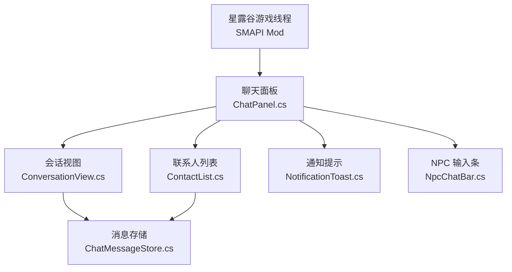
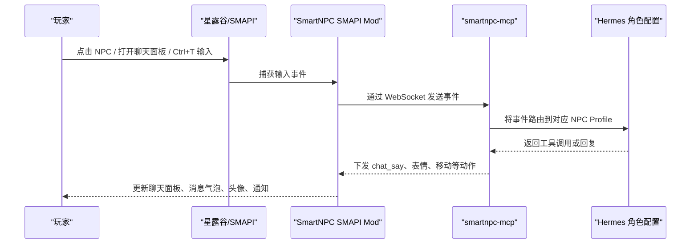
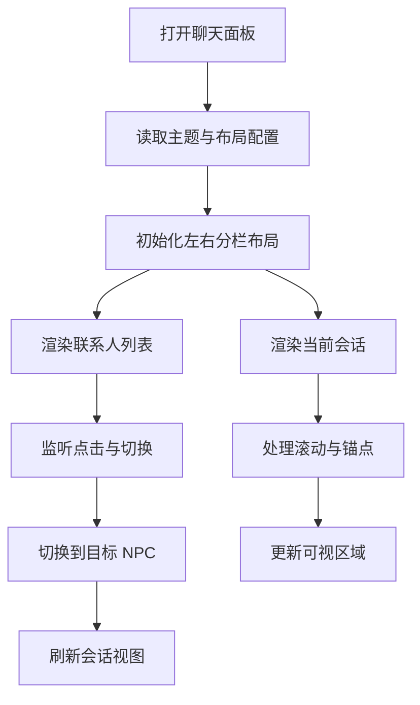
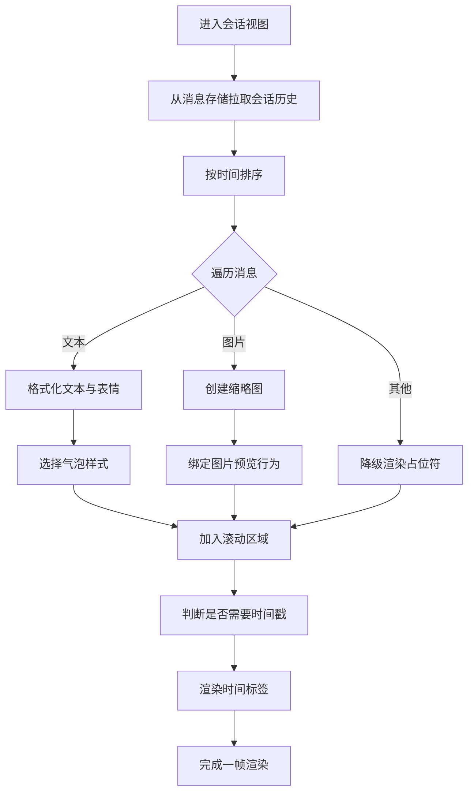
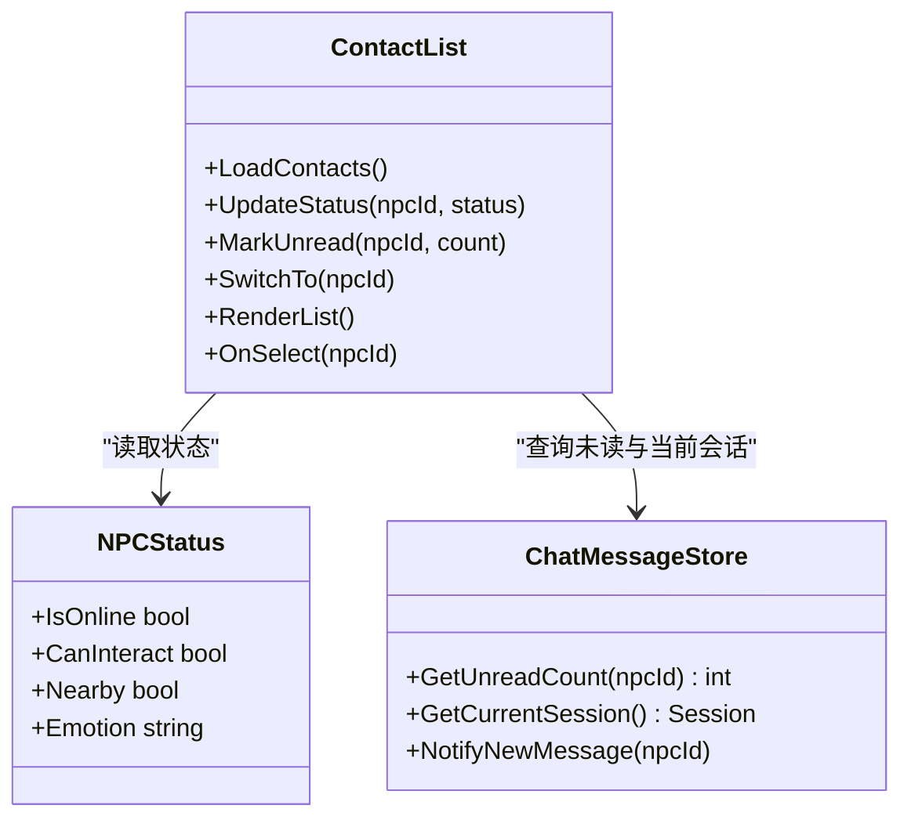
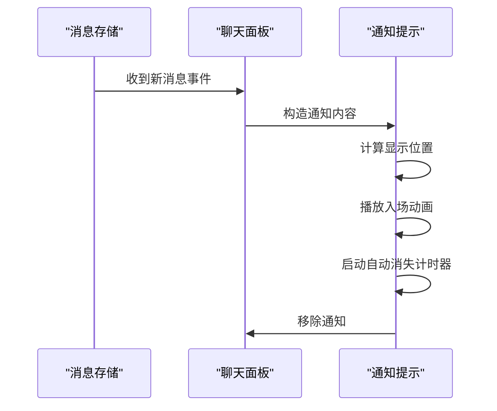
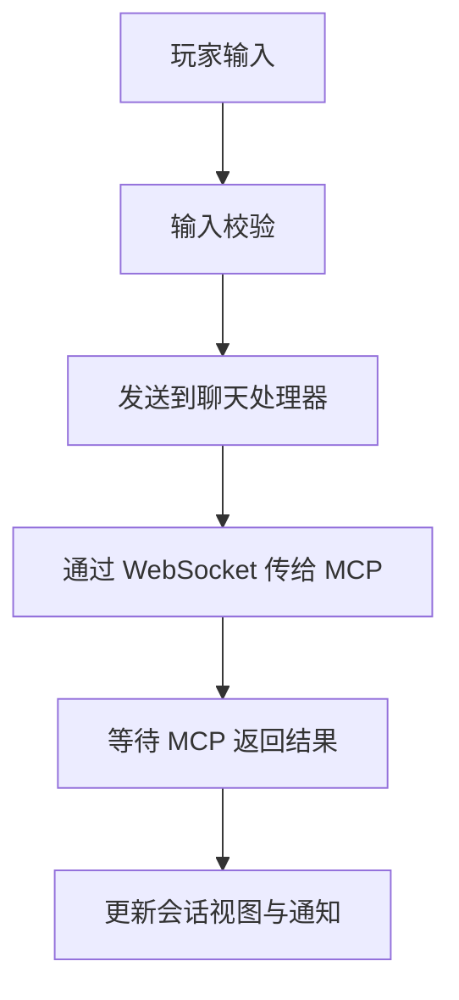
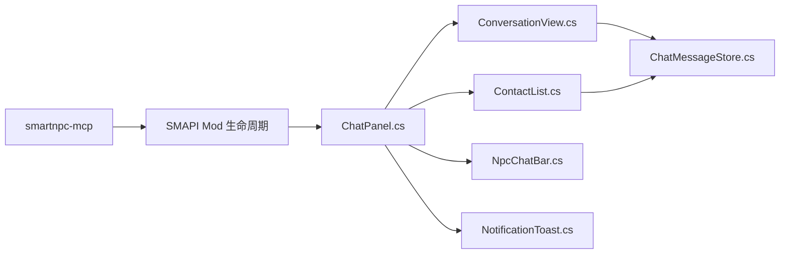

# 用户界面组件

<cite>
**本文引用的文件**   
- [README.md](file://SmartNPC/README.md)
- [main.go](file://SmartNPC/smartnpc-mcp/cmd/smartnpc-mcp/main.go)
- [adapter.go](file://SmartNPC/smartnpc-mcp/adapters/stardew/adapter.go)
- [ChatPanel.cs](file://SmartNPC/smartnpc-mod/UI/ChatPanel.cs)
- [ConversationView.cs](file://SmartNPC/smartnpc-mod/UI/ConversationView.cs)
- [ContactList.cs](file://SmartNPC/smartnpc-mod/UI/ContactList.cs)
- [NotificationToast.cs](file://SmartNPC/smartnpc-mod/UI/NotificationToast.cs)
- [NpcChatBar.cs](file://SmartNPC/smartnpc-mod/UI/NpcChatBar.cs)
- [ChatMessageStore.cs](file://SmartNPC/smartnpc-mod/UI/ChatMessageStore.cs)
</cite>

## 目录
1. [引言](#引言)
2. [项目结构](#项目结构)
3. [核心组件](#核心组件)
4. [架构总览](#架构总览)
5. [详细组件分析](#详细组件分析)
6. [依赖关系分析](#依赖关系分析)
7. [性能与渲染考量](#性能与渲染考量)
8. [故障排查指南](#故障排查指南)
9. [结论](#结论)
10. [附录：UI 定制指南](#附录ui-定制指南)

## 引言
本文件聚焦 SmartNPC 项目中“QQ 风格聊天面板”这一游戏内用户界面子系统，目标是帮助开发者与维护者理解其设计理念、数据流、渲染机制和可扩展点。文档同时覆盖会话视图、联系人列表、通知 Toast、消息存储以及 SMAPI Mod 与 MCP 层之间的交互边界。

该 UI 由 C# SMAPI Mod 提供，负责在游戏运行时绘制聊天面板、消息气泡、头像、时间戳、未读标记和弹出通知；Go 侧的 `smartnpc-mcp` 则承担工具注册、协议转换、Hermes 事件转发等职责，不直接渲染 UI。

## 项目结构
本次文档主要关注以下 UI 相关文件：

- `SmartNPC/smartnpc-mod/UI/ChatPanel.cs`：主面板容器、布局与可见性控制
- `SmartNPC/smartnpc-mod/UI/ConversationView.cs`：会话消息渲染
- `SmartNPC/smartnpc-mod/UI/ContactList.cs`：联系人列表与 NPC 状态指示
- `SmartNPC/smartnpc-mod/UI/NotificationToast.cs`：弹出通知与动画
- `SmartNPC/smartnpc-mod/UI/NpcChatBar.cs`：NPC 输入条与快捷操作
- `SmartNPC/smartnpc-mod/UI/ChatMessageStore.cs`：消息缓冲与滚动策略

图表来源
- [README.md:1-120](file://SmartNPC/README.md#L1-L120)

章节来源
- [README.md:1-120](file://SmartNPC/README.md#L1-L120)

## 核心组件
- 聊天面板：承载整体布局、显示开关、侧边栏与主区域。
- 会话视图：根据当前会话渲染消息气泡、头像、时间戳和图片预览。
- 联系人列表：展示 NPC 列表、在线状态、未读数、快速切换目标。
- 通知系统：在右下角或指定位置弹出简短提示，支持自动消失。
- NPC 输入条：用于玩家输入对话内容、发送消息或执行快捷动作。
- 消息存储：维护会话历史、未读计数、滚动锚点和清理策略。

章节来源
- [ChatPanel.cs](file://SmartNPC/smartnpc-mod/UI/ChatPanel.cs)
- [ConversationView.cs](file://SmartNPC/smartnpc-mod/UI/ConversationView.cs)
- [ContactList.cs](file://SmartNPC/smartnpc-mod/UI/ContactList.cs)
- [NotificationToast.cs](file://SmartNPC/smartnpc-mod/UI/NotificationToast.cs)
- [NpcChatBar.cs](file://SmartNPC/smartnpc-mod/UI/NpcChatBar.cs)
- [ChatMessageStore.cs](file://SmartNPC/smartnpc-mod/UI/ChatMessageStore.cs)

## 架构总览
从端到端看，UI 是 SMAPI Mod 的一部分，位于游戏线程中；MCP 层通过 WebSocket 接收事件并驱动游戏状态变化，再由 UI 反映给用户。

图表来源
- [README.md:1-120](file://SmartNPC/README.md#L1-L120)
- [main.go:1-120](file://SmartNPC/smartnpc-mcp/cmd/smartnpc-mcp/main.go#L1-L120)
- [adapter.go:1-163](file://SmartNPC/smartnpc-mcp/adapters/stardew/adapter.go#L1-L163)

章节来源
- [README.md:1-120](file://SmartNPC/README.md#L1-L120)
- [main.go:1-120](file://SmartNPC/smartnpc-mcp/cmd/smartnpc-mcp/main.go#L1-L120)
- [adapter.go:1-163](file://SmartNPC/smartnpc-mcp/adapters/stardew/adapter.go#L1-L163)

## 详细组件分析

### QQ 风格聊天面板设计
聊天面板采用类似即时通讯软件的面板形态：左侧为联系人列表，右侧为主会话区，底部可放置输入框或快捷操作按钮。面板具备以下特征：

- 布局管理器
  - 使用 SMAPI 提供的 UI 控件组合出左右分栏结构。
  - 主区域可滚动，联系人列表固定宽度并可独立滚动。
  - 面板支持最小化、隐藏、停靠位置调整。
- 样式系统
  - 背景、边框、圆角、阴影、字体颜色由主题或配置决定。
  - 消息气泡区分“我方”与“对方”，并通过颜色、对齐方式表达归属。
- 响应式设计
  - 根据窗口大小动态调整面板尺寸。
  - 小屏下优先保留会话区，联系人列表可折叠。
  - 长文本换行、图片缩放、头像比例适配。

图表来源
- [ChatPanel.cs](file://SmartNPC/smartnpc-mod/UI/ChatPanel.cs)

章节来源
- [ChatPanel.cs](file://SmartNPC/smartnpc-mod/UI/ChatPanel.cs)

### 会话视图渲染机制：ConversationView
`ConversationView` 负责把消息数据转换成游戏内可见元素。其核心流程包括：

- 消息气泡显示
  - 按消息方向（发送方/接收方）选择气泡样式。
  - 对纯文本进行自动换行，对富文本或表情进行占位渲染。
  - 同一发送方的多条短消息可合并为连续气泡，避免视觉碎片化。
- 时间戳格式化
  - 根据游戏内时间与本地设置生成可读时间字符串。
  - 当消息间隔较小时，可选择隐藏重复时间戳。
  - 支持相对时间显示，例如“刚刚”“几分钟前”。
- 头像加载
  - 从 NPC 资源路径或缓存中获取头像纹理。
  - 头像失败时降级为默认头像或首字母图标。
  - 头像与气泡间距、圆角、尺寸受主题影响。
- 图片预览
  - 对图片消息进行缩略图渲染。
  - 点击后进入全屏或放大预览模式。
  - 大图异步加载，避免阻塞渲染帧。

图表来源
- [ConversationView.cs](file://SmartNPC/smartnpc-mod/UI/ConversationView.cs)
- [ChatMessageStore.cs](file://SmartNPC/smartnpc-mod/UI/ChatMessageStore.cs)

章节来源
- [ConversationView.cs](file://SmartNPC/smartnpc-mod/UI/ConversationView.cs)
- [ChatMessageStore.cs](file://SmartNPC/smartnpc-mod/UI/ChatMessageStore.cs)

### 联系人列表管理逻辑：ContactList
`ContactList` 维护 NPC 联系人集合，并提供快速切换能力：

- NPC 状态指示
  - 根据 NPC 是否在线、是否可对话、是否在附近等状态显示不同图标。
  - 支持离线、忙碌、空闲、正在对话等状态分类。
- 在线标记
  - 使用绿色圆点或其他高亮标识当前在线 NPC。
  - 在线状态随 SMAPI 事件更新，避免手动刷新。
- 未读与提醒
  - 未读消息数显示在联系人条目右侧。
  - 新消息到达时高亮联系人名称或添加提醒标记。
- 快速切换功能
  - 点击联系人直接切换当前会话。
  - 支持键盘快捷键或滚轮快速浏览。
  - 搜索过滤时可缩小列表范围。

图表来源
- [ContactList.cs](file://SmartNPC/smartnpc-mod/UI/ContactList.cs)
- [ChatMessageStore.cs](file://SmartNPC/smartnpc-mod/UI/ChatMessageStore.cs)

章节来源
- [ContactList.cs](file://SmartNPC/smartnpc-mod/UI/ContactList.cs)
- [ChatMessageStore.cs](file://SmartNPC/smartnpc-mod/UI/ChatMessageStore.cs)

### 通知系统工作原理：NotificationToast
`NotificationToast` 负责向玩家推送轻量级通知，常见场景包括：

- 消息推送
  - 新消息、系统提示、NPC 主动问候等。
  - 支持按来源分类显示，例如私聊、群聊、系统。
- 动画效果
  - 从屏幕边缘滑入、淡入淡出、轻微弹跳。
  - 多通知时按队列依次出现，避免重叠遮挡。
- 自动消失机制
  - 默认停留若干秒后自动移除。
  - 鼠标悬停可延长显示时间。
  - 重要通知支持手动关闭或置顶。

图表来源
- [NotificationToast.cs](file://SmartNPC/smartnpc-mod/UI/NotificationToast.cs)
- [ChatPanel.cs](file://SmartNPC/smartnpc-mod/UI/ChatPanel.cs)
- [ChatMessageStore.cs](file://SmartNPC/smartnpc-mod/UI/ChatMessageStore.cs)

章节来源
- [NotificationToast.cs](file://SmartNPC/smartnpc-mod/UI/NotificationToast.cs)
- [ChatPanel.cs](file://SmartNPC/smartnpc-mod/UI/ChatPanel.cs)
- [ChatMessageStore.cs](file://SmartNPC/smartnpc-mod/UI/ChatMessageStore.cs)

### NPC 输入条：NpcChatBar
`NpcChatBar` 提供玩家与 NPC 对话的输入入口，并与会话视图联动：

- 输入框与发送按钮
  - 支持回车发送、Shift 换行。
  - 输入校验后触发聊天面板发送流程。
- 快捷操作
  - 快捷表情、常用语句、最近联系人。
  - 结合 SMAPI 事件执行简单动作。
- 与 MCP 层的边界
  - 输入最终转化为 MCP 工具调用或 WS 事件。
  - UI 只负责收集输入与反馈结果，不负责业务决策。

图表来源
- [NpcChatBar.cs](file://SmartNPC/smartnpc-mod/UI/NpcChatBar.cs)
- [ConversationView.cs](file://SmartNPC/smartnpc-mod/UI/ConversationView.cs)

章节来源
- [NpcChatBar.cs](file://SmartNPC/smartnpc-mod/UI/NpcChatBar.cs)
- [ConversationView.cs](file://SmartNPC/smartnpc-mod/UI/ConversationView.cs)

### 消息存储：ChatMessageStore
`ChatMessageStore` 作为 UI 层的数据中心：

- 会话历史
  - 按 NPC 维度保存消息序列。
  - 支持分页加载与历史裁剪。
- 未读计数
  - 记录每个 NPC 的未读数量。
  - 打开会话后清零或累积已读增量。
- 滚动锚点
  - 新消息到达时保持滚动到底部。
  - 用户向上查看历史时不自动滚动。
- 清理策略
  - 限制单会话最大消息数。
  - 长时间未活跃会话可延迟加载或压缩。

章节来源
- [ChatMessageStore.cs](file://SmartNPC/smartnpc-mod/UI/ChatMessageStore.cs)

## 依赖关系分析
UI 层内部依赖清晰：聊天面板聚合会话视图、联系人列表、输入条和通知；会话视图依赖消息存储；联系人列表也依赖消息存储获取未读信息。外部依赖方面，UI 由 SMAPI Mod 驱动，而业务数据来自 MCP 层下发的 WebSocket 事件。

图表来源
- [ChatPanel.cs](file://SmartNPC/smartnpc-mod/UI/ChatPanel.cs)
- [ConversationView.cs](file://SmartNPC/smartnpc-mod/UI/ConversationView.cs)
- [ContactList.cs](file://SmartNPC/smartnpc-mod/UI/ContactList.cs)
- [NotificationToast.cs](file://SmartNPC/smartnpc-mod/UI/NotificationToast.cs)
- [NpcChatBar.cs](file://SmartNPC/smartnpc-mod/UI/NpcChatBar.cs)
- [ChatMessageStore.cs](file://SmartNPC/smartnpc-mod/UI/ChatMessageStore.cs)
- [main.go:1-120](file://SmartNPC/smartnpc-mcp/cmd/smartnpc-mcp/main.go#L1-L120)
- [adapter.go:1-163](file://SmartNPC/smartnpc-mcp/adapters/stardew/adapter.go#L1-L163)

章节来源
- [main.go:1-120](file://SmartNPC/smartnpc-mcp/cmd/smartnpc-mcp/main.go#L1-L120)
- [adapter.go:1-163](file://SmartNPC/smartnpc-mcp/adapters/stardew/adapter.go#L1-L163)

## 性能与渲染考量
- 渲染批次
  - 批量绘制消息气泡，减少每帧多次 UI 重建。
  - 头像与图片使用纹理缓存，避免重复解码。
- 文本测量
  - 提前计算换行高度，降低滚动抖动。
  - 对长文本进行截断或折叠。
- 滚动性能
  - 仅重绘可视区域内的消息。
  - 大会话使用虚拟滚动或懒加载。
- 网络与异步
  - 图片下载与大图预览放在后台任务。
  - 网络失败时显示占位图，不阻塞主渲染循环。
- 内存管理
  - 限制会话消息上限。
  - 长期不活跃的会话释放部分资源。

[本节为通用性能建议，不直接分析具体代码文件]

## 故障排查指南
常见问题与定位思路：

- 聊天面板不显示
  - 检查 SMAPI Mod 是否成功加载。
  - 确认面板可见性开关未被其他 Mod 覆盖。
  - 查看控制台日志中是否有 UI 初始化错误。
- 消息不更新
  - 检查 WebSocket 连接是否正常。
  - 确认 MCP 层是否收到事件并下发动作。
  - 验证 `ChatMessageStore` 是否收到新消息事件。
- 头像不显示
  - 检查 NPC 头像资源路径是否正确。
  - 确认纹理加载是否失败并降级。
- 通知不消失
  - 检查定时器是否被意外取消。
  - 确认通知队列没有堆积过多导致后续通知无法显示。
- 输入无响应
  - 检查输入焦点是否被其他 UI 占用。
  - 确认发送按钮绑定事件是否生效。

章节来源
- [ChatPanel.cs](file://SmartNPC/smartnpc-mod/UI/ChatPanel.cs)
- [ConversationView.cs](file://SmartNPC/smartnpc-mod/UI/ConversationView.cs)
- [ContactList.cs](file://SmartNPC/smartnpc-mod/UI/ContactList.cs)
- [NotificationToast.cs](file://SmartNPC/smartnpc-mod/UI/NotificationToast.cs)
- [NpcChatBar.cs](file://SmartNPC/smartnpc-mod/UI/NpcChatBar.cs)
- [ChatMessageStore.cs](file://SmartNPC/smartnpc-mod/UI/ChatMessageStore.cs)

## 结论
SmartNPC 的 QQ 风格聊天面板以 SMAPI Mod 为载体，将 MCP 层的事件与工具调用转化为直观的游戏内 UI。会话视图、联系人列表、通知系统和输入条共同构成完整的即时通信体验。通过清晰的组件分工、消息存储抽象和 SMAPI/MCP 边界划分，UI 既易于扩展，也能与后端 AI 行为解耦。未来可在主题系统、虚拟化滚动、多语言与无障碍支持方面继续增强。

[本节为总结性内容，不直接分析具体代码文件]

## 附录：UI 定制指南

### 主题修改
- 背景与边框
  - 修改面板背景色、透明度、边框圆角和阴影强度。
  - 区分白天与夜晚主题时，可同时调整文字对比度。
- 消息气泡
  - 定义“我方”“对方”气泡的背景色、边框色、气泡尾方向。
  - 设置气泡内边距、行高和最大宽度。
- 主题切换
  - 提供预设主题，如浅色、深色、高对比度。
  - 支持按游戏内时间自动切换主题。

### 字体设置
- 字体家族
  - 支持中文、日文、俄文等多语言字体映射。
  - 提供回退字体链，避免缺字问题。
- 字号与行距
  - 根据分辨率和缩放比例调整基础字号。
  - 允许用户微调行距和字符间距。
- 表情与特殊符号
  - 为表情符号使用专用字形或贴图。
  - 对长表情序列进行换行保护。

### 颜色配置
- 语义色
  - 定义成功、警告、错误、信息等不同语义颜色。
  - 使用统一调色板，保证通知、链接、强调文本一致。
- 状态色
  - 在线、离线、忙碌、不可用等状态使用不同标记色。
  - 未读消息使用高亮色，已读消息恢复中性色。
- 可访问性
  - 确保文字与背景对比度符合无障碍标准。
  - 提供色盲友好配色方案。

章节来源
- [ChatPanel.cs](file://SmartNPC/smartnpc-mod/UI/ChatPanel.cs)
- [ConversationView.cs](file://SmartNPC/smartnpc-mod/UI/ConversationView.cs)
- [ContactList.cs](file://SmartNPC/smartnpc-mod/UI/ContactList.cs)
- [NotificationToast.cs](file://SmartNPC/smartnpc-mod/UI/NotificationToast.cs)
- [NpcChatBar.cs](file://SmartNPC/smartnpc-mod/UI/NpcChatBar.cs)
- [ChatMessageStore.cs](file://SmartNPC/smartnpc-mod/UI/ChatMessageStore.cs)