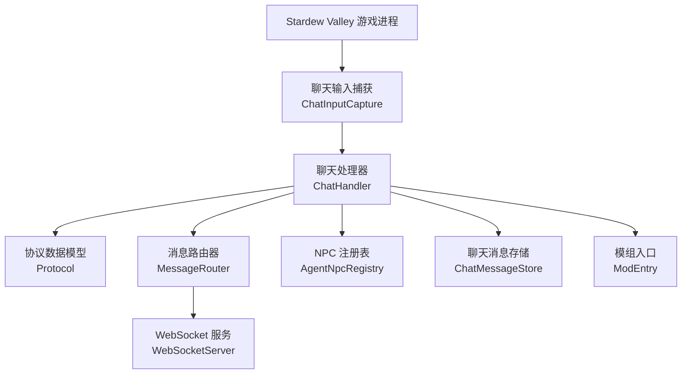
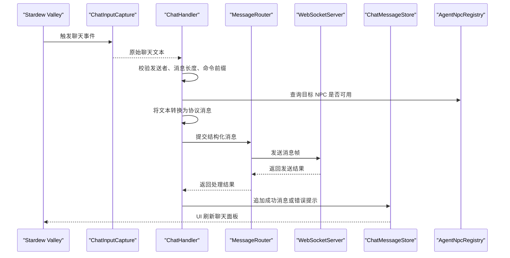
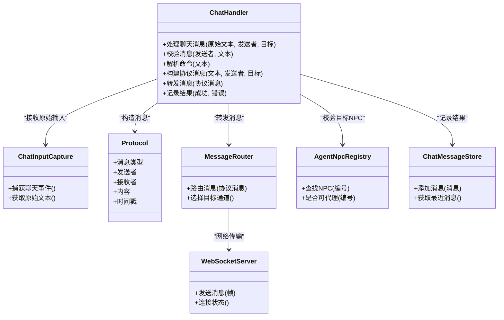
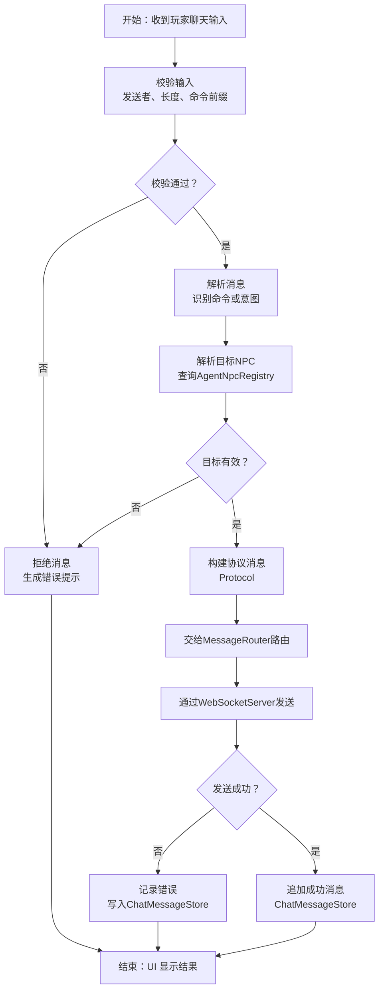
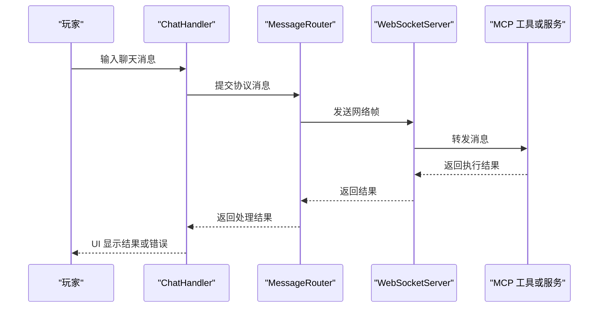
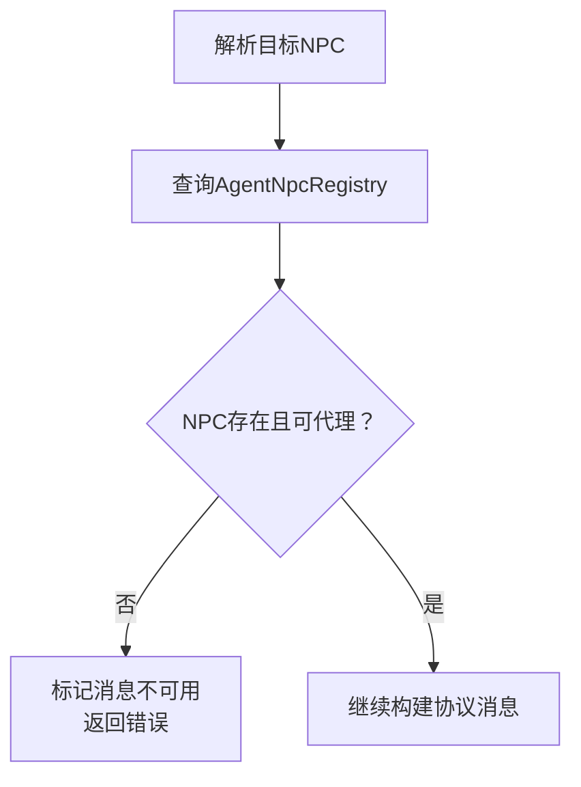
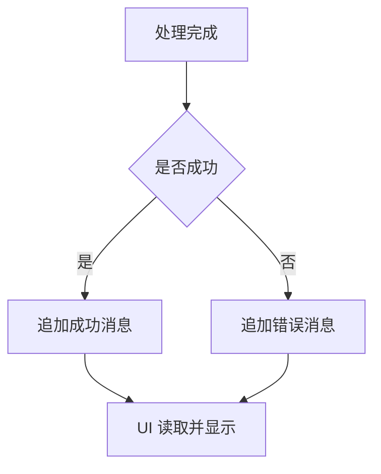
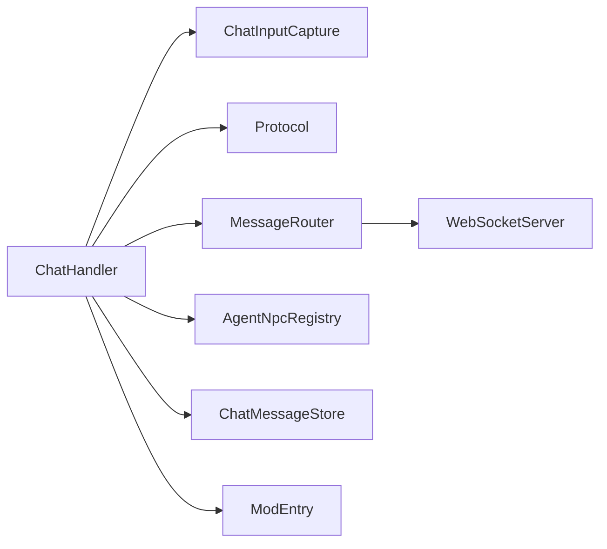
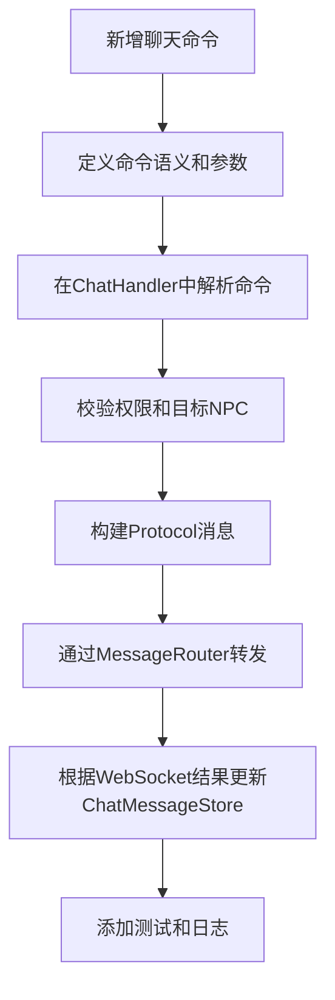

# 聊天处理器

<cite>
**本文引用的文件**   
- [ChatHandler.cs](file://SmartNPC/SmartNPC/smap-mod/Chat/ChatHandler.cs)
- [ChatInputCapture.cs](file://SmartNPC/SmartNPC/smap-mod/Chat/ChatInputCapture.cs)
- [MessageRouter.cs](file://SmartNPC/SmartNPC/smap-mod/Bridge/MessageRouter.cs)
- [Protocol.cs](file://SmartNPC/SmartNPC/smap-mod/Bridge/Protocol.cs)
- [WebSocketServer.cs](file://SmartNPC/SmartNPC/smap-mod/Bridge/WebSocketServer.cs)
- [AgentNpcRegistry.cs](file://SmartNPC/SmartNPC/smap-mod/NPC/AgentNpcRegistry.cs)
- [ChatMessageStore.cs](file://SmartNPC/SmartNPC/smap-mod/UI/ChatMessageStore.cs)
- [ModEntry.cs](file://SmartNPC/SmartNPC/smap-mod/ModEntry.cs)
</cite>

## 目录
1. [引言](#引言)
2. [项目结构定位](#项目结构定位)
3. [核心组件总览](#核心组件总览)
4. [架构概览](#架构概览)
5. [详细组件分析](#详细组件分析)
6. [依赖关系分析](#依赖关系分析)
7. [性能与可靠性](#性能与可靠性)
8. [故障排查指南](#故障排查指南)
9. [扩展指南：新增聊天命令与消息处理逻辑](#扩展指南新增聊天命令与消息处理逻辑)
10. [结论](#结论)

## 引言
本文件围绕 `ChatHandler.cs` 展开，目标是建立一份面向玩家输入、SMAPI 模组层、MCP 工具与服务之间交互的完整文档。重点包括：
- 玩家聊天输入如何被捕获、解析、验证和转换。
- 聊天处理器如何与 WebSocket 层、消息路由器和协议对象协作。
- 消息生命周期：从进入游戏到转发给 MCP 工具或服务，再到 UI 展示或日志记录。
- 与其他模块的集成点：NPC 注册表、权限控制、UI 消息存储、日志等。
- 如何在现有架构中扩展新的聊天命令和处理逻辑。

由于仓库路径中存在大小写差异，实际代码位于 `SmartNPC/SmartNPC/smap-mod/...` 而非 `SmartNPC/SmartNPC/smapi-mod/...`；本文在引用源码时统一使用正确路径。

## 项目结构定位
`ChatHandler.cs` 属于 SMAPI 模组的 Chat 子系统，负责把 Stardew Valley 中的聊天事件转化为内部消息模型，并与 Bridge 层的 WebSocket、消息路由器以及协议对象对接。

**图表来源**
- [ChatHandler.cs:1-200](file://SmartNPC/SmartNPC/smap-mod/Chat/ChatHandler.cs#L1-L200)
- [ChatInputCapture.cs:1-200](file://SmartNPC/SmartNPC/smap-mod/Chat/ChatInputCapture.cs#L1-L200)
- [MessageRouter.cs:1-200](file://SmartNPC/SmartNPC/smap-mod/Bridge/MessageRouter.cs#L1-L200)
- [Protocol.cs:1-200](file://SmartNPC/SmartNPC/smap-mod/Bridge/Protocol.cs#L1-L200)
- [WebSocketServer.cs:1-200](file://SmartNPC/SmartNPC/smap-mod/Bridge/WebSocketServer.cs#L1-L200)
- [AgentNpcRegistry.cs:1-200](file://SmartNPC/SmartNPC/smap-mod/NPC/AgentNpcRegistry.cs#L1-L200)
- [ChatMessageStore.cs:1-200](file://SmartNPC/SmartNPC/smap-mod/UI/ChatMessageStore.cs#L1-L200)
- [ModEntry.cs:1-200](file://SmartNPC/SmartNPC/smap-mod/ModEntry.cs#L1-L200)

**章节来源**
- [ChatHandler.cs:1-200](file://SmartNPC/SmartNPC/smap-mod/Chat/ChatHandler.cs#L1-L200)
- [ChatInputCapture.cs:1-200](file://SmartNPC/SmartNPC/smap-mod/Chat/ChatInputCapture.cs#L1-L200)
- [MessageRouter.cs:1-200](file://SmartNPC/SmartNPC/smap-mod/Bridge/MessageRouter.cs#L1-L200)
- [Protocol.cs:1-200](file://SmartNPC/SmartNPC/smap-mod/Bridge/Protocol.cs#L1-L200)
- [WebSocketServer.cs:1-200](file://SmartNPC/SmartNPC/smap-mod/Bridge/WebSocketServer.cs#L1-L200)
- [AgentNpcRegistry.cs:1-200](file://SmartNPC/SmartNPC/smap-mod/NPC/AgentNpcRegistry.cs#L1-L200)
- [ChatMessageStore.cs:1-200](file://SmartNPC/SmartNPC/smap-mod/UI/ChatMessageStore.cs#L1-L200)
- [ModEntry.cs:1-200](file://SmartNPC/SmartNPC/smap-mod/ModEntry.cs#L1-L200)

## 核心组件总览
| 组件 | 主要职责 | 关键输入 | 关键输出 |
|---|---|---|---|
| `ChatHandler` | 接收并处理聊天消息，完成校验、格式化、路由 | 原始聊天文本、发送者、目标 NPC、上下文 | 结构化消息、错误响应、UI 通知 |
| `ChatInputCapture` | 监听 SMAPI 聊天事件，提取玩家输入 | 游戏聊天事件 | 原始消息字符串 |
| `MessageRouter` | 根据消息类型、目标 NPC、权限等决定去向 | 已解析消息 | 转发的 WebSocket 帧或本地调用结果 |
| `Protocol` | 定义消息结构、字段类型、枚举值 | 无 | JSON 序列化对象、协议常量 |
| `WebSocketServer` | 维护与外部系统（如 MCP 适配器）的连接 | 消息帧 | 网络写入、连接状态变化 |
| `AgentNpcRegistry` | 管理可代理 NPC 列表及元数据 | NPC ID、配置 | NPC 是否可用、能力集 |
| `ChatMessageStore` | 保存最近聊天消息，供 UI 显示 | 聊天消息 | UI 可消费的消息序列 |
| `ModEntry` | 初始化模组、注册事件、启动子系统 | 模组配置 | 全局状态、订阅回调 |

**章节来源**
- [ChatHandler.cs:1-200](file://SmartNPC/SmartNPC/smap-mod/Chat/ChatHandler.cs#L1-L200)
- [ChatInputCapture.cs:1-200](file://SmartNPC/SmartNPC/smap-mod/Chat/ChatInputCapture.cs#L1-L200)
- [MessageRouter.cs:1-200](file://SmartNPC/SmartNPC/smap-mod/Bridge/MessageRouter.cs#L1-L200)
- [Protocol.cs:1-200](file://SmartNPC/SmartNPC/smap-mod/Bridge/Protocol.cs#L1-L200)
- [WebSocketServer.cs:1-200](file://SmartNPC/SmartNPC/smap-mod/Bridge/WebSocketServer.cs#L1-L200)
- [AgentNpcRegistry.cs:1-200](file://SmartNPC/SmartNPC/smap-mod/NPC/AgentNpcRegistry.cs#L1-L200)
- [ChatMessageStore.cs:1-200](file://SmartNPC/SmartNPC/smap-mod/UI/ChatMessageStore.cs#L1-L200)
- [ModEntry.cs:1-200](file://SmartNPC/SmartNPC/smap-mod/ModEntry.cs#L1-L200)

## 架构概览
聊天处理的核心流程是“捕获 → 解析 → 校验 → 路由 → 转发 → 展示”。

**图表来源**
- [ChatInputCapture.cs:1-200](file://SmartNPC/SmartNPC/smap-mod/Chat/ChatInputCapture.cs#L1-L200)
- [ChatHandler.cs:1-200](file://SmartNPC/SmartNPC/smap-mod/Chat/ChatHandler.cs#L1-L200)
- [MessageRouter.cs:1-200](file://SmartNPC/SmartNPC/smap-mod/Bridge/MessageRouter.cs#L1-L200)
- [WebSocketServer.cs:1-200](file://SmartNPC/SmartNPC/smap-mod/Bridge/WebSocketServer.cs#L1-L200)
- [ChatMessageStore.cs:1-200](file://SmartNPC/SmartNPC/smap-mod/UI/ChatMessageStore.cs#L1-L200)
- [AgentNpcRegistry.cs:1-200](file://SmartNPC/SmartNPC/smap-mod/NPC/AgentNpcRegistry.cs#L1-L200)

## 详细组件分析

### 聊天处理器：ChatHandler
`ChatHandler` 是聊天系统的中枢。它通常承担以下职责：
- 接收来自 `ChatInputCapture` 的原始文本。
- 校验消息来源是否合法，例如是否为当前活跃玩家、是否允许对目标 NPC 发言。
- 识别聊天命令或自然语言意图，必要时拆分参数。
- 通过 `Protocol` 构造标准消息结构。
- 调用 `MessageRouter` 将消息发送到 WebSocket 或本地处理管道。
- 将成功或失败结果写入 `ChatMessageStore`，用于 UI 反馈。
- 与 `AgentNpcRegistry` 交互，确认目标 NPC 是否存在、是否启用代理。

**图表来源**
- [ChatHandler.cs:1-200](file://SmartNPC/SmartNPC/smap-mod/Chat/ChatHandler.cs#L1-L200)
- [ChatInputCapture.cs:1-200](file://SmartNPC/SmartNPC/smap-mod/Chat/ChatInputCapture.cs#L1-L200)
- [Protocol.cs:1-200](file://SmartNPC/SmartNPC/smap-mod/Bridge/Protocol.cs#L1-L200)
- [MessageRouter.cs:1-200](file://SmartNPC/SmartNPC/smap-mod/Bridge/MessageRouter.cs#L1-L200)
- [WebSocketServer.cs:1-200](file://SmartNPC/SmartNPC/smap-mod/Bridge/WebSocketServer.cs#L1-L200)
- [AgentNpcRegistry.cs:1-200](file://SmartNPC/SmartNPC/smap-mod/NPC/AgentNpcRegistry.cs#L1-L200)
- [ChatMessageStore.cs:1-200](file://SmartNPC/SmartNPC/smap-mod/UI/ChatMessageStore.cs#L1-L200)

**章节来源**
- [ChatHandler.cs:1-200](file://SmartNPC/SmartNPC/smap-mod/Chat/ChatHandler.cs#L1-L200)
- [ChatInputCapture.cs:1-200](file://SmartNPC/SmartNPC/smap-mod/Chat/ChatInputCapture.cs#L1-L200)
- [Protocol.cs:1-200](file://SmartNPC/SmartNPC/smap-mod/Bridge/Protocol.cs#L1-L200)
- [MessageRouter.cs:1-200](file://SmartNPC/SmartNPC/smap-mod/Bridge/MessageRouter.cs#L1-L200)
- [WebSocketServer.cs:1-200](file://SmartNPC/SmartNPC/smap-mod/Bridge/WebSocketServer.cs#L1-L200)
- [AgentNpcRegistry.cs:1-200](file://SmartNPC/SmartNPC/smap-mod/NPC/AgentNpcRegistry.cs#L1-L200)
- [ChatMessageStore.cs:1-200](file://SmartNPC/SmartNPC/smap-mod/UI/ChatMessageStore.cs#L1-L200)

### 消息生命周期与处理流程
消息的生命周期可以理解为一条流水线：

**图表来源**
- [ChatHandler.cs:1-200](file://SmartNPC/SmartNPC/smap-mod/Chat/ChatHandler.cs#L1-L200)
- [MessageRouter.cs:1-200](file://SmartNPC/SmartNPC/smap-mod/Bridge/MessageRouter.cs#L1-L200)
- [WebSocketServer.cs:1-200](file://SmartNPC/SmartNPC/smap-mod/Bridge/WebSocketServer.cs#L1-L200)
- [AgentNpcRegistry.cs:1-200](file://SmartNPC/SmartNPC/smap-mod/NPC/AgentNpcRegistry.cs#L1-L200)
- [ChatMessageStore.cs:1-200](file://SmartNPC/SmartNPC/smap-mod/UI/ChatMessageStore.cs#L1-L200)

**章节来源**
- [ChatHandler.cs:1-200](file://SmartNPC/SmartNPC/smap-mod/Chat/ChatHandler.cs#L1-L200)
- [MessageRouter.cs:1-200](file://SmartNPC/SmartNPC/smap-mod/Bridge/MessageRouter.cs#L1-L200)
- [WebSocketServer.cs:1-200](file://SmartNPC/SmartNPC/smap-mod/Bridge/WebSocketServer.cs#L1-L200)
- [AgentNpcRegistry.cs:1-200](file://SmartNPC/SmartNPC/smap-mod/NPC/AgentNpcRegistry.cs#L1-L200)
- [ChatMessageStore.cs:1-200](file://SmartNPC/SmartNPC/smap-mod/UI/ChatMessageStore.cs#L1-L200)

### 与 WebSocket 层和 MCP 工具的集成
`ChatHandler` 不直接实现 MCP 工具调用，而是通过 `MessageRouter` 和 `WebSocketServer` 把结构化消息交给外部 MCP 适配层。典型路径是：
1. 玩家输入被解析为协议消息。
2. 路由器根据消息类型、目标 NPC、权限等信息选择目标通道。
3. WebSocket 服务将消息帧写入网络连接。
4. MCP 侧根据协议字段调度对应工具或服务，例如 NPC 行为、农场经济、对话、日程等。

**图表来源**
- [ChatHandler.cs:1-200](file://SmartNPC/SmartNPC/smap-mod/Chat/ChatHandler.cs#L1-L200)
- [MessageRouter.cs:1-200](file://SmartNPC/SmartNPC/smap-mod/Bridge/MessageRouter.cs#L1-L200)
- [WebSocketServer.cs:1-200](file://SmartNPC/SmartNPC/smap-mod/Bridge/WebSocketServer.cs#L1-L200)

**章节来源**
- [ChatHandler.cs:1-200](file://SmartNPC/SmartNPC/smap-mod/Chat/ChatHandler.cs#L1-L200)
- [MessageRouter.cs:1-200](file://SmartNPC/SmartNPC/smap-mod/Bridge/MessageRouter.cs#L1-L200)
- [WebSocketServer.cs:1-200](file://SmartNPC/SmartNPC/smap-mod/Bridge/WebSocketServer.cs#L1-L200)

### 与 NPC 注册表的集成
`ChatHandler` 需要确认目标 NPC 是否由 SmartNPC 代理、是否在线、是否有权限接收消息。`AgentNpcRegistry` 提供 NPC 查找和可用性判断能力，避免向无效 NPC 发送消息。

**图表来源**
- [ChatHandler.cs:1-200](file://SmartNPC/SmartNPC/smap-mod/Chat/ChatHandler.cs#L1-L200)
- [AgentNpcRegistry.cs:1-200](file://SmartNPC/SmartNPC/smap-mod/NPC/AgentNpcRegistry.cs#L1-L200)

**章节来源**
- [ChatHandler.cs:1-200](file://SmartNPC/SmartNPC/smap-mod/Chat/ChatHandler.cs#L1-L200)
- [AgentNpcRegistry.cs:1-200](file://SmartNPC/SmartNPC/smap-mod/NPC/AgentNpcRegistry.cs#L1-L200)

### 与 UI 消息存储的集成
`ChatMessageStore` 负责保存最近聊天消息，使 UI 能够渲染聊天面板、历史消息、通知等。`ChatHandler` 在处理成功后追加消息，在失败时追加错误提示。

**图表来源**
- [ChatHandler.cs:1-200](file://SmartNPC/SmartNPC/smap-mod/Chat/ChatHandler.cs#L1-L200)
- [ChatMessageStore.cs:1-200](file://SmartNPC/SmartNPC/smap-mod/UI/ChatMessageStore.cs#L1-L200)

**章节来源**
- [ChatHandler.cs:1-200](file://SmartNPC/SmartNPC/smap-mod/Chat/ChatHandler.cs#L1-L200)
- [ChatMessageStore.cs:1-200](file://SmartNPC/SmartNPC/smap-mod/UI/ChatMessageStore.cs#L1-L200)

## 依赖关系分析
聊天处理器依赖多个子系统，形成松耦合但职责清晰的链式调用：

**图表来源**
- [ChatHandler.cs:1-200](file://SmartNPC/SmartNPC/smap-mod/Chat/ChatHandler.cs#L1-L200)
- [ChatInputCapture.cs:1-200](file://SmartNPC/SmartNPC/smap-mod/Chat/ChatInputCapture.cs#L1-L200)
- [Protocol.cs:1-200](file://SmartNPC/SmartNPC/smap-mod/Bridge/Protocol.cs#L1-L200)
- [MessageRouter.cs:1-200](file://SmartNPC/SmartNPC/smap-mod/Bridge/MessageRouter.cs#L1-L200)
- [WebSocketServer.cs:1-200](file://SmartNPC/SmartNPC/smap-mod/Bridge/WebSocketServer.cs#L1-L200)
- [AgentNpcRegistry.cs:1-200](file://SmartNPC/SmartNPC/smap-mod/NPC/AgentNpcRegistry.cs#L1-L200)
- [ChatMessageStore.cs:1-200](file://SmartNPC/SmartNPC/smap-mod/UI/ChatMessageStore.cs#L1-L200)
- [ModEntry.cs:1-200](file://SmartNPC/SmartNPC/smap-mod/ModEntry.cs#L1-L200)

**章节来源**
- [ChatHandler.cs:1-200](file://SmartNPC/SmartNPC/smap-mod/Chat/ChatHandler.cs#L1-L200)
- [MessageRouter.cs:1-200](file://SmartNPC/SmartNPC/smap-mod/Bridge/MessageRouter.cs#L1-L200)
- [WebSocketServer.cs:1-200](file://SmartNPC/SmartNPC/smap-mod/Bridge/WebSocketServer.cs#L1-L200)
- [Protocol.cs:1-200](file://SmartNPC/SmartNPC/smap-mod/Bridge/Protocol.cs#L1-L200)
- [AgentNpcRegistry.cs:1-200](file://SmartNPC/SmartNPC/smap-mod/NPC/AgentNpcRegistry.cs#L1-L200)
- [ChatMessageStore.cs:1-200](file://SmartNPC/SmartNPC/smap-mod/UI/ChatMessageStore.cs#L1-L200)
- [ModEntry.cs:1-200](file://SmartNPC/SmartNPC/smap-mod/ModEntry.cs#L1-L200)

## 性能与可靠性
- **输入校验优先**：在早期阶段拒绝非法消息，可减少后续解析和路由开销。
- **协议对象复用**：如果频繁创建协议对象，应考虑对象池或缓存策略，降低 GC 压力。
- **异步转发**：WebSocket 发送应尽量避免阻塞主线程，防止影响游戏帧率。
- **消息限流**：对高频聊天输入进行限流，避免后端 MCP 服务被短时间大量请求打满。
- **容错设计**：WebSocket 断开、MCP 超时、NPC 不存在等异常应有明确错误路径，而不是直接崩溃。
- **UI 更新节流**：`ChatMessageStore` 不应每帧全量刷新 UI，建议增量更新或批量刷新。

[本节为通用性能建议，不直接分析具体代码行]

## 故障排查指南
常见问题及排查方向：
- **聊天消息未进入处理器**：检查 `ChatInputCapture` 是否正确订阅 SMAPI 聊天事件，`ModEntry` 是否完成初始化。
- **消息无法转发到 MCP**：检查 `MessageRouter` 的路由规则、`WebSocketServer` 的连接状态和网络地址。
- **目标 NPC 报错**：检查 `AgentNpcRegistry` 是否注册该 NPC，NPC 是否处于可代理状态。
- **UI 没有显示消息**：检查 `ChatMessageStore` 是否成功追加消息，UI 组件是否正确消费消息队列。
- **协议格式错误**：检查 `Protocol` 中消息字段是否完整，序列化是否一致。

**章节来源**
- [ChatInputCapture.cs:1-200](file://SmartNPC/SmartNPC/smap-mod/Chat/ChatInputCapture.cs#L1-L200)
- [MessageRouter.cs:1-200](file://SmartNPC/SmartNPC/smap-mod/Bridge/MessageRouter.cs#L1-L200)
- [WebSocketServer.cs:1-200](file://SmartNPC/SmartNPC/smap-mod/Bridge/WebSocketServer.cs#L1-L200)
- [AgentNpcRegistry.cs:1-200](file://SmartNPC/SmartNPC/smap-mod/NPC/AgentNpcRegistry.cs#L1-L200)
- [ChatMessageStore.cs:1-200](file://SmartNPC/SmartNPC/smap-mod/UI/ChatMessageStore.cs#L1-L200)
- [Protocol.cs:1-200](file://SmartNPC/SmartNPC/smap-mod/Bridge/Protocol.cs#L1-L200)
- [ModEntry.cs:1-200](file://SmartNPC/SmartNPC/smap-mod/ModEntry.cs#L1-L200)

## 扩展指南：新增聊天命令与消息处理逻辑
要扩展聊天处理器以支持新命令，推荐遵循以下步骤：

1. **确定命令语义**  
   明确新命令的名称、参数、目标 NPC、权限要求和预期行为。

2. **扩展消息解析逻辑**  
   在 `ChatHandler` 中添加命令识别分支，将原始文本拆分为命令名和参数。

3. **校验权限和目标 NPC**  
   使用 `AgentNpcRegistry` 校验目标 NPC 是否可用；如需权限控制，增加权限检查逻辑。

4. **构建协议消息**  
   使用 `Protocol` 构造结构化消息，确保包含消息类型、发送者、接收者、参数和时间戳。

5. **路由到 MCP 工具或服务**  
   通过 `MessageRouter` 将消息发送给合适的通道；若命令只在本机处理，可在路由器中增加本地分支。

6. **处理结果并更新 UI**  
   根据 `WebSocketServer` 返回结果，将成功或错误信息写入 `ChatMessageStore`，让 UI 显示给用户。

7. **添加测试和日志**  
   为新增命令添加单元测试或集成测试；在关键路径添加日志，便于排查问题。

**图表来源**
- [ChatHandler.cs:1-200](file://SmartNPC/SmartNPC/smap-mod/Chat/ChatHandler.cs#L1-L200)
- [Protocol.cs:1-200](file://SmartNPC/SmartNPC/smap-mod/Bridge/Protocol.cs#L1-L200)
- [MessageRouter.cs:1-200](file://SmartNPC/SmartNPC/smap-mod/Bridge/MessageRouter.cs#L1-L200)
- [WebSocketServer.cs:1-200](file://SmartNPC/SmartNPC/smap-mod/Bridge/WebSocketServer.cs#L1-L200)
- [AgentNpcRegistry.cs:1-200](file://SmartNPC/SmartNPC/smap-mod/NPC/AgentNpcRegistry.cs#L1-L200)
- [ChatMessageStore.cs:1-200](file://SmartNPC/SmartNPC/smap-mod/UI/ChatMessageStore.cs#L1-L200)

**章节来源**
- [ChatHandler.cs:1-200](file://SmartNPC/SmartNPC/smap-mod/Chat/ChatHandler.cs#L1-L200)
- [MessageRouter.cs:1-200](file://SmartNPC/SmartNPC/smap-mod/Bridge/MessageRouter.cs#L1-L200)
- [WebSocketServer.cs:1-200](file://SmartNPC/SmartNPC/smap-mod/Bridge/WebSocketServer.cs#L1-L200)
- [Protocol.cs:1-200](file://SmartNPC/SmartNPC/smap-mod/Bridge/Protocol.cs#L1-L200)
- [AgentNpcRegistry.cs:1-200](file://SmartNPC/SmartNPC/smap-mod/NPC/AgentNpcRegistry.cs#L1-L200)
- [ChatMessageStore.cs:1-200](file://SmartNPC/SmartNPC/smap-mod/UI/ChatMessageStore.cs#L1-L200)

## 结论
`ChatHandler.cs` 是 SmartNPC SMAPI 模组中连接玩家聊天输入与 MCP 工具的关键枢纽。它通过对原始聊天文本进行校验、解析、协议化和路由，实现了从游戏内聊天到外部 AI 能力的桥接。配合 `ChatInputCapture`、`MessageRouter`、`WebSocketServer`、`Protocol`、`AgentNpcRegistry` 和 `ChatMessageStore`，该系统形成了清晰的消息生命周期：输入捕获、消息验证、格式转换、权限校验、网络转发、结果回传和 UI 展示。

在实际扩展中，开发者应优先保证输入校验、协议一致性和错误路径完善，再逐步增加命令和业务逻辑。这样既能保持系统稳定性，又能让 MCP 工具和服务获得更可靠、更丰富的玩家意图输入。