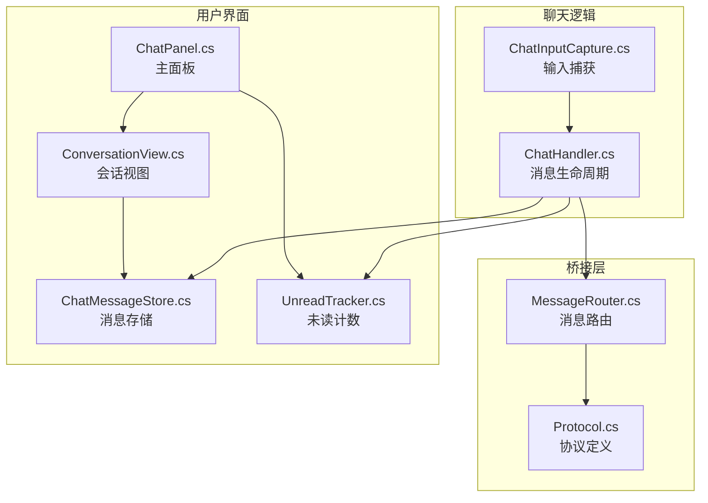
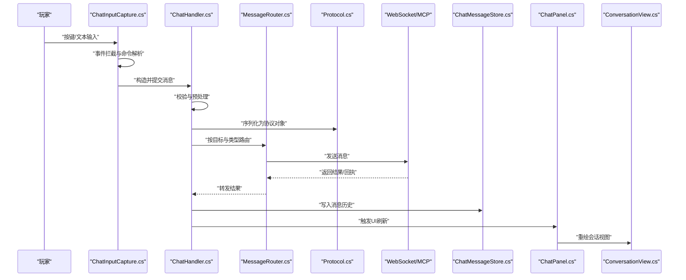
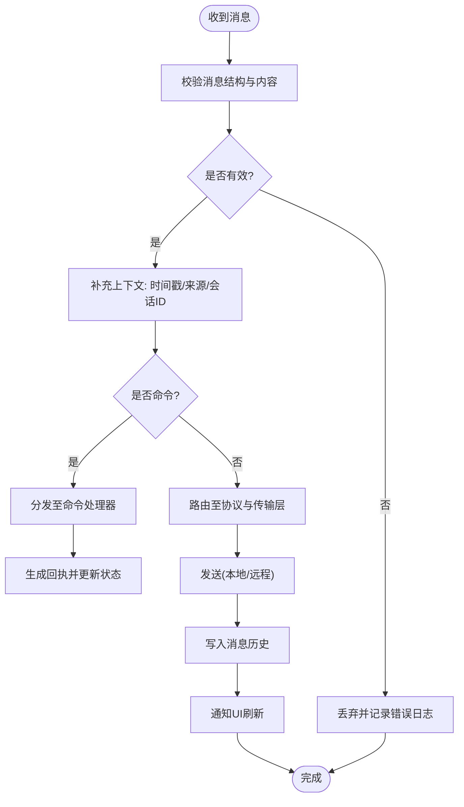
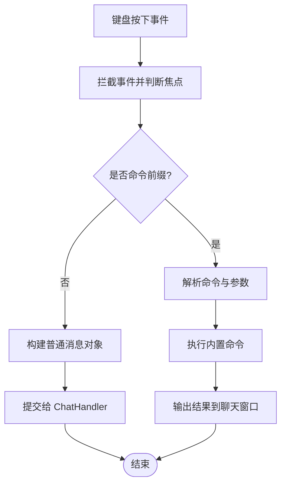
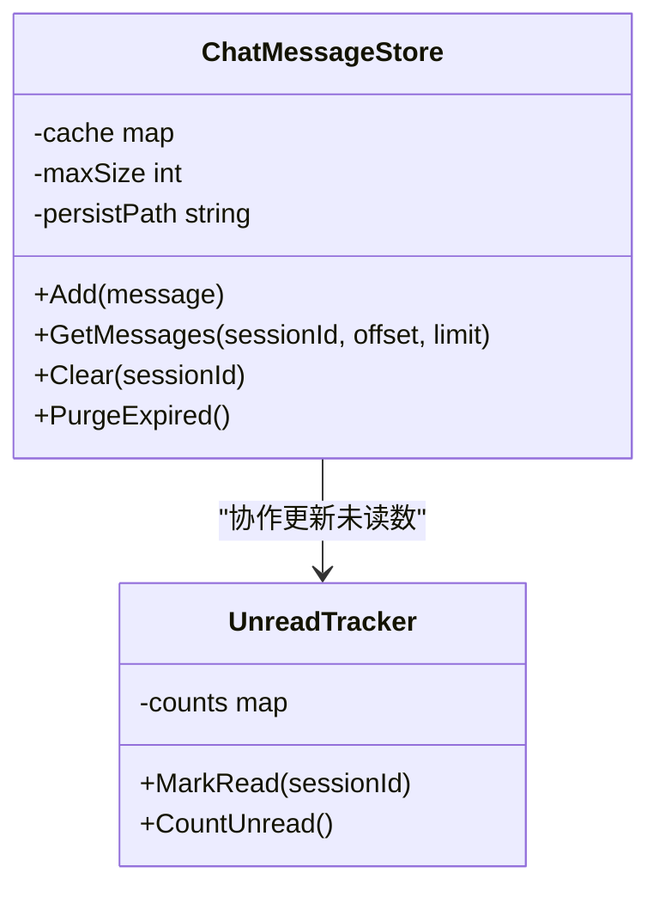
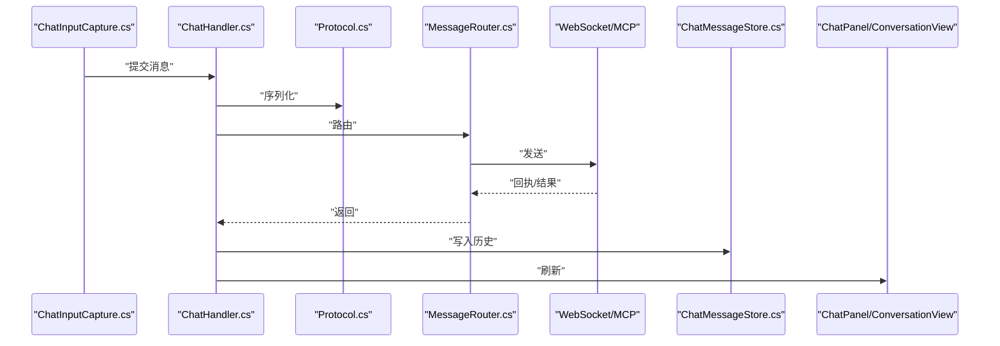
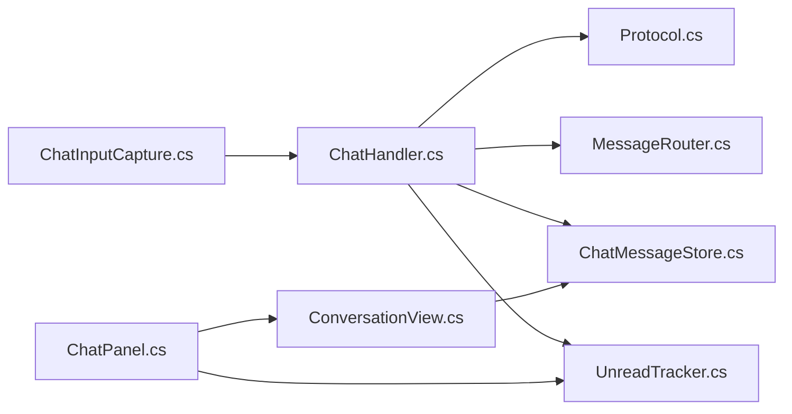

# 聊天系统组件

<cite>
**本文引用的文件**
- [ChatHandler.cs](file://SmartNPC/smapimod/Chat/ChatHandler.cs)
- [ChatInputCapture.cs](file://SmartNPC/smapimod/Chat/ChatInputCapture.cs)
- [ChatPanel.cs](file://SmartNPC/smapimod/UI/ChatPanel.cs)
- [ConversationView.cs](file://SmartNPC/smapimod/UI/ConversationView.cs)
- [ChatMessageStore.cs](file://SmartNPC/smapimod/UI/ChatMessageStore.cs)
- [UnreadTracker.cs](file://SmartNPC/smapimod/Data/UnreadTracker.cs)
- [MessageRouter.cs](file://SmartNPC/smapimod/Bridge/MessageRouter.cs)
- [Protocol.cs](file://SmartNPC/smapimod/Bridge/Protocol.cs)
</cite>

## 目录
1. [简介](#简介)
2. [项目结构](#项目结构)
3. [核心组件](#核心组件)
4. [架构总览](#架构总览)
5. [详细组件分析](#详细组件分析)
6. [依赖关系分析](#依赖关系分析)
7. [性能考虑](#性能考虑)
8. [故障排查指南](#故障排查指南)
9. [结论](#结论)
10. [附录：扩展与新增消息类型示例](#附录扩展与新增消息类型示例)

## 简介
本文件面向 SmartNPC 模组中的“聊天系统”部分，围绕以下目标展开：
- 深入解释 ChatHandler.cs 的消息接收、处理与转发机制。
- 详细描述 ChatInputCapture.cs 的输入捕获实现，包括键盘事件拦截、文本输入处理和命令解析。
- 阐述 UI 组件设计：ChatPanel.cs 的主面板布局、ConversationView.cs 的会话视图渲染、ChatMessageStore.cs 的消息存储与缓存策略。
- 说明从玩家输入到 WebSocket 传输再到 MCP 处理的完整发送链路。
- 覆盖未读消息跟踪、消息历史管理与性能优化策略。
- 提供具体代码路径和扩展建议，帮助扩展聊天功能或添加新的消息类型。

## 项目结构
聊天系统分布在 SMAPI 模组的三个主要区域：
- Chat：负责游戏内消息的生命周期管理（接收、处理、转发）。
- Bridge：负责与外部 WebSocket/MCP 的协议与路由。
- UI：负责玩家交互界面与消息展示。

图表来源
- [ChatHandler.cs:1-200](file://SmartNPC/smapimod/Chat/ChatHandler.cs#L1-L200)
- [ChatInputCapture.cs:1-200](file://SmartNPC/smapimod/Chat/ChatInputCapture.cs#L1-L200)
- [MessageRouter.cs:1-200](file://SmartNPC/smapimod/Bridge/MessageRouter.cs#L1-L200)
- [Protocol.cs:1-200](file://SmartNPC/smapimod/Bridge/Protocol.cs#L1-L200)
- [ChatPanel.cs:1-200](file://SmartNPC/smapimod/UI/ChatPanel.cs#L1-L200)
- [ConversationView.cs:1-200](file://SmartNPC/smapimod/UI/ConversationView.cs#L1-L200)
- [ChatMessageStore.cs:1-200](file://SmartNPC/smapimod/UI/ChatMessageStore.cs#L1-L200)
- [UnreadTracker.cs:1-200](file://SmartNPC/smapimod/Data/UnreadTracker.cs#L1-L200)

章节来源
- [ChatHandler.cs:1-200](file://SmartNPC/smapimod/Chat/ChatHandler.cs#L1-L200)
- [ChatInputCapture.cs:1-200](file://SmartNPC/smapimod/Chat/ChatInputCapture.cs#L1-L200)
- [MessageRouter.cs:1-200](file://SmartNPC/smapimod/Bridge/MessageRouter.cs#L1-L200)
- [Protocol.cs:1-200](file://SmartNPC/smapimod/Bridge/Protocol.cs#L1-L200)
- [ChatPanel.cs:1-200](file://SmartNPC/smapimod/UI/ChatPanel.cs#L1-L200)
- [ConversationView.cs:1-200](file://SmartNPC/smapimod/UI/ConversationView.cs#L1-L200)
- [ChatMessageStore.cs:1-200](file://SmartNPC/smapimod/UI/ChatMessageStore.cs#L1-L200)
- [UnreadTracker.cs:1-200](file://SmartNPC/smapimod/Data/UnreadTracker.cs#L1-L200)

## 核心组件
本节聚焦聊天系统的五个关键模块及其职责边界：
- ChatHandler.cs：统一入口，协调消息生命周期（接收、校验、分发、持久化、通知）。
- ChatInputCapture.cs：拦截键盘事件，将玩家输入转换为结构化消息，支持命令前缀解析。
- MessageRouter.cs：根据消息类型与目标 NPC 进行路由，决定是否走 WebSocket/MCP 通道。
- Protocol.cs：定义消息协议结构体、枚举及序列化规则。
- UI 子系统：ChatPanel.cs、ConversationView.cs、ChatMessageStore.cs、UnreadTracker.cs 共同协作完成显示与状态管理。

章节来源
- [ChatHandler.cs:1-200](file://SmartNPC/smapimod/Chat/ChatHandler.cs#L1-L200)
- [ChatInputCapture.cs:1-200](file://SmartNPC/smapimod/Chat/ChatInputCapture.cs#L1-L200)
- [MessageRouter.cs:1-200](file://SmartNPC/smapimod/Bridge/MessageRouter.cs#L1-L200)
- [Protocol.cs:1-200](file://SmartNPC/smapimod/Bridge/Protocol.cs#L1-L200)

## 架构总览
聊天系统采用“输入捕获 → 消息处理 → 协议封装 → 路由与传输 → UI 更新”的分层架构。

图表来源
- [ChatInputCapture.cs:1-200](file://SmartNPC/smapimod/Chat/ChatInputCapture.cs#L1-L200)
- [ChatHandler.cs:1-200](file://SmartNPC/smapimod/Chat/ChatHandler.cs#L1-L200)
- [MessageRouter.cs:1-200](file://SmartNPC/smapimod/Bridge/MessageRouter.cs#L1-L200)
- [Protocol.cs:1-200](file://SmartNPC/smapimod/Bridge/Protocol.cs#L1-L200)
- [ChatMessageStore.cs:1-200](file://SmartNPC/smapimod/UI/ChatMessageStore.cs#L1-L200)
- [ChatPanel.cs:1-200](file://SmartNPC/smapimod/UI/ChatPanel.cs#L1-L200)
- [ConversationView.cs:1-200](file://SmartNPC/smapimod/UI/ConversationView.cs#L1-L200)

## 详细组件分析

### ChatHandler.cs：消息接收、处理与转发
职责要点：
- 集中订阅来自输入捕获、WebSocket 回调、系统事件的消息入口。
- 对消息进行基础校验（长度、编码、敏感词过滤等）与上下文增强（时间戳、来源 NPC、会话标识）。
- 将消息分发给协议层与路由层；对回执/错误进行统一处理。
- 与消息存储与未读计数器联动，确保 UI 能正确反映最新状态。

关键流程：
- 接收：监听来自 ChatInputCapture 的已解析消息与来自 Bridge 的远端消息。
- 处理：标准化消息体、判定是否为命令、调用对应处理器。
- 转发：通过 MessageRouter 选择本地回显或远程 MCP 通道。
- 同步：更新 ChatMessageStore 与 UnreadTracker，触发 UI 刷新。

图表来源
- [ChatHandler.cs:1-200](file://SmartNPC/smapimod/Chat/ChatHandler.cs#L1-L200)
- [ChatMessageStore.cs:1-200](file://SmartNPC/smapimod/UI/ChatMessageStore.cs#L1-L200)
- [UnreadTracker.cs:1-200](file://SmartNPC/smapimod/Data/UnreadTracker.cs#L1-L200)

章节来源
- [ChatHandler.cs:1-200](file://SmartNPC/smapimod/Chat/ChatHandler.cs#L1-L200)

### ChatInputCapture.cs：输入捕获、键盘事件拦截与命令解析
职责要点：
- 在游戏帧循环中监听键盘事件，屏蔽默认行为并将输入转为内部消息。
- 识别命令前缀（如 /msg、/help 等），提取参数并执行预定义命令。
- 将普通文本输入转化为结构化消息对象，交由 ChatHandler 处理。

关键点：
- 事件拦截：在 SMAPI 的事件钩子中注册，避免影响其他 UI 控件。
- 文本处理：清理空白、限制最大长度、Unicode 规范化。
- 命令解析：基于前缀匹配与参数拆分，支持简单占位符。

图表来源
- [ChatInputCapture.cs:1-200](file://SmartNPC/smapimod/Chat/ChatInputCapture.cs#L1-L200)
- [ChatHandler.cs:1-200](file://SmartNPC/smapimod/Chat/ChatHandler.cs#L1-L200)

章节来源
- [ChatInputCapture.cs:1-200](file://SmartNPC/smapimod/Chat/ChatInputCapture.cs#L1-L200)

### ChatPanel.cs：主面板布局与交互
职责要点：
- 作为聊天窗口的根容器，组织顶部标题栏、会话列表、消息区与输入框。
- 响应开关面板、切换会话、打开设置等交互。
- 与 ConversationView 和 ChatMessageStore 协作，保证视图与数据一致。

设计要点：
- 分层布局：标题区、侧边栏、消息滚动区、输入区。
- 主题适配：根据配置切换明暗主题与字体大小。
- 状态同步：当消息变更时自动滚动到底部或保持原位。

章节来源
- [ChatPanel.cs:1-200](file://SmartNPC/smapimod/UI/ChatPanel.cs#L1-L200)

### ConversationView.cs：会话视图渲染
职责要点：
- 将 ChatMessageStore 中的消息列表渲染为可视化的消息气泡。
- 处理长消息折行、图片与富文本预览、时间戳与发送者头像。
- 提供点击复制、右键菜单等交互能力。

渲染策略：
- 增量渲染：仅重绘可见区域与变更消息项。
- 虚拟滚动：对于超长历史列表，按需加载与回收节点。
- 样式复用：对同类型消息复用绘制资源，降低开销。

章节来源
- [ConversationView.cs:1-200](file://SmartNPC/smapimod/UI/ConversationView.cs#L1-L200)

### ChatMessageStore.cs：消息存储与缓存策略
职责要点：
- 维护当前会话的消息列表，提供增删改查接口。
- 实现内存缓存与可选持久化（例如会话级文件缓存）。
- 提供分页加载、去重、过期清理等能力。

缓存策略：
- LRU 或固定容量队列：控制单会话消息数量。
- 冷热分离：热数据保留在内存，冷数据落盘。
- 脏标记与批量提交：减少频繁 I/O。

图表来源
- [ChatMessageStore.cs:1-200](file://SmartNPC/smapimod/UI/ChatMessageStore.cs#L1-L200)
- [UnreadTracker.cs:1-200](file://SmartNPC/smapimod/Data/UnreadTracker.cs#L1-L200)

章节来源
- [ChatMessageStore.cs:1-200](file://SmartNPC/smapimod/UI/ChatMessageStore.cs#L1-L200)
- [UnreadTracker.cs:1-200](file://SmartNPC/smapimod/Data/UnreadTracker.cs#L1-L200)

### 消息发送链路：从玩家输入到 MCP 处理
端到端链路如下：
1. 玩家输入：ChatInputCapture 拦截键盘事件，解析命令或文本。
2. 构造消息：生成结构化消息对象，携带来源、目标、类型与内容。
3. 协议封装：使用 Protocol 定义的格式序列化消息。
4. 路由决策：MessageRouter 根据目标 NPC 与消息类型决定走本地回显还是 WebSocket/MCP。
5. 传输：通过 WebSocket 发送到 MCP 服务；MCP 执行工具或工作流后返回结果。
6. 回执处理：ChatHandler 统一处理成功/失败回执，更新状态。
7. UI 更新：ChatMessageStore 写入历史，ChatPanel 与 ConversationView 刷新显示。

图表来源
- [ChatInputCapture.cs:1-200](file://SmartNPC/smapimod/Chat/ChatInputCapture.cs#L1-L200)
- [ChatHandler.cs:1-200](file://SmartNPC/smapimod/Chat/ChatHandler.cs#L1-L200)
- [Protocol.cs:1-200](file://SmartNPC/smapimod/Bridge/Protocol.cs#L1-L200)
- [MessageRouter.cs:1-200](file://SmartNPC/smapimod/Bridge/MessageRouter.cs#L1-L200)
- [ChatMessageStore.cs:1-200](file://SmartNPC/smapimod/UI/ChatMessageStore.cs#L1-L200)
- [ChatPanel.cs:1-200](file://SmartNPC/smapimod/UI/ChatPanel.cs#L1-L200)
- [ConversationView.cs:1-200](file://SmartNPC/smapimod/UI/ConversationView.cs#L1-L200)

## 依赖关系分析
组件间依赖如下：
- ChatInputCapture 依赖 ChatHandler 以提交消息。
- ChatHandler 依赖 Protocol 与 MessageRouter，并与 ChatMessageStore 与 UnreadTracker 协作。
- UI 层（ChatPanel、ConversationView）依赖 ChatMessageStore 获取数据，并受 UnreadTracker 驱动未读提示。

图表来源
- [ChatInputCapture.cs:1-200](file://SmartNPC/smapimod/Chat/ChatInputCapture.cs#L1-L200)
- [ChatHandler.cs:1-200](file://SmartNPC/smapimod/Chat/ChatHandler.cs#L1-L200)
- [Protocol.cs:1-200](file://SmartNPC/smapimod/Bridge/Protocol.cs#L1-L200)
- [MessageRouter.cs:1-200](file://SmartNPC/smapimod/Bridge/MessageRouter.cs#L1-L200)
- [ChatMessageStore.cs:1-200](file://SmartNPC/smapimod/UI/ChatMessageStore.cs#L1-L200)
- [UnreadTracker.cs:1-200](file://SmartNPC/smapimod/Data/UnreadTracker.cs#L1-L200)
- [ChatPanel.cs:1-200](file://SmartNPC/smapimod/UI/ChatPanel.cs#L1-L200)
- [ConversationView.cs:1-200](file://SmartNPC/smapimod/UI/ConversationView.cs#L1-L200)

章节来源
- [ChatHandler.cs:1-200](file://SmartNPC/smapimod/Chat/ChatHandler.cs#L1-L200)
- [MessageRouter.cs:1-200](file://SmartNPC/smapimod/Bridge/MessageRouter.cs#L1-L200)
- [Protocol.cs:1-200](file://SmartNPC/smapimod/Bridge/Protocol.cs#L1-L200)
- [ChatMessageStore.cs:1-200](file://SmartNPC/smapimod/UI/ChatMessageStore.cs#L1-L200)
- [UnreadTracker.cs:1-200](file://SmartNPC/smapimod/Data/UnreadTracker.cs#L1-L200)
- [ChatPanel.cs:1-200](file://SmartNPC/smapimod/UI/ChatPanel.cs#L1-L200)
- [ConversationView.cs:1-200](file://SmartNPC/smapimod/UI/ConversationView.cs#L1-L200)

## 性能考虑
- 输入节流：对高频键盘事件进行节流，避免每帧重复处理。
- 消息批处理：UI 刷新与存储写入采用批处理，减少锁竞争与 I/O。
- 视图虚拟化：ConversationView 使用虚拟滚动与增量绘制，降低大列表渲染成本。
- 缓存策略：ChatMessageStore 采用 LRU 与冷热分离，避免内存膨胀。
- 网络重试：WebSocket 断线重连与指数退避，避免雪崩式重试。
- 日志分级：调试信息仅在开发环境开启，生产环境仅记录必要错误。

[本节为通用性能指导，不直接分析具体文件]

## 故障排查指南
常见问题与建议：
- 输入无响应：检查 ChatInputCapture 的事件钩子是否注册成功，确认焦点是否在聊天输入框。
- 消息未显示：核对 ChatHandler 是否正确调用 ChatMessageStore 更新，以及 UI 刷新是否被触发。
- 远端无回执：检查 MessageRouter 的路由规则与 WebSocket 连接状态；查看 Protocol 序列化字段是否完整。
- 未读数异常：确认 UnreadTracker 的 MarkRead 与 CountUnread 逻辑是否与 UI 消费行为一致。
- 性能卡顿：观察 ConversationView 是否出现大量重绘，调整虚拟滚动阈值与缓存大小。

章节来源
- [ChatInputCapture.cs:1-200](file://SmartNPC/smapimod/Chat/ChatInputCapture.cs#L1-L200)
- [ChatHandler.cs:1-200](file://SmartNPC/smapimod/Chat/ChatHandler.cs#L1-L200)
- [MessageRouter.cs:1-200](file://SmartNPC/smapimod/Bridge/MessageRouter.cs#L1-L200)
- [ChatMessageStore.cs:1-200](file://SmartNPC/smapimod/UI/ChatMessageStore.cs#L1-L200)
- [UnreadTracker.cs:1-200](file://SmartNPC/smapimod/Data/UnreadTracker.cs#L1-L200)

## 结论
聊天系统通过清晰的层次划分与职责分离，实现了从输入捕获、消息处理、协议封装、路由传输到 UI 展示的完整闭环。ChatHandler 作为中枢，串联输入、协议、路由与 UI；ChatInputCapture 保障输入体验；UI 组件提供流畅的交互与渲染；Bridge 层对接外部 MCP 服务。在此基础上，可通过扩展命令、消息类型与 UI 模板，快速增强聊天能力。

[本节为总结性内容，不直接分析具体文件]

## 附录：扩展与新增消息类型示例

### 新增消息类型的步骤
- 在 Protocol.cs 中扩展消息类型枚举与对应的数据结构。
- 在 ChatHandler.cs 中添加对新消息类型的校验与处理分支。
- 若需要 UI 特殊展示，在 ConversationView.cs 中添加对应渲染分支。
- 如需持久化新字段，更新 ChatMessageStore 的序列化/反序列化逻辑。
- 若涉及命令，可在 ChatInputCapture.cs 的命令解析器中增加相应命令。

参考位置
- 协议定义：[Protocol.cs:1-200](file://SmartNPC/smapimod/Bridge/Protocol.cs#L1-L200)
- 消息处理：[ChatHandler.cs:1-200](file://SmartNPC/smapimod/Chat/ChatHandler.cs#L1-L200)
- 视图渲染：[ConversationView.cs:1-200](file://SmartNPC/smapimod/UI/ConversationView.cs#L1-L200)
- 存储扩展：[ChatMessageStore.cs:1-200](file://SmartNPC/smapimod/UI/ChatMessageStore.cs#L1-L200)
- 命令扩展：[ChatInputCapture.cs:1-200](file://SmartNPC/smapimod/Chat/ChatInputCapture.cs#L1-L200)

### 扩展现有命令的示例
- 在 ChatInputCapture.cs 的命令解析器中添加新命令前缀与参数解析。
- 在 ChatHandler.cs 的命令分发处添加对应处理器。
- 在 UI 层根据需要输出命令结果或状态提示。

参考位置
- 命令解析：[ChatInputCapture.cs:1-200](file://SmartNPC/smapimod/Chat/ChatInputCapture.cs#L1-L200)
- 命令分发：[ChatHandler.cs:1-200](file://SmartNPC/smapimod/Chat/ChatHandler.cs#L1-L200)