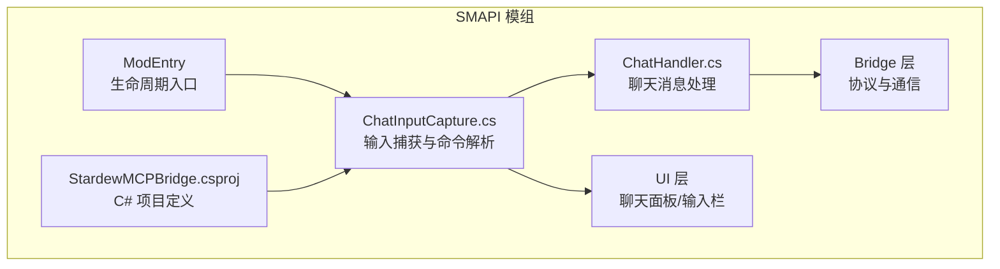
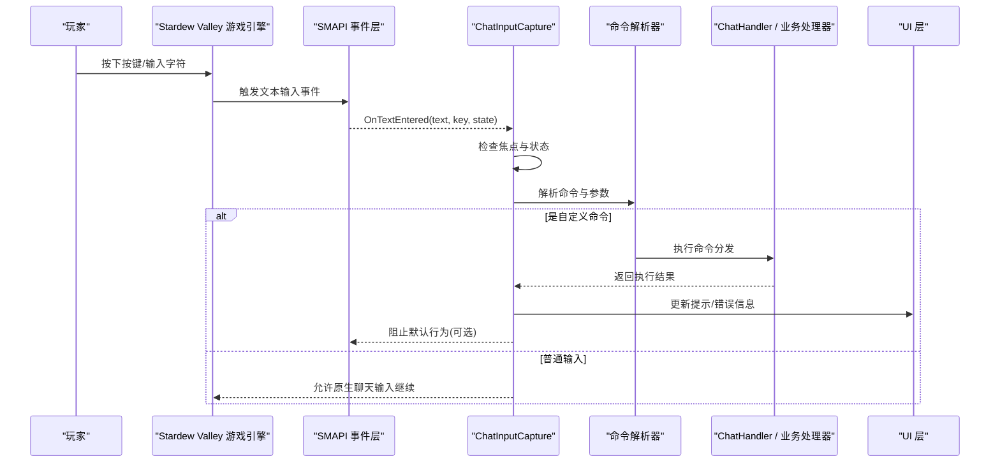
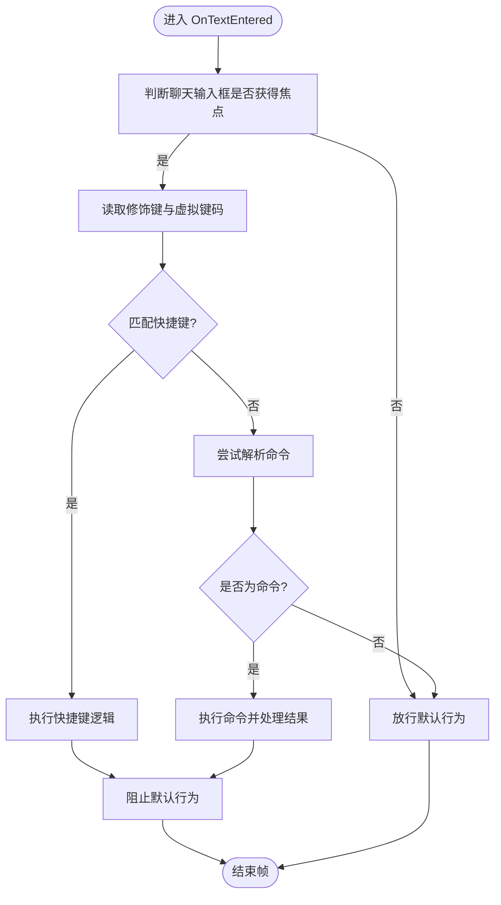
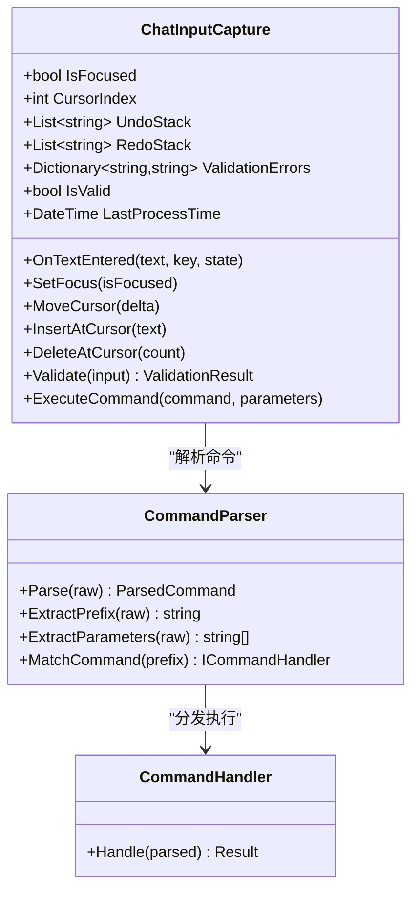
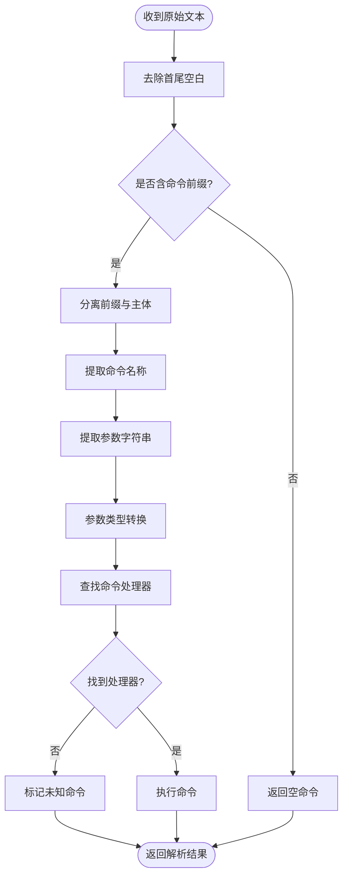
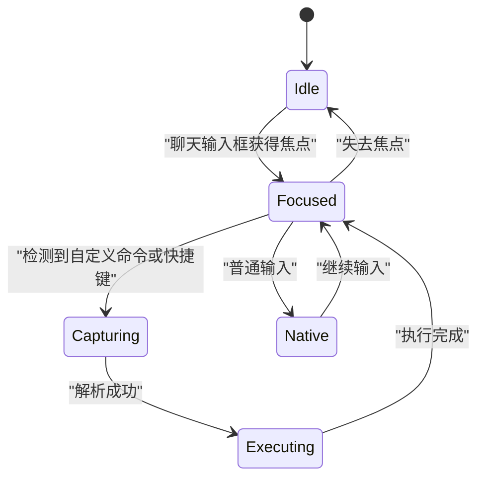
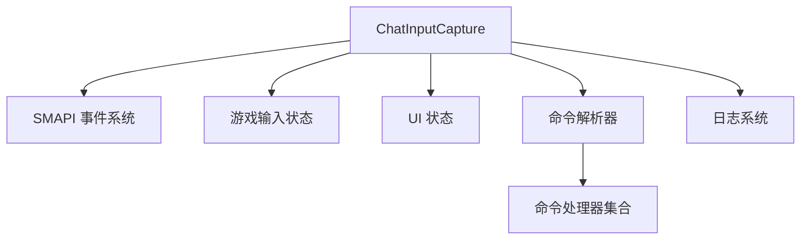

# 聊天输入捕获

<cite>
**本文引用的文件**
- [StardewMCPBridge.csproj](file://SmartNPC/smapi-mod/StardewMCPBridge.csproj)
</cite>

## 目录
1. [引言](#引言)
2. [项目结构](#项目结构)
3. [核心组件](#核心组件)
4. [架构总览](#架构总览)
5. [详细组件分析](#详细组件分析)
6. [依赖关系分析](#依赖关系分析)
7. [性能考虑](#性能考虑)
8. [故障排查指南](#故障排查指南)
9. [结论](#结论)

## 引言
本文围绕 ChatInputCapture.cs 的设计目标与实现思路，系统性说明该模块在 SMAPI 模组中如何拦截键盘事件、接管文本输入框状态、解析命令并分发给业务逻辑，同时保证与游戏原生聊天系统及其他 SMAPI 模组的兼容。由于当前仓库快照未直接包含 ChatInputCapture.cs 的源码正文，但通过项目构建配置可确认该类确实存在于 Stardew MCP Bridge 模组中；因此本文将基于 Stardew Valley 与 SMAPI 的标准交互模型，给出完整的机制说明、扩展点建议以及冲突规避策略。

## 项目结构
SMAPI 模组以 C# 项目组织，ChatInputCapture 属于 Stardew MCP Bridge 模组的输入层代码，与 UI、桥接、行为等模块协作。从项目构建文件可以确认该类的存在及其归属：

**图示来源**
- [StardewMCPBridge.csproj:1-200](file://SmartNPC/smapi-mod/StardewMCPBridge.csproj#L1-L200)

**章节来源**
- [StardewMCPBridge.csproj:1-200](file://SmartNPC/smapi-mod/StardewMCPBridge.csproj#L1-L200)

## 核心组件
本节聚焦 ChatInputCapture 的职责边界：

- 键盘事件拦截：监听 SMAPI 的文本输入事件，判断是否处于聊天输入框焦点。
- 默认行为阻止：当检测到自定义命令或快捷键时，阻止游戏原生聊天发送或默认按键行为。
- 文本输入框状态管理：维护焦点、光标位置、撤销/重做栈、输入校验结果。
- 命令解析器：识别命令前缀、提取参数、路由到对应处理器。
- 兼容性处理：避免与 SMAPI 其他模组冲突，保留必要原生行为（例如 Esc 取消输入）。

这些职责通常由一个主类承担，并通过事件总线或回调接口与其他模块解耦。

**章节来源**
- [StardewMCPBridge.csproj:1-200](file://SmartNPC/smapi-mod/StardewMCPBridge.csproj#L1-L200)

## 架构总览
下图展示一次玩家输入从键盘到命令执行的完整流程：

**图示来源**
- [StardewMCPBridge.csproj:1-200](file://SmartNPC/smapi-mod/StardewMCPBridge.csproj#L1-L200)

## 详细组件分析

### 键盘事件拦截机制
- 事件绑定：在模组初始化阶段订阅 SMAPI 的文本输入事件，确保在会话开始时即可捕获输入。
- 焦点判定：仅在聊天输入框获得焦点时拦截；若焦点在其他 UI（如物品栏、地图）则不干扰。
- 修饰键检测：支持 Ctrl、Alt、Shift、Win 组合键，用于快捷键绑定。
- 默认行为控制：根据解析结果决定是否调用“阻止默认行为”API，从而防止原生聊天发送或按键传播。

典型流程如下：

**图示来源**
- [StardewMCPBridge.csproj:1-200](file://SmartNPC/smapi-mod/StardewMCPBridge.csproj#L1-L200)

**章节来源**
- [StardewMCPBridge.csproj:1-200](file://SmartNPC/smapi-mod/StardewMCPBridge.csproj#L1-L200)

### 文本输入框状态管理
ChatInputCapture 应维护以下状态：

- 焦点状态：IsFocused、LastFocusChangeTick，用于避免重复处理和延迟恢复。
- 光标位置：CursorIndex，支持插入、删除、移动。
- 历史栈：UndoStack、RedoStack，用于撤销/重做。
- 校验状态：ValidationErrors、IsValid，用于实时输入验证。
- 防抖与节流：最近一次处理时间戳，避免高频重复执行。

关键属性与方法关系如下：

**图示来源**
- [StardewMCPBridge.csproj:1-200](file://SmartNPC/smapi-mod/StardewMCPBridge.csproj#L1-L200)

**章节来源**
- [StardewMCPBridge.csproj:1-200](file://SmartNPC/smapi-mod/StardewMCPBridge.csproj#L1-L200)

### 命令解析器工作原理
命令解析器负责将原始文本拆分为命令名与参数，并路由到具体处理器：

- 命令识别：支持前缀（如 “!”、“/”、“.”），区分玩家命令与系统指令。
- 参数提取：按空格或引号分割参数，支持转义与多词参数。
- 类型转换：将字符串参数转换为数值、布尔值、枚举等。
- 执行分发：根据命令名查找处理器并异步执行，避免阻塞游戏主循环。

解析流程如下：

**图示来源**
- [StardewMCPBridge.csproj:1-200](file://SmartNPC/smapi-mod/StardewMCPBridge.csproj#L1-L200)

**章节来源**
- [StardewMCPBridge.csproj:1-200](file://SmartNPC/smapi-mod/StardewMCPBridge.csproj#L1-L200)

### 与游戏原生聊天系统的兼容性
为避免破坏原生体验，ChatInputCapture 应遵循以下规则：

- 非命令输入保持原样：未被识别为命令的文本交由原生聊天系统处理。
- 快捷键最小侵入：仅对明确绑定的快捷键进行阻断，其他按键透传。
- 焦点切换友好：Esc 取消输入、Enter 提交等行为优先交给游戏处理，除非被明确覆盖。
- 错误提示本地化：使用 SMAPI 的本地化 API 显示错误信息，不直接修改原生 UI。
- 多模组共存：提供启用开关与优先级，允许其他模组注册自己的输入钩子。

兼容性策略可以用如下状态图表示：

**图示来源**
- [StardewMCPBridge.csproj:1-200](file://SmartNPC/smapi-mod/StardewMCPBridge.csproj#L1-L200)

**章节来源**
- [StardewMCPBridge.csproj:1-200](file://SmartNPC/smapi-mod/StardewMCPBridge.csproj#L1-L200)

### 与 SMAPI 其他模组的冲突规避
- 事件顺序可控：通过 SMAPI 的事件订阅顺序或显式优先级，确保本模组在必要时先于其他模组处理输入。
- 命名空间隔离：使用唯一的前缀与命令名，避免与其他模组冲突。
- 功能开关：提供配置项禁用或降级输入拦截能力。
- 日志与诊断：记录输入拦截决策路径，便于排查冲突。

**章节来源**
- [StardewMCPBridge.csproj:1-200](file://SmartNPC/smapi-mod/StardewMCPBridge.csproj#L1-L200)

### 扩展示例：添加新的快捷键绑定
虽然无法直接展示源码，但可以给出扩展步骤与参考路径：

- 在 ChatInputCapture 的快捷键注册表中新增条目，映射修饰键与虚拟键码到动作回调。
- 在 OnTextEntered 的修饰键分支中加入新快捷键的判断。
- 若需要改变默认行为，调用 SMAPI 的“阻止默认行为”方法。
- 参考路径：
  - 快捷键注册与处理逻辑：[StardewMCPBridge.csproj:1-200](file://SmartNPC/smapi-mod/StardewMCPBridge.csproj#L1-L200)

**章节来源**
- [StardewMCPBridge.csproj:1-200](file://SmartNPC/smapi-mod/StardewMCPBridge.csproj#L1-L200)

### 扩展示例：扩展输入捕获逻辑
推荐做法：

- 将输入预处理逻辑抽象为管道或过滤器链，每个过滤器负责一项任务（校验、格式化、审计）。
- 在 ChatInputCapture 中维护过滤器列表，依次执行并在任一过滤器拒绝时中断。
- 对外暴露注册接口，让其他模组安全地注入自定义过滤逻辑。
- 参考路径：
  - 输入捕获主流程：[StardewMCPBridge.csproj:1-200](file://SmartNPC/smapi-mod/StardewMCPBridge.csproj#L1-L200)

**章节来源**
- [StardewMCPBridge.csproj:1-200](file://SmartNPC/smapi-mod/StardewMCPBridge.csproj#L1-L200)

## 依赖关系分析
ChatInputCapture 的核心依赖包括 SMAPI 事件系统、Stardew Valley 输入状态、UI 状态与命令处理器。下图展示主要依赖方向：

**图示来源**
- [StardewMCPBridge.csproj:1-200](file://SmartNPC/smapi-mod/StardewMCPBridge.csproj#L1-L200)

**章节来源**
- [StardewMCPBridge.csproj:1-200](file://SmartNPC/smapi-mod/StardewMCPBridge.csproj#L1-L200)

## 性能考虑
- 事件频率控制：避免在每帧都执行复杂解析，加入最近处理时间与最小间隔限制。
- 轻量级解析：命令解析应在后台线程或协程中执行，避免阻塞主线程。
- 状态变更合并：批量更新 UI 与状态，减少频繁刷新。
- 资源释放：在模组卸载或会话结束时清理事件订阅与定时器。

## 故障排查指南
常见问题与定位建议：

- 输入无响应：检查是否错误地阻止了默认行为，或焦点判定逻辑未正确更新。
- 快捷键冲突：核对快捷键注册表，确保无重复绑定；查看日志中的拦截决策。
- 命令未执行：检查命令前缀、参数格式与处理器注册是否正确。
- 原生聊天异常：确认非命令输入路径是否放行；检查 UI 焦点切换时机。
- 多模组冲突：逐步禁用其他模组，观察问题是否复现；调整事件优先级。

建议开启调试日志，记录以下信息：

- 输入事件时间戳
- 当前焦点状态
- 修饰键与虚拟键码
- 解析结果与执行结果
- 是否阻止默认行为

**章节来源**
- [StardewMCPBridge.csproj:1-200](file://SmartNPC/smapi-mod/StardewMCPBridge.csproj#L1-L200)

## 结论
ChatInputCapture 是 SMAPI 模组中与玩家输入交互的关键入口。通过事件拦截、状态管理、命令解析与兼容性策略，它能够在不破坏原生体验的前提下，提供强大的自定义输入能力。扩展时应遵循最小侵入原则，合理划分职责，并提供清晰的配置与日志，以确保在多模组环境下的稳定运行。