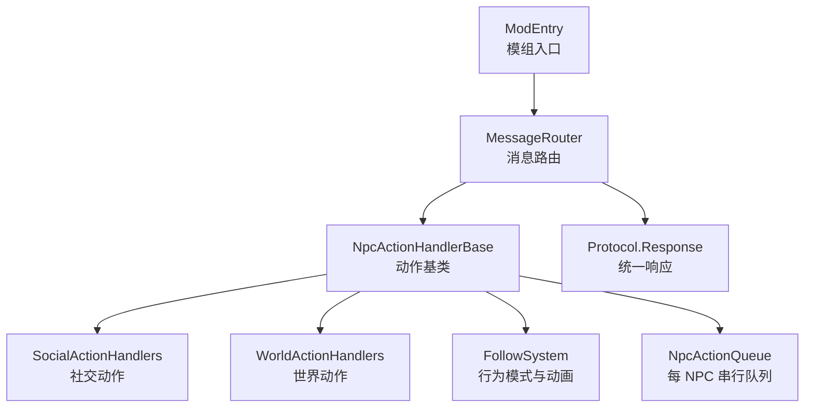
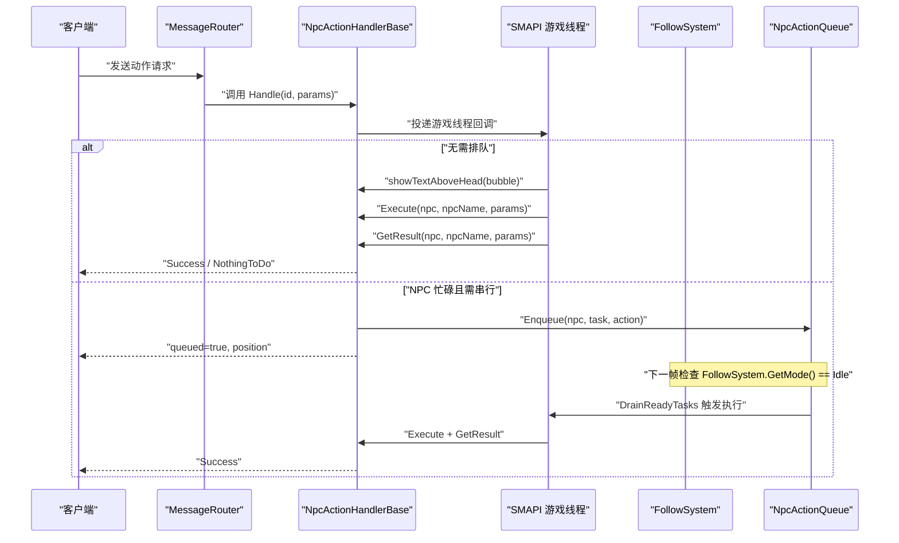
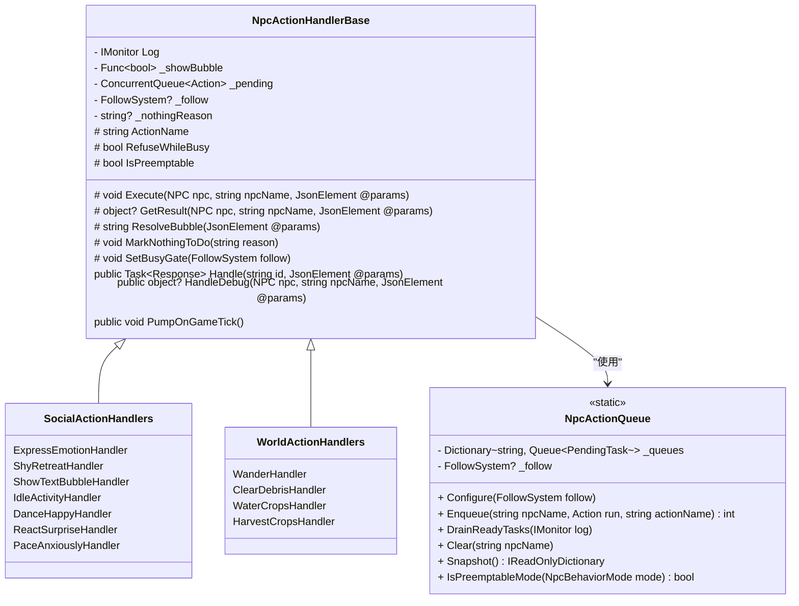
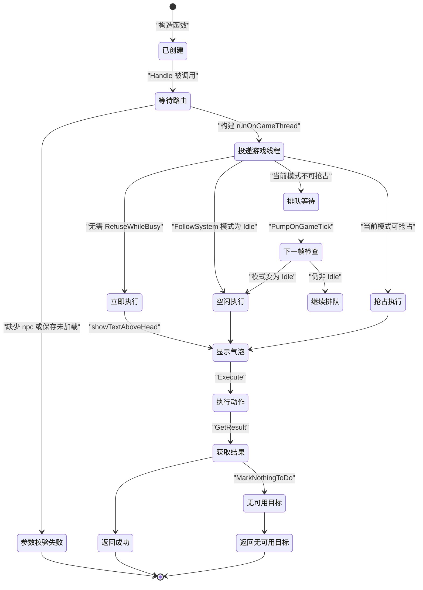
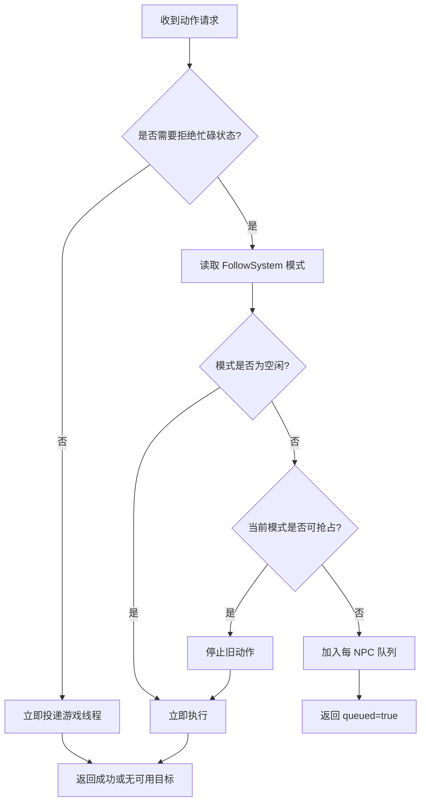
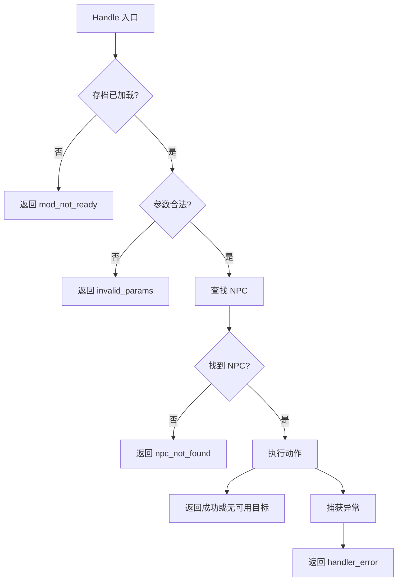
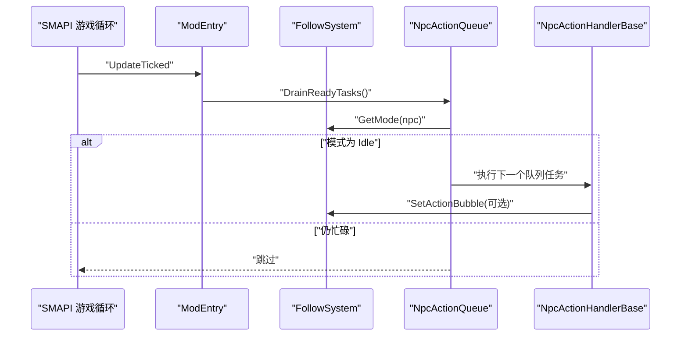

# NPC 动作处理器基类

<cite>
**本文引用的文件**   
- [NpcActionHandlerBase.cs](file://SmartNPC/smapi-mod/Behavior/NpcActionHandlerBase.cs)
- [SocialActionHandlers.cs](file://SmartNPC/smapi-mod/Behavior/SocialActionHandlers.cs)
- [WorldActionHandlers.cs](file://SmartNPC/smapi-mod/Behavior/WorldActionHandlers.cs)
- [ModEntry.cs](file://SmartNPC/smapi-mod/ModEntry.cs)
- [BehaviorHandler.cs](file://SmartNPC/smapi-mod/Movement/BehaviorHandler.cs)
- [Protocol.cs](file://SmartNPC/smapi-mod/Bridge/Protocol.cs)
- [MessageRouter.cs](file://SmartNPC/smapi-mod/Bridge/MessageRouter.cs)
</cite>

## 目录
1. [引言](#引言)
2. [项目结构与定位](#项目结构与定位)
3. [核心组件总览](#核心组件总览)
4. [架构与数据流](#架构与数据流)
5. [抽象基类设计](#抽象基类设计)
6. [动作状态机与生命周期](#动作状态机与生命周期)
7. [优先级、抢占与并发控制](#优先级抢占与并发控制)
8. [上下文共享机制](#上下文共享机制)
9. [具体动作实现示例](#具体动作实现示例)
10. [异步执行与异常处理](#异步执行与异常处理)
11. [与 SMAPI 游戏循环的集成](#与-smapi-游戏循环的集成)
12. [性能特征与优化建议](#性能特征与优化建议)
13. [故障排查指南](#故障排查指南)
14. [结论](#结论)

## 引言

本文聚焦 SmartNPC 模组中 NPC 行为系统的核心基础：`NpcActionHandlerBase`。该抽象基类为所有 NPC 动作处理器提供统一骨架，负责参数解析、NPC 查找、头顶气泡展示、游戏线程调度、任务排队、结果封装和错误处理；子类只需关注自身业务逻辑，例如表情、闲逛、浇水、收割、清理等。

文档重点解释以下问题：

- 动作接口如何定义，哪些成员必须重写、哪些可自定义。
- 动作从请求到完成的生命周期，以及空闲、忙碌、抢占、排队等状态转换。
- 三类动作模型：即时动作、可抢占模式动作、串行独占动作。
- 每个 NPC 的串行队列如何工作，以及如何避免多个长耗时动作互相干扰。
- 如何通过 `FollowSystem`、`IMonitor`、`JsonElement` 共享上下文。
- 如何在 SMAPI 更新循环中安全地执行游戏逻辑。
- 如何扩展新的 NPC 动作处理器，并正确处理异步操作和异常。

## 项目结构与定位

`NpcActionHandlerBase` 位于 SMAPI 模组的 `Behavior` 命名空间下，是行为层的基础抽象。与之配套的还有：

- **社交动作处理器集合**：表情、害羞撤退、文字气泡、闲置活动、跳舞、惊讶反应、焦虑踱步等。
- **世界动作处理器集合**：闲逛、清理杂物、浇水、收割、放入箱子、发货、采集、喂动物、播种、翻地、破坏资源、施肥、填充缺口、取物、转移物品等。
- **注册入口**：在模组启动时创建处理器数组，并通过消息路由注册 WebSocket 动作名称。
- **响应协议**：统一的 `Response.Success` / `Response.Failure` 结构，用于返回结构化结果。
- **行为控制器**：`BehaviorHandler` 负责非 `NpcActionHandlerBase` 体系的简单行为查询与表情映射。

**图表来源**
- [ModEntry.cs:80-160](file://SmartNPC/smapi-mod/ModEntry.cs#L80-L160)
- [NpcActionHandlerBase.cs:1-478](file://SmartNPC/smapi-mod/Behavior/NpcActionHandlerBase.cs#L1-L478)
- [SocialActionHandlers.cs:1-151](file://SmartNPC/smapi-mod/Behavior/SocialActionHandlers.cs#L1-L151)
- [WorldActionHandlers.cs:1-2429](file://SmartNPC/smapi-mod/Behavior/WorldActionHandlers.cs#L1-L2429)
- [Protocol.cs:30-45](file://SmartNPC/smapi-mod/Bridge/Protocol.cs#L30-L45)

**章节来源**
- [ModEntry.cs:1-200](file://SmartNPC/smapi-mod/ModEntry.cs#L1-L200)
- [NpcActionHandlerBase.cs:1-478](file://SmartNPC/smapi-mod/Behavior/NpcActionHandlerBase.cs#L1-L478)

## 核心组件总览

| 组件 | 职责 | 关键行为 |
|---|---|---|
| `NpcActionHandlerBase` | 抽象动作基类 | 参数校验、NPC 查找、气泡显示、线程调度、结果构造、错误处理、队列判定 |
| `NpcActionQueue` | 每 NPC 串行任务队列 | 入队、按空闲状态出队、清空、快照 |
| `SocialActionHandlers` | 社交类动作实现 | 表情、害羞、文字气泡、闲置、跳舞、惊讶、踱步 |
| `WorldActionHandlers` | 世界交互类动作实现 | 闲逛、清理、浇水、收割、种植、采集等 |
| `ModEntry` | 模组装配与事件绑定 | 初始化处理器、注册路由、绑定 SMAPI 更新循环 |
| `BehaviorHandler` | 非基类行为控制 | 表情枚举映射、行为模式查询、轻量任务泵 |
| `Protocol.Response` | 响应结构 | 成功、失败、错误码、附加数据 |
| `MessageRouter` | 消息分发 | 路由动作名到处理器，捕获未注册动作和异常 |

**章节来源**
- [NpcActionHandlerBase.cs:1-478](file://SmartNPC/smapi-mod/Behavior/NpcActionHandlerBase.cs#L1-L478)
- [SocialActionHandlers.cs:1-151](file://SmartNPC/smapi-mod/Behavior/SocialActionHandlers.cs#L1-L151)
- [WorldActionHandlers.cs:1-2429](file://SmartNPC/smapi-mod/Behavior/WorldActionHandlers.cs#L1-L2429)
- [ModEntry.cs:1-200](file://SmartNPC/smapi-mod/ModEntry.cs#L1-L200)
- [BehaviorHandler.cs:1-159](file://SmartNPC/smapi-mod/Movement/BehaviorHandler.cs#L1-L159)
- [Protocol.cs:30-45](file://SmartNPC/smapi-mod/Bridge/Protocol.cs#L30-L45)

## 架构与数据流

一个典型的 NPC 动作调用流程如下：

1. 外部通过 WebSocket 或 MCP 工具发送动作请求。
2. `MessageRouter` 根据动作名称找到对应处理器。
3. 处理器继承自 `NpcActionHandlerBase`，调用其公共 `Handle` 方法。
4. 基类验证模组是否就绪、是否包含目标 NPC。
5. 构建游戏线程回调，包括气泡文本、NPC 查找、`Execute` 调用、`GetResult` 获取结果。
6. 如果动作需要排他性，则检查当前 `FollowSystem` 模式：空闲立即执行、可抢占则中断旧动作、否则进入每 NPC 队列。
7. 每次 SMAPI 游戏帧更新时，队列被扫描并将空闲 NPC 的任务取出执行。
8. 最终通过 `TaskCompletionSource<Response>` 返回结构化结果给调用方。

**图表来源**
- [MessageRouter.cs:20-50](file://SmartNPC/smapi-mod/Bridge/MessageRouter.cs#L20-L50)
- [NpcActionHandlerBase.cs:150-330](file://SmartNPC/smapi-mod/Behavior/NpcActionHandlerBase.cs#L150-L330)
- [NpcActionHandlerBase.cs:330-478](file://SmartNPC/smapi-mod/Behavior/NpcActionHandlerBase.cs#L330-L478)
- [ModEntry.cs:120-200](file://SmartNPC/smapi-mod/ModEntry.cs#L120-L200)

## 抽象基类设计

### 抽象契约

`NpcActionHandlerBase` 定义了动作处理器应遵循的最小契约：

| 成员 | 类型 | 用途 | 是否必须重写 |
|---|---|---|---|
| `ActionName` | 字符串属性 | 暴露 WebSocket 动作名称，如 `npc_wander`、`npc_express_emotion` | 是 |
| `ActionNamePublic` | 只读属性 | 供注册器使用，直接转发 `ActionName` | 否，默认实现 |
| `RefuseWhileBusy` | 布尔虚属性 | 是否拒绝在 NPC 忙碌时立即执行 | 否，默认 false |
| `IsPreemptable` | 布尔虚属性 | 当前动作模式是否允许被更高优先级任务抢占 | 否，默认 false |
| `Execute` | 虚方法 | 执行实际 NPC 游戏逻辑 | 否，默认空实现 |
| `GetResult` | 虚方法 | 返回自定义结果对象 | 否，默认 null |
| `ResolveBubble` | 虚方法 | 生成 NPC 头顶气泡文本 | 否，默认基于动作名和参数 |
| `MarkNothingToDo` | 保护方法 | 标记本次动作“没有找到可执行目标” | 否，由子类主动调用 |
| `SetBusyGate` | 保护方法 | 注入 `FollowSystem` 引用，用于长耗时动作 | 由需要模式的子类调用 |
| `Handle` | 公共方法 | 统一入口，负责参数、线程、队列、结果 | 否，通常不重写 |
| `HandleDebug` | 公共方法 | 调试命令同步入口 | 否，通常不重写 |
| `PumpOnGameTick` | 公共方法 | 驱动本处理器内部的轻量待办队列 | 否，通常不重写 |

### 设计要点

- **单一职责分离**：基类负责基础设施，子类只写业务逻辑。
- **可扩展点明确**：气泡文本、执行逻辑、结果结构均可覆盖。
- **防御性编程**：对空 NPC、空保存、无效参数、异常抛出都有统一处理。
- **线程边界清晰**：所有访问游戏对象的代码都走游戏线程回调。
- **可观测性**：通过 `IMonitor.Log` 输出动作名、气泡内容、同屏状态、耗时统计。

**图表来源**
- [NpcActionHandlerBase.cs:1-478](file://SmartNPC/smapi-mod/Behavior/NpcActionHandlerBase.cs#L1-L478)
- [SocialActionHandlers.cs:1-151](file://SmartNPC/smapi-mod/Behavior/SocialActionHandlers.cs#L1-L151)
- [WorldActionHandlers.cs:1-2429](file://SmartNPC/smapi-mod/Behavior/WorldActionHandlers.cs#L1-L2429)

**章节来源**
- [NpcActionHandlerBase.cs:1-149](file://SmartNPC/smapi-mod/Behavior/NpcActionHandlerBase.cs#L1-L149)
- [NpcActionHandlerBase.cs:330-478](file://SmartNPC/smapi-mod/Behavior/NpcActionHandlerBase.cs#L330-L478)

## 动作状态机与生命周期

动作的生命周期不是简单的一次函数调用，而是一个受 `FollowSystem` 模式和每 NPC 队列约束的状态机。

**图表来源**
- [NpcActionHandlerBase.cs:150-330](file://SmartNPC/smapi-mod/Behavior/NpcActionHandlerBase.cs#L150-L330)
- [NpcActionHandlerBase.cs:330-478](file://SmartNPC/smapi-mod/Behavior/NpcActionHandlerBase.cs#L330-L478)

### 生命周期阶段说明

| 阶段 | 发生位置 | 关键判断 | 结果 |
|---|---|---|---|
| 参数校验 | `Handle` 开头 | 是否加载存档、是否包含有效 `npc` | 失败时立即返回 `mod_not_ready` 或 `invalid_params` |
| 气泡构建 | 游戏线程回调内 | `ResolveBubble` | 生成 NPC 头顶提示 |
| NPC 查找 | 游戏线程回调内 | `Game1.getCharacterFromName` | 找不到时返回 `npc_not_found` |
| 模式检查 | 决定立即执行还是排队 | `RefuseWhileBusy`、`FollowSystem.GetMode` | 决定抢占、排队或立即执行 |
| 执行逻辑 | 子类 `Execute` | 由具体动作决定 | 修改游戏状态、播放动画、操作物品 |
| 结果构造 | `GetResult` 或默认结构 | 是否有自定义结果、是否标记“无可用目标” | 返回成功、无可用目标或默认确认 |
| 异常路径 | try/catch 包裹 | 任何未捕获异常 | 记录日志并返回 `handler_error` |

**章节来源**
- [NpcActionHandlerBase.cs:150-330](file://SmartNPC/smapi-mod/Behavior/NpcActionHandlerBase.cs#L150-L330)

## 优先级、抢占与并发控制

系统把 NPC 动作分为三类，而不是依赖复杂分数优先级表：

| 类别 | 条件 | 行为 | 典型动作 |
|---|---|---|---|
| 即时动作 | `RefuseWhileBusy = false` | 不检查模式，不入队，直接投递游戏线程 | 聊天、表情、查看对象、闲置气泡 |
| 可抢占模式动作 | `RefuseWhileBusy = true` 且 `IsPreemptable = true` | 开始时串行化，但遇到更高优先级任务时可被中断 | 闲逛 |
| 串行独占动作 | `RefuseWhileBusy = true` 且 `IsPreemptable = false` | 若 NPC 忙，则追加到每 NPC 队列，直到当前动作结束 | 浇水、收割、清理、种植、采集、施肥、搬运等 |

抢占规则的核心是 `NpcActionQueue.IsPreemptableMode`：目前只有 `Wander` 被视为可抢占模式。跟随、带领等玩家发起的移动不被抢占，以避免打断玩家引导体验。

**图表来源**
- [NpcActionHandlerBase.cs:280-330](file://SmartNPC/smapi-mod/Behavior/NpcActionHandlerBase.cs#L280-L330)
- [NpcActionHandlerBase.cs:330-478](file://SmartNPC/smapi-mod/Behavior/NpcActionHandlerBase.cs#L330-L478)

### 并发模型

- 每个 NPC 同一时间只有一个 `FollowSystem` 模式。
- 每个 NPC 的串行队列是 FIFO，避免多个长耗时动作交叉执行。
- 队列只在 `FollowSystem.GetMode()` 返回 `Idle` 时消费，保证动作不会重叠。
- 队列中的任务在每个游戏帧最多每个 NPC 执行一个，避免连续帧密集执行导致状态突变。

**章节来源**
- [NpcActionHandlerBase.cs:1-60](file://SmartNPC/smapi-mod/Behavior/NpcActionHandlerBase.cs#L1-L60)
- [NpcActionHandlerBase.cs:280-330](file://SmartNPC/smapi-mod/Behavior/NpcActionHandlerBase.cs#L280-L330)
- [NpcActionHandlerBase.cs:330-478](file://SmartNPC/smapi-mod/Behavior/NpcActionHandlerBase.cs#L330-L478)

## 上下文共享机制

### 日志上下文

所有处理器接收 `IMonitor Log`，用于输出调试信息、警告和错误。基类会在 NPC 不存在、地图不同、耗时较长、抢占、队列派发等关键路径记录日志。

### 气泡上下文

气泡文本由 `ResolveBubble` 生成，默认逻辑会：

- 去除 `npc_` 前缀作为短动作名。
- 优先读取 `reason`，其次读取 `text`。
- 将过长文本截断。
- 社交动作和世界动作可以自定义气泡格式。

### 游戏状态上下文

- `Context.IsWorldReady` 用于判断存档是否加载。
- `Game1.getCharacterFromName` 用于查找 NPC。
- `npc.currentLocation?.Name` 与 `Game1.player?.currentLocation?.Name` 用于判断 NPC 与玩家是否在同一地图。
- `FollowSystem` 提供模式查询、模式设置、动画控制、气泡持久刷新、空闲检测等能力。

### JSON 参数上下文

参数以 `JsonElement` 传入，避免过早反序列化为强类型对象。子类通过 `TryGetProperty` 安全提取字段，例如：

- `reason`、`text`：气泡内容。
- `radius`、`center_x`、`center_y`、`max_distance`、矩形区域坐标。
- `activity`、`mode`：闲置活动配置。
- `duration_ticks`：社交移动持续时间。

**章节来源**
- [NpcActionHandlerBase.cs:60-149](file://SmartNPC/smapi-mod/Behavior/NpcActionHandlerBase.cs#L60-L149)
- [NpcActionHandlerBase.cs:150-279](file://SmartNPC/smapi-mod/Behavior/NpcActionHandlerBase.cs#L150-L279)

## 具体动作实现示例

### 示例一：表情动作

`ExpressEmotionHandler` 演示了最轻量的动作实现：

- 重写 `ActionName` 为 `npc_express_emotion`。
- 重写 `ResolveBubble`，根据情绪参数生成简洁气泡。
- 重写 `Execute`，调用 `npc.doEmote` 播放表情。
- 不设置 `RefuseWhileBusy`，因此属于即时动作。

**参考实现路径**
- [SocialActionHandlers.cs:12-54](file://SmartNPC/smapi-mod/Behavior/SocialActionHandlers.cs#L12-L54)

### 示例二：害羞撤退

`ShyRetreatHandler` 演示了需要 `FollowSystem` 的动作：

- 设置 `RefuseWhileBusy = true`，表示需要串行保护。
- 构造函数中注入 `FollowSystem` 并调用 `SetBusyGate`。
- `Execute` 调用 `_follow.StartSocialMovement` 完成后退动画。

**参考实现路径**
- [SocialActionHandlers.cs:56-72](file://SmartNPC/smapi-mod/Behavior/SocialActionHandlers.cs#L56-L72)

### 示例三：闲逛

`WanderHandler` 是系统中唯一启用抢占特性的动作：

- 设置 `RefuseWhileBusy = true` 和 `IsPreemptable = true`。
- 解析半径、中心点、最大距离、矩形区域。
- 调用 `FollowSystem.StartWander` 开始持续闲逛。
- 其他高优先级任务可以抢占闲逛模式。

**参考实现路径**
- [WorldActionHandlers.cs:10-110](file://SmartNPC/smapi-mod/Behavior/WorldActionHandlers.cs#L10-L110)

### 示例四：自定义动作处理器模板

如果要新增一个 NPC 动作，推荐遵循以下模式：

1. 新建一个继承 `NpcActionHandlerBase` 的内部密封类。
2. 提供 `ActionName`。
3. 如果需要排他性或模式控制，设置 `RefuseWhileBusy`，必要时设置 `IsPreemptable`。
4. 构造函数接收 `IMonitor`、`Func<bool> showBubble`，并在需要时接收 `FollowSystem` 或 `NpcInventory`。
5. 调用 `SetBusyGate(follow)` 注入行为系统。
6. 重写 `ResolveBubble`，让调试气泡有意义。
7. 重写 `Execute`，写入真实游戏逻辑。
8. 可选重写 `GetResult`，返回更丰富的结果。
9. 在 `ModEntry` 中实例化并注册到 `MessageRouter`。

**参考实现路径**
- [SocialActionHandlers.cs:1-151](file://SmartNPC/smapi-mod/Behavior/SocialActionHandlers.cs#L1-L151)
- [WorldActionHandlers.cs:1-2429](file://SmartNPC/smapi-mod/Behavior/WorldActionHandlers.cs#L1-L2429)
- [ModEntry.cs:120-200](file://SmartNPC/smapi-mod/ModEntry.cs#L120-L200)

**章节来源**
- [SocialActionHandlers.cs:1-151](file://SmartNPC/smapi-mod/Behavior/SocialActionHandlers.cs#L1-L151)
- [WorldActionHandlers.cs:1-2429](file://SmartNPC/smapi-mod/Behavior/WorldActionHandlers.cs#L1-L2429)
- [ModEntry.cs:120-200](file://SmartNPC/smapi-mod/ModEntry.cs#L120-L200)

## 异步执行与异常处理

### 异步模型

`Handle` 返回 `Task<Response>`，但内部并不总是真正异步：

- 参数校验失败时直接返回已完成失败任务。
- 正常路径创建 `TaskCompletionSource<Response>`，在游戏线程回调中设置结果。
- 队列任务在下一帧由 `PumpOnGameTick` 或 `NpcActionQueue.DrainReadyTasks` 执行。

这种设计让 WebSocket 层保持异步 API 风格，同时确保游戏对象访问始终落在 SMAPI 游戏线程上。

### 错误分类

| 错误场景 | 返回码 | 含义 |
|---|---|---|
| 存档未加载 | `mod_not_ready` | 游戏尚未准备好 |
| 参数缺失或格式错误 | `invalid_params` | 请求体不包含必要字段 |
| NPC 不存在 | `npc_not_found` | 无法通过名称找到 NPC |
| 动作执行异常 | `handler_error` | 子类 `Execute` 或其他逻辑抛出异常 |
| 未注册动作 | `unknown_action` | 由路由层返回 |

### 异常防护

- 基类用 try/catch 包裹整个游戏线程回调。
- 队列派发也单独 try/catch，避免单个失败影响后续任务。
- `BehaviorHandler` 同样对内部 pending 队列做异常隔离。
- 日志级别区分 Debug、Info、Warn、Error，便于分层排查。

**图表来源**
- [NpcActionHandlerBase.cs:150-279](file://SmartNPC/smapi-mod/Behavior/NpcActionHandlerBase.cs#L150-L279)
- [MessageRouter.cs:20-50](file://SmartNPC/smapi-mod/Bridge/MessageRouter.cs#L20-L50)

**章节来源**
- [NpcActionHandlerBase.cs:150-330](file://SmartNPC/smapi-mod/Behavior/NpcActionHandlerBase.cs#L150-L330)
- [BehaviorHandler.cs:1-159](file://SmartNPC/smapi-mod/Movement/BehaviorHandler.cs#L1-L159)
- [Protocol.cs:30-45](file://SmartNPC/smapi-mod/Bridge/Protocol.cs#L30-L45)

## 与 SMAPI 游戏循环的集成

### 事件绑定

`ModEntry.Entry` 订阅多个 SMAPI 事件：

- `GameLaunched`：初始化 Harmony、路由、WebSocket、UI、行为系统。
- `UpdateTicked`：驱动行为泵和动作队列。
- `SaveLoaded` / `Saving`：保存相关逻辑。
- `DayStarted` / `DayEnding`：每日切换逻辑。
- `TimeChanged`：时间变化回调。
- `RenderedHud` / `RenderedWorld`：渲染 UI 和调试叠加层。
- `Input.*`：按钮输入。
- `Player.Warped`：玩家传送后可能影响 NPC 可见性。

### 动作队列泵

`NpcActionQueue.Configure(_follow)` 在启动时注入 `FollowSystem`。随后 SMAPI 每帧调用 `NpcActionQueue.DrainReadyTasks`，检查每个有队列的 NPC 是否回到空闲状态，如果是，就取出队头任务执行。

### 气泡刷新

对于需要长时间运行的动作，基类会通过 `FollowSystem.SetActionBubble` 注册持久气泡，由 `FollowSystem.PumpOnGameTick` 周期性刷新，并在回到空闲时清除。

**图表来源**
- [ModEntry.cs:30-80](file://SmartNPC/smapi-mod/ModEntry.cs#L30-L80)
- [ModEntry.cs:160-200](file://SmartNPC/smapi-mod/ModEntry.cs#L160-L200)
- [NpcActionHandlerBase.cs:330-478](file://SmartNPC/smapi-mod/Behavior/NpcActionHandlerBase.cs#L330-L478)

**章节来源**
- [ModEntry.cs:1-200](file://SmartNPC/smapi-mod/ModEntry.cs#L1-L200)
- [NpcActionHandlerBase.cs:330-478](file://SmartNPC/smapi-mod/Behavior/NpcActionHandlerBase.cs#L330-L478)

## 性能特征与优化建议

### 已知性能特征

- 即时动作不经过队列，开销极低。
- 队列任务按每 NPC 每帧最多执行一个，避免批量堆积。
- 气泡文本截断为 37 字符加省略号，减少 UI 压力。
- 世界动作如清理杂物内置硬上限，防止单次调用拖拽过久。
- 计时日志仅在执行超过 500ms 或队列等待超过 100ms 时输出，降低常规日志噪声。

### 优化建议

| 场景 | 建议 |
|---|---|
| 高频动作 | 使用即时动作模型，不要误设 `RefuseWhileBusy` |
| 长耗时动作 | 拆分多帧任务，避免阻塞单帧 |
| 大范围扫描 | 限制半径、矩形区域，避免全图遍历 |
| 大量 NPC 同时排队 | 监控 `NpcActionQueue.Snapshot()`，评估队列长度 |
| 调试气泡过多 | 使用 `ModConfig.DebugShowBubble` 控制气泡开关 |
| 日志过多 | 区分 Debug、Info、Warn、Error，生产环境关闭详细计时 |

**章节来源**
- [NpcActionHandlerBase.cs:200-279](file://SmartNPC/smapi-mod/Behavior/NpcActionHandlerBase.cs#L200-L279)
- [WorldActionHandlers.cs:120-2429](file://SmartNPC/smapi-mod/Behavior/WorldActionHandlers.cs#L120-L2429)

## 故障排查指南

### 常见问题

| 现象 | 可能原因 | 排查步骤 |
|---|---|---|
| 动作一直返回 `mod_not_ready` | 存档未加载 | 检查 SMAPI 是否已进入世界 |
| 动作返回 `invalid_params` | 缺少 `npc` 或参数格式错误 | 检查 WebSocket 请求体 |
| 动作返回 `npc_not_found` | NPC 名称不存在 | 确认 NPC 名称拼写和大小写 |
| 动作返回 `queued=true` | NPC 正在执行另一个串行动作 | 等待队列释放，或查看 `Snapshot()` |
| 动作无效果但成功 | 子类未实现 `Execute` 或调用了无效 API | 检查具体动作处理器 |
| 气泡不显示 | `DebugShowBubble` 被关闭 | 检查配置或 `showBubble` 委托 |
| 动作执行缓慢 | 扫描范围过大或网络延迟 | 缩小半径、检查队列等待时间和执行时间日志 |

### 诊断工具

- `NpcActionHandlerBase.HandleDebug`：调试命令可直接同步调用，适合控制台测试。
- `NpcActionQueue.Snapshot()`：查看每个 NPC 的排队动作。
- `BehaviorHandler.HandleGetBehavior`：查询当前 NPC 的行为模式。
- 日志关键词：`[timing]`、`[NpcActionQueue]`、`preempting`、`queued at position`。

**章节来源**
- [NpcActionHandlerBase.cs:330-370](file://SmartNPC/smapi-mod/Behavior/NpcActionHandlerBase.cs#L330-L370)
- [NpcActionHandlerBase.cs:370-478](file://SmartNPC/smapi-mod/Behavior/NpcActionHandlerBase.cs#L370-L478)
- [BehaviorHandler.cs:100-159](file://SmartNPC/smapi-mod/Movement/BehaviorHandler.cs#L100-L159)

## 结论

`NpcActionHandlerBase` 是 SmartNPC NPC 行为系统的稳定基石。它把常见的参数校验、线程调度、气泡管理、队列分配、结果封装和错误处理抽取成通用逻辑，让具体动作处理器专注于游戏语义。配合 `FollowSystem` 的模式控制和 `NpcActionQueue` 的每 NPC 串行队列，系统实现了清晰的优先级、抢占和并发模型。

对开发者而言，最佳实践是：

- 明确动作属于即时、可抢占还是串行独占。
- 只访问当前 NPC 和游戏线程可用的对象。
- 始终通过 `JsonElement` 安全解析参数。
- 为复杂动作提供有意义的 `ResolveBubble`。
- 对可能无目标的扫描调用 `MarkNothingToDo`，让上层重新规划。
- 在 `Execute` 中捕获业务异常，避免污染基类统一异常路径。
- 在 `ModEntry` 中正确注册新动作，并复用已有的日志、气泡和队列机制。