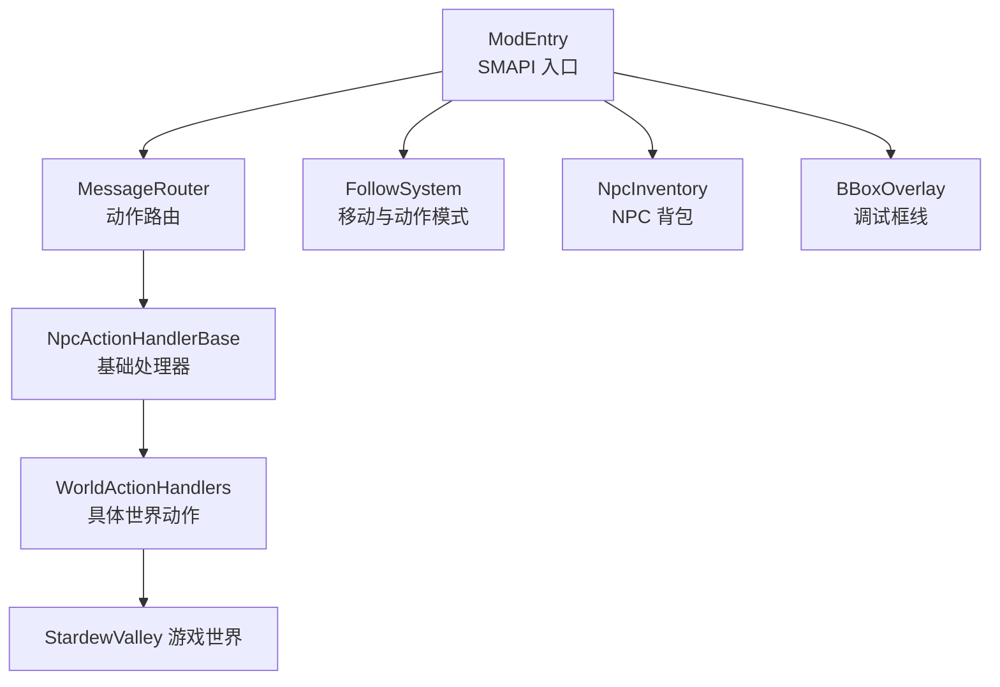
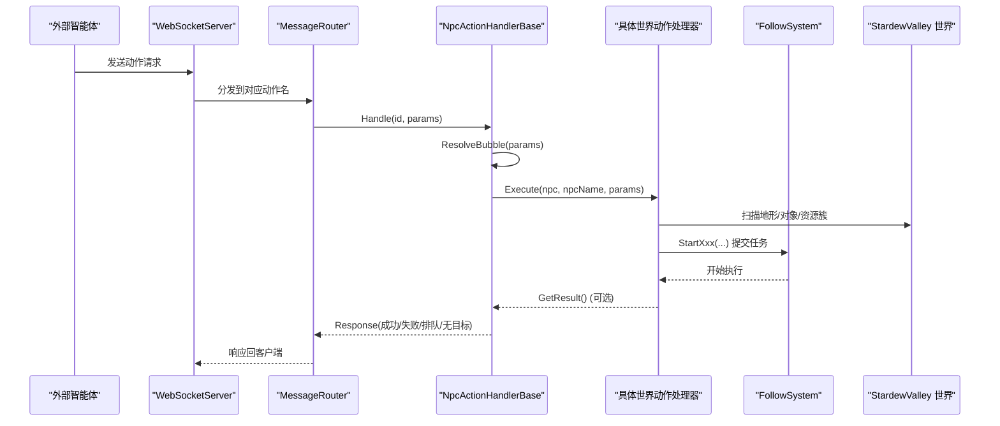
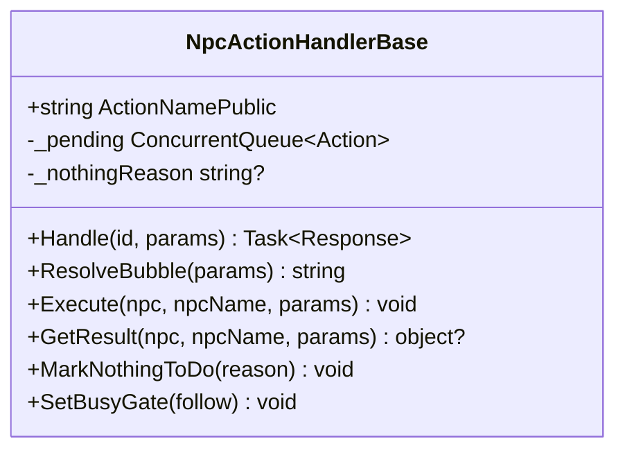
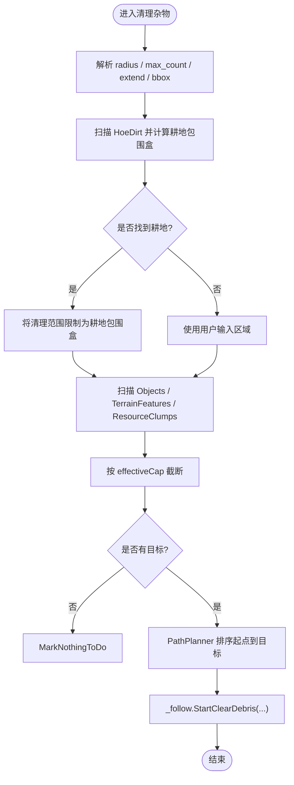
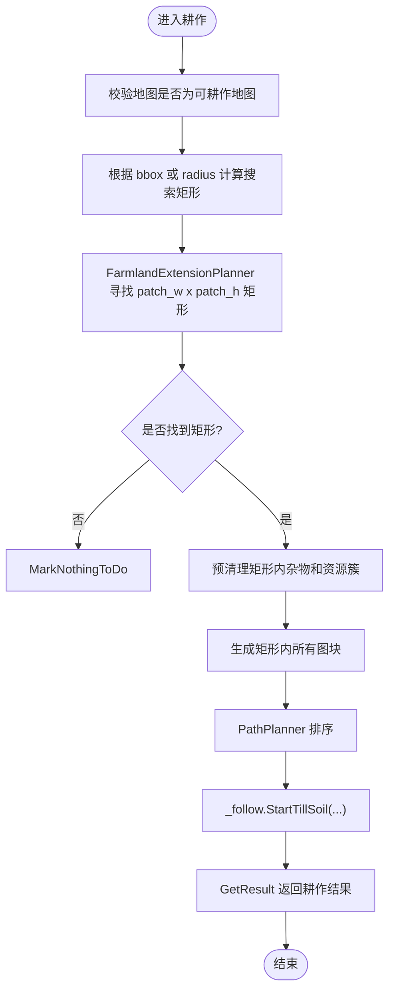
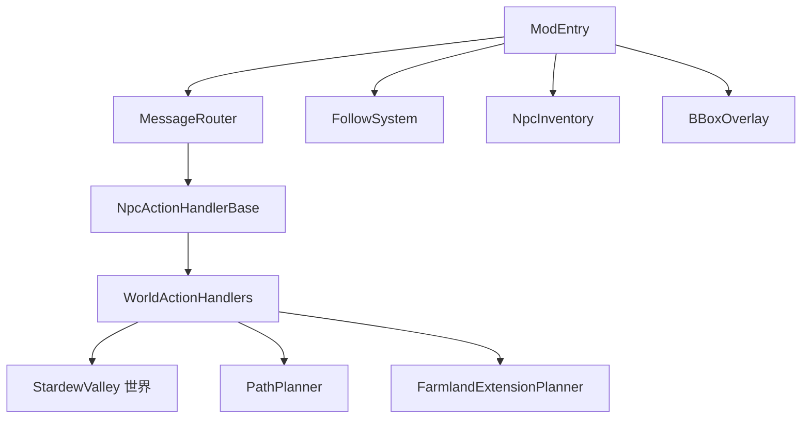

# 世界动作处理器

<cite>
**本文引用的文件**   
- [WorldActionHandlers.cs](file://SmartNPC/smapi-mod/Behavior/WorldActionHandlers.cs)
- [NpcActionHandlerBase.cs](file://SmartNPC/smapi-mod/Behavior/NpcActionHandlerBase.cs)
- [ModEntry.cs](file://SmartNPC/smapi-mod/ModEntry.cs)
- [ModConfig.cs](file://SmartNPC/smapi-mod/ModConfig.cs)
</cite>

## 目录
1. [引言](#引言)
2. [项目结构](#项目结构)
3. [核心组件](#核心组件)
4. [架构总览](#架构总览)
5. [详细组件分析](#详细组件分析)
6. [依赖关系分析](#依赖关系分析)
7. [性能与防作弊策略](#性能与防作弊策略)
8. [故障排查指南](#故障排查指南)
9. [结论](#结论)
10. [附录：扩展新世界的操作类型](#附录扩展新世界的操作类型)

## 引言
本文聚焦 SmartNPC SMAPI 模组中的“世界动作处理器”，即 NPC 在 Stardew Valley 世界中执行环境交互行为的核心实现。重点包括：
- 农场工具操作：浇水、收割、耕作、播种、清理杂物、采集可拾取物、破坏资源、施肥、补洞、存入箱子、寄售、从箱子取出等。
- 物品流转：NPC 背包库存、箱子存取、邮箱寄售。
- 状态观察：对象与环境扫描、农场工作建议汇总。
- SMAPI 集成：地形特征修改、物品生成、状态同步、路径规划与 FollowSystem 调度。
- 执行模型：串行队列、抢占式漫游、无目标反馈、气泡提示、调试可视化。
- 扩展方式：如何新增一种世界动作，以及如何设计多步骤、连锁反应流程。

## 项目结构
SmartNPC 的 SMAPI 部分采用分层组织：
- Behavior：按“动作类型”划分的处理器，每个世界动作一个类。
- Bridge：WebSocket 消息路由与协议。
- Movement/FollowSystem：移动、寻路、动作模式控制。
- Data：NPC 库存、未读消息等持久化数据。
- UI/Chat/Mail/Query/Patches：界面、聊天、查询、补丁等辅助系统。
- ModEntry：SMAPI 入口，装配所有子系统并注册动作。
- ModConfig：配置项（监听地址、调试开关、无人值守实验模式等）。

图示来源
- [ModEntry.cs:1-120](file://SmartNPC/smapi-mod/ModEntry.cs#L1-L120)
- [NpcActionHandlerBase.cs:1-60](file://SmartNPC/smapi-mod/Behavior/NpcActionHandlerBase.cs#L1-L60)
- [WorldActionHandlers.cs:1-40](file://SmartNPC/smapi-mod/Behavior/WorldActionHandlers.cs#L1-L40)

章节来源
- [ModEntry.cs:1-160](file://SmartNPC/smapi-mod/ModEntry.cs#L1-L160)

## 核心组件
- NpcActionHandlerBase：提供统一的请求处理、气泡显示、游戏线程调度、串行队列、无目标结构化反馈、结果构建。
- WorldActionHandlers：包含多个具体世界动作处理器，如 Wander、ClearDebris、WaterCrops、HarvestCrops、DepositItems、ShipItems、ForageCollect、PetAnimal、PlantSeeds、TillSoil、InspectObject、PlaceObject、BreakResource、Fertilize、FillGaps、WithdrawFromChest、TransferItem 等。
- ModEntry：装配路由器、跟随系统、NPC 库存、UI、调试覆盖层，并注册所有动作。
- ModConfig：暴露调试开关、监听前缀、无人值守自动睡觉等配置。

章节来源
- [NpcActionHandlerBase.cs:1-120](file://SmartNPC/smapi-mod/Behavior/NpcActionHandlerBase.cs#L1-L120)
- [WorldActionHandlers.cs:1-120](file://SmartNPC/smapi-mod/Behavior/WorldActionHandlers.cs#L1-L120)
- [ModEntry.cs:120-240](file://SmartNPC/smapi-mod/ModEntry.cs#L120-L240)
- [ModConfig.cs:1-144](file://SmartNPC/smapi-mod/ModConfig.cs#L1-L144)

## 架构总览
世界动作的整体调用链如下：

图示来源
- [ModEntry.cs:160-220](file://SmartNPC/smapi-mod/ModEntry.cs#L160-L220)
- [NpcActionHandlerBase.cs:60-160](file://SmartNPC/smapi-mod/Behavior/NpcActionHandlerBase.cs#L60-L160)
- [WorldActionHandlers.cs:120-240](file://SmartNPC/smapi-mod/Behavior/WorldActionHandlers.cs#L120-L240)

## 详细组件分析

### 基类：NpcActionHandlerBase
职责与关键点：
- 统一解析参数、查找 NPC、显示气泡、执行 Execute、返回结构化响应。
- 支持三类执行语义：
  - 平凡动作：默认不排队，立即执行。
  - 可抢占模式：仅漫游使用；被更高优先级任务抢占。
  - 串行独占：长时任务（收获/浇水/清理/耕作/采集/种植/施肥/破坏/存入/寄售/取出/接近说话）必须顺序完成，若 NPC 忙则入队并在空闲时排干。
- MarkNothingToDo：当预扫描未发现可执行目标时，返回结构化“无目标”结果，让智能体在同一回合重新规划。
- SetBusyGate：绑定 FollowSystem，使队列调度器能读取当前模式并强制停止可抢占模式。

图示来源
- [NpcActionHandlerBase.cs:1-120](file://SmartNPC/smapi-mod/Behavior/NpcActionHandlerBase.cs#L1-L120)

章节来源
- [NpcActionHandlerBase.cs:1-200](file://SmartNPC/smapi-mod/Behavior/NpcActionHandlerBase.cs#L1-L200)

### 漫游：WanderHandler
功能要点：
- 连续随机游走：选择可达图块，到达后再选下一个。
- 约束条件：中心点+最大距离，或矩形区域。
- 可抢占：漫游是填充行为，真实工作可以抢占。
- 日志与气泡：记录半径、中心、最大距离、矩形范围。

章节来源
- [WorldActionHandlers.cs:12-90](file://SmartNPC/smapi-mod/Behavior/WorldActionHandlers.cs#L12-L90)

### 清理杂物：ClearDebrisHandler
功能要点：
- 清理杂草、树枝、垃圾、小石头、树桩、幼苗、高草、空心原木等。
- 在农场地图且发现耕地时，会将搜索范围收缩到耕地包围盒，避免清理整片非耕地。
- 支持 extend 参数向外扩展一圈清理边缘。
- 硬上限：每次最多清理 15 个目标，防止长时间卡顿。
- 路径优化：使用 PathPlanner 对目标排序减少折返。
- 调试框：标记实际工作区域。

图示来源
- [WorldActionHandlers.cs:90-360](file://SmartNPC/smapi-mod/Behavior/WorldActionHandlers.cs#L90-L360)

章节来源
- [WorldActionHandlers.cs:60-360](file://SmartNPC/smapi-mod/Behavior/WorldActionHandlers.cs#L60-L360)

### 浇水：WaterCropsHandler
执行条件：
- 地形为 HoeDirt。
- 有作物且未死亡。
- 未处于水合状态（state != watered）。
- 在矩形或半径范围内。

资源消耗：
- 不直接扣减种子或肥料；由游戏引擎决定浇水所需工具/水资源。

结果反馈：
- 通过 FollowSystem 启动浇水序列。
- 若无目标，返回结构化“无目标”。

章节来源
- [WorldActionHandlers.cs:360-540](file://SmartNPC/smapi-mod/Behavior/WorldActionHandlers.cs#L360-L540)

### 收获：HarvestCropsHandler
执行条件：
- 地形为 HoeDirt。
- 有作物且未死亡。
- 处于最终生长阶段，并且满足成熟判定逻辑。
- 在矩形或半径范围内。

成熟判定逻辑：
- 单季作物：达到最终阶段后，即使 fullyGrown 仍为 false，也允许收获。
- 多季作物：首次成熟后 fullyGrown=true；再生倒计时期间 dayOfCurrentPhase>0 不算成熟。

资源消耗：
- 由游戏引擎扣除对应工具耐久或时间成本。

结果反馈：
- 通过 FollowSystem 启动收获序列。
- 若无目标，返回结构化“无目标”。

章节来源
- [WorldActionHandlers.cs:540-720](file://SmartNPC/smapi-mod/Behavior/WorldActionHandlers.cs#L540-L720)

### 存入箱子：DepositItemsHandler
执行条件：
- NPC 背包中存在待存入物品。
- 可选择自动寻找箱子，或指定坐标与地图。
- 可按 item_ids 过滤。

资源消耗：
- 无直接资源消耗，属于物品位置转移。

结果反馈：
- 启动 FollowSystem 存入流程。
- 若无法找到箱子，记录警告日志。

章节来源
- [WorldActionHandlers.cs:720-840](file://SmartNPC/smapi-mod/Behavior/WorldActionHandlers.cs#L720-L840)

### 寄售：ShipItemsHandler
执行条件：
- NPC 背包中存在可寄售物品。
- 农场存在邮箱建筑。
- 可按 item_ids 过滤。

资源消耗：
- 无直接资源消耗。

结果反馈：
- 启动 FollowSystem 寄售流程。
- 若没有邮箱，记录警告日志。

章节来源
- [WorldActionHandlers.cs:840-920](file://SmartNPC/smapi-mod/Behavior/WorldActionHandlers.cs#L840-L920)

### 采集可拾取物：ForageCollectHandler
执行条件：
- 对象位于 Objects 中。
- 是已生成对象 IsSpawnedObject。
- 在矩形或半径范围内。

资源消耗：
- 由游戏引擎决定拾取逻辑。

结果反馈：
- 通过 FollowSystem 启动采集流程。
- 若无目标，返回结构化“无目标”。

章节来源
- [WorldActionHandlers.cs:920-1080](file://SmartNPC/smapi-mod/Behavior/WorldActionHandlers.cs#L920-L1080)

### 抚摸宠物：PetAnimalHandler
执行条件：
- 玩家拥有宠物。
- 宠物与 NPC 在同一地图。
- 宠物可被访问。

资源消耗：
- 无直接资源消耗。

结果反馈：
- 若无宠物或不在同一地图，返回结构化“无目标”。
- 否则启动跟随系统抚摸宠物。

章节来源
- [WorldActionHandlers.cs:1080-1160](file://SmartNPC/smapi-mod/Behavior/WorldActionHandlers.cs#L1080-L1160)

### 播种：PlantSeedsHandler
执行条件：
- 地图为农场或温室或海岛农场。
- 地形为 HoeDirt 且没有作物。
- 在矩形或半径范围内。
- seed_id 必填。

资源消耗：
- 若背包中有该种子，则有效上限受种子数量限制。
- 若背包中没有种子，则不消耗种子，仅放置空土。

结果反馈：
- 通过 FollowSystem 启动播种流程。
- 若无空耕地，返回结构化“无目标”。

章节来源
- [WorldActionHandlers.cs:1160-1320](file://SmartNPC/smapi-mod/Behavior/WorldActionHandlers.cs#L1160-L1320)

### 耕作：TillSoilHandler
执行条件：
- 地图为农场或温室或海岛农场。
- 在指定 patch_w × patch_h 内能找到相邻现有耕地的矩形区域。

处理流程：
- 先清除矩形内所有杂物（Objects、TerrainFeatures、ResourceClumps）。
- 生成矩形内所有图块并按路径规划排序。
- 启动 FollowSystem 耕作，同时传入需要清理和破坏的图块列表。

结果反馈：
- GetResult 返回 tilled、patch 坐标、是否相邻现有耕地等信息。
- 若无合适矩形，返回结构化“无目标”。

图示来源
- [WorldActionHandlers.cs:1320-1560](file://SmartNPC/smapi-mod/Behavior/WorldActionHandlers.cs#L1320-L1560)

章节来源
- [WorldActionHandlers.cs:1320-1560](file://SmartNPC/smapi-mod/Behavior/WorldActionHandlers.cs#L1320-L1560)

### 环境观察：InspectObjectHandler
功能要点：
- 基础观察：统计成熟作物、生长中作物、未浇水、空耕地、对象、其他地形特征。
- farm_actions 模式：输出 7 个分组及其计数与包围盒，供上层智能体选择具体动作并传回矩形。
- 分组包括：收获、浇水、清理、耕作、采集、播种、破坏。
- 使用 HarvestCropsHandler.IsCropHarvestable 作为成熟判定的唯一来源，保证观察、选择、执行三层一致。

章节来源
- [WorldActionHandlers.cs:1560-2000](file://SmartNPC/smapi-mod/Behavior/WorldActionHandlers.cs#L1560-L2000)

### 其他世界动作
以下动作同样继承 NpcActionHandlerBase，并通过 FollowSystem 协调执行：
- PlaceObject：放置物品。
- BreakResource：破坏资源（大石头、陨石、成熟树等）。
- Fertilize：施肥。
- FillGaps：补洞。
- WithdrawFromChest：从箱子取出。
- TransferItem：物品转移。

章节来源
- [ModEntry.cs:180-240](file://SmartNPC/smapi-mod/ModEntry.cs#L180-L240)
- [WorldActionHandlers.cs:2000-2429](file://SmartNPC/smapi-mod/Behavior/WorldActionHandlers.cs#L2000-L2429)

## 依赖关系分析

图示来源
- [ModEntry.cs:160-240](file://SmartNPC/smapi-mod/ModEntry.cs#L160-L240)
- [WorldActionHandlers.cs:120-240](file://SmartNPC/smapi-mod/Behavior/WorldActionHandlers.cs#L120-L240)

耦合与内聚：
- 每个世界动作高度内聚于单一职责，符合单一职责原则。
- 与 FollowSystem 松耦合：处理器只负责扫描与提交任务，实际移动、动画、逐格执行由 FollowSystem 承担。
- 与 NpcInventory 松耦合：仅用于读写 NPC 背包。
- 与 PathPlanner/FarmlandExtensionPlanner 解耦：路径与矩形规划由专用模块处理。

潜在循环依赖：
- 未见明显循环引用；处理器依赖底层系统，不被底层系统反向依赖。

章节来源
- [ModEntry.cs:160-240](file://SmartNPC/smapi-mod/ModEntry.cs#L160-L240)
- [WorldActionHandlers.cs:120-240](file://SmartNPC/smapi-mod/Behavior/WorldActionHandlers.cs#L120-L240)

## 性能与防作弊策略
- 串行队列：长时世界动作通过 per-NPC 队列串行执行，避免多个工具同时运行导致状态混乱。
- 抢占式漫游：漫游可被真实工作抢占，避免 NPC 卡在无关移动上。
- 目标上限：
  - 清理杂物单次最多 15 个目标。
  - 浇水、收获、采集等支持 max_count 限制。
  - 矩形模式下以矩形大小作为上限。
- 范围收敛：
  - 清理杂物在农场地图上优先收缩到耕地包围盒。
  - 耕作要求矩形能与现有耕地相邻。
  - 播种、耕作限制地图类型。
- 成熟判定一致性：收获判断逻辑集中在 IsCropHarvestable，观察、选择、执行三层共享，避免误判。
- 调试可视化：BBoxOverlay 显示动作作用区域，便于定位过大范围或错误选择。
- 无目标反馈：MarkNothingToDo 让智能体在同一回合调整计划，而不是误认为任务已完成。

章节来源
- [NpcActionHandlerBase.cs:60-120](file://SmartNPC/smapi-mod/Behavior/NpcActionHandlerBase.cs#L60-L120)
- [WorldActionHandlers.cs:90-360](file://SmartNPC/smapi-mod/Behavior/WorldActionHandlers.cs#L90-L360)
- [WorldActionHandlers.cs:360-720](file://SmartNPC/smapi-mod/Behavior/WorldActionHandlers.cs#L360-L720)
- [WorldActionHandlers.cs:1320-1560](file://SmartNPC/smapi-mod/Behavior/WorldActionHandlers.cs#L1320-L1560)

## 故障排查指南
常见问题与建议：
- NPC 名称无效：
  - 检查请求中 npc 字段是否正确。
  - 基类会返回失败响应。
- 无保存或未加载：
  - 基类在未就绪时拒绝执行。
- 无目标但返回成功：
  - 确认处理器是否调用 MarkNothingToDo。
  - 检查 radius、bbox、extend、seed_id、item_ids 等参数。
- 行动卡住：
  - 查看 FollowSystem 当前模式。
  - 检查是否被串行队列阻塞。
  - 确认是否可抢占模式被更高优先级任务抢占。
- 清理范围过大：
  - 启用 DebugShowBBoxOverlay 查看黄色框。
  - 使用 bbox 精确限定区域。
- 地图不可用：
  - 播种、耕作只允许农场、温室、海岛农场。
  - 检查 location.IsFarm、IsGreenhouse、name 包含 Island 和 Farm。

章节来源
- [NpcActionHandlerBase.cs:60-160](file://SmartNPC/smapi-mod/Behavior/NpcActionHandlerBase.cs#L60-L160)
- [WorldActionHandlers.cs:1160-1320](file://SmartNPC/smapi-mod/Behavior/WorldActionHandlers.cs#L1160-L1320)
- [WorldActionHandlers.cs:1320-1560](file://SmartNPC/smapi-mod/Behavior/WorldActionHandlers.cs#L1320-L1560)

## 结论
世界动作处理器通过统一基类、清晰的动作分类、严格的执行模型和 SMAPI 深度集成，实现了 NPC 在 Stardew Valley 世界中的自动化农场与环境管理。其关键优势在于：
- 可扩展：新增动作只需继承基类并实现 Execute。
- 可观测：气泡、日志、调试框、farm_actions 汇总。
- 可控：串行队列、抢占、上限、范围收敛、地图限制。
- 可集成：FollowSystem、NpcInventory、PathPlanner、FarmlandExtensionPlanner、BBoxOverlay 协同工作。

## 附录：扩展新世界的操作类型
新增世界动作的步骤：
1. 新建处理器类，继承 NpcActionHandlerBase。
2. 定义 ActionName，例如 npc_my_world_action。
3. 设置 RefuseWhileBusy 与 IsPreemptable：
   - 长时任务设为 true。
   - 填充型任务可设为可抢占。
4. 实现 ResolveBubble：返回气泡文本。
5. 实现 Execute：
   - 解析参数：radius、max_count、bbox、extend、seed_id、item_ids 等。
   - 校验地图、范围、库存、NPC 位置。
   - 扫描世界：Objects、terrainFeatures、resourceClumps。
   - 使用 PathPlanner 或 FarmlandExtensionPlanner 进行路径/矩形规划。
   - 调用 _follow.StartXxx(...) 提交任务。
   - 必要时调用 MarkNothingToDo。
6. 可选实现 GetResult：返回结构化结果，如耕作返回 tilled、patch、adjacent_to_existing。
7. 在 ModEntry 中注册：
   - 构造处理器并传入 IMonitor、showBubble、NpcInventory、FollowSystem。
   - 调用 _router.Register(ActionNamePublic, handler.Handle)。

示例路径参考：
- 基础处理器：[NpcActionHandlerBase.cs:1-120](file://SmartNPC/smapi-mod/Behavior/NpcActionHandlerBase.cs#L1-L120)
- 具体动作示例：
  - [WorldActionHandlers.cs:90-360](file://SmartNPC/smapi-mod/Behavior/WorldActionHandlers.cs#L90-L360)
  - [WorldActionHandlers.cs:360-720](file://SmartNPC/smapi-mod/Behavior/WorldActionHandlers.cs#L360-L720)
  - [WorldActionHandlers.cs:1320-1560](file://SmartNPC/smapi-mod/Behavior/WorldActionHandlers.cs#L1320-L1560)
- 注册入口：[ModEntry.cs:180-240](file://SmartNPC/smapi-mod/ModEntry.cs#L180-L240)

复杂流程与连锁反应建议：
- 第一步：InspectObject farm_actions 获取分组与 bbox。
- 第二步：根据分组选择具体动作，并将 bbox 传给对应处理器。
- 第三步：若涉及物品转移，结合 DepositItems、WithdrawFromChest、TransferItem。
- 第四步：若涉及地形变更，先 ClearDebris，再 TillSoil，再 PlantSeeds，再 WaterCrops，最后 HarvestCrops。
- 第五步：每步都检查返回值与日志，必要时重试或调整范围。

权限与防作弊补充说明：
- 当前 WebSocket 协议无认证，配置文件明确提醒不要在不信任网络暴露 0.0.0.0。
- 建议在外部网关层增加身份验证与速率限制。
- 在游戏内通过串行队列、上限、地图限制、范围收敛降低滥用风险。

章节来源
- [ModEntry.cs:180-240](file://SmartNPC/smapi-mod/ModEntry.cs#L180-L240)
- [ModConfig.cs:1-60](file://SmartNPC/smapi-mod/ModConfig.cs#L1-L60)
- [WorldActionHandlers.cs:90-360](file://SmartNPC/smapi-mod/Behavior/WorldActionHandlers.cs#L90-L360)
- [WorldActionHandlers.cs:1320-1560](file://SmartNPC/smapi-mod/Behavior/WorldActionHandlers.cs#L1320-L1560)