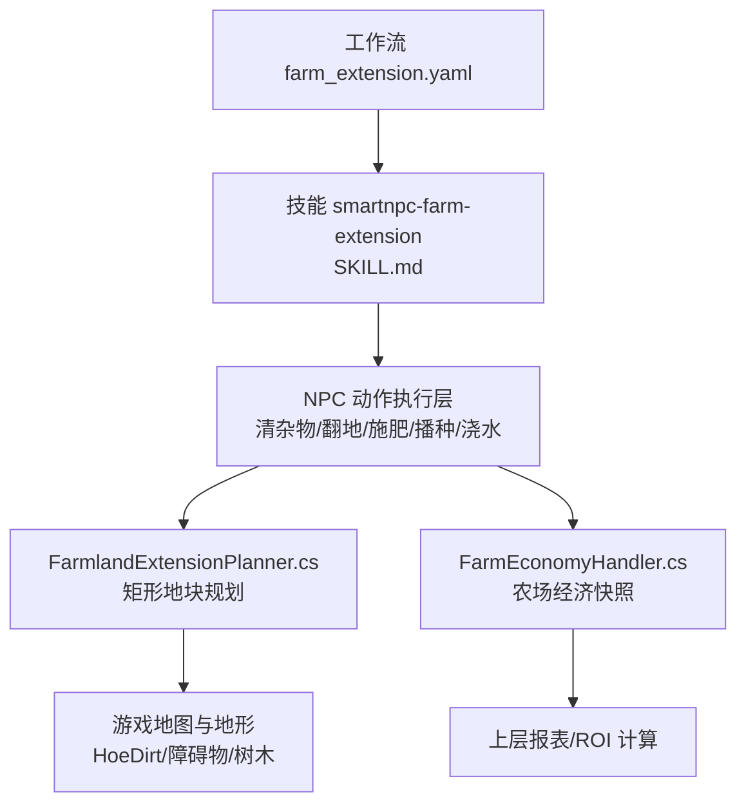
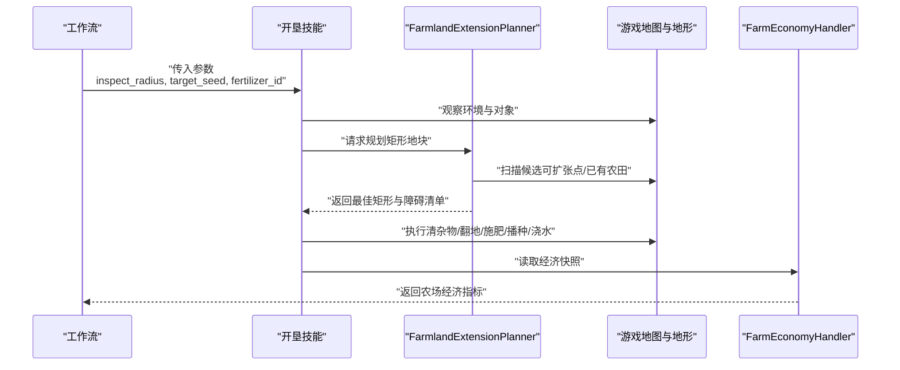
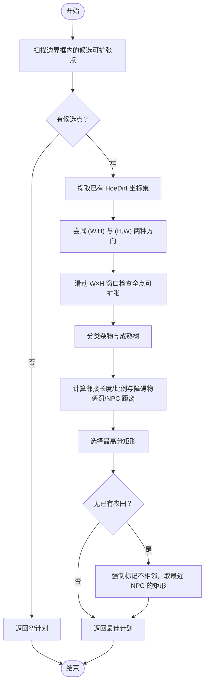
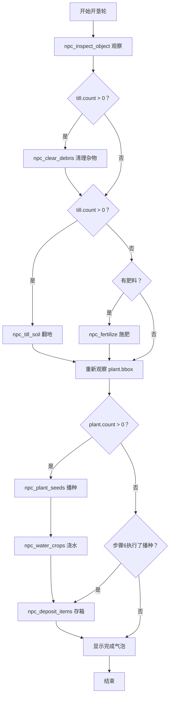
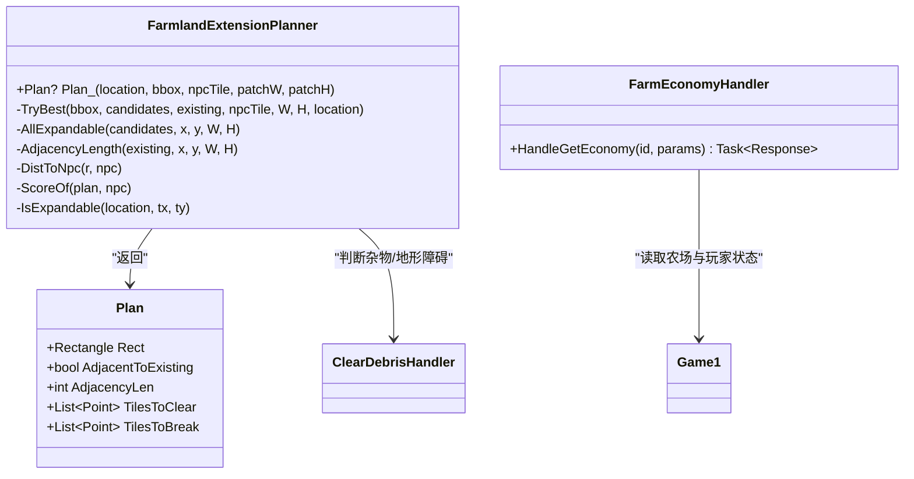

# 农场扩展规划器

<cite>
**本文引用的文件**
- [FarmlandExtensionPlanner.cs](file://SmartNPC/smapi-mod/Behavior/FarmlandExtensionPlanner.cs)
- [FarmEconomyHandler.cs](file://SmartNPC/smapi-mod/Query/FarmEconomyHandler.cs)
- [SKILL.md](file://提示词导出-20261026-004143/04-全部游戏技能/smartnpc/smartnpc-farm-extension/SKILL.md)
- [farm_extension.yaml](file://提示词导出-20261026-004143/11-内置工作流定义/farm_extension.yaml)
</cite>

## 目录
1. [引言](#引言)
2. [项目结构](#项目结构)
3. [核心组件](#核心组件)
4. [架构总览](#架构总览)
5. [详细组件分析](#详细组件分析)
6. [依赖关系分析](#依赖关系分析)
7. [性能与复杂度](#性能与复杂度)
8. [种植策略与收益评估](#种植策略与收益评估)
9. [故障排查](#故障排查)
10. [结论](#结论)

## 引言
本文件面向 SmartNPC 的“农场扩展规划器”，目标是解释 FarmlandExtensionPlanner.cs 中的智能农场规划逻辑，并把它与工作流、经济数据查询和 NPC 行为链路串联起来。重点包括：
- 地块价值评估与选择标准：优先规则化矩形、贴近已有农田、障碍惩罚、NPC 距离。
- 种植策略制定：开垦轮固定序列（清杂物→翻地→施肥→播种→浇水）。
- 收益最大化思路：基于经济快照指标构建投资回报计算框架。
- 动态调整：结合市场变化与季节种子库更新目标作物与资源分配。
- 与游戏经济系统集成：通过 FarmEconomyHandler 读取金币、已发货价值、可收获作物数等指标。

该文档既适合开发者理解代码实现，也适合非技术读者了解系统如何自动扩大和优化农场。

## 项目结构
围绕“农场扩展”的相关代码与配置分布在以下位置：
- 行为规划器：FarmlandExtensionPlanner.cs，负责在给定区域中挑选最优矩形地块集合，用于后续翻耕与种植。
- 经济数据查询：FarmEconomyHandler.cs，提供只读农场经济快照，供上层决策或报告使用。
- 工作流与技能说明：farm_extension.yaml 与 SKILL.md，描述 NPC XiaMi 执行“开垦轮”的固定流程与参数。

**图示来源**
- [farm_extension.yaml:1-20](file://提示词导出-20261026-004143/11-内置工作流定义/farm_extension.yaml#L1-L20)
- [SKILL.md:1-137](file://提示词导出-20261026-004143/04-全部游戏技能/smartnpc/smartnpc-farm-extension/SKILL.md#L1-L137)
- [FarmlandExtensionPlanner.cs:1-273](file://SmartNPC/smapi-mod/Behavior/FarmlandExtensionPlanner.cs#L1-L273)
- [FarmEconomyHandler.cs:1-88](file://SmartNPC/smapi-mod/Query/FarmEconomyHandler.cs#L1-L88)

**章节来源**
- [farm_extension.yaml:1-20](file://提示词导出-20261026-004143/11-内置工作流定义/farm_extension.yaml#L1-L20)
- [SKILL.md:1-137](file://提示词导出-20261026-004143/04-全部游戏技能/smartnpc/smartnpc-farm-extension/SKILL.md#L1-L137)
- [FarmlandExtensionPlanner.cs:1-273](file://SmartNPC/smapi-mod/Behavior/FarmlandExtensionPlanner.cs#L1-L273)
- [FarmEconomyHandler.cs:1-88](file://SmartNPC/smapi-mod/Query/FarmEconomyHandler.cs#L1-L88)

## 核心组件
### 1. 地块规划器 FarmlandExtensionPlanner
- 职责：在游戏地图内按给定边界框搜索所有“可扩张”地块，并选择一个规则矩形，使其尽可能贴近已有农田，同时考虑障碍物数量和 NPC 距离。
- 关键数据结构：
  - Plan：包含矩形范围、是否邻接已有农田、邻接边长、需清理的杂物坐标、需砍伐的成熟树木坐标。
  - 候选集：通过遍历边界框内每个格子，判断是否可扩张。
  - 已有农田集：从地形特征中提取 HoeDirt 坐标集合。
- 核心算法：
  - 生成候选可扩张点集。
  - 对两种宽高方向尝试滑动窗口，检查矩形内所有点是否都可扩张。
  - 统计邻接长度与障碍数量，计算分数，选出最高分方案。
  - 冷启动场景（地图上无已有农田）时退化为最靠近 NPC 的矩形。
- 输出：最佳矩形及其分类信息，供上层调用清杂物、翻地、播种等操作。

**章节来源**
- [FarmlandExtensionPlanner.cs:1-273](file://SmartNPC/smapi-mod/Behavior/FarmlandExtensionPlanner.cs#L1-L273)

### 2. 农场经济处理器 FarmEconomyHandler
- 职责：读取当前农场的只读经济状态，返回天季年、金币、累计收入、已发货物品数量与价值、种植与可收获作物数量、翻地与浇水地块数、动物数量等。
- 特点：
  - 不修改游戏状态，仅读取。
  - 对异常进行日志记录与容错，保证查询失败不会中断上层流程。
  - 结果以统一响应格式返回，便于 MCP 工具或 UI 消费。

**章节来源**
- [FarmEconomyHandler.cs:1-88](file://SmartNPC/smapi-mod/Query/FarmEconomyHandler.cs#L1-L88)

### 3. 开垦工作流与技能
- 工作流 farm_extension.yaml：定义输入参数（巡视半径、目标种子、肥料 ID），并以 skill_call 调用技能。
- 技能 SKILL.md：定义开垦轮固定顺序、参数、季节种子、性格影响与禁止事项。

**章节来源**
- [farm_extension.yaml:1-20](file://提示词导出-20261026-004143/11-内置工作流定义/farm_extension.yaml#L1-L20)
- [SKILL.md:1-137](file://提示词导出-20261026-004143/04-全部游戏技能/smartnpc/smartnpc-farm-extension/SKILL.md#L1-L137)

## 架构总览
下图展示从工作流到规划器、再到游戏地图与经济数据的整体交互。

**图示来源**
- [farm_extension.yaml:1-20](file://提示词导出-20261026-004143/11-内置工作流定义/farm_extension.yaml#L1-L20)
- [SKILL.md:1-137](file://提示词导出-20261026-004143/04-全部游戏技能/smartnpc/smartnpc-farm-extension/SKILL.md#L1-L137)
- [FarmlandExtensionPlanner.cs:1-273](file://SmartNPC/smapi-mod/Behavior/FarmlandExtensionPlanner.cs#L1-L273)
- [FarmEconomyHandler.cs:1-88](file://SmartNPC/smapi-mod/Query/FarmEconomyHandler.cs#L1-L88)

## 详细组件分析

### 地块价值评估与选择标准
FarmlandExtensionPlanner 的价值函数由多个因素组成：
- 邻接长度：新矩形与已有 HoeDirt 相邻的边长越大越好，鼓励连片扩展。
- 邻接比例：邻接长度除以矩形周长，体现“贴合度”。
- 障碍物惩罚：需要清理的杂物与需要砍伐的成熟树木越多，分数越低。
- NPC 距离：矩形中心到 NPC 的距离越小越好，作为同分情况下的就近偏好。

综合评分公式为：
- 评分 = 10 × 邻接长度 + 200 × 邻接比例 − 5 × 障碍物数量 − 0.5 × NPC 距离

这一设计使规划器优先选择“紧贴已有农田且干净”的矩形，避免把农场拆成零散小块。

**图示来源**
- [FarmlandExtensionPlanner.cs:1-273](file://SmartNPC/smapi-mod/Behavior/FarmlandExtensionPlanner.cs#L1-L273)

**章节来源**
- [FarmlandExtensionPlanner.cs:1-273](file://SmartNPC/smapi-mod/Behavior/FarmlandExtensionPlanner.cs#L1-L273)

### 种植策略制定与固定工作流
SKILL.md 定义了开垦轮的严格顺序：
- 观察环境：根据 inspect_radius 获取可翻耕与可种植区域。
- 清理待开垦区域：若存在可翻耕区域，先清杂物。
- 翻耕：对清理后的空地翻地。
- 施肥：若有肥料则施加基础肥料。
- 重新观察：翻地后必须重新检测种植区域，因为坐标可能变化。
- 播种：按目标种子种植；背包为空时使用免费模式。
- 浇水：新种下的种子必须浇水。
- 存箱与收尾气泡：整理背包并显示完成提示。

禁止事项明确排除对已有作物浇水、收获与破坏资源等行为，确保开垦轮专注“开发新地”。

**图示来源**
- [SKILL.md:1-137](file://提示词导出-20261026-004143/04-全部游戏技能/smartnpc/smartnpc-farm-extension/SKILL.md#L1-L137)

**章节来源**
- [SKILL.md:1-137](file://提示词导出-20261026-004143/04-全部游戏技能/smartnpc/smartnpc-farm-extension/SKILL.md#L1-L137)

### 作物轮作规划与季节性种植计划
SKILL.md 提供了季节种子映射：
- 春季：防风草、花椰菜、土豆。
- 夏季：红甘蓝、玉米、甜瓜。
- 秋季：南瓜、蔓越莓种子。
- 冬季：停止执行此工作流。

规划建议：
- 根据当前季节选择默认种子，并结合库存与市场趋势微调。
- 轮作周期建议以 2–3 个季节为一个循环，避免连续种植高耗肥作物导致土壤产出下降。
- 对于高价值作物（如南瓜、甜瓜），可搭配基础肥料提升收益。

注意：当前仓库未提供具体轮作算法实现，以上为基于季节种子与开垦工作流的实践建议。

**章节来源**
- [SKILL.md:1-137](file://提示词导出-20261026-004143/04-全部游戏技能/smartnpc/smartnpc-farm-extension/SKILL.md#L1-L137)

### 资源分配优化策略
- 肥料优先级：优先对面积大、邻接度高、障碍少的矩形施肥。
- 种子预算：根据背包种子数量决定播种面积；种子不足时优先高价值作物。
- 浇水时机：只在播种后立即浇水，避免浪费时间与水量。
- NPC 移动成本：规划器已用 NPC 距离作为次要权重，减少往返成本。

这些策略与 FarmlandExtensionPlanner 的评分函数及 SKILL.md 的工作流保持一致。

**章节来源**
- [FarmlandExtensionPlanner.cs:1-273](file://SmartNPC/smapi-mod/Behavior/FarmlandExtensionPlanner.cs#L1-L273)
- [SKILL.md:1-137](file://提示词导出-20261026-004143/04-全部游戏技能/smartnpc/smartnpc-farm-extension/SKILL.md#L1-L137)

### 与游戏经济系统的集成与 ROI 计算
FarmEconomyHandler 提供以下关键指标：
- 时间维度：day、season、year。
- 资金维度：gold、total_money_earned。
- 生产维度：crops_planted、crops_ready、tilled_tiles、watered_tiles、animals。
- 销售维度：shipping_bin_count、shipping_bin_value。

投资回报率（ROI）可定义为：
- 单次开垦 ROI = 新开垦矩形带来的预计新增销售额 − 开垦成本 / 开垦成本。
- 其中开垦成本包括：种子成本、肥料成本、NPC 行动时间机会成本。
- 预计新增销售额可通过 crops_ready × 平均售价估算，并结合历史 shipping_bin_value 校准。

示例计算（概念性）：
- 假设新开垦 30 块地，每块种植南瓜，预期产量 1 单位/块，平均售价 150 金。
- 种子与肥料成本合计 60 金。
- 预计新增销售额 = 30 × 150 = 4500 金。
- ROI ≈ (4500 − 60) / 60 ≈ 7400%。
- 实际 ROI 应扣除浇水、收割、运输等间接成本，并根据历史数据修正。

注意：该 ROI 模型为通用计算方法，仓库未提供完整自动化实现，需在上层决策层结合 FarmEconomyHandler 的输出进行扩展。

**章节来源**
- [FarmEconomyHandler.cs:1-88](file://SmartNPC/smapi-mod/Query/FarmEconomyHandler.cs#L1-L88)

### 动态调整种植计划以适应市场变化
- 当 shipping_bin_value 增长放缓时，提高高价值作物的权重。
- 当 crops_ready 低于预期时，增加肥料投入或扩大种植面积。
- 当 animals 数量上升时，适当降低动物饲料消耗型作物的种植比例。
- 结合季节变化提前切换种子，避免错过最佳生长周期。

上述调整建议可与工作流参数（target_seed、fertilizer_id）联动，由上层调度器驱动。

**章节来源**
- [farm_extension.yaml:1-20](file://提示词导出-20261026-004143/11-内置工作流定义/farm_extension.yaml#L1-L20)
- [FarmEconomyHandler.cs:1-88](file://SmartNPC/smapi-mod/Query/FarmEconomyHandler.cs#L1-L88)

## 依赖关系分析
FarmlandExtensionPlanner 依赖游戏地图与地形数据，并通过 Helper 类判断杂物与地形障碍。FarmEconomyHandler 依赖 Stardew Valley 的游戏状态对象。工作流与技能通过参数传递控制行为。

**图示来源**
- [FarmlandExtensionPlanner.cs:1-273](file://SmartNPC/smapi-mod/Behavior/FarmlandExtensionPlanner.cs#L1-L273)
- [FarmEconomyHandler.cs:1-88](file://SmartNPC/smapi-mod/Query/FarmEconomyHandler.cs#L1-L88)

**章节来源**
- [FarmlandExtensionPlanner.cs:1-273](file://SmartNPC/smapi-mod/Behavior/FarmlandExtensionPlanner.cs#L1-L273)
- [FarmEconomyHandler.cs:1-88](file://SmartNPC/smapi-mod/Query/FarmEconomyHandler.cs#L1-L88)

## 性能与复杂度
- 候选点扫描：O(B)，B 为边界框内格子数。
- 滑动窗口：O(W×H×S)，S 为窗口内点数检查次数。
- 邻接统计：O(W+H)。
- 总体复杂度：近似 O(B + W×H×(W+H))，在常规农场规模下可接受。
- 空间复杂度：O(C+E+P)，C 为候选点集，E 为已有农田集，P 为矩形内点数。

优化建议：
- 预缓存已有 HoeDirt 坐标集，避免重复扫描。
- 对明显不可行的窗口提前剪枝（例如超出边界或包含不可扩张点）。
- 将频繁调用的 IsExpandable 与分类逻辑做局部缓存。

**章节来源**
- [FarmlandExtensionPlanner.cs:1-273](file://SmartNPC/smapi-mod/Behavior/FarmlandExtensionPlanner.cs#L1-L273)

## 种植策略与收益评估

### 地块选择标准总结
- 土壤质量：通过 Diggable 属性与 HoeDirt 状态间接体现；规划器优先选择可扩张且能连片的区域。
- 水源距离：仓库未直接实现水源距离评分，但可通过上层策略对靠近水源的区域加权。
- 光照条件：仓库未直接实现光照评分，可在上层策略中对朝向与遮挡进行加权。
- 空间布局分析：通过邻接长度与邻接比例衡量与已有农田的贴合度，避免碎片化。

**章节来源**
- [FarmlandExtensionPlanner.cs:1-273](file://SmartNPC/smapi-mod/Behavior/FarmlandExtensionPlanner.cs#L1-L273)

### 收益最大化算法思路
- 短期：优先种植当季高价值作物，搭配基础肥料提升单产。
- 中期：根据 crops_ready 与 shipping_bin_value 动态调整种子与肥料比例。
- 长期：建立作物轮作周期，平衡高耗肥作物与恢复型作物。

**章节来源**
- [SKILL.md:1-137](file://提示词导出-20261026-004143/04-全部游戏技能/smartnpc/smartnpc-farm-extension/SKILL.md#L1-L137)
- [FarmEconomyHandler.cs:1-88](file://SmartNPC/smapi-mod/Query/FarmEconomyHandler.cs#L1-L88)

### 动态调整机制
- 当市场变化导致某作物价格波动时，上层调度器可修改 target_seed。
- 当肥料库存不足时，降低施肥概率或选择更经济的种子。
- 当 NPC 疲劳或路径成本上升时，优先选择靠近 NPC 的矩形。

**章节来源**
- [farm_extension.yaml:1-20](file://提示词导出-20261026-004143/11-内置工作流定义/farm_extension.yaml#L1-L20)
- [FarmlandExtensionPlanner.cs:1-273](file://SmartNPC/smapi-mod/Behavior/FarmlandExtensionPlanner.cs#L1-L273)

## 故障排查
- 无法找到农场或地图未就绪：FarmEconomyHandler 会返回失败响应，检查保存加载状态。
- 货物箱读取异常：记录警告日志并继续返回其他指标，避免整个查询失败。
- 动物计数异常：同样记录警告日志并返回 0 或保留之前值。
- 规划器返回空计划：表示边界框内无可扩张矩形，需扩大 inspect_radius 或清理障碍物。

**章节来源**
- [FarmEconomyHandler.cs:1-88](file://SmartNPC/smapi-mod/Query/FarmEconomyHandler.cs#L1-L88)
- [FarmlandExtensionPlanner.cs:1-273](file://SmartNPC/smapi-mod/Behavior/FarmlandExtensionPlanner.cs#L1-L273)

## 结论
FarmlandExtensionPlanner 实现了“规则矩形、贴边连片、障碍惩罚、就近 NPC”的地块选择策略，配合 SKILL.md 的开垦轮工作流，形成稳定的农场扩展能力。FarmEconomyHandler 提供只读经济快照，为 ROI 计算与动态调整提供数据基础。虽然仓库未实现完整的作物轮作与市场预测算法，但现有架构已具备扩展空间，可在上层调度器中注入市场信号与资源约束，实现更智能的收益最大化。