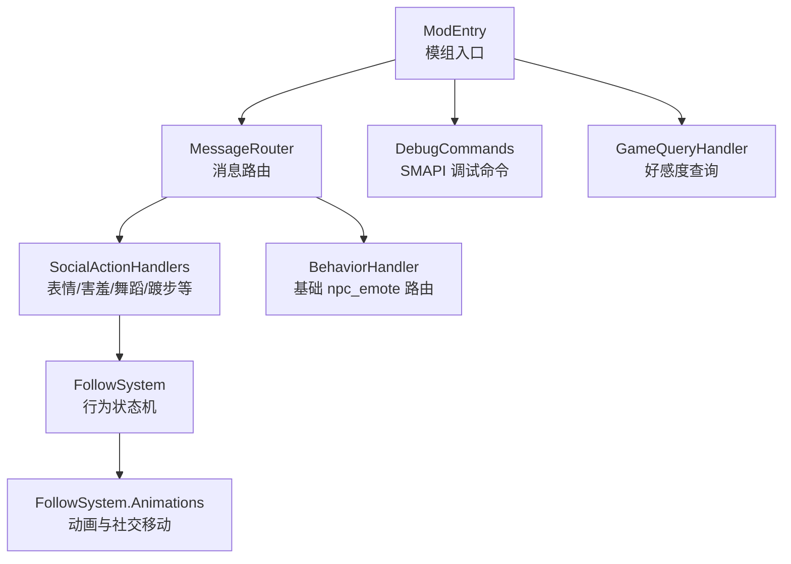
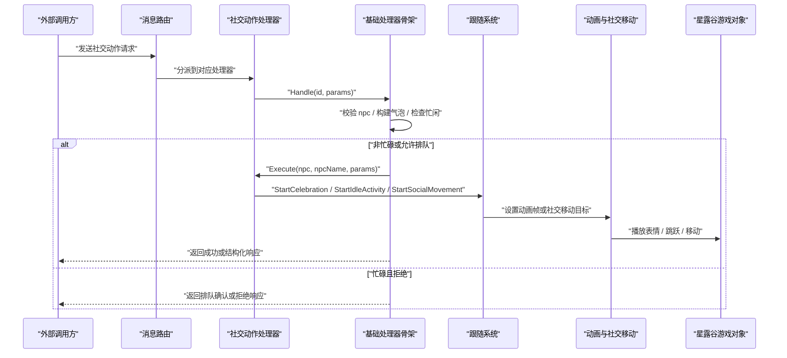
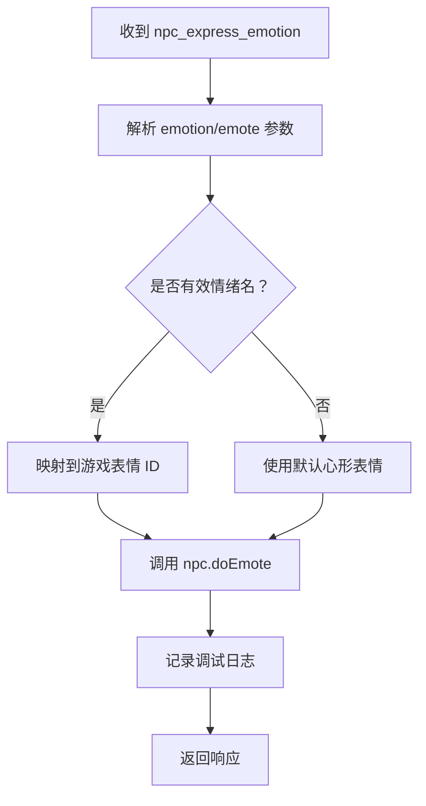
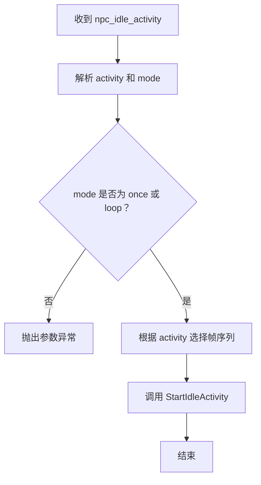
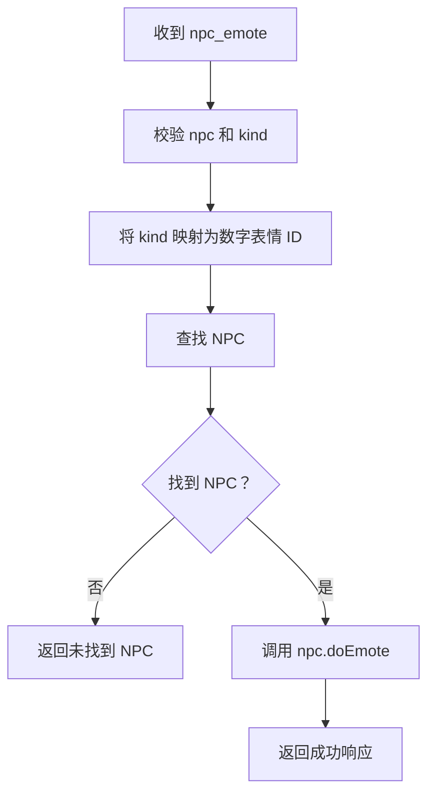
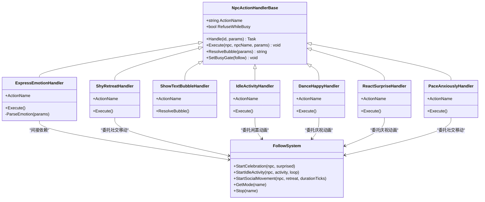
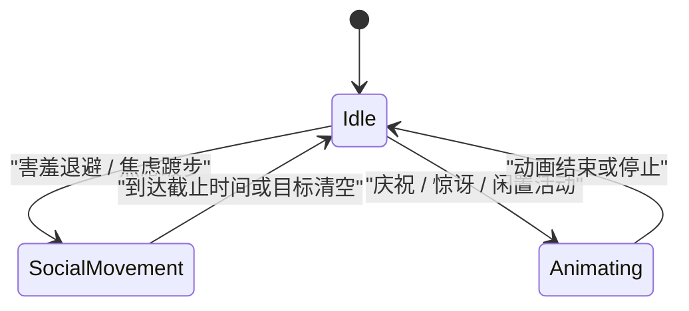
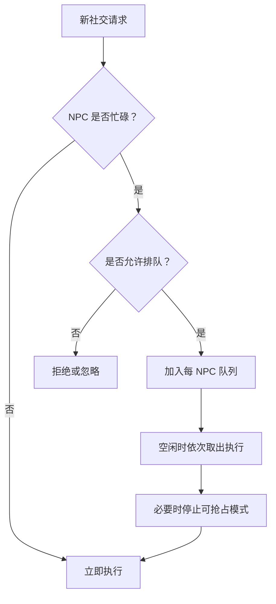
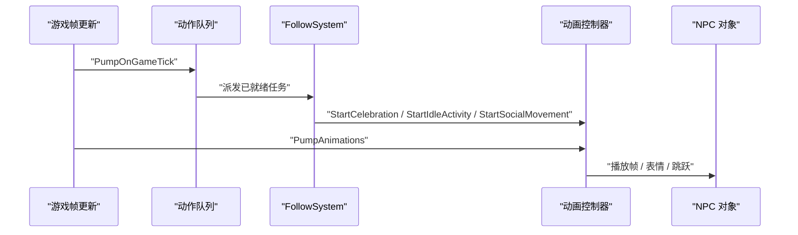

# 社交动作处理器

<cite>
**本文引用的文件**   
- [SocialActionHandlers.cs](file://SmartNPC/smapi-mod/Behavior/SocialActionHandlers.cs)
- [NpcActionHandlerBase.cs](file://SmartNPC/smapi-mod/Behavior/NpcActionHandlerBase.cs)
- [FollowSystem.cs](file://SmartNPC/smapi-mod/Movement/FollowSystem.cs)
- [FollowSystem.Animations.cs](file://SmartNPC/smapi-mod/Movement/FollowSystem.Animations.cs)
- [BehaviorHandler.cs](file://SmartNPC/smapi-mod/Movement/BehaviorHandler.cs)
- [ModEntry.cs](file://SmartNPC/smapi-mod/ModEntry.cs)
- [DebugCommands.cs](file://SmartNPC/smapi-mod/Debug/DebugCommands.cs)
- [GameQueryHandler.cs](file://SmartNPC/smapi-mod/Query/GameQueryHandler.cs)
- [XiaMiData.cs](file://SmartNPC/smapi-mod/NPC/XiaMiData.cs)
</cite>

## 目录
1. [简介](#简介)
2. [项目结构定位](#项目结构定位)
3. [核心组件概览](#核心组件概览)
4. [架构总览](#架构总览)
5. [详细组件分析](#详细组件分析)
6. [依赖关系分析](#依赖关系分析)
7. [参数验证与状态更新机制](#参数验证与状态更新机制)
8. [NPC 关系系统集成说明](#npc-关系系统集成说明)
9. [调用示例与复杂互动场景](#调用示例与复杂互动场景)
10. [冷却时间、优先级冲突与动画同步](#冷却时间优先级冲突与动画同步)
11. [性能特性与扩展建议](#性能特性与扩展建议)
12. [故障排查指南](#故障排查指南)
13. [结论](#结论)

## 简介
本文件面向 SmartNPC SMAPI 模组中的 NPC 间社交行为实现，重点围绕 `SocialActionHandlers.cs` 中定义的表情表达、害羞退避、文本气泡、闲置活动、开心跳舞、惊讶反应和焦虑踱步等社交动作。文档同时解释这些动作如何与行为调度、移动系统、动画播放、WebSocket 消息路由以及 SMAPI 控制台命令协作，并给出可操作的调用方式。

需要特别说明的是：当前仓库中没有独立的“送礼”处理器；礼物相关能力主要通过 NPC 背包读写与物品展示动画间接体现，而不是以专用 `gift` 社交处理器形式出现。

## 项目结构定位
社交动作处理代码集中在 SMAPI 模组的 `Behavior` 子目录中，并与 `Movement` 子目录的跟随系统、动画控制器、行为处理器协同工作。入口类负责注册 WebSocket 路由、创建各处理器实例，并把它们挂到统一的消息分发器上。

**图示来源**  
- [ModEntry.cs:140-175](file://SmartNPC/smapi-mod/ModEntry.cs#L140-L175)  
- [SocialActionHandlers.cs:1-151](file://SmartNPC/smapi-mod/Behavior/SocialActionHandlers.cs#L1-L151)  
- [BehaviorHandler.cs:1-159](file://SmartNPC/smapi-mod/Movement/BehaviorHandler.cs#L1-L159)  
- [FollowSystem.cs:1-200](file://SmartNPC/smapi-mod/Movement/FollowSystem.cs#L1-L200)  
- [FollowSystem.Animations.cs:1-120](file://SmartNPC/smapi-mod/Movement/FollowSystem.Animations.cs#L1-L120)

**章节来源**  
- [ModEntry.cs:140-175](file://SmartNPC/smapi-mod/ModEntry.cs#L140-L175)  
- [SocialActionHandlers.cs:1-151](file://SmartNPC/smapi-mod/Behavior/SocialActionHandlers.cs#L1-L151)

## 核心组件概览
| 组件 | 主要职责 | 与社交动作的关系 |
|---|---|---|
| `SocialActionHandlers` | 定义各类社交动作处理器，解析 JSON 参数，执行表情、移动或动画逻辑 | 直接实现社交动作 |
| `NpcActionHandlerBase` | 提供公共调度骨架：参数校验、气泡显示、忙闲判断、队列化执行、结果构造 | 所有社交处理器继承它 |
| `FollowSystem` | 维护每个 NPC 的行为模式、路径、目标队列、超时和状态切换 | 接收社交动作后进入社交移动或闲置动画状态 |
| `FollowSystem.Animations` | 播放自定义帧序列、庆祝动画、闲置活动、社交移动目标序列 | 实际驱动 NPC 动画和移动 |
| `BehaviorHandler` | 处理基础 `npc_emote` 消息，映射表情字符串到游戏原生表情 ID | 提供另一种表情触发通道 |
| `ModEntry` | 组装系统、注册 WebSocket 路由、注入处理器实例 | 把社交动作暴露为可调用的 WS 动作 |
| `DebugCommands` | 提供 SMAPI 控制台命令，用于快速测试社交动作 | 便于调试表情、舞蹈、踱步、害羞退避等 |
| `GameQueryHandler` | 读取玩家对 NPC 的好感度数据 | 不修改好感度，但为关系系统提供查询接口 |
| `XiaMiData` | 定义 XiaMi 自定义帧常量 | 为社交动画帧提供索引 |

**章节来源**  
- [SocialActionHandlers.cs:1-151](file://SmartNPC/smapi-mod/Behavior/SocialActionHandlers.cs#L1-L151)  
- [NpcActionHandlerBase.cs:1-200](file://SmartNPC/smapi-mod/Behavior/NpcActionHandlerBase.cs#L1-L200)  
- [FollowSystem.cs:1-200](file://SmartNPC/smapi-mod/Movement/FollowSystem.cs#L1-L200)  
- [FollowSystem.Animations.cs:1-120](file://SmartNPC/smapi-mod/Movement/FollowSystem.Animations.cs#L1-L120)  
- [BehaviorHandler.cs:1-159](file://SmartNPC/smapi-mod/Movement/BehaviorHandler.cs#L1-L159)  
- [ModEntry.cs:140-175](file://SmartNPC/smapi-mod/ModEntry.cs#L140-L175)  
- [DebugCommands.cs:1-200](file://SmartNPC/smapi-mod/Debug/DebugCommands.cs#L1-L200)  
- [GameQueryHandler.cs:1-100](file://SmartNPC/smapi-mod/Query/GameQueryHandler.cs#L1-L100)  
- [XiaMiData.cs:1-120](file://SmartNPC/smapi-mod/NPC/XiaMiData.cs#L1-L120)

## 架构总览
社交动作的整体调用链路可以概括为：外部请求 → WebSocket 路由 → 具体社交处理器 → 基础处理器骨架 → 跟随系统 → 动画与移动控制。

**图示来源**  
- [ModEntry.cs:140-175](file://SmartNPC/smapi-mod/ModEntry.cs#L140-L175)  
- [NpcActionHandlerBase.cs:150-360](file://SmartNPC/smapi-mod/Behavior/NpcActionHandlerBase.cs#L150-L360)  
- [SocialActionHandlers.cs:20-151](file://SmartNPC/smapi-mod/Behavior/SocialActionHandlers.cs#L20-L151)  
- [FollowSystem.Animations.cs:39-120](file://SmartNPC/smapi-mod/Movement/FollowSystem.Animations.cs#L39-L120)

## 详细组件分析

### 表情表达处理器：`ExpressEmotionHandler`
该处理器实现名为 `npc_express_emotion` 的社交动作。它支持从参数中解析 `emotion` 或 `emote` 字段，并将常见情绪映射到游戏内表情 ID。默认表情是心形表情。

关键行为：
- 支持的情绪名称包括心形、惊叹号、问号、愤怒、流汗、哭泣、音符、睡觉、星星、中性、开心、悲伤、惊讶等。
- 如果参数无效，则回退到默认表情。
- 通过 `npc.doEmote` 调用游戏原生表情。
- 在日志中记录动作名称、NPC 名称、情绪名称和最终使用的表情 ID。
- 气泡文案使用 `[情绪名]` 或 `[emote]` 作为占位提示。

**图示来源**  
- [SocialActionHandlers.cs:12-58](file://SmartNPC/smapi-mod/Behavior/SocialActionHandlers.cs#L12-L58)

**章节来源**  
- [SocialActionHandlers.cs:12-58](file://SmartNPC/smapi-mod/Behavior/SocialActionHandlers.cs#L12-L58)

### 害羞退避处理器：`ShyRetreatHandler`
该处理器实现 `npc_shy_retreat`，让 NPC 表现害羞退避。它属于“忙碌时拒绝”的动作，会委托 `FollowSystem.StartSocialMovement` 完成退避移动，并附带一个固定时长。

关键点：
- 在忙碌状态下会被拒绝。
- 退避方向由 NPC 位置与玩家位置的相对方向决定。
- 退避过程中会播放流汗表情。
- 移动目标是一个靠近远离方向的格子。

**章节来源**  
- [SocialActionHandlers.cs:60-78](file://SmartNPC/smapi-mod/Behavior/SocialActionHandlers.cs#L60-L78)  
- [FollowSystem.Animations.cs:88-120](file://SmartNPC/smapi-mod/Movement/FollowSystem.Animations.cs#L88-L120)

### 文本气泡处理器：`ShowTextBubbleHandler`
该处理器实现 `npc_show_text_bubble`，主要用于让 NPC 头顶显示自定义文本气泡。它的执行体为空，因为气泡本身即被视为动作效果。

关键点：
- 如果参数中存在非空 `text` 字段，则直接使用该文本作为气泡内容。
- 否则回退到通用气泡文案。
- 不改变 NPC 行为模式，也不启动跟随系统。

**章节来源**  
- [SocialActionHandlers.cs:80-99](file://SmartNPC/smapi-mod/Behavior/SocialActionHandlers.cs#L80-L99)  
- [NpcActionHandlerBase.cs:120-148](file://SmartNPC/smapi-mod/Behavior/NpcActionHandlerBase.cs#L120-L148)

### 闲置活动处理器：`IdleActivityHandler`
该处理器实现 `npc_idle_activity`，用于让 NPC 进入闲置动画，比如锄地、休息、环顾四周、手持南瓜、手持作物、手持花、手持鸡等。

关键点：
- 支持 `activity` 和 `mode` 两个参数。
- `mode` 只接受 `once` 或 `loop`，否则会抛出参数错误。
- 不同活动对应不同的帧序列和播放间隔。
- 属于“忙碌时拒绝”的动作。

**图示来源**  
- [SocialActionHandlers.cs:101-118](file://SmartNPC/smapi-mod/Behavior/SocialActionHandlers.cs#L101-L118)  
- [FollowSystem.Animations.cs:39-54](file://SmartNPC/smapi-mod/Movement/FollowSystem.Animations.cs#L39-L54)

**章节来源**  
- [SocialActionHandlers.cs:101-118](file://SmartNPC/smapi-mod/Behavior/SocialActionHandlers.cs#L101-L118)  
- [FollowSystem.Animations.cs:39-54](file://SmartNPC/smapi-mod/Movement/FollowSystem.Animations.cs#L39-L54)

### 开心跳舞处理器：`DanceHappyHandler`
该处理器实现 `npc_dance_happy`，触发庆祝动画。它会调用 `FollowSystem.StartCelebration`，并传入 `surprised=false`。

关键点：
- 属于“忙碌时拒绝”的动作。
- 庆祝动画包含多个帧，例如欢呼、站立、爱心等。
- 同时触发游戏原生心形表情。

**章节来源**  
- [SocialActionHandlers.cs:120-128](file://SmartNPC/smapi-mod/Behavior/SocialActionHandlers.cs#L120-L128)  
- [FollowSystem.Animations.cs:56-76](file://SmartNPC/smapi-mod/Movement/FollowSystem.Animations.cs#L56-L76)

### 惊讶反应处理器：`ReactSurpriseHandler`
该处理器实现 `npc_react_surprise`，触发惊讶动画。它与开心跳舞的区别在于传入 `surprised=true`，并使用惊讶帧序列。

关键点：
- 属于“忙碌时拒绝”的动作。
- 惊讶动画会触发惊叹号表情。
- NPC 会有轻微跳跃动作。

**章节来源**  
- [SocialActionHandlers.cs:130-139](file://SmartNPC/smapi-mod/Behavior/SocialActionHandlers.cs#L130-L139)  
- [FollowSystem.Animations.cs:56-76](file://SmartNPC/smapi-mod/Movement/FollowSystem.Animations.cs#L56-L76)

### 焦虑踱步处理器：`PaceAnxiouslyHandler`
该处理器实现 `npc_pace_anxious`，让 NPC 在原地附近来回踱步。它通过 `FollowSystem.StartSocialMovement` 生成左右交替的移动目标，并在结束时回到原点。

关键点：
- 支持可选的 `duration_ticks` 参数，默认值为 200。
- 实际持续时间会被限制在一个合理区间内。
- 踱步过程中会播放睡眠或疲惫类表情。
- 属于“忙碌时拒绝”的动作。

**章节来源**  
- [SocialActionHandlers.cs:141-151](file://SmartNPC/smapi-mod/Behavior/SocialActionHandlers.cs#L141-L151)  
- [FollowSystem.Animations.cs:76-120](file://SmartNPC/smapi-mod/Movement/FollowSystem.Animations.cs#L76-L120)

### 基础表情路由：`BehaviorHandler.HandleEmote`
除了社交处理器外，系统还提供 `npc_emote` 这一更通用的表情路由。它将表情字符串映射到星露谷原生表情 ID，然后调用 `npc.doEmote`。

关键映射规则：
- `question`、`?` → 问号表情。
- `angry`、`mad` → 愤怒表情。
- `exclamation`、`!`、`sparkle` → 惊叹号表情。
- `heart`、`love` → 心形表情。
- `sleep`、`zzz` → 睡觉表情。
- `sad` → 悲伤表情。
- `happy`、`smile` → 开心表情。
- `x`、`cross` → 叉号表情。
- `pause` → 暂停表情。
- `music`、`note` → 音符表情。
- 未知类型回退到惊叹号。

**图示来源**  
- [BehaviorHandler.cs:35-112](file://SmartNPC/smapi-mod/Movement/BehaviorHandler.cs#L35-L112)

**章节来源**  
- [BehaviorHandler.cs:35-112](file://SmartNPC/smapi-mod/Movement/BehaviorHandler.cs#L35-L112)

## 依赖关系分析
社交动作处理器依赖以下层次：

| 层级 | 依赖项 | 作用 |
|---|---|---|
| 协议层 | WebSocket 路由 | 接收 MCP 或外部客户端的请求 |
| 调度层 | `NpcActionHandlerBase` | 统一参数校验、气泡、忙闲判断、队列 |
| 行为层 | `FollowSystem` | 管理 NPC 行为模式、路径和目标队列 |
| 动画层 | `FollowSystem.Animations` | 播放帧序列、社交移动、庆祝动画 |
| 游戏层 | `StardewValley.NPC` | 调用 `doEmote`、`Halt`、移动、跳跃 |
| 调试层 | `DebugCommands` | 提供控制台命令测试社交动作 |

**图示来源**  
- [SocialActionHandlers.cs:12-151](file://SmartNPC/smapi-mod/Behavior/SocialActionHandlers.cs#L12-L151)  
- [NpcActionHandlerBase.cs:40-200](file://SmartNPC/smapi-mod/Behavior/NpcActionHandlerBase.cs#L40-L200)  
- [FollowSystem.cs:1-200](file://SmartNPC/smapi-mod/Movement/FollowSystem.cs#L1-L200)  
- [FollowSystem.Animations.cs:39-120](file://SmartNPC/smapi-mod/Movement/FollowSystem.Animations.cs#L39-L120)

**章节来源**  
- [SocialActionHandlers.cs:12-151](file://SmartNPC/smapi-mod/Behavior/SocialActionHandlers.cs#L12-L151)  
- [NpcActionHandlerBase.cs:40-200](file://SmartNPC/smapi-mod/Behavior/NpcActionHandlerBase.cs#L40-L200)  
- [FollowSystem.cs:1-200](file://SmartNPC/smapi-mod/Movement/FollowSystem.cs#L1-L200)  
- [FollowSystem.Animations.cs:39-120](file://SmartNPC/smapi-mod/Movement/FollowSystem.Animations.cs#L39-L120)

## 参数验证与状态更新机制

### 参数验证
社交动作的参数验证主要由两部分完成：

1. **基础处理器骨架**：
   - 要求存在 `npc` 字段。
   - 若没有保存或未加载世界，立即返回失败。
   - 构建气泡文本，用于在游戏内显示动作意图。
   - 将请求封装为游戏线程任务，避免 WebSocket 线程直接操作游戏对象。

2. **具体处理器**：
   - `ExpressEmotionHandler` 允许 `emotion` 或 `emote` 二选一。
   - `IdleActivityHandler` 校验 `mode` 必须为 `once` 或 `loop`。
   - `PaceAnxiouslyHandler` 允许可选的 `duration_ticks`，并为数值增加边界保护。
   - `ShowTextBubbleHandler` 优先使用 `text` 字段，否则退回默认气泡。

**章节来源**  
- [NpcActionHandlerBase.cs:150-220](file://SmartNPC/smapi-mod/Behavior/NpcActionHandlerBase.cs#L150-L220)  
- [SocialActionHandlers.cs:20-151](file://SmartNPC/smapi-mod/Behavior/SocialActionHandlers.cs#L20-L151)

### 状态更新机制
社交动作不会直接修改 NPC 的对话树或好感度表，而是通过以下方式影响状态：

| 动作 | 状态变化 |
|---|---|
| 表情表达 | 调用原生表情，不改变行为模式 |
| 害羞退避 | 进入 `SocialMovement` 模式，设置退避目标队列和截止时间 |
| 文本气泡 | 仅显示气泡，不改变行为模式 |
| 闲置活动 | 进入闲置动画，可能为单次或循环 |
| 开心跳舞 | 进入庆祝动画，触发跳跃和表情 |
| 惊讶反应 | 进入惊讶动画，触发跳跃和表情 |
| 焦虑踱步 | 进入社交移动，左右交替行走后回到原点 |

**图示来源**  
- [FollowSystem.cs:1-200](file://SmartNPC/smapi-mod/Movement/FollowSystem.cs#L1-L200)  
- [FollowSystem.Animations.cs:76-120](file://SmartNPC/smapi-mod/Movement/FollowSystem.Animations.cs#L76-L120)

**章节来源**  
- [FollowSystem.cs:1-200](file://SmartNPC/smapi-mod/Movement/FollowSystem.cs#L1-L200)  
- [FollowSystem.Animations.cs:76-120](file://SmartNPC/smapi-mod/Movement/FollowSystem.Animations.cs#L76-L120)

## NPC 关系系统集成说明

### 当前集成范围
当前代码中与 NPC 关系相关的实现主要集中在好感度查询和宠物互动的小幅提升上：

- `GameQueryHandler` 提供读取玩家对某 NPC 的好感度的能力。
- `FollowSystem` 中对宠物互动的小幅好感度提升逻辑位于宠物抚摸相关流程中。
- `XiaMiData` 确保玩家对 XiaMi 这个自定义 NPC 存在好感度记录，以便查询和调试命令可用。

### 当前缺失的能力
当前仓库中并没有以下能力的完整实现：
- 社交动作自动增加玩家对 NPC 的好感度。
- 社交动作根据好感度阈值决定是否允许执行。
- 社交礼仪规则引擎（例如不能对讨厌自己的人做亲昵动作）。
- 基于好感度的对话触发器。
- 专门的送礼处理器。

因此，如果要完善 NPC 关系系统集成，需要在现有基础上增加关系模型、礼仪策略和社交奖励逻辑。

**章节来源**  
- [GameQueryHandler.cs:70-90](file://SmartNPC/smapi-mod/Query/GameQueryHandler.cs#L70-L90)  
- [FollowSystem.cs:2100-2135](file://SmartNPC/smapi-mod/Movement/FollowSystem.cs#L2100-L2135)  
- [XiaMiData.cs:90-110](file://SmartNPC/smapi-mod/NPC/XiaMiData.cs#L90-L110)

## 调用示例与复杂互动场景

### 通过 WebSocket 调用社交动作
社交动作通过 SMAPI 模组的 WebSocket 服务暴露。典型调用步骤如下：

1. 连接 SMAPI 模组的 WebSocket 服务。
2. 向 `MessageRouter` 注册的动作名称发送请求。
3. 请求体中包含 `npc` 字段，部分动作还包含情绪、活动、模式或时长等参数。
4. 路由将请求交给对应的处理器。
5. 处理器通过 `NpcActionHandlerBase.Handle` 执行校验、气泡和调度。
6. 最终由 `FollowSystem` 或游戏对象执行实际效果。

示例动作名称：
- `npc_express_emotion`
- `npc_shy_retreat`
- `npc_show_text_bubble`
- `npc_idle_activity`
- `npc_dance_happy`
- `npc_react_surprise`
- `npc_pace_anxiously`
- `npc_emote`（基础表情）

**章节来源**  
- [ModEntry.cs:140-175](file://SmartNPC/smapi-mod/ModEntry.cs#L140-L175)  
- [SocialActionHandlers.cs:12-151](file://SmartNPC/smapi-mod/Behavior/SocialActionHandlers.cs#L12-L151)  
- [BehaviorHandler.cs:35-112](file://SmartNPC/smapi-mod/Movement/BehaviorHandler.cs#L35-L112)

### 通过 SMAPI 控制台调试社交动作
开发者可以使用 SMAPI 控制台命令快速测试社交动作，例如：
- `smartnpc_express_emotion`
- `smartnpc_dance`
- `smartnpc_react_surprise`
- `smartnpc_pace`
- `smartnpc_shy_retreat`
- `smartnpc_idle_activity`
- `smartnpc_text_bubble`

这些命令内部会复用同一套处理器和跟随系统，适合调试动作参数、动画和移动行为。

**章节来源**  
- [DebugCommands.cs:1-200](file://SmartNPC/smapi-mod/Debug/DebugCommands.cs#L1-L200)

### 复杂互动场景设计
虽然当前代码没有内置复杂的 NPC 间社交对话链，但可以基于现有组件组合出多步互动：

1. NPC A 先表达开心表情。
2. NPC B 对 NPC A 做出惊讶反应。
3. NPC C 开始闲置活动，例如锄地或环顾四周。
4. 某个 NPC 害羞退避，制造距离感。
5. 另一个 NPC 焦虑踱步，表现紧张。
6. 最后通过文本气泡显示临时对话提示。

这种组合适合模拟 NPC 间的简单群体互动，但若要实现真正的 NPC 间对话和关系联动，需要额外引入对话编排器和关系状态机。

[本节为概念性说明，不直接分析具体源码片段]

## 冷却时间、优先级冲突与动画同步

### 冷却时间
当前代码中没有全局的“社交动作冷却时间”。相关的时间控制主要体现在：

- `PaceAnxiouslyHandler` 的 `duration_ticks` 控制踱步持续时间。
- `FollowSystem.Animations` 中的社交移动有截止时间，超过后强制结束。
- 闲置活动的帧播放间隔按活动类型区分。
- 基础表情路由没有显式冷却，重复调用会重复触发表情。

如果需要冷却时间，建议在调用层或处理器层增加每 NPC 的最近一次社交动作时间戳。

**章节来源**  
- [SocialActionHandlers.cs:141-151](file://SmartNPC/smapi-mod/Behavior/SocialActionHandlers.cs#L141-L151)  
- [FollowSystem.Animations.cs:76-120](file://SmartNPC/smapi-mod/Movement/FollowSystem.Animations.cs#L76-L120)

### 优先级冲突解决
处理器通过 `RefuseWhileBusy` 和行为模式控制优先级：

- 默认处理器不是“忙碌时拒绝”，会立即执行。
- 害羞退避、闲置活动、跳舞、惊讶、踱步都设置 `RefuseWhileBusy=true`。
- 这些动作会委托 `FollowSystem`，而 `FollowSystem` 每个 NPC 只能处于一种行为模式中。
- 当 NPC 已经处于长耗时任务时，新的排他任务可能被加入队列，等待空闲后再执行。

**图示来源**  
- [NpcActionHandlerBase.cs:200-360](file://SmartNPC/smapi-mod/Behavior/NpcActionHandlerBase.cs#L200-L360)  
- [FollowSystem.cs:300-400](file://SmartNPC/smapi-mod/Movement/FollowSystem.cs#L300-L400)

**章节来源**  
- [NpcActionHandlerBase.cs:200-360](file://SmartNPC/smapi-mod/Behavior/NpcActionHandlerBase.cs#L200-L360)  
- [FollowSystem.cs:300-400](file://SmartNPC/smapi-mod/Movement/FollowSystem.cs#L300-L400)

### 动画同步机制
动画同步由 `FollowSystem.Animations` 和 `FollowSystem.PumpAnimations` 共同完成：

- 动画在处理器和队列调度之后执行，避免被原生走路动画覆盖。
- 每次游戏帧更新时，动画控制器会根据已注册 NPC 列表和时间增量播放帧。
- 庆祝和惊讶动画会同时触发游戏原生表情和跳跃。
- 社交移动会生成一组目标点，逐格寻路，直到截止时间到达或目标清空。

**图示来源**  
- [ModEntry.cs:200-220](file://SmartNPC/smapi-mod/ModEntry.cs#L200-L220)  
- [FollowSystem.Animations.cs:1-38](file://SmartNPC/smapi-mod/Movement/FollowSystem.Animations.cs#L1-L38)  
- [FollowSystem.Animations.cs:56-120](file://SmartNPC/smapi-mod/Movement/FollowSystem.Animations.cs#L56-L120)

**章节来源**  
- [FollowSystem.Animations.cs:1-120](file://SmartNPC/smapi-mod/Movement/FollowSystem.Animations.cs#L1-L120)  
- [ModEntry.cs:200-220](file://SmartNPC/smapi-mod/ModEntry.cs#L200-L220)

## 性能特性与扩展建议

### 性能特性
- 社交动作大多数是轻量级动画或短暂移动，对主线程压力较小。
- 长时间行为通过 `FollowSystem` 的模式控制和队列机制避免无限阻塞。
- 动画更新频率与游戏帧绑定，避免额外轮询开销。
- 表情映射和参数解析均为本地计算，没有网络或数据库 I/O。

### 扩展建议
如果要进一步完善社交系统，可以考虑：

1. **增加社交冷却时间**：
   - 为每个 NPC 维护最近一次社交动作时间。
   - 在处理器入口处检查冷却窗口。

2. **增加关系规则**：
   - 读取 `friendshipData` 决定社交动作是否可执行。
   - 对低好感度 NPC 禁止亲昵动作。
   - 对高好感度 NPC 解锁特殊表情或对话。

3. **增加送礼处理器**：
   - 新增 `npc_gift` 处理器。
   - 从 NPC 背包取出物品，交给目标 NPC。
   - 根据物品品质和关系调整好感度。
   - 播放收集或赠送动画。

4. **增加对话触发器**：
   - 在社交动作完成后触发对话。
   - 根据 NPC 性格、关系、场景选择不同台词。

5. **增加群组社交**：
   - 支持一个 NPC 对多个 NPC 同时表达。
   - 避免多人同时跳舞导致视觉冲突。

[本节为通用优化建议，不直接分析具体源码片段]

## 故障排查指南

### 常见问题
| 问题 | 可能原因 | 排查方法 |
|---|---|---|
| 表情不播放 | NPC 名称错误、游戏未加载、表情映射为空 | 检查 `npc` 字段和日志输出 |
| 动画突然停止 | 达到社交移动截止时间或目标清空 | 检查 `duration_ticks` 和移动目标数量 |
| 动作无响应 | NPC 正在执行其他行为模式 | 查看 `GetMode` 或调试面板 |
| 文本气泡不显示 | 参数中 `text` 为空 | 确认传入非空文本 |
| 闲聊或舞蹈无法执行 | NPC 处于忙碌状态且拒绝排队 | 等待空闲或使用控制台命令重试 |

### 推荐调试手段
- 使用 SMAPI 控制台命令快速复现社交动作。
- 启用调试气泡显示，观察动作名称和意图。
- 查看 WebSocket 响应，确认是否返回成功或错误码。
- 通过 `npc_get_behavior` 查询当前行为模式。
- 通过好感度查询接口确认关系数据是否初始化。

**章节来源**  
- [DebugCommands.cs:1-200](file://SmartNPC/smapi-mod/Debug/DebugCommands.cs#L1-L200)  
- [BehaviorHandler.cs:112-159](file://SmartNPC/smapi-mod/Movement/BehaviorHandler.cs#L112-L159)  
- [GameQueryHandler.cs:70-90](file://SmartNPC/smapi-mod/Query/GameQueryHandler.cs#L70-L90)

## 结论
`SocialActionHandlers.cs` 实现了 SmartNPC 模组中核心的 NPC 社交行为，包括表情表达、害羞退避、文本气泡、闲置活动、开心跳舞、惊讶反应和焦虑踱步。这些动作通过统一的处理器基类进行参数校验、气泡显示和忙闲调度，并依赖 `FollowSystem` 和动画控制器完成实际的视觉表现。

当前系统尚未实现完整的 NPC 关系系统和送礼处理器。社交动作主要改变 NPC 的视觉状态和行为模式，而不直接修改玩家对 NPC 的好感度。若要在未来扩展社交深度，应补充关系规则、冷却机制、礼物处理和对话触发逻辑，使社交行为不仅“看起来像人”，也能“像人一样记住关系”。