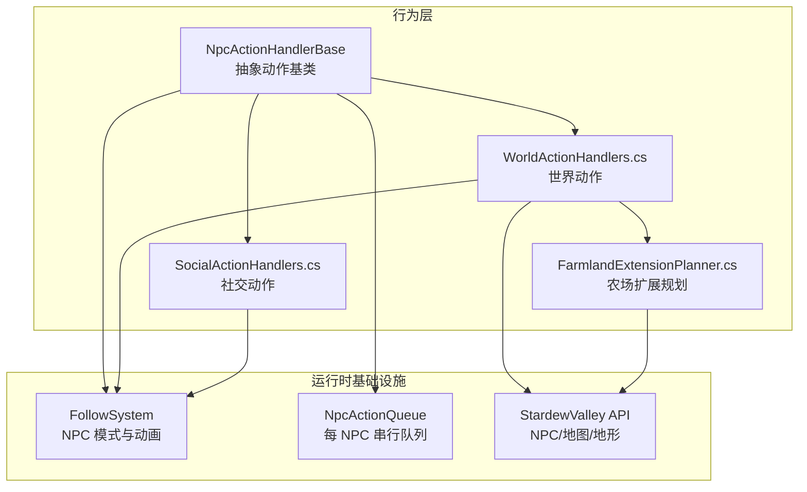
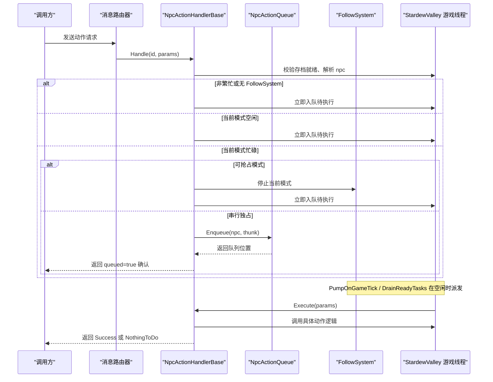
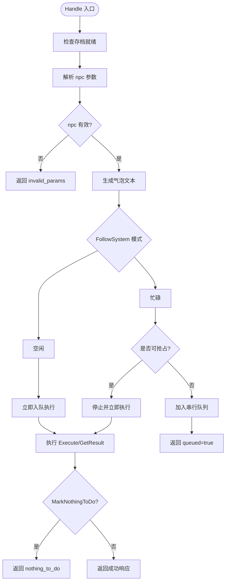
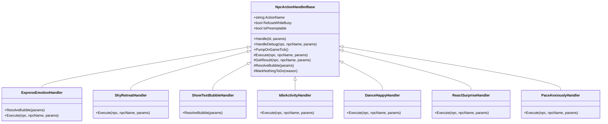
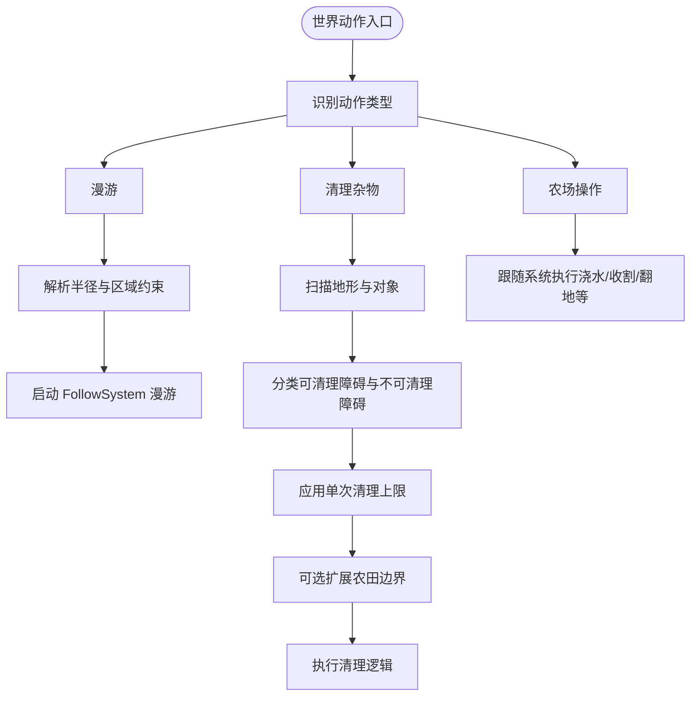
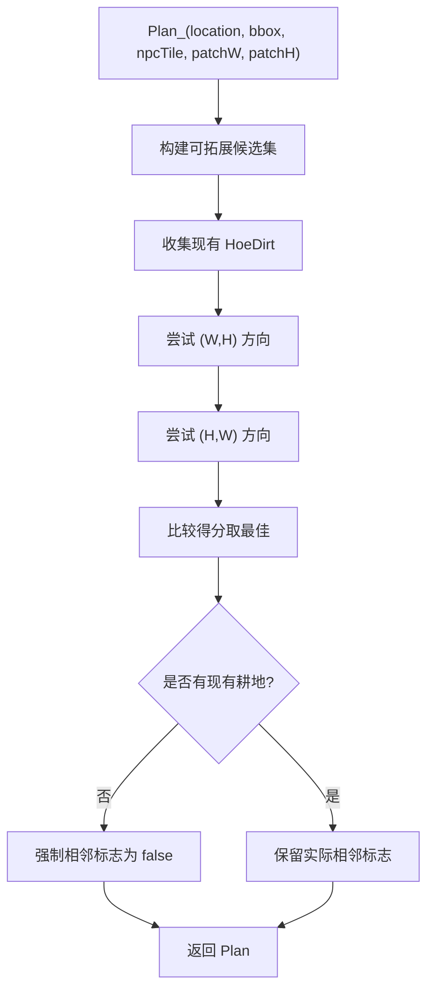
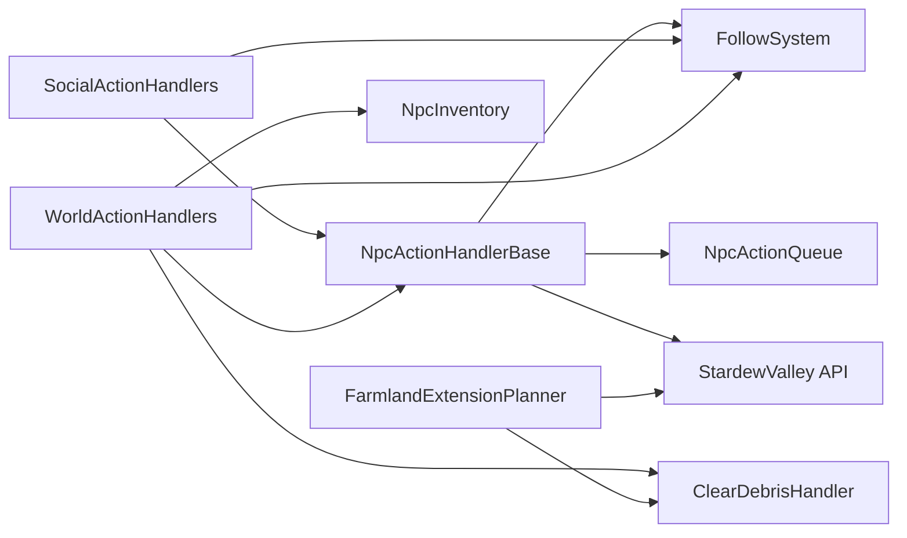

# 行为与动作处理器

<cite>
**本文引用的文件**   
- [NpcActionHandlerBase.cs](file://SmartNPC/smapi-mod/Behavior/NpcActionHandlerBase.cs)
- [SocialActionHandlers.cs](file://SmartNPC/smapi-mod/Behavior/SocialActionHandlers.cs)
- [WorldActionHandlers.cs](file://SmartNPC/smapi-mod/Behavior/WorldActionHandlers.cs)
- [FarmlandExtensionPlanner.cs](file://SmartNPC/smapi-mod/Behavior/FarmlandExtensionPlanner.cs)
</cite>

## 目录
1. [引言](#引言)
2. [项目结构](#项目结构)
3. [核心组件](#核心组件)
4. [架构总览](#架构总览)
5. [详细组件分析](#详细组件分析)
6. [依赖关系分析](#依赖关系分析)
7. [性能考量](#性能考量)
8. [故障排查指南](#故障排查指南)
9. [结论](#结论)
10. [附录：自定义动作处理器实现指南](#附录自定义动作处理器实现指南)

## 引言
本文聚焦 SmartNPC 模组中 NPC 行为与动作处理体系，围绕四个关键源文件展开：
- NpcActionHandlerBase.cs：定义统一的动作基类、请求路由、气泡展示、队列调度、结果封装和“无目标可执行”语义。
- SocialActionHandlers.cs：表情、害羞后退、文本气泡、闲逛式社交、跳舞、惊讶反应等 NPC 间社交动作。
- WorldActionHandlers.cs：世界动作处理器，包括漫游、清理杂物、以及大量农场操作（如除草、浇水、收割、翻地、采集、施肥、破坏、存取箱、接近并对话等）。
- FarmlandExtensionPlanner.cs：面向自动农场的矩形地块扩展规划器，评估候选区域、计算邻接分数、识别障碍并产出可执行的平整计划。

这些组件共同实现了一个可扩展、线程安全、可排队、可抢占、可回退的 NPC 动作执行框架，使 AI 工作流可以稳定驱动 Stardew Valley 游戏内的复杂交互。

## 项目结构
本节从行为层角度梳理代码组织方式：

**图表来源**
- [NpcActionHandlerBase.cs:1-478](file://SmartNPC/smapi-mod/Behavior/NpcActionHandlerBase.cs#L1-L478)
- [SocialActionHandlers.cs:1-151](file://SmartNPC/smapi-mod/Behavior/SocialActionHandlers.cs#L1-L151)
- [WorldActionHandlers.cs:1-2429](file://SmartNPC/smapi-mod/Behavior/WorldActionHandlers.cs#L1-L2429)
- [FarmlandExtensionPlanner.cs:1-273](file://SmartNPC/smapi-mod/Behavior/FarmlandExtensionPlanner.cs#L1-L273)

**章节来源**
- [NpcActionHandlerBase.cs:1-478](file://SmartNPC/smapi-mod/Behavior/NpcActionHandlerBase.cs#L1-L478)
- [SocialActionHandlers.cs:1-151](file://SmartNPC/smapi-mod/Behavior/SocialActionHandlers.cs#L1-L151)
- [WorldActionHandlers.cs:1-2429](file://SmartNPC/smapi-mod/Behavior/WorldActionHandlers.cs#L1-L2429)
- [FarmlandExtensionPlanner.cs:1-273](file://SmartNPC/smapi-mod/Behavior/FarmlandExtensionPlanner.cs#L1-L273)

## 核心组件
### NpcActionHandlerBase：抽象动作接口与生命周期
NpcActionHandlerBase 是所有动作处理器的统一基类，承担以下职责：
- 解析参数中的 npc 字段，定位游戏线程上的 NPC。
- 根据 ActionName 生成头顶气泡文本，支持自定义 ResolveBubble。
- 将 Execute 与 GetResult 暴露给子类，实现具体逻辑。
- 提供 RefuseWhileBusy 与 IsPreemptable 控制是否进入队列、是否可被抢占。
- 通过 MarkNothingToDo 让动作处理器表达“当前区域内无可执行目标”，从而返回结构化 no-op 响应。
- Handle 方法负责请求路由、错误捕获、队列入队、抢占判定、任务泵出；HandleDebug 为调试命令提供同步入口。
- NpcActionQueue 维护每个 NPC 的串行任务队列，按 FollowSystem 模式空闲时逐 tick 派发。

关键点：
- 三执行类别：
  - 平凡动作：RefuseWhileBusy=false，立即入队并在下一 tick 执行，不改变 FollowSystem 模式。
  - 可抢占模式：RefuseWhileBusy=true 且 IsPreemptable=true，当前仅用于漫游；高优先级任务可中断它。
  - 串行独占：RefuseWhileBusy=true 且 IsPreemptable=false，长耗时操作必须串行完成。
- 上下文共享：所有动作在同一游戏线程上执行，确保 NPC、地图、保存状态有效；FollowSystem 作为共享“忙碌门控”。

**章节来源**
- [NpcActionHandlerBase.cs:1-478](file://SmartNPC/smapi-mod/Behavior/NpcActionHandlerBase.cs#L1-L478)

### SocialActionHandlers：社交动作实现
该文件集中实现了 NPC 之间的社交互动，主要类型包括：
- 表情动作：将 emotion/emote 映射到游戏内表情 ID，调用 NPC.doEmote。
- 害羞后退：启动 FollowSystem 的社交移动模式。
- 文本气泡：直接使用 text 参数显示气泡。
- 闲置活动：支持 once/loop 两种模式的闲置动作。
- 快乐舞蹈与惊讶反应：分别调用庆祝或惊讶动画。
- 焦虑踱步：以时长参数驱动社交移动。

这些动作大多设置 RefuseWhileBusy=true，走串行动作生命周期，由 FollowSystem 管理移动与动画。

**章节来源**
- [SocialActionHandlers.cs:1-151](file://SmartNPC/smapi-mod/Behavior/SocialActionHandlers.cs#L1-L151)

### WorldActionHandlers：世界动作与农场操作
该文件包含大量与游戏世界交互的动作，例如：
- 漫游：支持半径、中心、最大距离、矩形区域约束；可抢占，便于更高优先级任务打断。
- 清理杂物：扫描地形特征与对象，识别可清理杂草、树枝、石头、树桩、树苗，并支持扩展农田边界。
- 其他农场操作：浇水、收割、翻地、采集、施肥、破坏、存入箱子、取出物品、接近并对话等。

其中清理杂物与农田扩展密切相关：FarmlandExtensionPlanner 会借助 ClearDebrisHandler 的障碍判断能力，区分可清理障碍与不可清理障碍物。

**章节来源**
- [WorldActionHandlers.cs:1-2429](file://SmartNPC/smapi-mod/Behavior/WorldActionHandlers.cs#L1-L2429)

### FarmlandExtensionPlanner：农场扩展规划逻辑
FarmlandExtensionPlanner 是一个静态规划器，输入为地图、矩形搜索范围、NPC 位置、期望补丁宽高，输出为 Plan：
- Plan 包含矩形范围、是否与现有耕地相邻、邻接长度、需要清理的障碍点、需要砍伐的成熟树木点。
- 算法步骤：
  1. 构建候选集：范围内可拓展的地块。
  2. 收集现有 HoeDirt 集合用于邻接评分。
  3. 冷启动：没有现有耕地时优先靠近 NPC。
  4. 热启动：对 (W,H) 与 (H,W) 两个方向滑动窗口，计算邻接长度、共享边比例、距离惩罚与障碍惩罚，选择最高分方案。
  5. 若无法找到合适矩形，则返回 null，上层动作处理器将其转化为“无目标可执行”响应。

该规划器并不直接修改游戏状态，而是为上层动作处理器提供结构化执行计划。

**章节来源**
- [FarmlandExtensionPlanner.cs:1-273](file://SmartNPC/smapi-mod/Behavior/FarmlandExtensionPlanner.cs#L1-L273)

## 架构总览
下图展示动作从外部调用到游戏执行的完整流程：

**图表来源**
- [NpcActionHandlerBase.cs:1-478](file://SmartNPC/smapi-mod/Behavior/NpcActionHandlerBase.cs#L1-L478)

## 详细组件分析

### NpcActionHandlerBase：设计模式、生命周期与上下文共享
#### 设计模式
- 模板方法模式：Handle 固定流程，Execute 与 GetResult 留给子类实现。
- 策略模式：RefuseWhileBusy 与 IsPreemptable 决定执行策略。
- 观察者/回调模式：_showBubble 回调允许注入气泡显示策略。
- 工厂/注册模式：ActionNamePublic 供路由器注册不同动作名。

#### 生命周期
- 请求进入 Handle：
  - 检查 Context.IsWorldReady。
  - 解析 npc 参数，失败则返回 invalid_params。
  - 生成气泡文本，克隆参数避免后续变更影响。
  - 构造延迟执行 thunk，封装 TrySetResult。
- 游戏线程执行：
  - 查找 NPC，找不到则返回 npc_not_found。
  - 显示气泡，必要时注册持久气泡。
  - 调用 Execute，再调用 GetResult。
  - 若标记 nothing_to_do，返回结构化 no-op。
  - 否则返回通用成功响应。
- 异常处理：
  - catch 捕获异常，记录 handler_error。
  - 长时间执行或等待超时打日志，便于诊断。

#### 队列与抢占
- 平凡动作：RefuseWhileBusy=false，直接入 _pending，PumpOnGameTick 消费。
- 忙碌但空闲：FollowSystem.GetMode==Idle，立即执行。
- 可抢占模式：NpcActionQueue.IsPreemptableMode 判断为 Wander 时可 Stop 后立刻执行。
- 串行独占：Enqueue 到 NpcActionQueue，DrainReadyTasks 在 Idle 时逐个派发。

#### “无目标可执行”机制
- MarkNothingToDo 设置内部原因。
- Execute 结束后，GetResult 为空且 reason 存在时，返回 nothing_to_do=true，附带人类可读提示。
- 这使 AI 在同一回合重新评估，而不是误判任务已完成。

**图表来源**
- [NpcActionHandlerBase.cs:1-478](file://SmartNPC/smapi-mod/Behavior/NpcActionHandlerBase.cs#L1-L478)

**章节来源**
- [NpcActionHandlerBase.cs:1-478](file://SmartNPC/smapi-mod/Behavior/NpcActionHandlerBase.cs#L1-L478)

### SocialActionHandlers：社交动作分类与行为
- 表情动作：
  - 支持多种情绪名称，映射到游戏表情 ID。
  - 默认心形表情，未识别时回退。
  - 气泡标题简化为情绪名称。
- 害羞后退：
  - 使用 FollowSystem.StartSocialMovement，退避持续一段时间。
- 文本气泡：
  - 直接使用 text 参数内容，不执行其他逻辑。
- 闲置活动：
  - 支持 activity 与 mode，mode 限定 once 或 loop。
  - 通过 FollowSystem.StartIdleActivity 驱动。
- 快乐舞蹈与惊讶反应：
  - 通过 FollowSystem.StartCelebration 触发不同表情动画。
- 焦虑踱步：
  - 支持 duration_ticks 参数，控制社交移动持续时间。

**图表来源**
- [SocialActionHandlers.cs:1-151](file://SmartNPC/smapi-mod/Behavior/SocialActionHandlers.cs#L1-L151)
- [NpcActionHandlerBase.cs:1-478](file://SmartNPC/smapi-mod/Behavior/NpcActionHandlerBase.cs#L1-L478)

**章节来源**
- [SocialActionHandlers.cs:1-151](file://SmartNPC/smapi-mod/Behavior/SocialActionHandlers.cs#L1-L151)

### WorldActionHandlers：世界动作与农场操作
- 漫游：
  - 支持 radius、center_x/y、max_distance、x1/y1/x2/y2。
  - DoWander 公开静态方法供调试命令使用。
  - 可抢占，适合填充行为，容易被收割、浇水等高优先级任务打断。
- 清理杂物：
  - 扫描地形特征与对象，识别可清理障碍。
  - 支持农田边界扩展 extend 参数。
  - 硬限制单次最多清理数量，防止长时间阻塞。
  - 与非农场地图兼容，仍可用于清理小径或路径。
- 其他世界动作：
  - 浇水、收割、翻地、采集、施肥、破坏、存入/取出、接近并对话等，均继承基类生命周期，由 FollowSystem 管理移动与动画。

**图表来源**
- [WorldActionHandlers.cs:1-2429](file://SmartNPC/smapi-mod/Behavior/WorldActionHandlers.cs#L1-L2429)

**章节来源**
- [WorldActionHandlers.cs:1-2429](file://SmartNPC/smapi-mod/Behavior/WorldActionHandlers.cs#L1-L2429)

### FarmlandExtensionPlanner：地块评估、种植策略与收益计算
FarmlandExtensionPlanner 的核心目标是生成整齐的矩形新地块，并与现有耕地保持良好邻接。

- 数据结构：
  - Plan：矩形范围、是否相邻、邻接长度、需清理障碍点、需砍伐树木点。
- 候选集构建：
  - 遍历搜索框，筛选 passable、Diggable=T、无不可清理对象或地形特征的格子。
- 现有耕地收集：
  - 收集所有 HoeDirt 坐标，用于邻接评分。
- 双方向尝试：
  - 对 (W,H) 与 (H,W) 都进行滑动窗口评分，取更优者。
- 评分函数：
  - 邻接长度权重高。
  - 共享边比例显著加分。
  - 距离 NPC 越近略优。
  - 障碍数量越多扣分，倾向干净地块。
- 冷启动：
  - 若无现有耕地，选择最靠近 NPC 的候选矩形。
- 返回空值：
  - 如果无法找到合适矩形，返回 null，上层动作处理器转为 nothing_to_do。

**图表来源**
- [FarmlandExtensionPlanner.cs:1-273](file://SmartNPC/smapi-mod/Behavior/FarmlandExtensionPlanner.cs#L1-L273)

**章节来源**
- [FarmlandExtensionPlanner.cs:1-273](file://SmartNPC/smapi-mod/Behavior/FarmlandExtensionPlanner.cs#L1-L273)

## 依赖关系分析
- NpcActionHandlerBase 依赖：
  - IMonitor：日志。
  - FollowSystem：模式查询、暂停、气泡更新、运动控制。
  - NpcActionQueue：串行任务队列。
  - Game1、Context：游戏状态访问。
- SocialActionHandlers 依赖：
  - NpcActionHandlerBase。
  - FollowSystem：社交移动、闲置活动、庆祝动画。
- WorldActionHandlers 依赖：
  - NpcActionHandlerBase。
  - FollowSystem：漫游、移动控制。
  - NpcInventory：物品库存访问。
  - ClearDebrisHandler：障碍判断。
  - GameLocation、TerrainFeatures、Object：地图与地形数据。
- FarmlandExtensionPlanner 依赖：
  - ClearDebrisHandler：障碍判断。
  - GameLocation、TerrainFeatures、HoeDirt、Tree：地图与地形数据。

**图表来源**
- [NpcActionHandlerBase.cs:1-478](file://SmartNPC/smapi-mod/Behavior/NpcActionHandlerBase.cs#L1-L478)
- [SocialActionHandlers.cs:1-151](file://SmartNPC/smapi-mod/Behavior/SocialActionHandlers.cs#L1-L151)
- [WorldActionHandlers.cs:1-2429](file://SmartNPC/smapi-mod/Behavior/WorldActionHandlers.cs#L1-L2429)
- [FarmlandExtensionPlanner.cs:1-273](file://SmartNPC/smapi-mod/Behavior/FarmlandExtensionPlanner.cs#L1-L273)

**章节来源**
- [NpcActionHandlerBase.cs:1-478](file://SmartNPC/smapi-mod/Behavior/NpcActionHandlerBase.cs#L1-L478)
- [SocialActionHandlers.cs:1-151](file://SmartNPC/smapi-mod/Behavior/SocialActionHandlers.cs#L1-L151)
- [WorldActionHandlers.cs:1-2429](file://SmartNPC/smapi-mod/Behavior/WorldActionHandlers.cs#L1-L2429)
- [FarmlandExtensionPlanner.cs:1-273](file://SmartNPC/smapi-mod/Behavior/FarmlandExtensionPlanner.cs#L1-L273)

## 性能考量
- 游戏线程单任务执行：
  - 所有 Execute 在游戏线程串行执行，避免并发修改游戏状态。
- 队列调度：
  - 平凡动作跳过长耗时独占，减少等待。
  - 串行队列每次 tick 只派发一个任务，降低帧率抖动。
- 可抢占漫游：
  - 漫游作为填充行为，可被收割、浇水等高优先级任务抢占。
- 清理杂物上限：
  - 单次清理数量有限制，避免长时间占用游戏线程。
- 规划器复杂度：
  - FarmlandExtensionPlanner 在矩形窗口内滑动扫描，时间复杂度与候选区域面积成正比；对于大地图应限制搜索框大小。

[本节为通用性能建议，不直接分析具体文件]

## 故障排查指南
常见问题与处理方式：
- npc_not_found：
  - 参数中 npc 名称不存在，检查 NPC 名称拼写与角色是否在场景中。
- invalid_params：
  - 缺少 npc 字段或类型不正确，检查请求参数结构。
- handler_error：
  - 动作执行抛出异常，查看日志中 action 与错误消息，定位具体动作。
- nothing_to_do：
  - 动作已执行但区域内无可执行目标，AI 应重新评估，扩大搜索范围或切换工具。
- queued=true：
  - 动作已进入串行队列，等待当前独占任务完成；检查队列快照与 FollowSystem 模式。
- 长时间执行警告：
  - 执行超过阈值或队列等待过长，检查是否存在无限循环、地形过大或逻辑缺陷。

**章节来源**
- [NpcActionHandlerBase.cs:1-478](file://SmartNPC/smapi-mod/Behavior/NpcActionHandlerBase.cs#L1-L478)

## 结论
SmartNPC 的行为与动作处理器以 NpcActionHandlerBase 为核心，形成统一的动作抽象、生命周期管理与上下文共享机制。SocialActionHandlers 与 WorldActionHandlers 在此基础上实现丰富的社交与世界交互，FarmlandExtensionPlanner 则为自动农场提供稳定的矩形扩展规划。整体设计强调：
- 可插拔的动作类型。
- 清晰的串行与抢占模型。
- 明确的成功、排队、无目标与错误响应。
- 与 FollowSystem 深度耦合的 NPC 行为控制。
- 面向 AI 工作流的稳定执行语义。

这使得 NPC 可以在 Stardew Valley 中进行自然、有序且可观测的自主行为。

[本节为总结性内容，不直接分析具体文件]

## 附录：自定义动作处理器实现指南
### 创建自定义动作处理器
步骤概览：
1. 新建类继承 NpcActionHandlerBase。
2. 实现 ActionName，指定 WebSocket 动作名。
3. 根据需要重写：
   - ResolveBubble：自定义气泡文本。
   - Execute：具体游戏逻辑。
   - GetResult：返回自定义结果。
   - RefuseWhileBusy：是否需要串行独占。
   - IsPreemptable：是否可被高优先级任务抢占。
4. 在构造函数中注入 IMonitor、Func<bool> showBubble，必要时注入 FollowSystem 或 NpcInventory。
5. 向消息路由器注册 ActionNamePublic。

示例说明：
- 若动作只需要显示气泡，可不重写 Execute。
- 若动作需要控制 NPC 移动或动画，注入 FollowSystem 并调用其方法。
- 若动作可能没有可执行目标，调用 MarkNothingToDo 返回结构化 no-op。

### 扩展现有行为类型
- 社交动作扩展：
  - 新增表情或社交动画，参考 ExpressEmotionHandler 或 ShyRetreatHandler。
- 世界动作扩展：
  - 新增农场操作，参考 WanderHandler 或 ClearDebrisHandler。
- 农场扩展规划：
  - 调整 FarmlandExtensionPlanner 的评分函数或候选集构建，以适应新的地块偏好。

### 动作执行的状态管理、错误处理与回滚机制
- 状态管理：
  - FollowSystem 管理 NPC 当前模式，如 Idle、Wander、Social、Celebration 等。
  - NpcActionQueue 管理串行任务顺序。
- 错误处理：
  - Handle 捕获异常并返回 handler_error。
  - 日志记录动作名称、NPC 名称、队列等待时间与执行时间。
- 回滚机制：
  - 当前设计以“幂等与重试友好”为主，而非显式事务回滚。
  - 若动作中途失败，上层工作流应检测 nothing_to_do 或错误响应，重新规划或取消后续任务。
  - 对于可抢占动作，FollowSystem.Stop 可中断低优先级行为，让高优先级动作立即执行。

**章节来源**
- [NpcActionHandlerBase.cs:1-478](file://SmartNPC/smapi-mod/Behavior/NpcActionHandlerBase.cs#L1-L478)
- [SocialActionHandlers.cs:1-151](file://SmartNPC/smapi-mod/Behavior/SocialActionHandlers.cs#L1-L151)
- [WorldActionHandlers.cs:1-2429](file://SmartNPC/smapi-mod/Behavior/WorldActionHandlers.cs#L1-L2429)
- [FarmlandExtensionPlanner.cs:1-273](file://SmartNPC/smapi-mod/Behavior/FarmlandExtensionPlanner.cs#L1-L273)