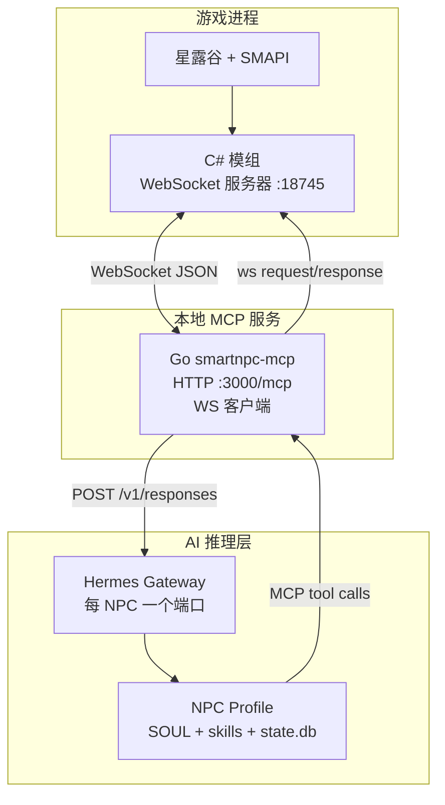
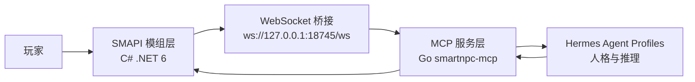
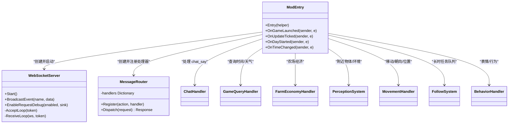
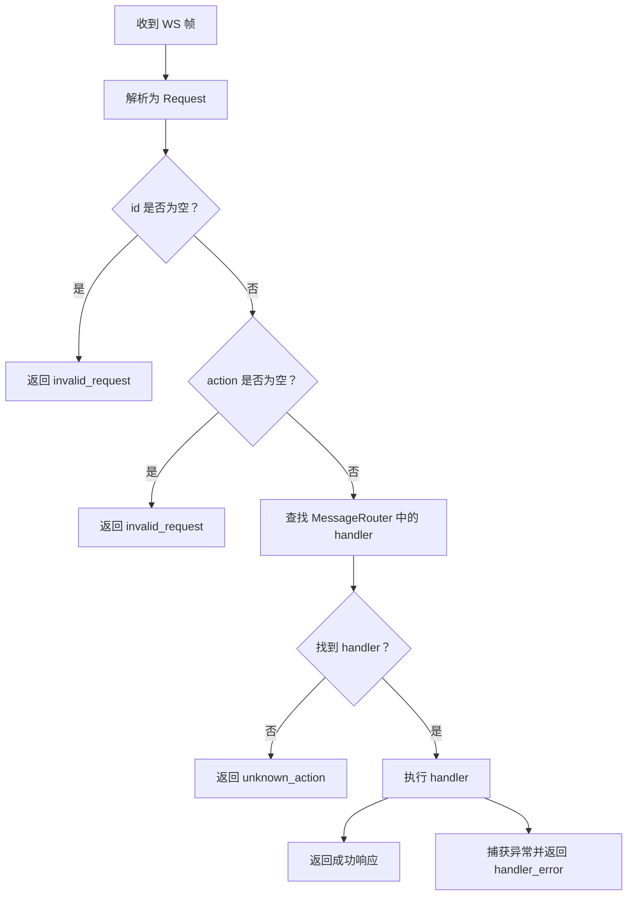
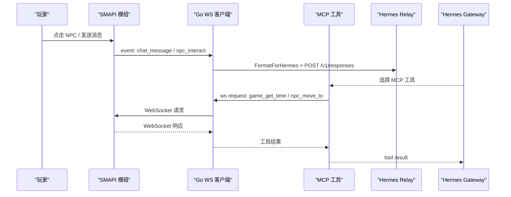
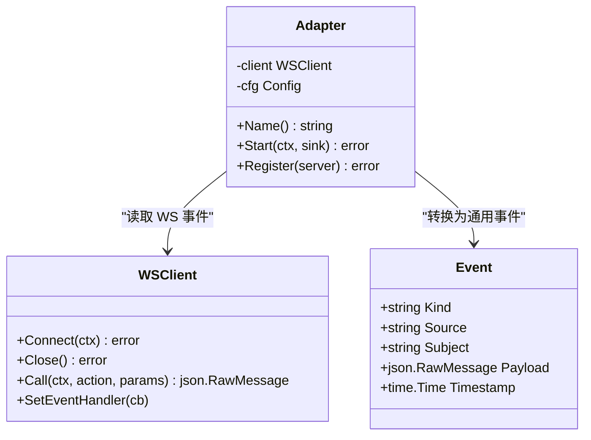
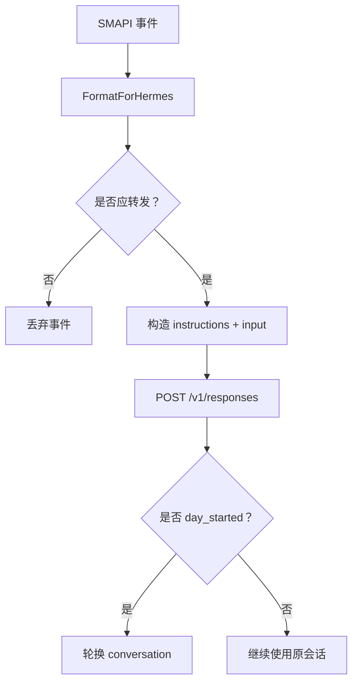
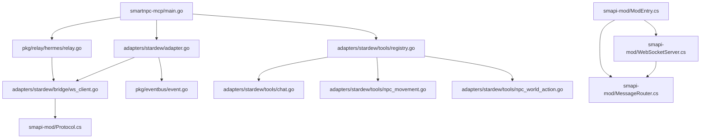
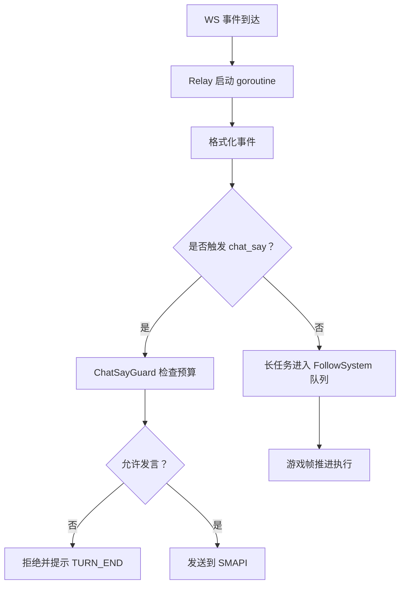

# 核心架构设计

<cite>
**本文引用的文件**   
- [README.md](file://SmartNPC/README.md)
- [current-architecture.md](file://SmartNPC/docs/current-architecture.md)
- [technical-architecture.md](file://SmartNPC/docs/technical-architecture.md)
- [smartnpc-mcp/main.go](file://SmartNPC/smartnpc-mcp/cmd/smartnpc-mcp/main.go)
- [stardew/adapter.go](file://SmartNPC/smartnpc-mcp/adapters/stardew/adapter.go)
- [stardew/ws_client.go](file://SmartNPC/smartnpc-mcp/adapters/stardew/bridge/ws_client.go)
- [stardew/events/format.go](file://SmartNPC/smartnpc-mcp/adapters/stardew/events/format.go)
- [hermes/relay.go](file://SmartNPC/smartnpc-mcp/pkg/relay/hermes/relay.go)
- [eventbus/event.go](file://SmartNPC/smartnpc-mcp/pkg/eventbus/event.go)
- [tools/registry.go](file://SmartNPC/smartnpc-mcp/adapters/stardew/tools/registry.go)
- [tools/chat.go](file://SmartNPC/smartnpc-mcp/adapters/stardew/tools/chat.go)
- [tools/npc_movement.go](file://SmartNPC/smartnpc-mcp/adapters/stardew/tools/npc_movement.go)
- [tools/npc_world_action.go](file://SmartNPC/smartnpc-mcp/adapters/stardew/tools/npc_world_action.go)
- [smapi-mod/ModEntry.cs](file://SmartNPC/smapi-mod/ModEntry.cs)
- [smapi-mod/WebSocketServer.cs](file://SmartNPC/smapi-mod/Bridge/WebSocketServer.cs)
- [smapi-mod/MessageRouter.cs](file://SmartNPC/smapi-mod/Bridge/MessageRouter.cs)
- [smapi-mod/Protocol.cs](file://SmartNPC/smapi-mod/Bridge/Protocol.cs)
- [smapi-mod/AgentControlPatch.cs](file://SmartNPC/smapi-mod/Patches/AgentControlPatch.cs)
- [StardewMCPBridge.csproj](file://SmartNPC/smapi-mod/StardewMCPBridge.csproj)
</cite>

## 目录
1. [引言](#引言)
2. [项目结构](#项目结构)
3. [核心组件](#核心组件)
4. [架构总览](#架构总览)
5. [详细组件分析](#详细组件分析)
6. [依赖关系分析](#依赖关系分析)
7. [性能与并发特性](#性能与并发特性)
8. [部署拓扑与系统边界](#部署拓扑与系统边界)
9. [故障排查指南](#故障排查指南)
10. [结论](#结论)

## 引言
SmartNPC 是一个以 Hermes Agent Profiles 为核心的星露谷 NPC 智能体运行时。它把 SMAPI 模组、Go MCP 服务和 Hermes 人格配置拆成三层：SMAPI 模组负责游戏内 UI、输入捕获和动作执行；Go MCP 服务负责工具注册、协议转换、事件路由和工作流调度；Hermes 负责每个 NPC 的人格、技能、记忆与模型推理。三者通过 WebSocket `ws://127.0.0.1:18745/ws` 和 HTTP MCP 接口 `:3000/mcp` 通信，形成“玩家输入 → 游戏事件 → MCP 路由 → Hermes 决策 → MCP 工具调用 → SMAPI 执行”的闭环。

当前仓库采用 **Hermes-first** 架构：LLM 不直接操作游戏对象，而是通过 MCP 暴露的工具间接驱动 SMAPI 模组。这样既保留游戏线程安全边界，又让 NPC 具备主动行为、日程规划和多角色对话能力。

**章节来源**
- [README.md:1-120](file://SmartNPC/README.md#L1-L120)

## 项目结构
仓库主要包含四个关键区域：

| 路径 | 职责 | 关键技术 |
|---|---|---|
| `smapi-mod/` | C# SMAPI 模组，运行于 Stardew Valley 进程内 | .NET 6、Harmony 代码注入、WebSocket 服务器、游戏事件订阅 |
| `smartnpc-mcp/` | Go MCP 服务，暴露工具并桥接 SMAPI 与 Hermes | Model Context Protocol、WebSocket 客户端、HTTP Streamable MCP、事件总线 |
| `hermes/profiles/<npc>/` | 每个 NPC 的人格定义、技能策略、关键规则和日程配方 | SOUL.md、skills、config-overlay、cron-recipes |
| `docs/`、`scripts/` | 架构文档、协议说明、启动脚本和调试辅助 | Taskfile、PowerShell、Shell、Python 补丁 |

**图表来源**
- [README.md:35-105](file://SmartNPC/README.md#L35-L105)
- [smartnpc-mcp/main.go:1-40](file://SmartNPC/smartnpc-mcp/cmd/smartnpc-mcp/main.go#L1-L40)
- [stardew/ws_client.go:1-30](file://SmartNPC/smartnpc-mcp/adapters/stardew/bridge/ws_client.go#L1-L30)

**章节来源**
- [README.md:120-200](file://SmartNPC/README.md#L120-L200)
- [current-architecture.md:1-40](file://SmartNPC/docs/current-architecture.md#L1-L40)

## 核心组件
SmartNPC 的核心由以下组件构成：

| 组件 | 位置 | 职责 | 设计模式 |
|---|---|---|---|
| SMAPI 模组入口 | `ModEntry.cs` | 初始化 Harmony、注册消息路由、挂载 WebSocket、绑定游戏事件 | 组合根、观察者模式 |
| WebSocket 服务器 | `WebSocketServer.cs` | 监听 `ws://127.0.0.1:18745/ws`，接收请求并广播事件 | 适配器、发布者-订阅者 |
| 消息路由器 | `MessageRouter.cs` | 按 action 分发到 handler，记录耗时和异常 | 策略模式 |
| WS 协议 DTO | `Protocol.cs` | 定义 Request、Response、Event 数据结构 | 数据契约 |
| Harmony 补丁 | `AgentControlPatch.cs` | 阻止 AI NPC 被游戏强制播放睡眠动画 | 代码注入 |
| Go MCP 主程序 | `main.go` | 解析参数、注册工具、连接 SMAPI、转发 Hermes | 工厂、适配器 |
| Stardew 适配器 | `adapters/stardew/adapter.go` | 将 WS 事件转为 eventbus.Event，挂载工具组 | 适配器模式 |
| WS 客户端 | `ws_client.go` | 连接 SMAPI、重试、会话绑定、事件回调 | 长连接客户端 |
| 事件格式化器 | `events/format.go` | 把原始事件转成 Hermes 可读文本 | 适配器/模板 |
| Hermes Relay | `relay.go` | POST 事件到 `/v1/responses`，管理会话轮换 | 观察者、序列化 |
| 工具注册中心 | `tools/registry.go` | 统一注册查询、感知、移动、世界动作等工具 | 注册表 |
| 聊天守卫 | `tools/chat.go` | 限制每次唤醒只能调用一次 `chat_say` | 守卫/预算控制 |

**章节来源**
- [smapi-mod/ModEntry.cs:1-120](file://SmartNPC/smapi-mod/ModEntry.cs#L1-L120)
- [smapi-mod/WebSocketServer.cs:1-60](file://SmartNPC/smapi-mod/Bridge/WebSocketServer.cs#L1-L60)
- [smapi-mod/MessageRouter.cs:1-53](file://SmartNPC/smapi-mod/Bridge/MessageRouter.cs#L1-L53)
- [smapi-mod/Protocol.cs:1-67](file://SmartNPC/smapi-mod/Bridge/Protocol.cs#L1-L67)
- [smartnpc-mcp/adapters/stardew/adapter.go:1-80](file://SmartNPC/smartnpc-mcp/adapters/stardew/adapter.go#L1-L80)
- [smartnpc-mcp/adapters/stardew/bridge/ws_client.go:1-60](file://SmartNPC/smartnpc-mcp/adapters/stardew/bridge/ws_client.go#L1-L60)
- [smartnpc-mcp/adapters/stardew/events/format.go:1-40](file://SmartNPC/smartnpc-mcp/adapters/stardew/events/format.go#L1-L40)
- [smartnpc-mcp/pkg/relay/hermes/relay.go:1-60](file://SmartNPC/smartnpc-mcp/pkg/relay/hermes/relay.go#L1-L60)
- [smartnpc-mcp/adapters/stardew/tools/registry.go:1-40](file://SmartNPC/smartnpc-mcp/adapters/stardew/tools/registry.go#L1-L40)
- [smartnpc-mcp/adapters/stardew/tools/chat.go:1-40](file://SmartNPC/smartnpc-mcp/adapters/stardew/tools/chat.go#L1-L40)

## 架构总览
SmartNPC 的三层架构围绕“谁决策、谁编排、谁执行”划分：

| 层级 | 边界 | 输入 | 输出 | 关键约束 |
|---|---|---|---|---|
| SMAPI 模组层 | 游戏进程内部 | 玩家输入、游戏事件、MCP 工具请求 | 游戏状态变更、UI 更新、WebSocket 事件 | 所有写游戏对象的操作必须在游戏线程执行 |
| MCP 服务层 | 本地进程 | WS 事件、HTTP MCP 请求 | WS 请求、Hermes 事件 POST、工具结果 | 硬校验、超时、重连、会话隔离 |
| Hermes 层 | WSL 或远程 Gateway | 事件、人设、技能、历史 | 工具调用、模型回复 | LLM 只决定“做什么”，不直接碰游戏内存 |

**图表来源**
- [technical-architecture.md:1-60](file://SmartNPC/docs/technical-architecture.md#L1-L60)
- [current-architecture.md:10-40](file://SmartNPC/docs/current-architecture.md#L10-L40)

**章节来源**
- [technical-architecture.md:1-100](file://SmartNPC/docs/technical-architecture.md#L1-L100)
- [current-architecture.md:1-60](file://SmartNPC/docs/current-architecture.md#L1-L60)

## 详细组件分析

### SMAPI 模组层：游戏内交互与动作执行
SMAPI 模组是 SmartNPC 在游戏内的唯一执行面。`ModEntry.cs` 在 `Entry` 中完成 Harmony 补丁、消息路由、查询处理器、感知系统、移动系统、行为系统和 UI 的组装，并在 `OnGameLaunched` 中注册所有工具动作。

**图表来源**
- [smapi-mod/ModEntry.cs:1-120](file://SmartNPC/smapi-mod/ModEntry.cs#L1-L120)
- [smapi-mod/WebSocketServer.cs:1-60](file://SmartNPC/smapi-mod/Bridge/WebSocketServer.cs#L1-L60)
- [smapi-mod/MessageRouter.cs:1-53](file://SmartNPC/smapi-mod/Bridge/MessageRouter.cs#L1-L53)

#### 消息路由与策略模式
`MessageRouter` 维护 action 到 handler 的映射。WS 收到请求后按 `action` 查找处理器，找不到返回 `unknown_action`，抛出异常返回 `handler_error`，正常执行则记录耗时。这体现了策略模式：不同工具动作由独立 handler 实现，新增功能只需注册新 action。

**图表来源**
- [smapi-mod/MessageRouter.cs:20-53](file://SmartNPC/smapi-mod/Bridge/MessageRouter.cs#L20-L53)

**章节来源**
- [smapi-mod/ModEntry.cs:1-200](file://SmartNPC/smapi-mod/ModEntry.cs#L1-L200)
- [smapi-mod/MessageRouter.cs:1-53](file://SmartNPC/smapi-mod/Bridge/MessageRouter.cs#L1-L53)
- [smapi-mod/Protocol.cs:1-67](file://SmartNPC/smapi-mod/Bridge/Protocol.cs#L1-L67)

### MCP 服务层：工具注册、协议转换与事件调度
Go MCP 服务承担三个关键角色：
1. 暴露 MCP 工具，供 Hermes 或其他 MCP 客户端调用。
2. 作为 WS 客户端连接 SMAPI 模组，转发工具请求和结果。
3. 将 SMAPI 事件格式化为 Hermes 可理解的事件，并通过 `/v1/responses` 推送给对应 NPC 的 Gateway。

**图表来源**
- [smartnpc-mcp/adapters/stardew/events/format.go:1-80](file://SmartNPC/smartnpc-mcp/adapters/stardew/events/format.go#L1-L80)
- [smartnpc-mcp/pkg/relay/hermes/relay.go:80-140](file://SmartNPC/smartnpc-mcp/pkg/relay/hermes/relay.go#L80-L140)
- [smartnpc-mcp/adapters/stardew/bridge/ws_client.go:120-200](file://SmartNPC/smartnpc-mcp/adapters/stardew/bridge/ws_client.go#L120-L200)

#### 适配器模式：SMAPI 协议到通用事件总线
`adapters/stardew/Adapter` 实现了 `agentbridge.EventSource`，把 SMAPI 的 WS 事件转换为通用的 `eventbus.Event`。这样 MCP 核心不必关心 Stardew 的具体字段，只需要消费 `kind`、`source`、`subject`、`payload`。

**图表来源**
- [stardew/adapter.go:1-80](file://SmartNPC/smartnpc-mcp/adapters/stardew/adapter.go#L1-L80)
- [eventbus/event.go:1-76](file://SmartNPC/smartnpc-mcp/pkg/eventbus/event.go#L1-L76)
- [stardew/ws_client.go:1-60](file://SmartNPC/smartnpc-mcp/adapters/stardew/bridge/ws_client.go#L1-L60)

**章节来源**
- [smartnpc-mcp/cmd/smartnpc-mcp/main.go:1-120](file://SmartNPC/smartnpc-mcp/cmd/smartnpc-mcp/main.go#L1-L120)
- [smartnpc-mcp/adapters/stardew/adapter.go:1-163](file://SmartNPC/smartnpc-mcp/adapters/stardew/adapter.go#L1-L163)
- [smartnpc-mcp/pkg/eventbus/event.go:1-76](file://SmartNPC/smartnpc-mcp/pkg/eventbus/event.go#L1-L76)

### Hermes Agent Profiles：人格管理与推理边界
Hermes 层是 SmartNPC 的“大脑”。每个 NPC 拥有独立的 profile，包括：
- `SOUL.md`：人格描述。
- `critical-policy.md`：必须保留在压缩上下文中的关键规则。
- `skills/`：行为策略，例如农场照料、社交互动、日程规划。
- `config-overlay.yaml`、`cron-recipes.md`：运行时配置和定时任务。

Relay 在每次 POST 前加载 persona 和 critical policy，并按天轮换 conversation ID，避免长期对话膨胀。同一 NPC 的 turn 通过互斥锁串行化，防止 Hermes 服务端转录交错。

**图表来源**
- [smartnpc-mcp/adapters/stardew/events/format.go:1-120](file://SmartNPC/smartnpc-mcp/adapters/stardew/events/format.go#L1-L120)
- [smartnpc-mcp/pkg/relay/hermes/relay.go:60-140](file://SmartNPC/smartnpc-mcp/pkg/relay/hermes/relay.go#L60-L140)

**章节来源**
- [current-architecture.md:40-118](file://SmartNPC/docs/current-architecture.md#L40-L118)
- [smartnpc-mcp/pkg/relay/hermes/relay.go:1-200](file://SmartNPC/smartnpc-mcp/pkg/relay/hermes/relay.go#L1-L200)

### 关键设计模式总结
| 模式 | 应用场景 | 收益 |
|---|---|---|
| 策略模式 | SMAPI 侧 `MessageRouter` 按 action 分发 handler | 新增工具无需修改路由逻辑 |
| 观察者模式 | SMAPI 订阅 `GameLoop`、`Input`、`Display` 事件；WS Server 广播事件 | 解耦游戏生命周期和模块行为 |
| 适配器模式 | WS 事件 → `eventbus.Event`；SMAPI JSON → 结构化 DTO | 降低下游对 wire format 的耦合 |
| 注册表模式 | MCP 工具统一注册 | 工具按领域分组，便于扩展和维护 |
| 守卫/预算模式 | `ChatSayGuard` 限制每次唤醒的发言次数 | 防止 LLM 陷入重复发言循环 |
| 工厂模式 | main.go 根据配置选择单目标或多目标 Hermes Relay | 支持 legacy 单 profile 和生产多 profile |

**章节来源**
- [smapi-mod/MessageRouter.cs:1-53](file://SmartNPC/smapi-mod/Bridge/MessageRouter.cs#L1-L53)
- [smartnpc-mcp/adapters/stardew/tools/registry.go:1-81](file://SmartNPC/smartnpc-mcp/adapters/stardew/tools/registry.go#L1-L81)
- [smartnpc-mcp/adapters/stardew/tools/chat.go:1-120](file://SmartNPC/smartnpc-mcp/adapters/stardew/tools/chat.go#L1-L120)

## 依赖关系分析

**图表来源**
- [smartnpc-mcp/cmd/smartnpc-mcp/main.go:1-120](file://SmartNPC/smartnpc-mcp/cmd/smartnpc-mcp/main.go#L1-L120)
- [smartnpc-mcp/adapters/stardew/adapter.go:1-80](file://SmartNPC/smartnpc-mcp/adapters/stardew/adapter.go#L1-L80)
- [smartnpc-mcp/adapters/stardew/bridge/ws_client.go:1-60](file://SmartNPC/smartnpc-mcp/adapters/stardew/bridge/ws_client.go#L1-L60)
- [smartnpc-mcp/pkg/eventbus/event.go:1-76](file://SmartNPC/smartnpc-mcp/pkg/eventbus/event.go#L1-L76)
- [smartnpc-mcp/pkg/relay/hermes/relay.go:1-60](file://SmartNPC/smartnpc-mcp/pkg/relay/hermes/relay.go#L1-L60)
- [smartnpc-mcp/adapters/stardew/tools/registry.go:1-81](file://SmartNPC/smartnpc-mcp/adapters/stardew/tools/registry.go#L1-L81)
- [smapi-mod/ModEntry.cs:1-120](file://SmartNPC/smapi-mod/ModEntry.cs#L1-L120)
- [smapi-mod/WebSocketServer.cs:1-60](file://SmartNPC/smapi-mod/Bridge/WebSocketServer.cs#L1-L60)
- [smapi-mod/MessageRouter.cs:1-53](file://SmartNPC/smapi-mod/Bridge/MessageRouter.cs#L1-L53)
- [smapi-mod/Protocol.cs:1-67](file://SmartNPC/smapi-mod/Bridge/Protocol.cs#L1-L67)

**章节来源**
- [smartnpc-mcp/cmd/smartnpc-mcp/main.go:1-120](file://SmartNPC/smartnpc-mcp/cmd/smartnpc-mcp/main.go#L1-L120)
- [smapi-mod/ModEntry.cs:1-200](file://SmartNPC/smapi-mod/ModEntry.cs#L1-L200)

## 性能与并发特性

| 方面 | 实现方式 | 影响 |
|---|---|---|
| WS 连接可靠性 | WSClient 使用默认 5 秒拨号超时、2 秒重试退避、60 分钟调用超时 | 短网络抖动不会立即中断工具链 |
| 事件处理非阻塞 | Relay.HandleEvent 启动 goroutine 执行 POST | WS 读循环不会被慢 Hermes 阻塞 |
| 同 NPC 会话串行化 | Relay 使用 `turnMu` 串行化同一 conversation 的模型回合 | 避免 Hermes 转录中出现乱序 tool_calls |
| 单次发言预算 | ChatSayGuard 限制 private/group 通道中每个 speaker 的 `chat_say` 次数 | 防止 LLM 无限重复输出 |
| 游戏线程保护 | SMAPI handler 不直接写游戏状态，长任务交给 FollowSystem 和游戏帧调度 | 避免多线程访问 Game1 导致崩溃 |
| 工具执行粒度 | 移动、浇水、收割等可能跨帧执行 | `ok=true` 不代表整片农场已完成 |

**图表来源**
- [smartnpc-mcp/pkg/relay/hermes/relay.go:100-160](file://SmartNPC/smartnpc-mcp/pkg/relay/hermes/relay.go#L100-L160)
- [smartnpc-mcp/adapters/stardew/tools/chat.go:40-120](file://SmartNPC/smartnpc-mcp/adapters/stardew/tools/chat.go#L40-L120)
- [smapi-mod/ModEntry.cs:120-200](file://SmartNPC/smapi-mod/ModEntry.cs#L120-L200)

**章节来源**
- [smartnpc-mcp/adapters/stardew/bridge/ws_client.go:1-60](file://SmartNPC/smartnpc-mcp/adapters/stardew/bridge/ws_client.go#L1-L60)
- [smartnpc-mcp/pkg/relay/hermes/relay.go:1-200](file://SmartNPC/smartnpc-mcp/pkg/relay/hermes/relay.go#L1-L200)
- [smartnpc-mcp/adapters/stardew/tools/chat.go:1-160](file://SmartNPC/smartnpc-mcp/adapters/stardew/tools/chat.go#L1-L160)
- [current-architecture.md:60-118](file://SmartNPC/docs/current-architecture.md#L60-L118)

## 部署拓扑与系统边界

### 系统边界
- **游戏边界**：SMAPI 模组运行在 Stardew Valley 进程中，受限于 .NET 6、XNA/SMAPI API 和游戏线程。
- **MCP 边界**：Go 进程提供 MCP 工具、WS 客户端和 HTTP 接口，但不直接调用模型 API。
- **AI 边界**：Hermes Gateway 负责模型调用、人格加载、记忆和工具循环；SmartNPC 通过 `/v1/responses` 注入事件。
- **网络边界**：默认仅本机通信；HTTP MCP 可通过 `--http-allow-any-origin` 放宽来源，但生产环境应启用 `--mcp-api-key`。

### 通信端口
| 组件 | 地址 | 用途 |
|---|---|---|
| SMAPI WebSocket | `ws://127.0.0.1:18745/ws` | MCP 与 SMAPI 的双向 JSON-RPC |
| MCP HTTP | `:3000/mcp` | Hermes 或其他 MCP 客户端接入 |
| Hermes Gateway | 每 NPC 一个端口，如 `:8642` | 事件注入、模型推理、原生 MCP 工具 |

### 启动顺序
推荐顺序为：构建模组 → 安装模组 → 启动 MCP → 启动 Hermes Gateway → 启动 SMAPI 游戏。切换 DLL 后需要完整重启游戏，仅退出存档无效。

**章节来源**
- [README.md:200-434](file://SmartNPC/README.md#L200-L434)
- [current-architecture.md:80-118](file://SmartNPC/docs/current-architecture.md#L80-L118)

## 故障排查指南

| 现象 | 可能原因 | 排查步骤 |
|---|---|---|
| MCP 无法连接 SMAPI | WS URL 错误、SMAPI 未启动、端口占用 | 检查 `ws://127.0.0.1:18745/ws`，查看 WSClient 日志 |
| Hermes 没有收到事件 | hermes-url 为空、npc_filter 过滤、事件被格式化为空 | 检查 `--hermes-config`、`--hermes-npc`、FormatForHermes 输出 |
| NPC 反复说话 | ChatSayGuard 未生效或 LLM 忽略 hint | 检查 channel、group_id、speaker 是否匹配 |
| 长任务未完成 | 工具返回 `ok=true` 只是接受请求 | 观察 FollowSystem 队列、游戏帧和后续事件 |
| 游戏切图后行为异常 | 动画控制未释放、FollowSystem 未重置 | 检查 ModEntry 的生命周期处理和调试命令 |
| 模型输出异常 | Hermes Python 源码被本机补丁修改 | 对照 `patch_hermes_model_output.py`、`patch_hermes_transcript.py` |

**章节来源**
- [smartnpc-mcp/adapters/stardew/bridge/ws_client.go:1-120](file://SmartNPC/smartnpc-mcp/adapters/stardew/bridge/ws_client.go#L1-L120)
- [smartnpc-mcp/adapters/stardew/events/format.go:1-120](file://SmartNPC/smartnpc-mcp/adapters/stardew/events/format.go#L1-L120)
- [smartnpc-mcp/adapters/stardew/tools/chat.go:40-160](file://SmartNPC/smartnpc-mcp/adapters/stardew/tools/chat.go#L40-L160)
- [current-architecture.md:60-118](file://SmartNPC/docs/current-architecture.md#L60-L118)

## 技术选型考量

### 为什么用 Go 实现 MCP 服务
Go 适合编写轻量、高并发、低依赖的服务端程序。SmartNPC 的 MCP 服务需要同时处理：
- WebSocket 长连接
- HTTP Streamable MCP
- Hermes 事件 POST
- 工具注册与序列化
- 多 NPC 扇出

Go 的 goroutine、标准库和网络库使其能稳定承载这些并发任务，同时保持二进制体积小、部署简单。

### 为什么 SMAPI 模组用 C# .NET 6
Stardew Valley 基于 .NET/XNA，SMAPI 官方模组生态也是 C#。要访问游戏对象、地图、NPC、动画、UI 和 Harmony 补丁，C# 是最自然的选择。

### Harmony 代码注入的作用
`AgentControlPatch` 通过 Harmony 拦截 `NPC.playSleepingAnimation`，阻止 AI 管理的 NPC 被游戏强制播放睡眠动画。这是在不直接修改游戏源码的前提下，覆盖游戏默认行为的典型用法。

**章节来源**
- [smartnpc-mcp/cmd/smartnpc-mcp/main.go:1-40](file://SmartNPC/smartnpc-mcp/cmd/smartnpc-mcp/main.go#L1-L40)
- [StardewMCPBridge.csproj:1-56](file://SmartNPC/smapi-mod/StardewMCPBridge.csproj#L1-L56)
- [smapi-mod/Patches/AgentControlPatch.cs:1-44](file://SmartNPC/smapi-mod/Patches/AgentControlPatch.cs#L1-L44)

## 结论
SmartNPC 的核心架构通过清晰的三层分工，把“游戏交互”“协议编排”“AI 推理”解耦在一起。SMAPI 模组负责可信执行，Go MCP 服务负责协议转换和硬边界校验，Hermes 负责人格和决策。WebSocket 和 HTTP MCP 构成了稳定的双向通信通道，而策略模式、观察者模式和适配器模式保证了系统可扩展、可测试、可演进。

未来改进方向包括：更完善的并行聊天处理、统一的 agent-bridge CLI 路由、更强的工作流预编译验证，以及在不同部署环境中自动发现 MCP 与 Hermes 地址的能力。但在这些演进之前，当前架构已经提供了足够清晰的行为边界和安全护栏。