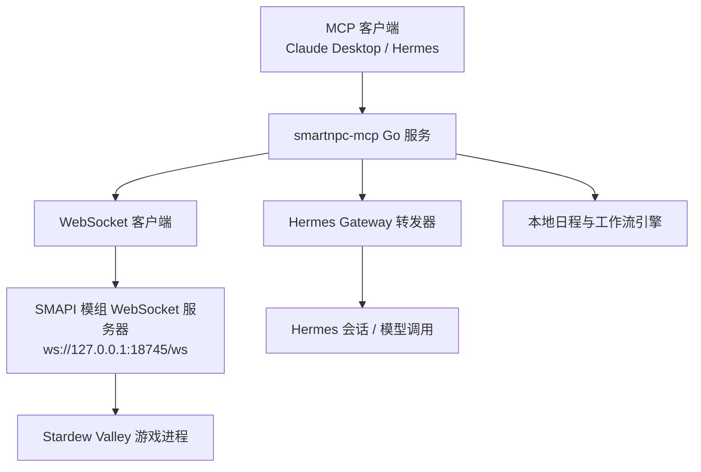
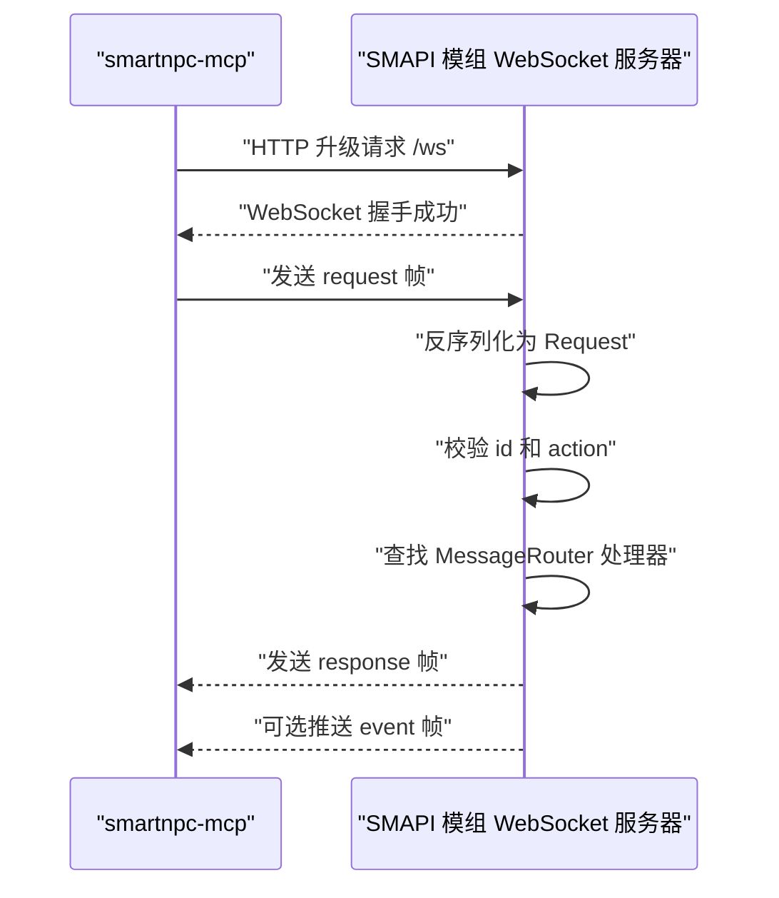
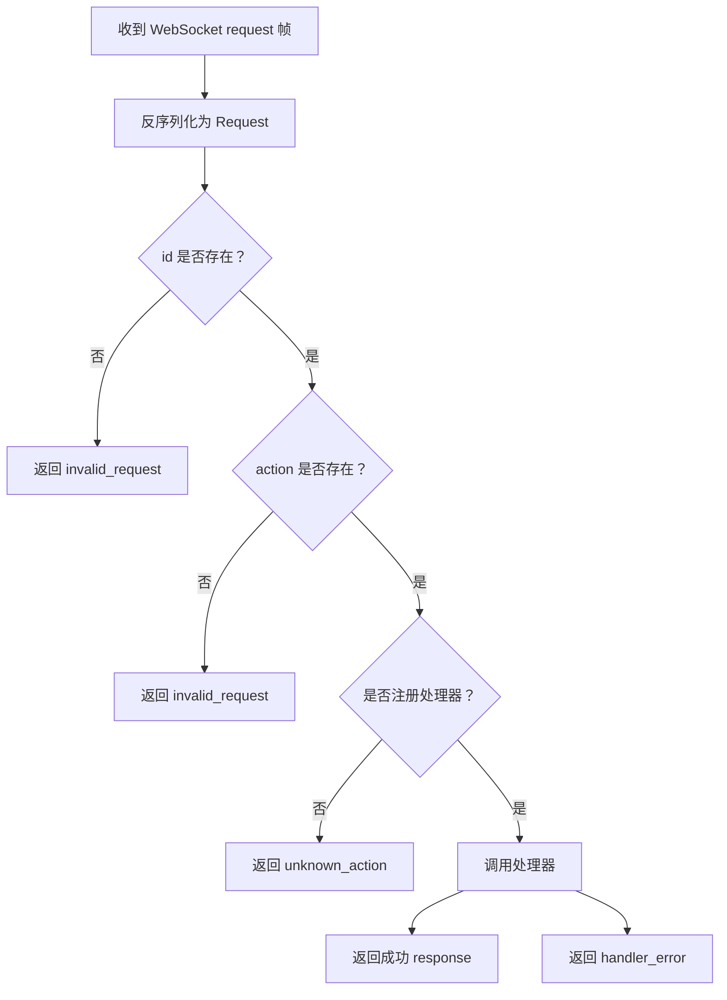
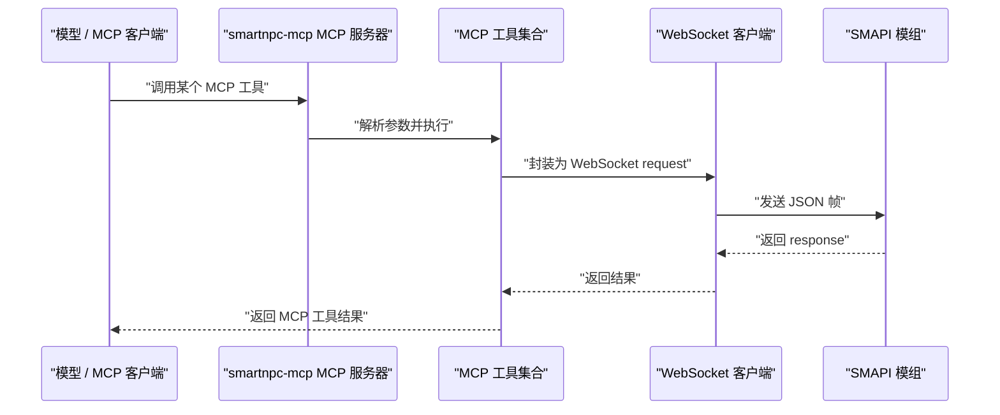
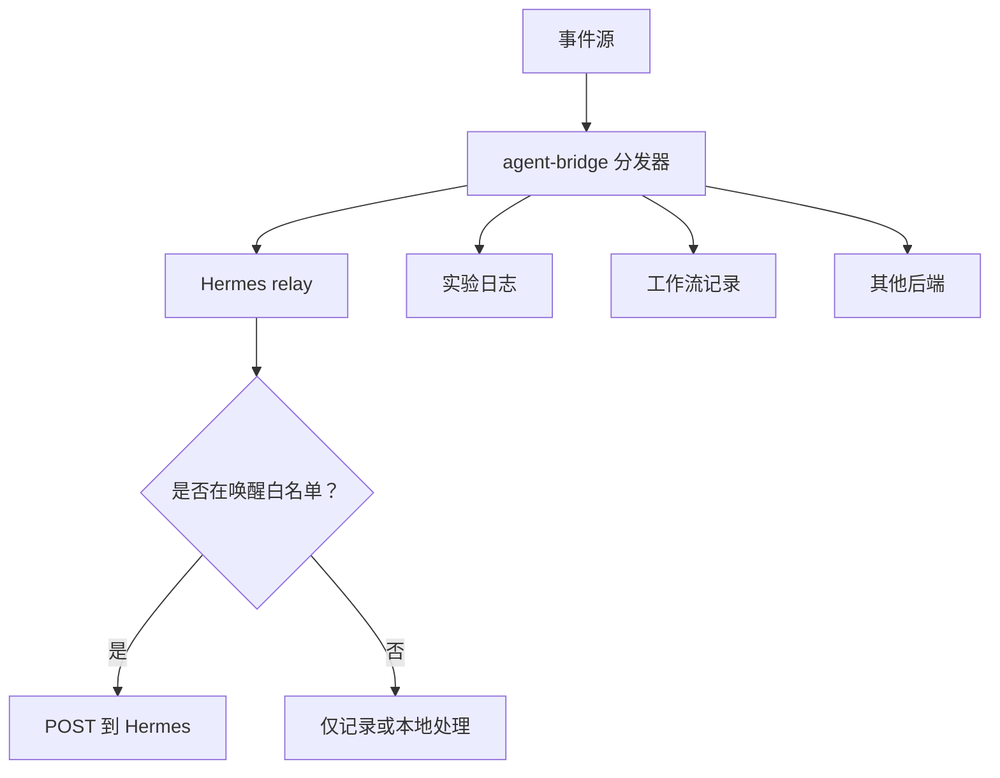

# 通信协议设计

<cite>
**本文引用的文件**   
- [protocol.md](file://SmartNPC/docs/protocol.md)
- [events.md](file://SmartNPC/docs/events.md)
- [mcp-tools.md](file://SmartNPC/docs/mcp-tools.md)
- [current-architecture.md](file://SmartNPC/docs/current-architecture.md)
- [Protocol.cs](file://SmartNPC/smapi-mod/Bridge/Protocol.cs)
- [MessageRouter.cs](file://SmartNPC/smapi-mod/Bridge/MessageRouter.cs)
- [WebSocketServer.cs](file://SmartNPC/smapi-mod/Bridge/WebSocketServer.cs)
- [ws_client.go](file://SmartNPC/smartnpc-mcp/adapters/stardew/bridge/ws_client.go)
- [events.go](file://SmartNPC/smartnpc-mcp/adapters/stardew/events/events.go)
- [format.go](file://SmartNPC/smartnpc-mcp/adapters/stardew/events/format.go)
- [event.go](file://SmartNPC/smartnpc-mcp/pkg/eventbus/event.go)
- [server.go](file://SmartNPC/smartnpc-mcp/pkg/agentbridge/server.go)
- [http.go](file://SmartNPC/smartnpc-mcp/pkg/transport/http.go)
- [main.go](file://SmartNPC/smartnpc-mcp/cmd/smartnpc-mcp/main.go)
</cite>

## 目录

1. [简介](#简介)
2. [项目结构与通信边界](#项目结构与通信边界)
3. [WebSocket 协议规范](#websocket-协议规范)
4. [消息路由与动作分发](#消息路由与动作分发)
5. [MCP 工具适配与 HTTP 接口](#mcp-工具适配与-http-接口)
6. [事件系统](#事件系统)
7. [协议消息示例](#协议消息示例)
8. [版本兼容性与向后兼容策略](#版本兼容性与向后兼容策略)
9. [调试工具与故障排查](#调试工具与故障排查)
10. [结论](#结论)

## 简介

SmartNPC 通过三层架构把游戏模组、智能体调度服务和外部 MCP 客户端连接起来：

- **SMAPI 模组（C#）**：运行在游戏进程中，负责读取游戏状态、驱动 NPC 行为、播放动画，并通过 WebSocket 暴露桥接能力。
- **smartnpc-mcp（Go）**：实现 MCP 工具注册、WebSocket 客户端、事件转发、日程和工作流引擎，是外部模型调用与游戏世界之间的中间层。
- **Hermes 或外部 MCP 客户端**：作为 MCP 客户端发起工具调用；在实验模式下，Hermes profile 根据 `day_started` 等事件唤醒管家 NPC 自主规划农场工作。

当前仓库的“实验构建”已移除玩家对话、群聊和 NPC 间私信等旧交互面，聚焦单 Agent 农场管家。因此，协议文档中保留的历史字段和动作会明确标注为历史内容，避免误以为仍可调用。

**章节来源**
- [current-architecture.md:1-163](file://SmartNPC/docs/current-architecture.md#L1-L163)

## 项目结构与通信边界

SmartNPC 的通信边界可以概括为以下三条主线：



**图示来源**
- [current-architecture.md:1-60](file://SmartNPC/docs/current-architecture.md#L1-L60)
- [main.go:1-120](file://SmartNPC/smartnpc-mcp/cmd/smartnpc-mcp/main.go#L1-L120)
- [ws_client.go:1-60](file://SmartNPC/smartnpc-mcp/adapters/stardew/bridge/ws_client.go#L1-L60)
- [WebSocketServer.cs:1-40](file://SmartNPC/smapi-mod/Bridge/WebSocketServer.cs#L1-L40)

关键职责划分如下：

| 组件 | 主要职责 | 不应承担的职责 |
|---|---|---|
| SMAPI 模组 | 处理 WebSocket 请求、访问游戏对象、执行 NPC 动作、广播事件 | 不直接调用模型 API |
| smartnpc-mcp | 注册 MCP 工具、管理 WebSocket 连接、转发事件、调度日程和工作流 | 不持有完整模型会话，也不代替游戏渲染画面 |
| Hermes | 维护角色人设、记忆、技能、模型推理和原生工具循环 | 不直接修改游戏内存 |
| 外部 MCP 客户端 | 发起工具调用、订阅日志通知、消费结构化事件 | 不理解 SMAPI 内部对象布局 |

**章节来源**
- [current-architecture.md:1-60](file://SmartNPC/docs/current-architecture.md#L1-L60)
- [server.go:1-120](file://SmartNPC/smartnpc-mcp/pkg/agentbridge/server.go#L1-L120)

## WebSocket 协议规范

### 传输与端点

- 传输协议：**WebSocket**
- 默认地址：`ws://127.0.0.1:18745/ws`
- 帧格式：**UTF-8 文本帧**
- 序列化格式：**JSON**
- 服务端角色：**SMAPI 模组**
- 客户端角色：**smartnpc-mcp**

该协议从 M2 的单 HTTP POST 迁移到 M3 的 WebSocket，以支持双向推送、请求响应关联和异步事件。

**章节来源**
- [protocol.md:1-20](file://SmartNPC/docs/protocol.md#L1-L20)

### 信封格式

所有 WebSocket 帧都是带 `type` 字段的 JSON 对象，分为三类：

| type | 方向 | 用途 |
|---|---|---|
| `request` | 客户端 → 服务端 | RPC 调用，期望收到匹配的 `response` |
| `response` | 服务端 → 客户端 | 对应某条 `request` 的结果 |
| `event` | 服务端 → 客户端 | 服务端主动推送，无需确认 |

#### request 信封

| 字段 | 类型 | 必填 | 说明 |
|---|---|---:|---|
| `type` | string | 是 | 固定为 `"request"` |
| `id` | string | 是 | 唯一标识，建议使用 UUIDv4；服务端原样回显 |
| `action` | string | 是 | 动作名称，例如 `game_get_time`、`chat_say`、`npc_move_to` |
| `params` | object | 否 | 动作相关参数；空时可省略 |
| `from_npc` | string | 否 | 调用方 MCP 会话绑定的 NPC 内部名；用于调试镜像和多角色上下文 |

`from_npc` 由 `agent_register_self` 工具绑定后自动注入；若未绑定，则可能为空，模组会记录警告并丢弃调试镜像。

#### response 信封

成功时：

| 字段 | 类型 | 说明 |
|---|---|---|
| `type` | string | 固定为 `"response"` |
| `id` | string | 对应原始请求的 `id` |
| `ok` | boolean | 固定为 `true` |
| `data` | object | 动作返回数据 |

失败时：

| 字段 | 类型 | 说明 |
|---|---|---|
| `type` | string | 固定为 `"response"` |
| `id` | string | 对应原始请求的 `id` |
| `ok` | boolean | 固定为 `false` |
| `error.code` | string | 机器可读错误码 |
| `error.message` | string | 人类可读错误信息 |

任一响应只包含 `data` 或 `error` 之一。

#### event 信封

| 字段 | 类型 | 说明 |
|---|---|---|
| `type` | string | 固定为 `"event"` |
| `name` | string | 事件名称 |
| `data` | object | 事件负载 |
| `timestamp` | number | Unix 毫秒时间戳 |

事件是“发送即弃”，服务端不等待客户端确认。

**章节来源**
- [protocol.md:21-100](file://SmartNPC/docs/protocol.md#L21-L100)
- [Protocol.cs:1-67](file://SmartNPC/smapi-mod/Bridge/Protocol.cs#L1-L67)

### 连接建立流程



**图示来源**
- [WebSocketServer.cs:100-220](file://SmartNPC/smapi-mod/Bridge/WebSocketServer.cs#L100-L220)
- [MessageRouter.cs:1-53](file://SmartNPC/smapi-mod/Bridge/MessageRouter.cs#L1-L53)
- [ws_client.go:1-120](file://SmartNPC/smartnpc-mcp/adapters/stardew/bridge/ws_client.go#L1-L120)

### 连接生命周期与错误处理

WebSocket 服务器使用 `HttpListener` 监听 `/ws`。非 WebSocket 请求返回 400。同一时刻只保留一个连接：新连接会关闭前一个连接。

| 阶段 | 行为 | 错误处理 |
|---|---|---|
| 接受连接 | 检查是否为 WebSocket 且路径为 `/ws` | 非 WebSocket 或非 `/ws` 返回 400 |
| 接收帧 | 按消息片段拼接成完整 UTF-8 JSON | 反序列化失败记录警告并丢弃 |
| 处理请求 | 校验 `id`、`action`，分发给处理器 | 未知动作返回 `unknown_action` |
| 发送响应 | 加锁后发送 JSON 文本帧 | 发送异常记录调试日志 |
| 断开连接 | 清理当前连接引用 | 捕获异常并释放资源 |

**章节来源**
- [WebSocketServer.cs:60-220](file://SmartNPC/smapi-mod/Bridge/WebSocketServer.cs#L60-L220)
- [WebSocketServer.cs:201-324](file://SmartNPC/smapi-mod/Bridge/WebSocketServer.cs#L201-L324)

## 消息路由与动作分发

### 路由机制

SMAPI 模组的 `MessageRouter` 维护一个动作名到处理器委托的映射。每个动作处理器签名统一为：

```text
RequestHandler(id, params) -> Response
```

路由器在处理前会做三项基础校验：

1. 缺少 `id` 时返回 `invalid_request`。
2. 缺少 `action` 时返回 `invalid_request`。
3. 找不到对应处理器时返回 `unknown_action`。

处理器本身抛出的异常会被捕获，包装为 `handler_error` 响应。



**图示来源**
- [MessageRouter.cs:1-53](file://SmartNPC/smapi-mod/Bridge/MessageRouter.cs#L1-L53)
- [WebSocketServer.cs:201-220](file://SmartNPC/smapi-mod/Bridge/WebSocketServer.cs#L201-L220)

**章节来源**
- [MessageRouter.cs:1-53](file://SmartNPC/smapi-mod/Bridge/MessageRouter.cs#L1-L53)

### 请求响应模式

WebSocket 层是轻量 RPC：

- 客户端发送 `request`，携带 `id`、`action`、`params`。
- 服务端找到处理器并执行。
- 处理器返回 `Response.Success` 或 `Response.Failure`。
- 客户端通过 `id` 匹配对应的 goroutine 通道，完成调用。

对于耗时较长的动作（例如寻路、浇水、收割），处理器通常只返回“已接受”，实际效果在后续游戏帧中逐步生效。

**章节来源**
- [protocol.md:21-100](file://SmartNPC/docs/protocol.md#L21-L100)
- [ws_client.go:1-120](file://SmartNPC/smartnpc-mcp/adapters/stardew/bridge/ws_client.go#L1-L120)

### 异步通知模式

事件不是请求响应的一部分。服务端通过 `BroadcastEvent` 向当前连接推送 `event` 帧。事件不需要 ack，消费者应独立处理，避免阻塞网络读取循环。

事件在 smartnpc-mcp 侧可被转发给 Hermes，也可进入本地日程、工作流或实验日志追踪。

**章节来源**
- [protocol.md:80-100](file://SmartNPC/docs/protocol.md#L80-L100)
- [WebSocketServer.cs:260-324](file://SmartNPC/smapi-mod/Bridge/WebSocketServer.cs#L260-L324)

## MCP 工具适配与 HTTP 接口

### MCP 服务角色

smartnpc-mcp 同时承担两个角色：

1. **MCP 服务端**：向 Claude Desktop、Hermes 或其他 MCP 客户端暴露工具列表和工具调用。
2. **WebSocket 客户端**：向 SMAPI 模组发起 `request`，并订阅 `event`。



**图示来源**
- [main.go:1-120](file://SmartNPC/smartnpc-mcp/cmd/smartnpc-mcp/main.go#L1-L120)
- [server.go:1-120](file://SmartNPC/smartnpc-mcp/pkg/agentbridge/server.go#L1-L120)
- [ws_client.go:1-120](file://SmartNPC/smartnpc-mcp/adapters/stardew/bridge/ws_client.go#L1-L120)

### 工具注册分层

工具可见性有两层：

1. **Go 注册层**：smartnpc-mcp 注册 MCP 工具。
2. **Hermes profile 过滤层**：Hermes profile 可通过 `mcp_servers.smartnpc_game.tools.include` 进一步筛选模型可见的工具。

实验构建默认注册约 50 个工具；开启 debug 后可增加一个调试工具，但该工具不在管家白名单内。

**章节来源**
- [mcp-tools.md:1-60](file://SmartNPC/docs/mcp-tools.md#L1-L60)
- [current-architecture.md:40-100](file://SmartNPC/docs/current-architecture.md#L40-L100)

### HTTP 接口定义

smartnpc-mcp 支持两种 MCP 传输：

| 传输方式 | 启动方式 | 适用场景 |
|---|---|---|
| stdio | 默认模式 | 桌面 MCP 客户端作为子进程启动 |
| Streamable HTTP | `--http :端口` | WSL 中的 Hermes 或其他远程客户端 |

HTTP 服务暴露以下端点：

| 路径 | 方法 | 说明 |
|---|---|---|
| `/mcp` | HTTP | MCP Streamable HTTP 入口 |
| `/mcp/` | HTTP | MCP 子路径 |
| `/healthz` | GET | 健康检查，返回 `{"ok":true}` |

可选安全配置：

| 配置项 | 含义 |
|---|---|
| `AllowAnyOrigin` | 允许跨主机连接，WSL 访问 Windows 宿主 IP 时需要 |
| `MCPAPIKey` | 要求 `/mcp` 请求携带匹配的 `Authorization: Bearer <key>` |
| `ReadHeaderTimeout` | 请求头读取超时，默认 5 秒 |
| `ShutdownTimeout` | 优雅关闭超时，默认 5 秒 |

**章节来源**
- [http.go:1-124](file://SmartNPC/smartnpc-mcp/pkg/transport/http.go#L1-L124)
- [main.go:1-120](file://SmartNPC/smartnpc-mcp/cmd/smartnpc-mcp/main.go#L1-L120)

### 工具调用格式

MCP 工具调用最终会被转换为 WebSocket `request` 帧。核心映射关系如下：

| MCP 工具类别 | 典型动作 | WebSocket action | 是否依赖模组 |
|---|---|---|---|
| 会话与播报 | `agent_register_self`、`chat_say` | `agent_register_self`、`chat_say` | 需要 WS 连接 |
| 游戏状态查询 | `game_get_time`、`game_get_weather` | 同名 action | 需要存档 |
| 农场经济 | `farm_get_economy` | `farm_get_economy` | 需要存档 |
| NPC 行为 | `npc_move_to`、`npc_wander`、`npc_ship_items` | 同名 action | 需要存档 |
| 日程与工作流 | `npc_plan_day`、`workflow_run_history` | 部分走本地引擎，部分走 WS | 混合 |

工具描述强调副作用、调用时机、关键输入和常见错误，便于模型决定是否调用。

**章节来源**
- [mcp-tools.md:1-200](file://SmartNPC/docs/mcp-tools.md#L1-L200)
- [protocol.md:100-200](file://SmartNPC/docs/protocol.md#L100-L200)

## 事件系统

### 事件来源

SmartNPC 的事件有两个主要来源：

1. **模组事件**：由 SMAPI 模组产生，经 WebSocket 到达 smartnpc-mcp，再转为 MCP 日志通知。
2. **合成事件**：由 smartnpc-mcp 自身产生，例如日程触发、工作流技能调用、农场主指令轮询。

两类事件共享统一信封结构，使下游消费者看到一致的数据流。

**章节来源**
- [events.md:1-40](file://SmartNPC/docs/events.md#L1-L40)
- [events.go:1-40](file://SmartNPC/smartnpc-mcp/adapters/stardew/events/events.go#L1-L40)

### 事件信封

MCP 通知包裹的结构如下：

| 字段 | 类型 | 说明 |
|---|---|---|
| `kind` | string | 固定为 `"stardew/event"` |
| `name` | string | 事件名称 |
| `data` | object | 事件负载 |
| `timestamp` | number | Unix 毫秒时间戳 |

新增字段必须保持向前兼容：未知字段应静默忽略。

**章节来源**
- [events.md:41-80](file://SmartNPC/docs/events.md#L41-L80)
- [events.go:180-220](file://SmartNPC/smartnpc-mcp/adapters/stardew/events/events.go#L180-L220)

### 事件类型与状态

实验构建下，只有四类事件可唤醒 Hermes：

| 事件 | 来源 | 是否唤醒 |
|---|---|---:|
| `day_started` | 模组 | 是 |
| `schedule_trigger` | 合成 | 是 |
| `workflow_skill_call` | 合成 | 是 |
| `owner_directive` | 合成 | 是 |

其他重要事件：

| 事件 | 来源 | 行为 |
|---|---|---|
| `game_time_tick` | 模组 | 仅驱动本地日程，不唤醒 |
| `day_ending` | 模组 | 仅记账，写入日志和状态 |
| `forage_collected` | 模组 | 记录采集结果，不唤醒 |

历史事件仍保留在文档和类型定义中，但实验分支不再产生：

| 事件 | 状态 |
|---|---|
| `chat_message` | 已移除 |
| `chat_received` | 已移除 |
| `npc_interact` | 已移除 |
| `group_create` | 已移除 |
| `npc_message` | 已移除 |
| `npc_broadcast` | 已移除 |
| `location_changed` | 预留 |
| `friendship_changed` | 预留 |
| `npc_perception_update` | 预留 |

**章节来源**
- [events.md:41-160](file://SmartNPC/docs/events.md#L41-L160)
- [events.go:60-180](file://SmartNPC/smartnpc-mcp/adapters/stardew/events/events.go#L60-L180)

### 事件订阅与过滤

事件进入 agent-bridge 后，先由事件源启动并发运行，再通过 `dispatch` 顺序转发给所有后端。后端包括 Hermes relay、实验日志、工作流记录等。

Hermes relay 会在转发前使用白名单过滤，避免无关 tick 事件打断模型推理。



**图示来源**
- [server.go:120-177](file://SmartNPC/smartnpc-mcp/pkg/agentbridge/server.go#L120-L177)
- [events.md:1-40](file://SmartNPC/docs/events.md#L1-L40)

**章节来源**
- [server.go:120-177](file://SmartNPC/smartnpc-mcp/pkg/agentbridge/server.go#L120-L177)
- [event.go:1-76](file://SmartNPC/smartnpc-mcp/pkg/eventbus/event.go#L1-L76)

## 协议消息示例

以下示例使用仓库文档定义的字段结构。为避免直接粘贴源码，示例以字段清单形式呈现。

### 聊天消息

虽然实验构建移除了玩家对话事件，但 `chat_say` 仍可作为单向公告存在。

**WebSocket request**

| 字段 | 值 | 说明 |
|---|---|---|
| `type` | `"request"` | 请求帧 |
| `id` | UUID | 唯一请求标识 |
| `action` | `"chat_say"` | 游戏内聊天框公告 |
| `params.speaker` | `"XiaMi"` | 显示名称 |
| `params.text` | `"今日农场工作已完成。"` | 公告内容 |
| `params.color` | `"yellow"` | 可选颜色 |
| `from_npc` | `"XiaMi"` | 可选，绑定后的 NPC 名 |

**WebSocket response**

| 字段 | 值 | 说明 |
|---|---|---|
| `type` | `"response"` | 响应帧 |
| `id` | 同上 | 对应请求 |
| `ok` | `true` | 成功 |
| `data.ok` | `true` | 动作级成功 |

**错误示例**

| 字段 | 值 | 说明 |
|---|---|---|
| `type` | `"response"` | 响应帧 |
| `ok` | `false` | 失败 |
| `error.code` | `"mod_not_ready"` | 没有加载存档 |
| `error.message` | 人类可读提示 | 例如缺少 `speaker` 或 `text` |

**章节来源**
- [protocol.md:100-180](file://SmartNPC/docs/protocol.md#L100-L180)

### NPC 控制命令

以移动为例。

**WebSocket request**

| 字段 | 值 | 说明 |
|---|---|---|
| `type` | `"request"` | 请求帧 |
| `id` | UUID | 唯一请求标识 |
| `action` | `"npc_move_to"` | NPC 移动 |
| `params.npc` | `"XiaMi"` | NPC 内部名 |
| `params.x` | 整数 | 目标横坐标 |
| `params.y` | 整数 | 目标纵坐标 |
| `params.map` | `"Farm"` | 可选目标地图 |

**WebSocket response**

| 字段 | 值 | 说明 |
|---|---|---|
| `type` | `"response"` | 响应帧 |
| `ok` | `true` | 已接受寻路或传送 |
| `data.ok` | `true` | 动作级成功 |
| `data.message` | `"pathing"` 或 `"warped"` | 移动方式 |

注意：接受不等于移动已完成。异步动作应在后续帧观察位置或行为状态。

**章节来源**
- [protocol.md:280-360](file://SmartNPC/docs/protocol.md#L280-L360)

### 状态查询

以游戏时间和天气为例。

**WebSocket request**

| 字段 | 值 | 说明 |
|---|---|---|
| `type` | `"request"` | 请求帧 |
| `id` | UUID | 唯一请求标识 |
| `action` | `"game_get_time"` | 查询时间 |
| `params` | 空对象或省略 | 无参 |

**WebSocket response**

| 字段 | 值 | 说明 |
|---|---|---|
| `type` | `"response"` | 响应帧 |
| `ok` | `true` | 成功 |
| `data.hour` | 整数 | 0–23 |
| `data.minute` | 整数 | 通常为 0 或 30 |
| `data.timeOfDay` | 整数 | 原始游戏时间值 |
| `data.day` | 整数 | 1–28 |
| `data.day_of_week` | string | 星期简称 |
| `data.season` | string | 季节 |
| `data.year` | 整数 | 游戏年份 |

天气查询类似，返回 `weather`、`is_raining`、`is_snowing`、`is_lightning`、`season`。

**章节来源**
- [protocol.md:140-220](file://SmartNPC/docs/protocol.md#L140-L220)

### 农场经济查询

这是实验构建新增的只读动作。

**WebSocket request**

| 字段 | 值 | 说明 |
|---|---|---|
| `type` | `"request"` | 请求帧 |
| `action` | `"farm_get_economy"` | 农场经济记分板 |
| `params` | 空对象或省略 | 无参 |

**WebSocket response**

| 字段 | 值 | 说明 |
|---|---|---|
| `type` | `"response"` | 响应帧 |
| `ok` | `true` | 成功 |
| `data.gold` | 整数 | 当前金币 |
| `data.total_money_earned` | 整数 | 累计收入 |
| `data.shipping_bin_count` | 整数 | 出货箱待售物品数 |
| `data.shipping_bin_value` | 整数 | 出货箱总价值 |
| `data.crops_planted` | 整数 | 已种植作物地块 |
| `data.crops_ready` | 整数 | 可收获作物数 |
| `data.tilled_tiles` | 整数 | 已耕地数量 |
| `data.watered_tiles` | 整数 | 已浇水地块 |
| `data.animals` | 整数 | 动物数量 |

**章节来源**
- [protocol.md:201-260](file://SmartNPC/docs/protocol.md#L201-L260)

### 事件通知

以 `day_started` 为例。

**WebSocket event**

| 字段 | 值 | 说明 |
|---|---|---|
| `type` | `"event"` | 事件帧 |
| `name` | `"day_started"` | 新的一天开始 |
| `data.day` | 整数 | 1–28 |
| `data.season` | string | 季节 |
| `data.year` | 整数 | 年份 |
| `data.day_of_week` | string | 星期 |
| `timestamp` | number | Unix 毫秒 |

**章节来源**
- [events.md:160-220](file://SmartNPC/docs/events.md#L160-L220)

## 版本兼容性与向后兼容策略

### 协议层面

1. **JSON 字段扩展优先**：新增字段应保持可选，现有消费者忽略未知字段。
2. **错误码稳定**：`error.code` 是机器可读字符串，应避免频繁重命名。
3. **动作名稳定**：已注册的 `action` 不应随意改名或删除；删除需配合文档和注册表。
4. **JSON 序列化选项**：C# 端使用忽略空值的序列化选项，避免多余字段污染报文。

**章节来源**
- [protocol.md:1-20](file://SmartNPC/docs/protocol.md#L1-L20)
- [Protocol.cs:40-67](file://SmartNPC/smapi-mod/Bridge/Protocol.cs#L40-L67)

### 事件层面

事件文档明确要求：

- 新字段必须能被未知消费者忽略。
- 类型定义与文档同步更新。
- 实验构建对唤醒事件进行白名单限制，而非删除底层事件类型。

**章节来源**
- [events.md:41-80](file://SmartNPC/docs/events.md#L41-L80)
- [events.go:1-40](file://SmartNPC/smartnpc-mcp/adapters/stardew/events/events.go#L1-L40)

### 向后兼容策略

| 变更类型 | 策略 |
|---|---|
| 新增 WebSocket action | 只在客户端和服务端都支持后启用；旧客户端忽略未知 action |
| 新增事件字段 | 保留旧字段语义；新字段可选 |
| 移除交互面 | 文档中标注“实验构建已移除”，避免未来开发者误用 |
| 移除 MCP 工具 | Go 注册表删除；Hermes profile 白名单也应更新 |
| 行为变化 | 通过文档和测试说明，不隐式改变已有动作语义 |

**章节来源**
- [protocol.md:1-40](file://SmartNPC/docs/protocol.md#L1-L40)
- [mcp-tools.md:180-240](file://SmartNPC/docs/mcp-tools.md#L180-L240)

## 调试工具与故障排查

### 常见问题定位

| 现象 | 可能原因 | 排查步骤 |
|---|---|---|
| MCP 客户端无法连接 smartnpc-mcp | 端口未启动、防火墙拦截、WSL 跨主机配置错误 | 检查 `--http` 地址、`AllowAnyOrigin`、`/healthz` |
| MCP 工具调用超时 | WS 客户端连接断开、模组未加载存档、动作耗时过长 | 查看 WS 客户端日志、模组日志、动作耗时 |
| 模组返回 `unknown_action` | 客户端调用了未注册动作 | 核对 `action` 名和当前实验构建支持的动作 |
| 模组返回 `mod_not_ready` | 没有加载存档 | 先加载存档再调用需要游戏的动作 |
| 事件未唤醒 Hermes | 事件不在唤醒白名单 | 检查事件名是否为 `day_started`、`schedule_trigger`、`workflow_skill_call`、`owner_directive` |
| 聊天消息未显示 | `chat_say` 参数不完整或频道配置错误 | 检查 `speaker`、`text`、`channel`、`group_id` |
| 调试镜像不显示 | 调试开关未开启或未绑定 `from_npc` | 检查 `DebugLogIncomingRequests` 和 `agent_register_self` |

**章节来源**
- [protocol.md:100-220](file://SmartNPC/docs/protocol.md#L100-L220)
- [events.md:1-40](file://SmartNPC/docs/events.md#L1-L40)

### WebSocket 调试建议

1. 使用浏览器或 WebSocket 客户端直连 `ws://127.0.0.1:18745/ws`。
2. 发送最小 `request`，验证 `id` 是否正确回显。
3. 观察 `response` 的 `ok`、`data`、`error.code`。
4. 监听 `event` 帧，确认事件名称和时间戳。
5. 若连接被替换，检查是否有多实例或重复启动。

**章节来源**
- [WebSocketServer.cs:100-220](file://SmartNPC/smapi-mod/Bridge/WebSocketServer.cs#L100-L220)

### MCP 调试建议

1. 使用 `/healthz` 验证 HTTP 服务是否存活。
2. 检查 `/mcp` 是否返回 MCP 初始化结果。
3. 调用 `ping` 工具验证端到端链路。
4. 检查 Hermes relay 配置是否启用了目标 profile。
5. 查看实验日志目录中的 `tool-calls.jsonl`、`events.jsonl`、`workflow-runs.jsonl`。

**章节来源**
- [http.go:60-124](file://SmartNPC/smartnpc-mcp/pkg/transport/http.go#L60-L124)
- [main.go:1-120](file://SmartNPC/smartnpc-mcp/cmd/smartnpc-mcp/main.go#L1-L120)

### 调试镜像

当模组启用调试请求镜像时，每个入站 `request` 会被打包为结构化事件，并在游戏线程上投递到聊天面板 UI。该功能不会直接修改业务逻辑，主要用于定位 `action`、`id`、`params` 和 `from_npc` 是否正确。

**章节来源**
- [WebSocketServer.cs:40-120](file://SmartNPC/smapi-mod/Bridge/WebSocketServer.cs#L40-L120)
- [WebSocketServer.cs:220-260](file://SmartNPC/smapi-mod/Bridge/WebSocketServer.cs#L220-L260)

## 结论

SmartNPC 的通信协议围绕三个核心展开：

1. **WebSocket 协议**定义了客户端与服务端之间的信封、动作、响应和事件格式。
2. **消息路由机制**保证 `action` 能正确分发到处理器，并提供统一的错误处理和性能计时。
3. **MCP 适配层**把外部模型调用翻译成 WS 请求，并把模组事件转成 MCP 日志通知。

在当前实验构建中，协议重点从“玩家对话”转向“农场管家自主经营”。这使协议更聚焦于日程、工作流、环境感知、物流和经济指标，而不是玩家聊天界面。

对外部集成者来说，最重要的实践是：

- 始终携带稳定的 `id`。
- 使用文档中声明的 `action`。
- 区分“已接受”和“已完成”的异步动作。
- 忽略未知事件字段。
- 只让白名单事件唤醒模型。
- 通过 `/healthz`、WS 帧、日志文件和实验目录共同定位问题。