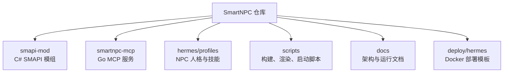
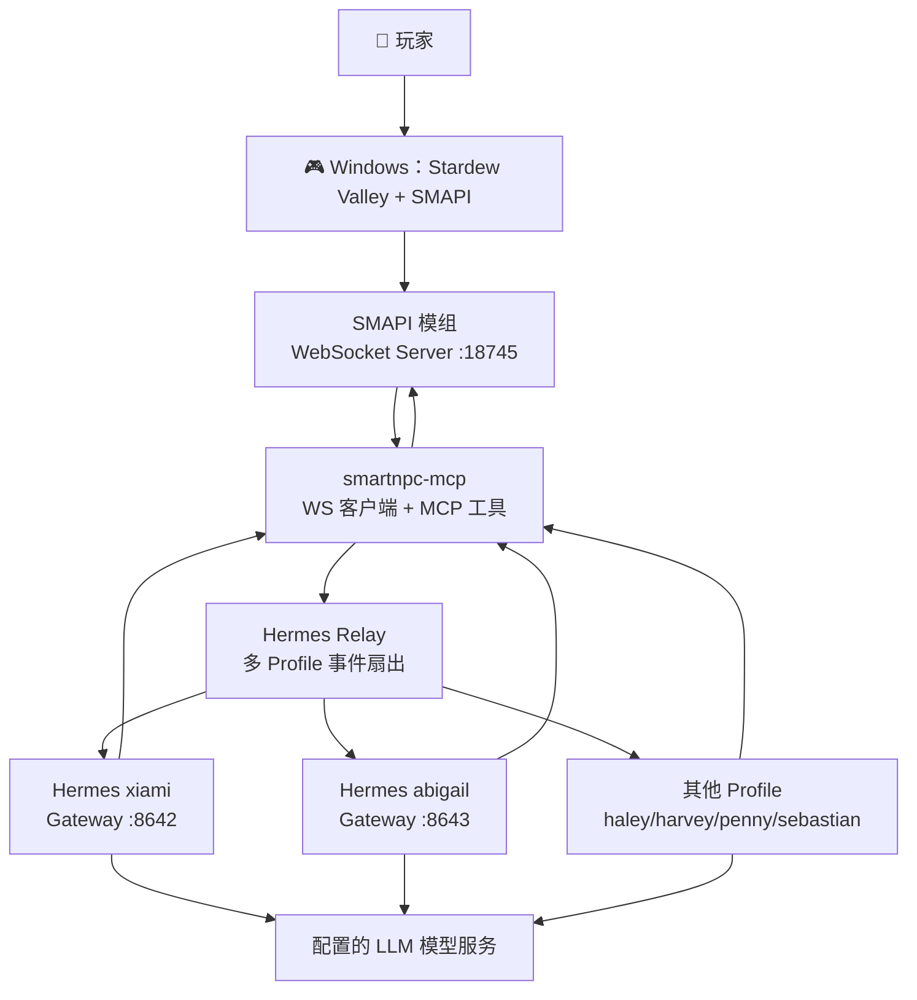
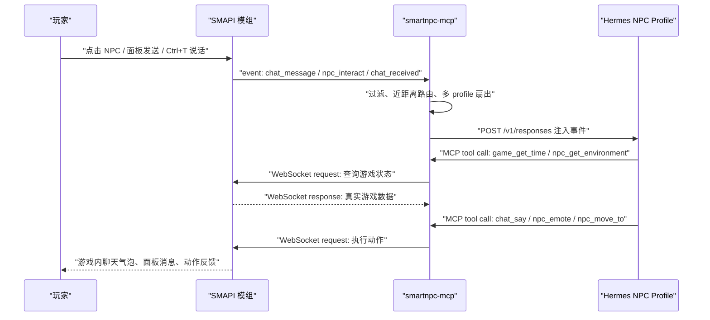
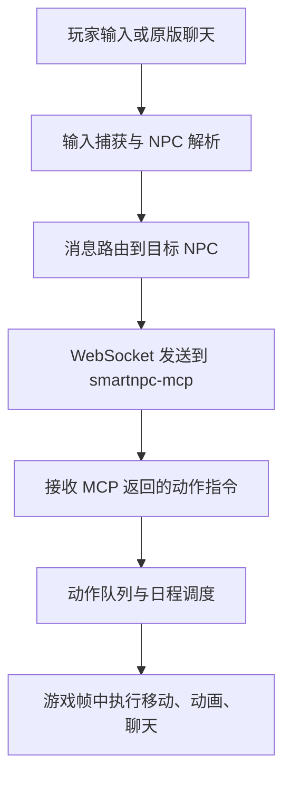
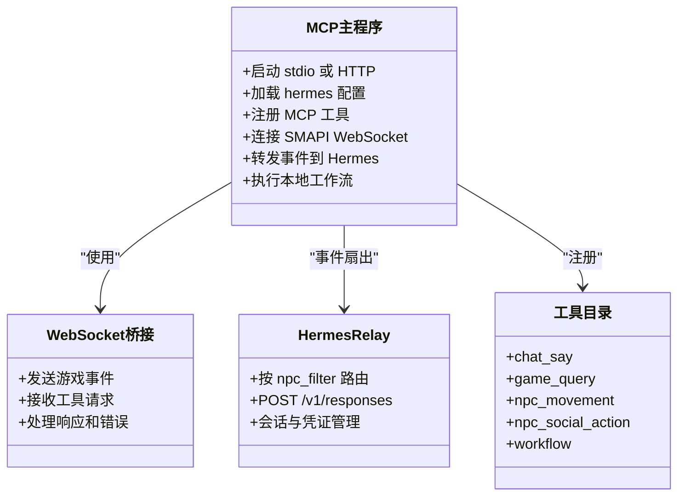
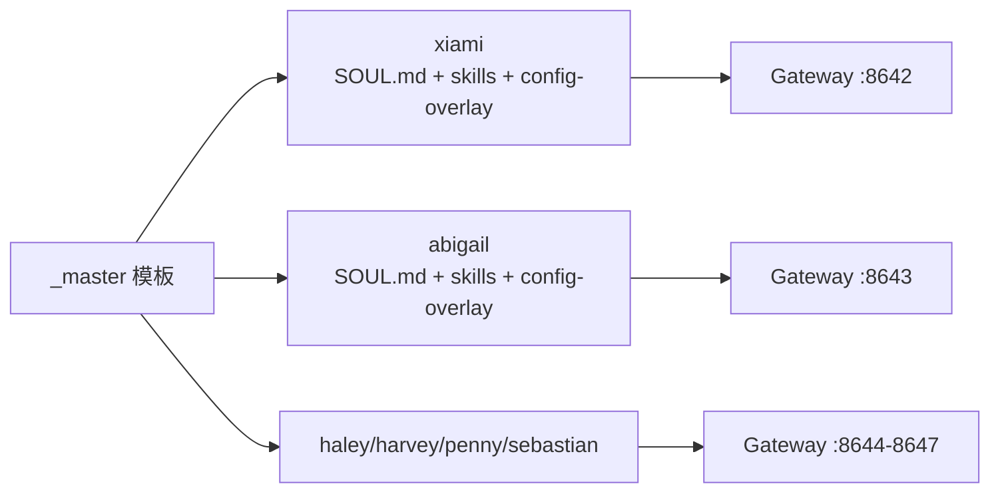
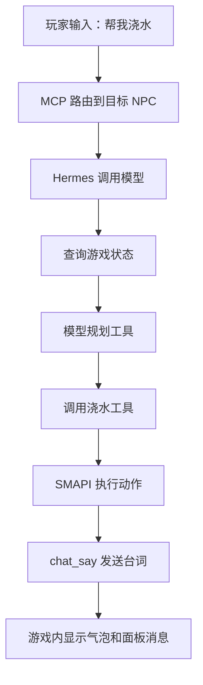
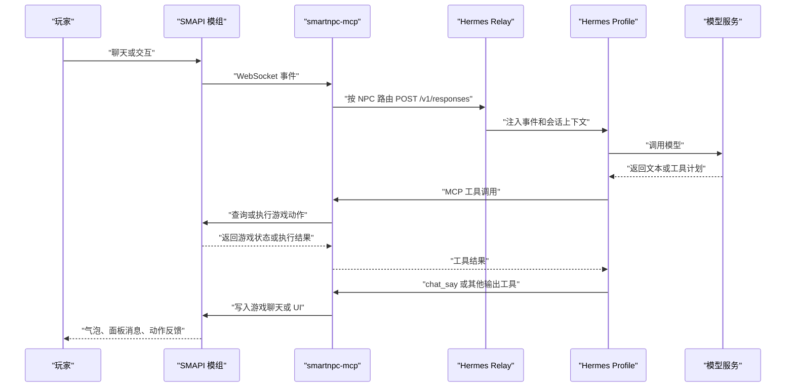

# 项目概览与快速开始

<cite>
**本文引用的文件**   
- [SmartNPC/README.md](file://SmartNPC/README.md)
- [SmartNPC/docs/setup.md](file://SmartNPC/docs/setup.md)
- [SmartNPC/docs/current-architecture.md](file://SmartNPC/docs/current-architecture.md)
- [SmartNPC/docs/local-runtime.md](file://SmartNPC/docs/local-runtime.md)
- [SmartNPC/hermes/README.md](file://SmartNPC/hermes/README.md)
- [SmartNPC/hermes/npcs.yaml](file://SmartNPC/hermes/npcs.yaml)
- [SmartNPC/hermes/runtime-config.yaml](file://SmartNPC/hermes/runtime-config.yaml)
- [SmartNPC/smartnpc-mcp/README.md](file://SmartNPC/smartnpc-mcp/README.md)
- [SmartNPC/smartnpc-mcp/cmd/smartnpc-mcp/main.go](file://SmartNPC/smartnpc-mcp/cmd/smartnpc-mcp/main.go)
- [SmartNPC/run.bat](file://SmartNPC/run.bat)
- [SmartNPC/setup.bat](file://SmartNPC/setup.bat)
</cite>

## 目录
1. [引言](#引言)
2. [项目结构](#项目结构)
3. [核心组件](#核心组件)
4. [架构总览](#架构总览)
5. [详细组件分析](#详细组件分析)
6. [依赖与环境要求](#依赖与环境要求)
7. [安装与快速开始](#安装与快速开始)
8. [数据流与处理逻辑](#数据流与处理逻辑)
9. [常见问题排查](#常见问题排查)
10. [结论](#结论)

## 引言
SmartNPC 是一个为星露谷物语 NPC 提供人格化聊天、长期记忆、工具调用和主动行为能力的 AI NPC 运行时。它的核心价值是把 SMAPI 模组中的游戏状态、UI 和动作，与 MCP 能力边界、Hermes Agent Profiles 的决策边界解耦：模型只负责“怎么想”，Go 层负责协议转换、硬校验和游戏能力暴露，SMAPI 模组负责贴近游戏线程的真实交互。

项目当前采用 **Hermes-first** 设计：玩家输入进入 SMAPI 模组后，通过 WebSocket 交给 smartnpc-mcp；MCP 服务将事件转发到 Hermes Gateway，由对应 NPC Profile 调用模型、规划并执行 MCP 工具，最终把对话、移动、表情、送礼等结果写回游戏。

## 项目结构
仓库围绕三层职责组织代码和资源：

| 路径 | 主要职责 |
|---|---|
| `smapi-mod/` | C# SMAPI 模组：游戏内 UI、NPC 注册、WebSocket Server、查询与动作处理器、动画、日程执行等。 |
| `smartnpc-mcp/` | Go MCP 服务：MCP 工具注册、WebSocket 客户端、HTTP MCP、事件路由、日程与工作流引擎、Hermes relay。 |
| `hermes/profiles/<npc>/` | 每个 NPC 的 Hermes Profile：`SOUL.md` 定义灵魂，`skills/` 定义技能，`config-overlay.yaml` 注入 MCP 连接与 API Server，`state.db` 保存记忆。 |
| `scripts/` | 渲染 profile、探测 WSL IP、启动 Hermes gateway、重置、调试日志等辅助脚本。 |
| `deploy/hermes/` | Hermes Docker 部署模板、入口脚本、健康检查脚本。 |
| `docs/` | 架构、协议、事件、MCP 工具、本地运行、E2E 验证等文档。 |
| `run.bat` / `setup.bat` | Windows 一键启动与首次环境初始化脚本。 |



**图表来源**
- [SmartNPC/README.md:1-120](file://SmartNPC/README.md#L1-L120)
- [SmartNPC/docs/current-architecture.md:1-40](file://SmartNPC/docs/current-architecture.md#L1-L40)

**章节来源**
- [SmartNPC/README.md:1-120](file://SmartNPC/README.md#L1-L120)
- [SmartNPC/docs/current-architecture.md:1-40](file://SmartNPC/docs/current-architecture.md#L1-L40)

## 核心组件
- **SMAPI 模组层**：嵌入 Stardew Valley，承担聊天面板、NPC 交互捕获、世界状态读取、动作队列、动画播放和 WebSocket Server（默认端口 `:18745`）。
- **MCP 服务层**：以 `smartnpc-mcp` 进程实现，支持 stdio 和 Streamable HTTP（默认示例端口 `:3000`），暴露 MCP 工具，并把游戏事件 POST 到 Hermes Gateway。
- **Hermes Agent Profiles**：每个 NPC 一个独立 Profile，负责人格、记忆、技能、工具规划和主动行为；多 Profile 可分别绑定不同 Gateway 端口。

项目强调硬边界安全：MCP/SMAPI 层负责参数校验、NPC 存在性、地图合法性、游戏线程安全和超时重连；LLM 只决定策略，不直接操作游戏对象。

**章节来源**
- [SmartNPC/README.md:1-80](file://SmartNPC/README.md#L1-L80)
- [SmartNPC/docs/current-architecture.md:1-40](file://SmartNPC/docs/current-architecture.md#L1-L40)

## 架构总览
SmartNPC 的三层架构不是单进程模块，而是跨 Windows 主机、Go 服务和 WSL Hermes 的运行拓扑：



**图表来源**
- [SmartNPC/README.md:20-110](file://SmartNPC/README.md#L20-L110)
- [SmartNPC/hermes/npcs.yaml:1-70](file://SmartNPC/hermes/npcs.yaml#L1-L70)
- [SmartNPC/hermes/runtime-config.yaml:1-15](file://SmartNPC/hermes/runtime-config.yaml#L1-L15)

从一句话链路看：



**图表来源**
- [SmartNPC/README.md:40-110](file://SmartNPC/README.md#L40-L110)
- [SmartNPC/smartnpc-mcp/cmd/smartnpc-mcp/main.go:1-80](file://SmartNPC/smartnpc-mcp/cmd/smartnpc-mcp/main.go#L1-L80)

**章节来源**
- [SmartNPC/README.md:20-110](file://SmartNPC/README.md#L20-L110)
- [SmartNPC/docs/current-architecture.md:1-40](file://SmartNPC/docs/current-architecture.md#L1-L40)

## 详细组件分析

### SMAPI 模组层
SMAPI 模组是离游戏最近的一层，负责：
- 在游戏内展示 SmartNPC 聊天面板、未读提示、联系人列表和群组界面。
- 捕获玩家对 NPC 的对话输入、快捷键输入以及原版聊天框中附近 NPC 可听见的声音。
- 维护 NPC 注册表、对话队列、库存状态、感知系统和运动系统。
- 向 `smartnpc-mcp` 提供 WebSocket JSON 请求/响应通道。
- 在后续游戏帧中执行长时间动作，例如跟随、寻路、动画播放。

模组的关键边界是：**工具收到请求、动作完成、动画播放是不同阶段**，涉及游戏对象的工作必须放在游戏线程执行。



**图表来源**
- [SmartNPC/docs/current-architecture.md:1-40](file://SmartNPC/docs/current-architecture.md#L1-L40)
- [SmartNPC/docs/current-architecture.md:41-80](file://SmartNPC/docs/current-architecture.md#L41-L80)

**章节来源**
- [SmartNPC/docs/current-architecture.md:1-40](file://SmartNPC/docs/current-architecture.md#L1-L40)
- [SmartNPC/docs/current-architecture.md:41-80](file://SmartNPC/docs/current-architecture.md#L41-L80)

### MCP 服务层
`smartnpc-mcp` 是 MCP 服务器，也是 SMAPI 模组与 Hermes 之间的桥梁：
- 支持 stdio 模式和 Streamable HTTP 模式；后者让 WSL 内的 Hermes 能跨主机访问。
- 注册 MCP 工具，包括聊天、查询、感知、移动、社交、世界行为、工作流等能力。
- 通过 WebSocket 连接 SMAPI 模组的 `ws://127.0.0.1:18745/ws`。
- 根据 `hermes-config` 或单目标参数，把事件 POST 到 Hermes Gateway 的 `/v1/responses`。
- 对工具调用做硬校验，避免非法 NPC、非法地图或不安全的线程调用。
- 管理日程和工作流：本地确定性步骤由引擎执行，需要智能体判断的步骤才交给 Hermes。



**图表来源**
- [SmartNPC/smartnpc-mcp/cmd/smartnpc-mcp/main.go:1-120](file://SmartNPC/smartnpc-mcp/cmd/smartnpc-mcp/main.go#L1-L120)
- [SmartNPC/smartnpc-mcp/README.md:1-40](file://SmartNPC/smartnpc-mcp/README.md#L1-L40)
- [SmartNPC/hermes/runtime-config.yaml:1-15](file://SmartNPC/hermes/runtime-config.yaml#L1-L15)

**章节来源**
- [SmartNPC/smartnpc-mcp/cmd/smartnpc-mcp/main.go:1-120](file://SmartNPC/smartnpc-mcp/cmd/smartnpc-mcp/main.go#L1-L120)
- [SmartNPC/smartnpc-mcp/README.md:1-40](file://SmartNPC/smartnpc-mcp/README.md#L1-L40)

### Hermes Agent Profiles
Hermes Profile 是决策边界：
- `SOUL.md` 定义角色灵魂、说话风格、好感度档位和行为约束。
- `skills/smartnpc/` 提供共享或 NPC 专属技能。
- `config-overlay.yaml` 注入 MCP 连接、API Server 开关和模型凭据覆盖。
- 每个启用的 NPC 可以拥有独立 Gateway、会话、记忆和人设。
- 默认仓库配置中仅 `xiami` 启用，其他 NPC 保留但未启用。



**图表来源**
- [SmartNPC/hermes/README.md:1-60](file://SmartNPC/hermes/README.md#L1-L60)
- [SmartNPC/hermes/npcs.yaml:1-70](file://SmartNPC/hermes/npcs.yaml#L1-L70)

**章节来源**
- [SmartNPC/hermes/README.md:1-60](file://SmartNPC/hermes/README.md#L1-L60)
- [SmartNPC/hermes/npcs.yaml:1-70](file://SmartNPC/hermes/npcs.yaml#L1-L70)

### 关键处理流程：浇水示例
以玩家说“帮我浇水”为例：
1. SMAPI 模组把玩家原话和目标 NPC 发给 `smartnpc-mcp`。
2. Relay 根据目标角色路由，将当前事件 POST 到 Hermes 的 `/v1/responses`。
3. Hermes Profile 调用模型，模型通过 MCP 查询时间、天气、位置等状态。
4. 模型选择 `npc_water_crops` 等工具；`smartnpc-mcp` 把工具请求交给 SMAPI 模组。
5. 模组返回接受、排队或失败；长时间动作由 FollowSystem 在后续帧继续执行。
6. 模型显式调用 `chat_say`，把台词发回游戏聊天面板。



**图表来源**
- [SmartNPC/docs/current-architecture.md:41-80](file://SmartNPC/docs/current-architecture.md#L41-L80)

**章节来源**
- [SmartNPC/docs/current-architecture.md:41-80](file://SmartNPC/docs/current-architecture.md#L41-L80)

## 依赖与环境要求
项目明确区分 Windows 主机环境和 WSL 环境：

| 组件 | 版本或要求 | 用途 |
|---|---|---|
| Stardew Valley | 1.6+ | 游戏本体 |
| SMAPI | 4.0+ | 模组加载器 |
| .NET SDK | 6.0 或 8.0（C# Dev Kit） | 构建 SMAPI 模组，target `net6.0` |
| Go | 1.22+，推荐 1.25+ | 构建 `smartnpc-mcp` |
| Task | latest | 统一构建入口 |
| WSL2 | Ubuntu-22.04 或自定义发行版 | Docker 宿主 |
| Docker Engine | WSL 内 | 运行 Hermes Agent 容器 |
| Hermes Agent | 已安装并可运行 | 提供 Agent Profiles 和 Gateway |

仓库 README 描述 Hermes-first 主链路需要 WSL Ubuntu-22.04 + Hermes Agent；本地运行时说明也记录了本机实际使用 Ubuntu-24.04。首次安装建议优先阅读 `docs/setup.md`，再结合本机路径文档确认命令。

**章节来源**
- [SmartNPC/README.md:120-200](file://SmartNPC/README.md#L120-L200)
- [SmartNPC/docs/setup.md:1-80](file://SmartNPC/docs/setup.md#L1-L80)
- [SmartNPC/docs/local-runtime.md:1-40](file://SmartNPC/docs/local-runtime.md#L1-L40)

## 安装与快速开始

### 前置准备
1. 在 Steam 安装 Stardew Valley，并运行一次确认正常。
2. 安装 SMAPI 4.0+，确保 `StardewModdingAPI.exe` 能进入游戏且控制台无红字。
3. 安装 Go、.NET SDK 和 Task。
4. 安装 WSL2 Ubuntu，并在 WSL 内安装 Docker Engine。
5. 复制 `.env.example` 为 `.env`，至少填写 `SMARTNPC_GAME_PATH`、`HERMES_AGENT_URL`、`HERMES_AGENT_API_KEY`、`HERMES_AGENT_MODEL`。

### 首次安装
在 Windows 终端进入仓库根目录：

```cmd
git clone <仓库 URL> SmartNPC
cd SmartNPC
copy .env.example .env
setup.bat
```

`setup.bat` 会：
- 检查 WSL、Docker、游戏路径和 LLM 配置。
- 渲染 Hermes profile。
- 自动探测 Windows 与 WSL IP。
- 从 `hermes/npcs.yaml` 生成 `deploy/hermes/docker-compose.yml`。
- 生成 `deploy/hermes/.env`。
- 在 WSL Docker 中构建 Hermes Agent 镜像。

### 一键启动
```cmd
run.bat
```

`run.bat` 的典型流程：
1. 构建 SMAPI 模组和 `smartnpc-mcp`。
2. 停止旧的游戏、MCP 进程。
3. 安装模组。
4. 启动 `smartnpc-mcp --http :3000 --ws-url ws://127.0.0.1:18745/ws --hermes-config ...`。
5. 等待 MCP HTTP 端点可用。
6. 通过 `docker compose up -d` 启动 Hermes gateways。
7. 逐个检测 Gateway `/health`。
8. 启动 `StardewModdingAPI.exe`。

### 手动启动
适合理解链路时使用：
1. 构建模组和 MCP。
2. 启动带 Hermes 路由的 `smartnpc-mcp`。
3. 在 WSL 中启动对应 Hermes Gateway。
4. 通过 `StardewModdingAPI.exe` 启动游戏。
5. 载入存档后按 `Tab` 查看 SmartNPC 聊天面板。

如果本机路径与默认值不一致，应优先参考 `docs/local-runtime.md` 中的本机位置和分步命令。

**章节来源**
- [SmartNPC/docs/setup.md:1-120](file://SmartNPC/docs/setup.md#L1-L120)
- [SmartNPC/run.bat:1-199](file://SmartNPC/run.bat#L1-L199)
- [SmartNPC/setup.bat:1-155](file://SmartNPC/setup.bat#L1-L155)
- [SmartNPC/docs/local-runtime.md:40-117](file://SmartNPC/docs/local-runtime.md#L40-L117)

## 数据流与处理逻辑

### 端到端数据流


**图表来源**
- [SmartNPC/README.md:40-110](file://SmartNPC/README.md#L40-L110)
- [SmartNPC/smartnpc-mcp/cmd/smartnpc-mcp/main.go:1-120](file://SmartNPC/smartnpc-mcp/cmd/smartnpc-mcp/main.go#L1-L120)

### 多 Profile 路由
`hermes/npcs.yaml` 是所有 NPC 和 Profile 的统一注册源，包含 id、game_name、display_name、gateway_port、enabled 和 peer 关系。`runtime-config.yaml` 由渲染脚本生成，供 `smartnpc-mcp --hermes-config` 消费，用于按 `npc_filter` 把事件分发到不同 Gateway。

| NPC | 游戏内名 | Gateway 端口 | 是否启用 |
|---|---|---:|---|
| xiami | XiaMi | 8642 | true |
| abigail | Abigail | 8643 | false |
| haley | Haley | 8644 | false |
| harvey | Harvey | 8645 | false |
| penny | Penny | 8646 | false |
| sebastian | Sebastian | 8647 | false |

**章节来源**
- [SmartNPC/hermes/npcs.yaml:1-70](file://SmartNPC/hermes/npcs.yaml#L1-L70)
- [SmartNPC/hermes/runtime-config.yaml:1-15](file://SmartNPC/hermes/runtime-config.yaml#L1-L15)

### 主动行为与日程
新一天触发 `day_started` 时，系统清理旧日程、轮换 Hermes 会话并唤醒智能体规划当天任务。工作流中的普通工具步骤由本地引擎执行；需要智能体判断的步骤才交给 Hermes。预编译请求限制模型只能查询并提交结构化结果，不能提前执行世界动作或发言。

**章节来源**
- [SmartNPC/docs/current-architecture.md:41-80](file://SmartNPC/docs/current-architecture.md#L41-L80)

## 常见问题排查

| 问题 | 可能原因 | 排查方法 |
|---|---|---|
| `.env` 未找到 | 未执行 `copy .env.example .env` | 重新复制并填写必填变量 |
| `StardewModdingAPI.exe` 不存在 | `SMARTNPC_GAME_PATH` 指向错误目录 | 修正 `.env` 中的游戏路径 |
| Docker Compose 不存在 | 未运行 `setup.bat` | 先执行首次安装 |
| MCP HTTP 端点不可达 | MCP 未启动或端口被占用 | 查看 `logs/mcp_*.log`，检查 `:3000` 或本机端口 |
| Hermes Gateway 健康检查失败 | WSL IP 变化、端口冲突或容器未启动 | 在 WSL 中执行 `docker compose ps` 和 `docker compose logs` |
| 游戏启动但无 SmartNPC 面板 | 未加载 SMAPI 模组或未完整重启游戏 | 用 `StardewModdingAPI.exe` 启动，替换 DLL 后必须完全退出并重启 |
| 聊天有回复但动作未执行 | 工具只表示请求进入队列，不一定立即完成 | 检查 MCP 工具返回和 SMAPI 日志 |
| 模型输出异常 | Hermes Python 补丁或模型凭证配置问题 | 核对 `model-output.log`、`.env` 和 Hermes Gateway 健康状态 |
| 多 NPC 路由无效 | `npcs.yaml` 中 NPC 未启用或 `npc_filter` 不匹配 | 检查 enabled、game_name 和 runtime-config |

常用诊断命令：
- 查看 MCP 日志：`watch-smartnpc-logs.ps1 -Detailed`
- 查看 Hermes 可读日志：`watch-hermes-output.ps1`
- 检查 MCP 健康：`Invoke-RestMethod 'http://127.0.0.1:3001/healthz'`
- 检查 MCP 状态：`Invoke-RestMethod 'http://127.0.0.1:3001/status'`
- 检查 WSL Docker：`wsl -d Ubuntu-22.04 bash -c "cd %REPO_WSL%/deploy/hermes && docker compose ps"`

**章节来源**
- [SmartNPC/run.bat:120-199](file://SmartNPC/run.bat#L120-L199)
- [SmartNPC/setup.bat:1-155](file://SmartNPC/setup.bat#L1-L155)
- [SmartNPC/docs/local-runtime.md:80-117](file://SmartNPC/docs/local-runtime.md#L80-L117)
- [SmartNPC/docs/current-architecture.md:81-118](file://SmartNPC/docs/current-architecture.md#L81-L118)

## 结论
SmartNPC 通过 SMAPI 模组、MCP 服务和 Hermes Agent Profiles 三层解耦，把星露谷 NPC 从静态对话扩展为具备人格、记忆、工具能力和主动行为的智能角色。Windows 主机运行游戏和 MCP，WSL 运行 Hermes；两者通过 WebSocket、HTTP MCP 和 Gateway `/v1/responses` 协作。

对于新用户，优先完成 `docs/setup.md` 的环境准备，再用 `setup.bat` 渲染 profile 和构建镜像，最后用 `run.bat` 一键启动。若只需本机调试，应参考 `docs/local-runtime.md` 中的本机路径、端口和分步命令，不要直接把通用示例当成已适配的机器配置。