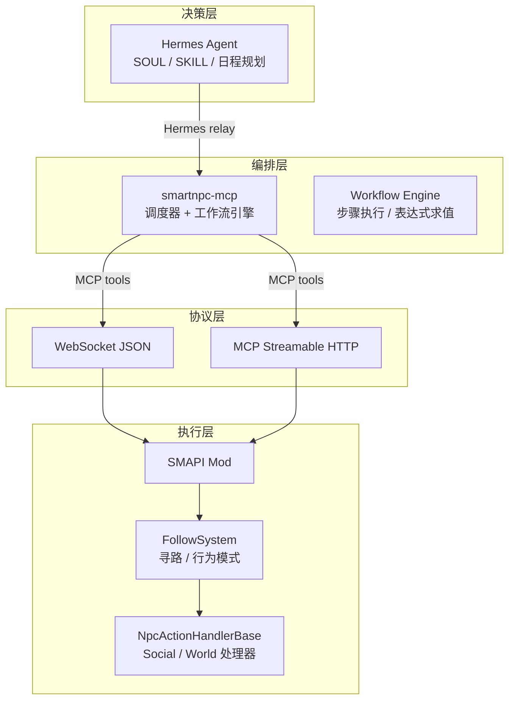
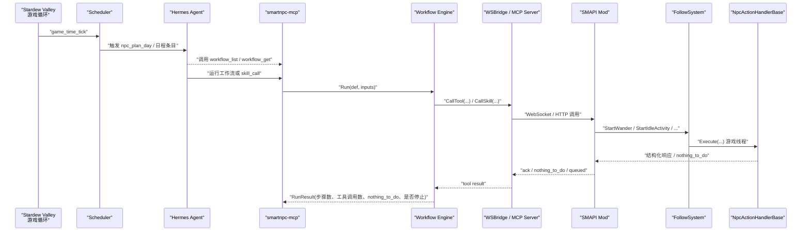
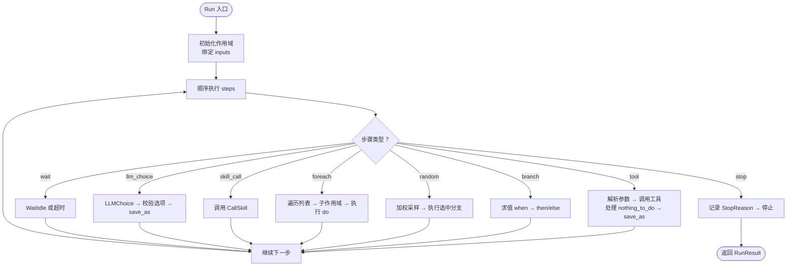
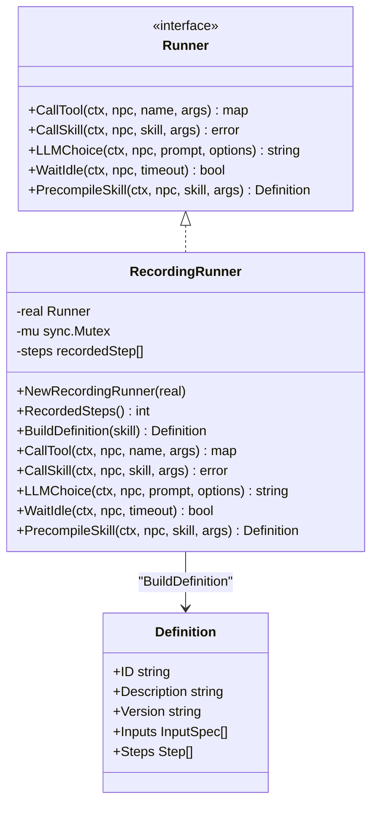
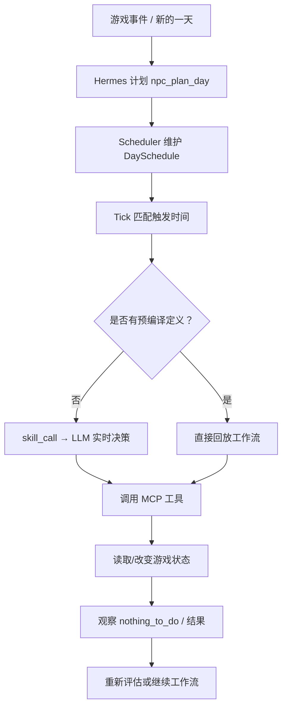
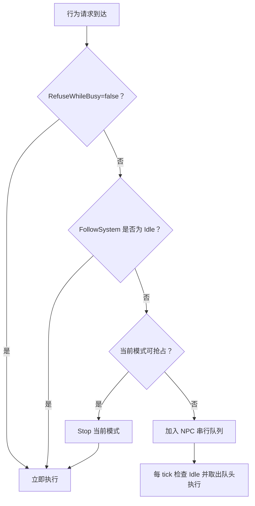
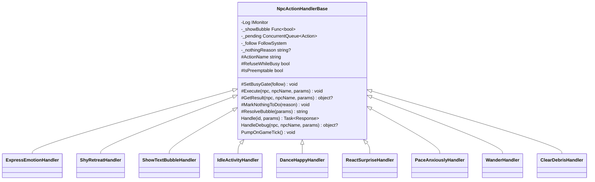
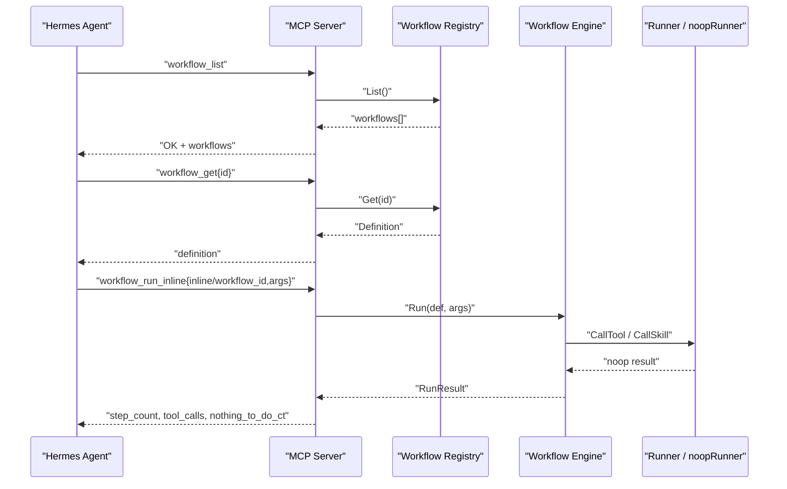
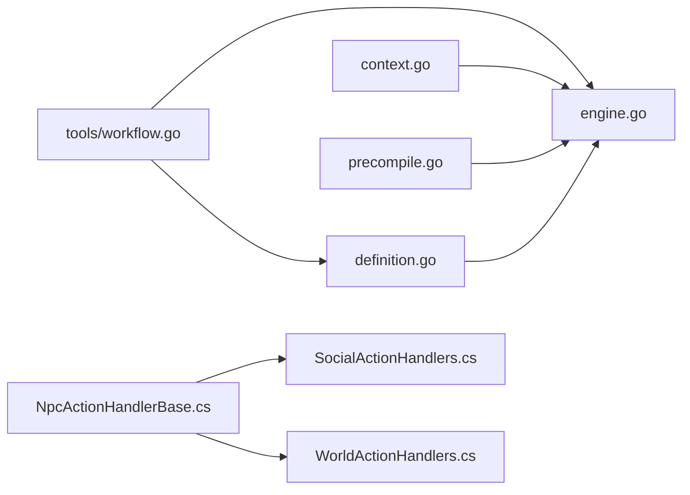

# NPC 自主行为系统

<cite>
**本文引用的文件**   
- [engine.go](file://SmartNPC/smartnpc-mcp/pkg/workflow/engine.go)
- [definition.go](file://SmartNPC/smartnpc-mcp/pkg/workflow/definition.go)
- [context.go](file://SmartNPC/smartnpc-mcp/pkg/workflow/context.go)
- [precompile.go](file://SmartNPC/smartnpc-mcp/pkg/workflow/precompile.go)
- [workflow.go](file://SmartNPC/smartnpc-mcp/adapters/stardew/tools/workflow.go)
- [npc_behavior.go](file://SmartNPC/smartnpc-mcp/adapters/stardew/tools/npc_behavior.go)
- [NpcActionHandlerBase.cs](file://SmartNPC/smapi-mod/Behavior/NpcActionHandlerBase.cs)
- [SocialActionHandlers.cs](file://SmartNPC/smapi-mod/Behavior/SocialActionHandlers.cs)
- [WorldActionHandlers.cs](file://SmartNPC/smapi-mod/Behavior/WorldActionHandlers.cs)
- [npc-agent-autonomy.md](file://SmartNPC/docs/npc-agent-autonomy.md)
- [workflow-authoring.md](file://SmartNPC/docs/workflow-authoring.md)
</cite>

## 目录
1. [引言](#引言)
2. [项目结构](#项目结构)
3. [核心组件](#核心组件)
4. [架构总览](#架构总览)
5. [详细组件分析](#详细组件分析)
6. [依赖关系分析](#依赖关系分析)
7. [性能考量](#性能考量)
8. [故障排查指南](#故障排查指南)
9. [结论](#结论)

## 引言
本文件系统性地说明 SmartNPC 中 NPC 的“自主行为”如何从高层意图落地到游戏内的移动、社交与农场操作。它覆盖以下目标：
- 解释 NPC 自主决策机制：意图识别、目标选择、计划生成；
- 说明工作流引擎如何驱动复杂行为序列，包括定义、状态、异常处理；
- 梳理行为处理器基类 NpcActionHandlerBase 的设计模式，以及 SocialActionHandlers 与 WorldActionHandlers 的职责边界；
- 给出 NPC 行为配置与工作流编排示例；
- 提供性能优化建议与常见问题定位方法。

需要特别说明的是：当前仓库中的“优先级评分模型、动态权重调整、冲突检测与解决策略”并非由单一集中式优先级调度器实现，而是通过“时间驱动的日程表 + 工作流分支/随机选择 + 游戏层串行队列与抢占规则”共同体现。文档会据此如实映射现有实现。

## 项目结构
SmartNPC 的 NPC 自主行为系统横跨四个层次：
- 决策层：Hermes Agent（LLM）负责人格、技能与日程规划；
- 编排层：smartnpc-mcp（Go）负责事件中继、调度器与工作流引擎；
- 协议层：WebSocket JSON 与 MCP Streamable HTTP；
- 执行层：C# SMAPI Mod 集成 FollowSystem 与行为处理器。

**图示来源**
- [npc-agent-autonomy.md:1-120](file://SmartNPC/docs/npc-agent-autonomy.md#L1-L120)

**章节来源**
- [npc-agent-autonomy.md:1-120](file://SmartNPC/docs/npc-agent-autonomy.md#L1-L120)

## 核心组件
- 工作流定义 DSL：Definition、Step、InputSpec，描述可执行的 NPC 行为流程；
- 工作流引擎：Run、runSteps、runStep，按步骤调度工具调用、分支、随机选择、遍历、技能调用、等待和终止；
- 作用域与表达式：Scope、EvalBool、Eval，支持变量路径查找、比较与布尔逻辑；
- 预编译能力：RecordingRunner，将 LLM 的技能执行过程录制为确定性工作流定义；
- 工作流 MCP 工具：workflow_list、workflow_get、workflow_run_inline、workflow_choice_reply、workflow_precompile_result、workflow_run_history、npc_workflow_status；
- 游戏层行为基类：NpcActionHandlerBase，统一解析参数、显示气泡、排队与结果封装；
- 社会行为处理器：表情、害羞后退、文本气泡、空闲活动、舞蹈、惊讶反应、踱步等；
- 世界行为处理器：漫游、清理杂物、以及其他农场与世界交互动作。

**章节来源**
- [definition.go:1-120](file://SmartNPC/smartnpc-mcp/pkg/workflow/definition.go#L1-L120)
- [engine.go:1-120](file://SmartNPC/smartnpc-mcp/pkg/workflow/engine.go#L1-L120)
- [context.go:1-120](file://SmartNPC/smartnpc-mcp/pkg/workflow/context.go#L1-L120)
- [precompile.go:1-120](file://SmartNPC/smartnpc-mcp/pkg/workflow/precompile.go#L1-L120)
- [workflow.go:1-120](file://SmartNPC/smartnpc-mcp/adapters/stardew/tools/workflow.go#L1-L120)
- [NpcActionHandlerBase.cs:1-120](file://SmartNPC/smapi-mod/Behavior/NpcActionHandlerBase.cs#L1-L120)
- [SocialActionHandlers.cs:1-151](file://SmartNPC/smapi-mod/Behavior/SocialActionHandlers.cs#L1-L151)
- [WorldActionHandlers.cs:1-200](file://SmartNPC/smapi-mod/Behavior/WorldActionHandlers.cs#L1-L200)

## 架构总览
NPC 的自主行为在两个主通道上推进：
1. **时间驱动**：Scheduler 根据一天中的时间触发工作流或技能；
2. **事件驱动**：游戏事件经 hermesrelay 注入给对应 NPC 的 Agent，Agent 决定是否需要响应并调用工具。

工作流引擎是“具体执行编排”的核心：它将 MCP 工具调用、分支判断、随机采样、遍历、技能调用、等待与提前终止组织成有序步骤；游戏层则保证每个 NPC 在同一时刻只有一个 FollowSystem 模式，并通过串行队列与抢占规则避免冲突。

**图示来源**
- [npc-agent-autonomy.md:80-160](file://SmartNPC/docs/npc-agent-autonomy.md#L80-L160)
- [engine.go:1-120](file://SmartNPC/smartnpc-mcp/pkg/workflow/engine.go#L1-L120)
- [workflow.go:1-120](file://SmartNPC/smartnpc-mcp/adapters/stardew/tools/workflow.go#L1-L120)
- [NpcActionHandlerBase.cs:120-300](file://SmartNPC/smapi-mod/Behavior/NpcActionHandlerBase.cs#L120-L300)

## 详细组件分析

### 工作流引擎与状态管理
工作流引擎以 `Run` 作为唯一公开入口。它创建顶层作用域，绑定声明输入与调用方传入的额外输入，然后顺序执行步骤。每一步都会增加 `StepCount`，并根据步骤类型分派到对应的执行器。

关键设计点：
- 步骤类型包括工具调用、分支、随机选择、遍历、技能调用、LLM 选择、等待、提前终止；
- 工具调用支持超时、输出保存、`nothing_to_do` 策略；
- 分支使用表达式求值；
- 随机选择对权重归一化后采样；
- 遍历每次迭代建立子作用域，防止变量污染；
- 等待条件目前只支持 idle，默认超时 30 秒；
- 提前终止记录原因，便于日志与调试。

**图示来源**
- [engine.go:1-120](file://SmartNPC/smartnpc-mcp/pkg/workflow/engine.go#L1-L120)
- [engine.go:201-450](file://SmartNPC/smartnpc-mcp/pkg/workflow/engine.go#L201-L450)

**章节来源**
- [engine.go:1-120](file://SmartNPC/smartnpc-mcp/pkg/workflow/engine.go#L1-L120)
- [engine.go:201-626](file://SmartNPC/smartnpc-mcp/pkg/workflow/engine.go#L201-L626)

#### 工具调用的 nothing_to_do 策略
当工具返回 `nothing_to_do=true` 时，引擎不会简单认为任务成功完成，而是根据 `on_nothing_to_do` 字段采取不同策略：
- 空值或 `skip`：继续执行后续步骤；
- `stop`：记录停止原因并结束工作流；
- `fail`：向上抛出错误。

这使上层调度器可以区分“确实没有可执行目标”和“工具失败”。

**章节来源**
- [engine.go:240-330](file://SmartNPC/smartnpc-mcp/pkg/workflow/engine.go#L240-L330)

#### 表达式与作用域
作用域支持父级链式查找，变量写入不可重绑定同一名称；表达式语法刻意保持轻量，包含变量路径、字面量、比较运算符和布尔逻辑。这种设计让工作流可以在不引入完整脚本语言的前提下表达常见分支逻辑。

**章节来源**
- [context.go:1-120](file://SmartNPC/smartnpc-mcp/pkg/workflow/context.go#L1-L120)
- [context.go:120-452](file://SmartNPC/smartnpc-mcp/pkg/workflow/context.go#L120-L452)

#### 预编译能力
预编译用于把 LLM 实时决策过程转化为确定性工作流定义。RecordingRunner 拦截写工具调用，仅回放读工具，最终构建出只有工具步骤的工作流。这样在触发时可以零 LLM 延迟直接执行。

**图示来源**
- [precompile.go:1-200](file://SmartNPC/smartnpc-mcp/pkg/workflow/precompile.go#L1-L200)
- [definition.go:1-120](file://SmartNPC/smartnpc-mcp/pkg/workflow/definition.go#L1-L120)

**章节来源**
- [precompile.go:1-200](file://SmartNPC/smartnpc-mcp/pkg/workflow/precompile.go#L1-L200)

### NPC 自主决策机制：意图识别、目标选择与计划生成
当前代码库中没有单一的“意图分类器”或“全局优先级评分器”，但可以从三个层面理解自主决策：

1. **意图识别**：由 Hermes Agent 根据 SOUL.md、SKILLs、事件上下文判断当前该做什么，例如早间巡视、社交互动、资源采集、晚间收尾；
2. **目标选择**：通过工作流中的 tool 步骤查询环境，例如 `npc_inspect_object`，然后根据分支条件选择浇水、收割、清理等具体目标；
3. **计划生成**：`npc_plan_day` 生成全天日程条目，每条条目可以是工作流 ID、内联定义或 legacy action；预编译可将 skill 执行录制成确定性工作流。

**图示来源**
- [npc-agent-autonomy.md:120-220](file://SmartNPC/docs/npc-agent-autonomy.md#L120-L220)
- [workflow-authoring.md:1-172](file://SmartNPC/docs/workflow-authoring.md#L1-L172)

**章节来源**
- [npc-agent-autonomy.md:120-220](file://SmartNPC/docs/npc-agent-autonomy.md#L120-L220)
- [workflow-authoring.md:1-172](file://SmartNPC/docs/workflow-authoring.md#L1-L172)

### 行为优先级算法：现有实现与约束
仓库中没有独立的“优先级评分函数”，优先级体现在以下几处：

- **时间优先级**：日程条目按时间排序，先触发的条目优先；
- **工作流内部优先级**：`branch` 的 then/else、`random` 的权重、`stop` 的提前终止；
- **游戏层并发优先级**：
  - 简单动作：立即执行，不入队；
  - 可抢占模式：当前只有 wander，可以被更高优先级任务打断；
  - 串行独占模式：长时间任务入队，必须等前一个独占任务结束；
- **nothing_to_do 策略**：引擎层对“无目标”的处理影响后续行为，而不是继续盲目执行。

因此，“优先级”不是单一数值，而是“时间 + 工作流逻辑 + 游戏模式 + 队列”的组合。

**图示来源**
- [NpcActionHandlerBase.cs:120-380](file://SmartNPC/smapi-mod/Behavior/NpcActionHandlerBase.cs#L120-L380)

**章节来源**
- [NpcActionHandlerBase.cs:120-478](file://SmartNPC/smapi-mod/Behavior/NpcActionHandlerBase.cs#L120-L478)

### 行为处理器基类 NpcActionHandlerBase 的设计模式
NpcActionHandlerBase 是一个模板方法基类，承担以下职责：
- 统一解析 `npc` 参数；
- 在游戏线程上执行实际逻辑；
- 显示头部气泡；
- 根据 `RefuseWhileBusy` 和 `IsPreemptable` 控制是否排队、是否可抢占；
- 封装结构化响应，包括 `nothing_to_do`；
- 提供 `HandleDebug` 供调试命令使用；
- 暴露 `PumpOnGameTick` 让子类消费本地 pending 队列。

**图示来源**
- [NpcActionHandlerBase.cs:1-200](file://SmartNPC/smapi-mod/Behavior/NpcActionHandlerBase.cs#L1-L200)
- [SocialActionHandlers.cs:1-151](file://SmartNPC/smapi-mod/Behavior/SocialActionHandlers.cs#L1-L151)
- [WorldActionHandlers.cs:1-200](file://SmartNPC/smapi-mod/Behavior/WorldActionHandlers.cs#L1-L200)

**章节来源**
- [NpcActionHandlerBase.cs:1-200](file://SmartNPC/smapi-mod/Behavior/NpcActionHandlerBase.cs#L1-L200)
- [NpcActionHandlerBase.cs:201-478](file://SmartNPC/smapi-mod/Behavior/NpcActionHandlerBase.cs#L201-L478)

### SocialActionHandlers 的具体实现
SocialActionHandlers 主要处理面向 NPC 自身或社交相关的轻量行为：
- `ExpressEmotionHandler`：根据 emotion/emote 参数调用游戏原生 emote；
- `ShyRetreatHandler`：启动社交移动后退；
- `ShowTextBubbleHandler`：直接使用 text 参数显示气泡；
- `IdleActivityHandler`：启动空闲活动，支持 once 或 loop；
- `DanceHappyHandler`：欢乐舞蹈；
- `ReactSurpriseHandler`：惊讶反应；
- `PaceAnxiouslyHandler`：焦虑踱步。

这些处理器多数设置 `RefuseWhileBusy=true`，表示它们属于需要 FollowSystem 串行控制的长行为；其中未设置 `IsPreemptable=true`，意味着它们不会被其他独占任务抢占。

**章节来源**
- [SocialActionHandlers.cs:1-151](file://SmartNPC/smapi-mod/Behavior/SocialActionHandlers.cs#L1-L151)

### WorldActionHandlers 的具体实现
WorldActionHandlers 处理与游戏世界交互的行为，典型代表包括：
- `WanderHandler`：允许 NPC 在半径或区域限制内连续行走；标记为可抢占；
- `ClearDebrisHandler`：清理杂物，针对农田区域做包围盒扩展，并有硬上限保护；
- 其他世界交互动作由各自处理器继承基类并在 Execute 中调用 FollowSystem 或修改游戏状态。

Wander 是可抢占行为的代表性例子：当更高优先级任务到来时，FollowSystem.Stop 会被调用，当前漫游被中断，新任务立即执行。

**章节来源**
- [WorldActionHandlers.cs:1-200](file://SmartNPC/smapi-mod/Behavior/WorldActionHandlers.cs#L1-L200)

### MCP 工具与工作流编排接口
smartnpc-mcp 暴露一组工作流相关工具：
- `workflow_list`：列出已注册工作流；
- `workflow_get`：获取单个工作流的完整定义；
- `workflow_run_inline`：调试用，用 noop runner 验证工作流结构；
- `workflow_choice_reply`：回复 LLM 选择；
- `workflow_precompile_result`：提交预编译结果；
- `workflow_run_history`：查询历史运行记录；
- `npc_workflow_status`：查询每个 NPC 的工作流运行状态、队列深度与待触发日程数量。

此外还有 NPC 行为工具：
- `npc_emote`：显示游戏原生表情气泡；
- `npc_get_behavior`：查询 NPC 当前行为模式。

**图示来源**
- [workflow.go:1-200](file://SmartNPC/smartnpc-mcp/adapters/stardew/tools/workflow.go#L1-L200)
- [workflow.go:201-512](file://SmartNPC/smartnpc-mcp/adapters/stardew/tools/workflow.go#L201-L512)
- [npc_behavior.go:1-108](file://SmartNPC/smartnpc-mcp/adapters/stardew/tools/npc_behavior.go#L1-L108)

**章节来源**
- [workflow.go:1-200](file://SmartNPC/smartnpc-mcp/adapters/stardew/tools/workflow.go#L1-L200)
- [workflow.go:201-512](file://SmartNPC/smartnpc-mcp/adapters/stardew/tools/workflow.go#L201-L512)
- [npc_behavior.go:1-108](file://SmartNPC/smartnpc-mcp/adapters/stardew/tools/npc_behavior.go#L1-L108)

## 依赖关系分析
工作流引擎与数据定义解耦：definition.go 只声明数据结构，engine.go 实现执行逻辑，context.go 提供作用域与表达式，precompile.go 提供录制与回放能力。MCP 工具层依赖 registry 与 engine，但不直接耦合 FollowSystem。C# 层则独立于 Go 层，通过 WebSocket 和 MCP 协议交互。

**图示来源**
- [definition.go:1-120](file://SmartNPC/smartnpc-mcp/pkg/workflow/definition.go#L1-L120)
- [engine.go:1-120](file://SmartNPC/smartnpc-mcp/pkg/workflow/engine.go#L1-L120)
- [context.go:1-120](file://SmartNPC/smartnpc-mcp/pkg/workflow/context.go#L1-L120)
- [precompile.go:1-120](file://SmartNPC/smartnpc-mcp/pkg/workflow/precompile.go#L1-L120)
- [workflow.go:1-120](file://SmartNPC/smartnpc-mcp/adapters/stardew/tools/workflow.go#L1-L120)
- [NpcActionHandlerBase.cs:1-120](file://SmartNPC/smapi-mod/Behavior/NpcActionHandlerBase.cs#L1-L120)
- [SocialActionHandlers.cs:1-151](file://SmartNPC/smapi-mod/Behavior/SocialActionHandlers.cs#L1-L151)
- [WorldActionHandlers.cs:1-200](file://SmartNPC/smapi-mod/Behavior/WorldActionHandlers.cs#L1-L200)

**章节来源**
- [definition.go:1-120](file://SmartNPC/smartnpc-mcp/pkg/workflow/definition.go#L1-L120)
- [engine.go:1-120](file://SmartNPC/smartnpc-mcp/pkg/workflow/engine.go#L1-L120)
- [context.go:1-120](file://SmartNPC/smartnpc-mcp/pkg/workflow/context.go#L1-L120)
- [precompile.go:1-120](file://SmartNPC/smartnpc-mcp/pkg/workflow/precompile.go#L1-L120)
- [workflow.go:1-120](file://SmartNPC/smartnpc-mcp/adapters/stardew/tools/workflow.go#L1-L120)
- [NpcActionHandlerBase.cs:1-120](file://SmartNPC/smapi-mod/Behavior/NpcActionHandlerBase.cs#L1-L120)

## 性能考量
- **工作流步骤数量**：定义注释指出每个工作流通常不超过 50 个步骤，适合局部扫描与轻量表达式求值；
- **工具调用超时**：默认工具超时为 120 秒，重型动作应显式设置更短或更合适的超时；
- **遍历保护**：foreach 默认最大迭代 50，防止数据过大导致卡顿；
- **随机选择开销低**：单次归一化与采样，复杂度与分支数量线性相关；
- **表达式求值轻量**：没有算术与函数调用，降低运行时开销；
- **预编译减少 LLM 延迟**：录制后直接回放工具步骤，避免每次触发都调用 LLM；
- **游戏层队列单 tick 取一项**：避免一次 tick 内批量执行造成帧抖动；
- **气泡与日志**：长时间动作会在 FollowSystem 刷新气泡，同时记录耗时，帮助发现慢动作；
- **内存占用**：队列和字典锁粒度较小，且队列长度受 NPC 串行模式限制。

[本节为通用性能讨论，不直接分析具体代码行]

## 故障排查指南

### 工作流相关问题
- **nil 定义或 runner**：Run 会直接返回错误；
- **未知步骤类型**：引擎返回错误并停止；
- **工具缺少 name**：工具步骤校验失败；
- **nothing_to_do 策略无效**：检查 on_nothing_to_do 是否设置为 skip、stop 或 fail；
- **LLM 选择非法选项**：引擎回退到第一个选项，并记录调试日志；
- **wait 条件未知**：当前只支持 idle，其他值会报错；
- **变量引用未解析**：resolveArgs 会把未解析引用设为 nil，由下游工具决定是否报错；
- **save_as 重复绑定**：Scope.Set 会报错，应在工作流中避免同作用域重复命名；
- **foreach 越界或无限循环**：使用 max_iter 限制；
- **调试运行**：使用 `workflow_run_inline` 在不修改游戏状态的情况下验证工作流。

**章节来源**
- [engine.go:1-120](file://SmartNPC/smartnpc-mcp/pkg/workflow/engine.go#L1-L120)
- [engine.go:201-626](file://SmartNPC/smartnpc-mcp/pkg/workflow/engine.go#L201-L626)
- [workflow.go:201-512](file://SmartNPC/smartnpc-mcp/adapters/stardew/tools/workflow.go#L201-L512)

### 游戏层行为问题
- **NPC 未找到**：返回 npc_not_found；
- **mod 未就绪**：返回 mod_not_ready；
- **行为模式冲突**：查看 FollowSystem 当前模式，确认是否可抢占；
- **任务被排队**：响应中包含 queued 与 position，表示任务进入串行队列；
- **nothing_to_do**：基类会把 MarkNothingToDo 的原因包装为结构化响应，提示 agent 重新评估；
- **handler 异常**：捕获异常并返回 handler_error；
- **长时间动作卡顿**：基类会记录 queueWait 与 exec 耗时；
- **队列堆积**：可通过 `npc_workflow_status` 查看队列深度与待触发日程数量。

**章节来源**
- [NpcActionHandlerBase.cs:120-478](file://SmartNPC/smapi-mod/Behavior/NpcActionHandlerBase.cs#L120-L478)
- [npc_behavior.go:1-108](file://SmartNPC/smartnpc-mcp/adapters/stardew/tools/npc_behavior.go#L1-L108)
- [workflow.go:201-512](file://SmartNPC/smartnpc-mcp/adapters/stardew/tools/workflow.go#L201-L512)

### 常见问题快速对照
| 现象 | 可能原因 | 建议排查 |
|---|---|---|
| 工作流一直跳过某个分支 | 表达式为假或变量未绑定 | 检查 when 表达式与 save_as 绑定 |
| 工具调用频繁返回 nothing_to_do | 区域无目标或参数过窄 | 扩大半径、使用 inspect 工具观察 |
| 行为一直排队不执行 | NPC 正在执行独占动作 | 查看当前 FollowSystem 模式与队列 |
| 漫游被突然中断 | 高优先级任务抢占 wander | 检查是否出现 harvest/water 等独占任务 |
| 工作流执行很慢 | 工具超时过长或 LLM 选择延迟 | 检查 timeout_seconds 与 precompile |
| 自定义工作流无法加载 | 环境变量或注册表未生效 | 检查 SMARTNPC_WORKFLOW_DIR 与 workflow_list |

## 结论
SmartNPC 的 NPC 自主行为系统以“Hermes Agent 决策 + smartnpc-mcp 编排 + C# SMAPI 执行”的分层架构为基础。工作流引擎负责把 MCP 工具调用、分支判断、随机选择、遍历、技能调用、等待与提前终止组合成可观测、可调试、可预编译的行为序列；游戏层通过 NpcActionHandlerBase 与 FollowSystem 确保每个 NPC 的行为模式清晰、串行可控，并对漫游等填充行为提供抢占能力。

如果未来要增强“优先级评分模型、动态权重调整、冲突检测与解决策略”，可在现有基础上：
- 在工作流 random 分支中加入基于状态的可计算权重；
- 在调度层引入任务评分与淘汰策略；
- 在队列层增加优先级队列与冲突检测；
- 在 nothing_to_do 策略中引入重试、降级与替代目标。

但在当前实现中，优先级与冲突控制已经足够支撑“一日日程 + 工作流编排 + 游戏串行模式”的 NPC 自运转体验。

[本节为总结性内容，不直接分析具体文件]