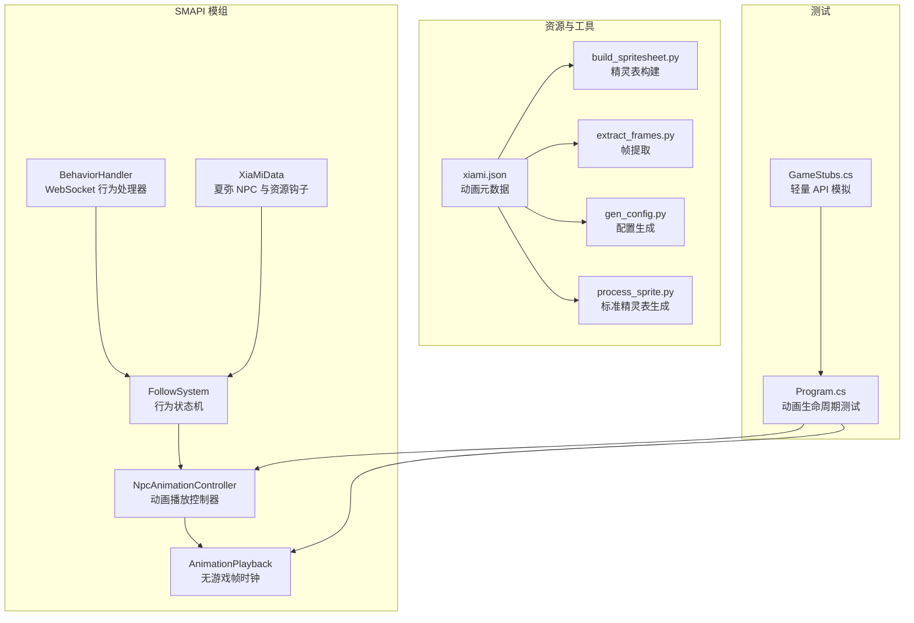
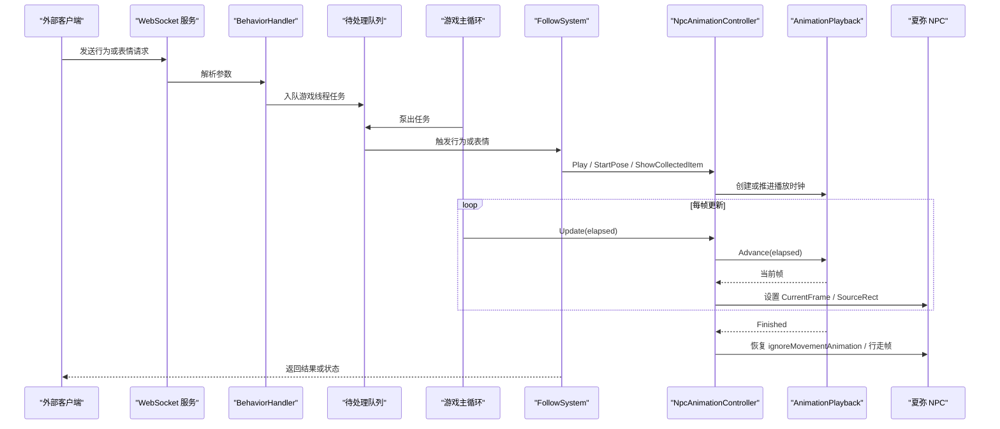
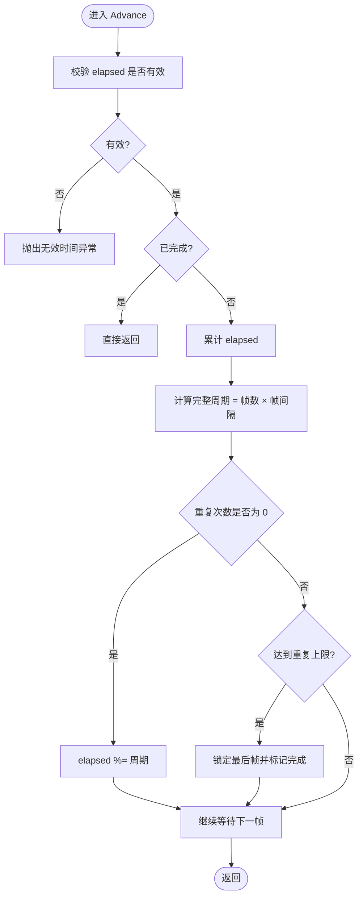
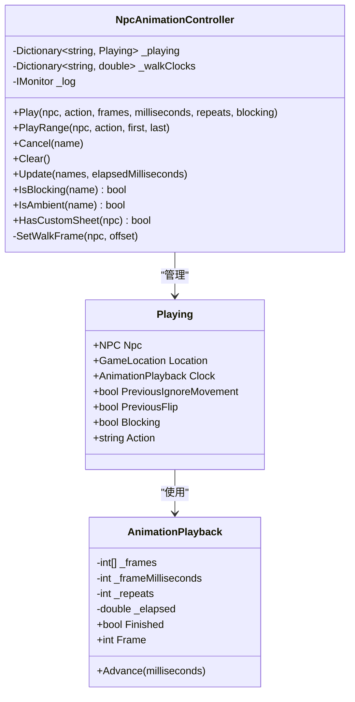
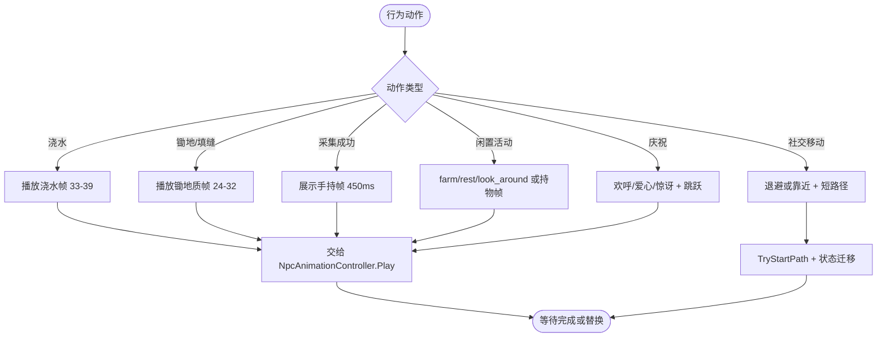
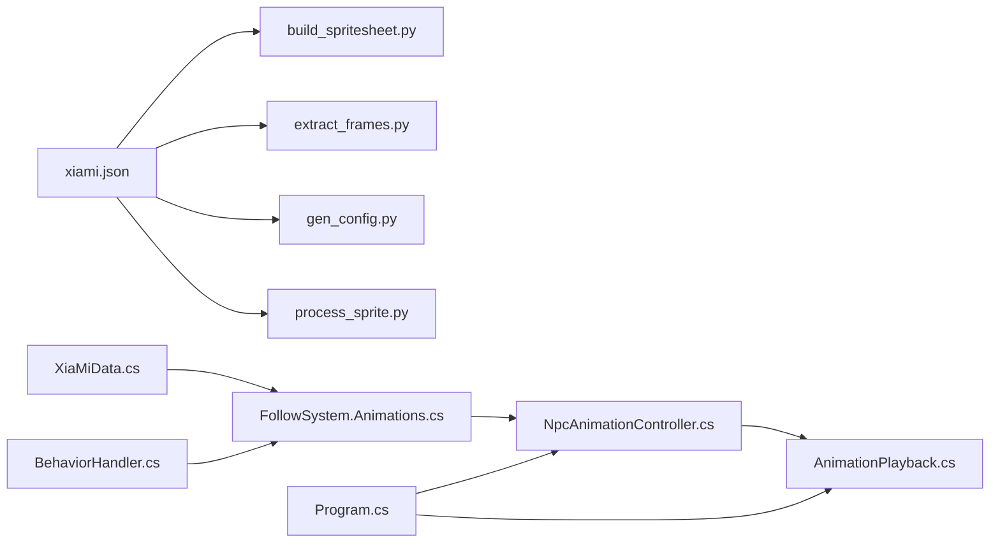

# 动画系统

<cite>
**本文引用的文件**
- [NpcAnimationController.cs](file://SmartNPC/smapi-mod/Movement/NpcAnimationController.cs)
- [AnimationPlayback.cs](file://SmartNPC/smapi-mod/Movement/AnimationPlayback.cs)
- [FollowSystem.Animations.cs](file://SmartNPC/smapi-mod/Movement/FollowSystem.Animations.cs)
- [BehaviorHandler.cs](file://SmartNPC/smapi-mod/Movement/BehaviorHandler.cs)
- [XiaMiData.cs](file://SmartNPC/smapi-mod/NPC/XiaMiData.cs)
- [xiami.json](file://SmartNPC/smapi-mod/assets/xiami/xiami.json)
- [build_spritesheet.py](file://SmartNPC/smapi-mod/assets/xiami/build_spritesheet.py)
- [extract_frames.py](file://SmartNPC/smapi-mod/scripts/extract_frames.py)
- [gen_config.py](file://SmartNPC/smapi-mod/scripts/gen_config.py)
- [process_sprite.py](file://SmartNPC/smapi-mod/scripts/process_sprite.py)
- [xiami-animations.md](file://SmartNPC/docs/xiami-animations.md)
- [Program.cs](file://SmartNPC/tests/animations/Program.cs)
- [GameStubs.cs](file://SmartNPC/tests/animations/GameStubs.cs)
</cite>

## 目录
1. [引言](#引言)
2. [项目结构](#项目结构)
3. [核心组件](#核心组件)
4. [架构总览](#架构总览)
5. [详细组件分析](#详细组件分析)
6. [依赖关系分析](#依赖关系分析)
7. [性能与优化](#性能与优化)
8. [故障诊断与排错](#故障诊断与排错)
9. [自定义角色开发指南](#自定义角色开发指南)
10. [结论](#结论)

## 引言
本文件面向需要理解、扩展或维护 SmartNPC 中“夏弥”角色动画系统的开发者。文档聚焦以下目标：
- 解释动画播放控制器如何管理帧序列、驱动状态机、处理动画切换和行走恢复。
- 说明夏弥动画素材的组织方式，包括精灵表格式、帧坐标定义、动画元数据配置。
- 梳理动画提取、精灵表构建和资源优化的工具链。
- 描述从外部输入到游戏内动画触发的机制，包括事件桥接、状态同步和网络广播路径。
- 提供新角色动画导入、配置文件编写和兼容性测试步骤。
- 给出渲染批处理、内存池、LOD 等优化建议，以及常见问题排查方法。

## 项目结构
动画相关代码主要集中在 SMAPI 模组目录的 `Movement` 与 `NPC` 子模块中，资源定义位于 `assets/xiami`，Python 工具脚本位于 `scripts`，单元测试位于 `tests/animations`。

**图表来源**
- [FollowSystem.Animations.cs:1-120](file://SmartNPC/smapi-mod/Movement/FollowSystem.Animations.cs#L1-L120)
- [NpcAnimationController.cs:1-109](file://SmartNPC/smapi-mod/Movement/NpcAnimationController.cs#L1-L109)
- [AnimationPlayback.cs:1-41](file://SmartNPC/smapi-mod/Movement/AnimationPlayback.cs#L1-L41)
- [BehaviorHandler.cs:1-159](file://SmartNPC/smapi-mod/Movement/BehaviorHandler.cs#L1-L159)
- [XiaMiData.cs:1-159](file://SmartNPC/smapi-mod/NPC/XiaMiData.cs#L1-L159)
- [xiami.json:1-200](file://SmartNPC/smapi-mod/assets/xiami/xiami.json#L1-L200)
- [build_spritesheet.py:1-117](file://SmartNPC/smapi-mod/assets/xiami/build_spritesheet.py#L1-L117)
- [extract_frames.py:1-68](file://SmartNPC/smapi-mod/scripts/extract_frames.py#L1-L68)
- [gen_config.py:1-112](file://SmartNPC/smapi-mod/scripts/gen_config.py#L1-L112)
- [process_sprite.py:1-104](file://SmartNPC/smapi-mod/scripts/process_sprite.py#L1-L104)
- [Program.cs:1-99](file://SmartNPC/tests/animations/Program.cs#L1-L99)
- [GameStubs.cs:1-42](file://SmartNPC/tests/animations/GameStubs.cs#L1-L42)

**章节来源**
- [xiami-animations.md:1-30](file://SmartNPC/docs/xiami-animations.md#L1-L30)

## 核心组件
- **动画播放时钟 AnimationPlayback**：纯逻辑时间推进器，负责根据帧数组、每帧毫秒数和重复次数计算当前帧；支持零重复无限循环，并在完成时锁定最后一帧，直到所有者主动恢复空闲姿态。
- **NPC 动画控制器 NpcAnimationController**：运行在游戏线程、Vanilla 更新之后，接管夏弥的精灵帧。它维护正在播放的动画集合、行走时钟、阻塞标志、方向映射和 Sprite 源矩形。
- **跟随系统动画扩展 FollowSystem.Animations**：将行为动作（浇水、锄地、采集、庆祝、社交移动、闲置活动）转换为帧序列并交给控制器播放，同时控制行为模式在 Idle、Animating、SocialMovement 之间切换。
- **行为处理器 BehaviorHandler**：接收 WebSocket 消息，把表情和查询请求序列化后放入队列，由游戏主循环泵出执行，避免跨线程访问 Game1。
- **夏弥数据 XiaMiData**：注册夏弥 NPC、注入角色精灵表、头像、对话、日程和行为偏好数据，并提供常量化的帧索引。

**章节来源**
- [AnimationPlayback.cs:1-41](file://SmartNPC/smapi-mod/Movement/AnimationPlayback.cs#L1-L41)
- [NpcAnimationController.cs:1-109](file://SmartNPC/smapi-mod/Movement/NpcAnimationController.cs#L1-L109)
- [FollowSystem.Animations.cs:1-120](file://SmartNPC/smapi-mod/Movement/FollowSystem.Animations.cs#L1-L120)
- [BehaviorHandler.cs:1-159](file://SmartNPC/smapi-mod/Movement/BehaviorHandler.cs#L1-L159)
- [XiaMiData.cs:1-159](file://SmartNPC/smapi-mod/NPC/XiaMiData.cs#L1-L159)

## 架构总览
整体动画流程可概括为：外部事件或内部工作流通过 WebSocket 进入 BehaviorHandler，再调度到 FollowSystem 的行为状态机；行为层决定要播放的动画片段，随后 NpcAnimationController 接管夏弥的 Sprite 帧，AnimationPlayback 负责时间推进；完成后恢复行走或闲置状态。

**图表来源**
- [BehaviorHandler.cs:1-159](file://SmartNPC/smapi-mod/Movement/BehaviorHandler.cs#L1-L159)
- [FollowSystem.Animations.cs:1-120](file://SmartNPC/smapi-mod/Movement/FollowSystem.Animations.cs#L1-L120)
- [NpcAnimationController.cs:1-109](file://SmartNPC/smapi-mod/Movement/NpcAnimationController.cs#L1-L109)
- [AnimationPlayback.cs:1-41](file://SmartNPC/smapi-mod/Movement/AnimationPlayback.cs#L1-L41)

## 详细组件分析

### 动画播放时钟 AnimationPlayback
AnimationPlayback 是无游戏状态的动画计时器，核心职责是：
- 校验帧数组长度、帧间隔为正数、重复次数非负。
- 根据累计经过时间除以帧间隔得到索引，并对帧数组长度取模，实现循环播放。
- 当重复次数不为零且累计时间达到完整周期乘以重复次数时，标记完成并固定最后帧。
- 重复次数为零时，表示无限循环，永远不完成。
- 对负数、NaN、无穷大经过时间抛出异常，防止异常 tick 污染状态。

复杂度方面，Advance 是 O(1)，Frame 也是 O(1)。空间复杂度取决于帧数组长度，但只保存一份克隆副本，避免外部修改影响播放。

**图表来源**
- [AnimationPlayback.cs:1-41](file://SmartNPC/smapi-mod/Movement/AnimationPlayback.cs#L1-L41)

**章节来源**
- [AnimationPlayback.cs:1-41](file://SmartNPC/smapi-mod/Movement/AnimationPlayback.cs#L1-L41)
- [Program.cs:1-99](file://SmartNPC/tests/animations/Program.cs#L1-L99)

### NPC 动画控制器 NpcAnimationController
NpcAnimationController 是动画系统的运行时中枢，主要职责包括：
- 仅对名为“夏弥”的 NPC 应用自定义帧编号，其他村民不受影响。
- Play 启动指定帧序列，暂停原 Sprite 动画，记录之前的移动忽略标志和翻转状态，设置面朝方向，并将 NPC 加入 `_playing` 字典。
- Cancel 恢复之前的移动标志、翻转状态，停止 Sprite 动画，重置行走偏移。
- Clear 清理所有播放项和行走时钟，常用于场景重载或卸载。
- Update 按受管 NPC 名称列表推进时钟；如果保存重载、地图切换或出现新的 controller，会主动取消旧播放，避免残留姿势。
- 未播放动画时，根据 isMoving 和 elapsed 计算 800ms 周期中的行走偏移，并按朝向映射到前、背、左三组帧。
- SetWalkFrame 根据 FacingDirection 选择起始帧，并对右侧行走进行 flip 处理。

该控制器采用“阻塞式动画”和“环境式动画”两种语义：阻塞式动画占用工作门控，阻止后续作业；环境式动画不阻塞，允许被新动作替换。

**图表来源**
- [NpcAnimationController.cs:1-109](file://SmartNPC/smapi-mod/Movement/NpcAnimationController.cs#L1-L109)
- [AnimationPlayback.cs:1-41](file://SmartNPC/smapi-mod/Movement/AnimationPlayback.cs#L1-L41)

**章节来源**
- [NpcAnimationController.cs:1-109](file://SmartNPC/smapi-mod/Movement/NpcAnimationController.cs#L1-L109)
- [xiami-animations.md:1-30](file://SmartNPC/docs/xiami-animations.md#L1-L30)
- [Program.cs:1-99](file://SmartNPC/tests/animations/Program.cs#L1-L99)

### 跟随系统动画扩展 FollowSystem.Animations
FollowSystem 的行为状态机拥有大量业务模式，如 Idle、Following、Leading、TillSoil、WaterCrops、HarvestCrops、Animating、SocialMovement 等。动画扩展负责：
- PumpAnimations：在游戏世界就绪时调用控制器 Update，传入已管理的 NPC 名称和实际经过时间。
- StartPose：对夏弥播放任意帧序列，loop 时设置为环境式动画，否则为阻塞式动画。
- StartIdleActivity：将 farm、rest、look_around 及 hold_pumpkin、hold_crop、hold_flower、hold_chicken 映射到对应帧。
- StartCelebration：播放欢呼或惊讶表情，并配合跳跃和原生表情。
- ShowCollectedItem：根据采集物品类型选择南瓜、作物或花朵持物帧。
- StartSocialMovement：构造短距离路径目标，结合 doEmote 表达退缩或靠近。

**图表来源**
- [FollowSystem.Animations.cs:1-120](file://SmartNPC/smapi-mod/Movement/FollowSystem.Animations.cs#L1-L120)

**章节来源**
- [FollowSystem.cs:1-200](file://SmartNPC/smapi-mod/Movement/FollowSystem.cs#L1-L200)
- [FollowSystem.Animations.cs:1-120](file://SmartNPC/smapi-mod/Movement/FollowSystem.Animations.cs#L1-L120)

### 行为处理器 BehaviorHandler
BehaviorHandler 承担网络侧到游戏侧的桥接职责：
- HandleEmote：解析 npc 和 kind，映射到 Stardew Valley 原生表情 ID，入队执行；若找不到 NPC，返回错误响应。
- HandleGetBehavior：读取 FollowSystem 中 NPC 的模式并返回。
- PumpOnGameTick：在主循环中安全取出队列任务执行，捕获异常并记录日志。

该设计保证 WebSocket 接收循环不会直接访问 Game1，从而避免跨线程崩溃。

**章节来源**
- [BehaviorHandler.cs:1-159](file://SmartNPC/smapi-mod/Movement/BehaviorHandler.cs#L1-L159)

### 夏弥数据 XiaMiData
XiaMiData 负责：
- 在存档加载时生成夏弥 NPC，放置于农场固定位置。
- 通过 AssetRequested 钩子注入 Characters/XiaMi 精灵表、Portraits/XiaMi 头像、Data/NPCDispositions、Characters/Dialogue/XiaMi、Characters/schedules/XiaMi。
- 定义夏弥的帧常量，供控制器和跟随系统使用。

注意：当前实现通过 AnimatedSprite("Characters\\XiaMi", 0, 16, 32) 引用内置字符命名空间，而 Python 构建工具输出的是 XiaMi_spritesheet.png，两者资源路径需保持一致才能正确显示。

**章节来源**
- [XiaMiData.cs:1-159](file://SmartNPC/smapi-mod/NPC/XiaMiData.cs#L1-L159)

## 依赖关系分析
- NpcAnimationController 依赖 AnimationPlayback 做时间推进，依赖 XiaMiData 提供帧起始索引，依赖 IMonitor 输出调试日志。
- FollowSystem.Animations 依赖 NpcAnimationController 播放帧，依赖 FollowSystem 的状态字段控制行为模式。
- BehaviorHandler 依赖 FollowSystem 查询状态，依赖 StardewModdingAPI 上下文判断世界是否就绪。
- XiaMiData 依赖 StardewValley 内容系统注入资源和 NPC。
- Python 工具依赖 xiami.json 中的 bbox 和 animation 定义。

**图表来源**
- [xiami.json:1-200](file://SmartNPC/smapi-mod/assets/xiami/xiami.json#L1-L200)
- [build_spritesheet.py:1-117](file://SmartNPC/smapi-mod/assets/xiami/build_spritesheet.py#L1-L117)
- [extract_frames.py:1-68](file://SmartNPC/smapi-mod/scripts/extract_frames.py#L1-L68)
- [gen_config.py:1-112](file://SmartNPC/smapi-mod/scripts/gen_config.py#L1-L112)
- [process_sprite.py:1-104](file://SmartNPC/smapi-mod/scripts/process_sprite.py#L1-L104)
- [XiaMiData.cs:1-159](file://SmartNPC/smapi-mod/NPC/XiaMiData.cs#L1-L159)
- [FollowSystem.Animations.cs:1-120](file://SmartNPC/smapi-mod/Movement/FollowSystem.Animations.cs#L1-L120)
- [NpcAnimationController.cs:1-109](file://SmartNPC/smapi-mod/Movement/NpcAnimationController.cs#L1-L109)
- [AnimationPlayback.cs:1-41](file://SmartNPC/smapi-mod/Movement/AnimationPlayback.cs#L1-L41)
- [BehaviorHandler.cs:1-159](file://SmartNPC/smapi-mod/Movement/BehaviorHandler.cs#L1-L159)
- [Program.cs:1-99](file://SmartNPC/tests/animations/Program.cs#L1-L99)

**章节来源**
- [xiami-animations.md:1-30](file://SmartNPC/docs/xiami-animations.md#L1-L30)

## 性能与优化
现有实现已经具备若干良好实践：
- AnimationPlayback 使用整型帧数组和简单算术，Advance 与 Frame 均为 O(1)，适合高频调用。
- NpcAnimationController 仅在夏弥上启用自定义帧映射，避免对其他村民造成额外开销。
- 环境式动画不阻塞工作门控，减少不必要的状态锁竞争。
- 行走时钟以 800ms 周期计算，使用模运算保持恒定步频。

可进一步优化的方向：
- 批处理渲染：当前每个帧都调用 Sprite.UpdateSourceRect，可考虑在同一帧批次中合并多个 NPC 的 SourceRect 更新，减少 GPU 状态切换。
- 内存池管理：为常用帧数组、Playing 对象和临时 Point 建立对象池，减少 GC 压力。
- LOD 控制：远距离 NPC 可降低动画帧率或改用关键帧插值；近距时使用完整帧序列。
- 缓存帧引用：对常用帧段如 24-32、33-39、40-48 预编译为静态数组，避免每次 Range 分配。
- 异步 IO 分离：资源加载和工具链应放在独立线程或构建阶段，避免阻塞游戏主循环。
- 统计与监控：为播放时长、帧丢弃、卡顿峰值添加指标，便于定位性能热点。

[本节为通用性能建议，不直接分析具体文件]

## 故障诊断与排错
常见症状与根因：
- 动画卡住或无法恢复行走：可能因为播放未完成就释放了 movement 标志，或保存重载、地图切换后旧 Playing 未取消。控制器会在 NPC 引用变化、location 变化或出现新 controller 时取消播放。
- 夏弥帧编号应用到其他村民：控制器只在 HasCustomSheet 为真时应用帧编号，其他村民应保持默认 Sprite。
- 右侧行走镜像异常：SetWalkFrame 只对右向设置 flip，并确保使用左侧帧起始索引。
- 闲置动画阻塞新工作：环境式动画 repeats=0，不应阻塞；若仍阻塞，检查 StartPose 的 blocking 参数。
- WebSocket 操作无响应：确认 WorldReady 检查已通过，并查看 BehaviorHandler 的 pump 日志。
- 资源未加载：检查 XiaMiData 的 AssetRequested 钩子是否匹配 Characters/XiaMi、Portraits/XiaMi、Data/NPCDispositions、Dialogue 和 schedules。

排查步骤：
1. 使用控制台命令预览浇水、锄地或全部帧，确认帧序列是否正确。
2. 重启游戏并重新加载存档，确保 DLL 热重载不会误以为资源已更新。
3. 运行动画单元测试，覆盖浇水帧、暂停、最终帧持续时间、慢 tick、重复、环境循环、替换、无效时间、路径中断、保存重载、方向映射和卸载。
4. 检查 xiami.json 中 bbox 是否与源图尺寸一致，必要时用 extract_frames.py 验证裁剪框。
5. 对比 build_spritesheet.py 输出的帧索引参考与 XiaMiData.cs 中的常量是否一致。

**章节来源**
- [xiami-animations.md:1-30](file://SmartNPC/docs/xiami-animations.md#L1-L30)
- [Program.cs:1-99](file://SmartNPC/tests/animations/Program.cs#L1-L99)
- [GameStubs.cs:1-42](file://SmartNPC/tests/animations/GameStubs.cs#L1-L42)

## 自定义角色开发指南
新增一个类似夏弥的角色动画，可按以下步骤进行：

1. 准备原始素材
   - 使用高质量 PNG 作为源图，保留透明通道或棋盘格背景以便工具去除。
   - 为每个姿态标注 bbox，包含 x、y、w、h。

2. 编写或生成元数据
   - 使用 gen_config.py 生成 sprite_actions_positions JSON，或在已有 xiami.json 基础上扩展新角色的 animations 和 frames。
   - 明确 idle、walk、action、emote 等动画的名称、FPS、loop、frames 列表。

3. 提取帧与构建精灵表
   - 运行 extract_frames.py 验证每帧裁剪是否正确。
   - 运行 process_sprite.py 或 build_spritesheet.py 生成 SDV 兼容的精灵表。
   - 确认帧顺序、单元格大小、行列布局与运行时 AnimatedSprite 构造参数一致。

4. 在 C# 中添加帧常量与数据
   - 为新角色创建类似 XiaMiData 的数据类，定义帧起始索引、常量、NPC 生成和资源钩子。
   - 在 FollowSystem 中增加新的 StartPose 或专用动作映射。
   - 在 NpcAnimationController 中决定是否启用自定义帧映射；若非夏弥类角色，可能需要扩展 HasCustomSheet 策略。

5. 编写兼容性测试
   - 参照 Program.cs 编写针对新角色帧序列、暂停、循环、替换、路径中断、保存重载和方向映射的测试。
   - 使用 GameStubs.cs 风格的轻量 stub 避免依赖真实 SDV 装配。

6. 集成与验证
   - 通过 WebSocket 或控制台命令触发新动作，观察动画播放、状态恢复和日志输出。
   - 验证与其他村民隔离，确保新帧编号不会污染默认 NPC。

**章节来源**
- [gen_config.py:1-112](file://SmartNPC/smapi-mod/scripts/gen_config.py#L1-L112)
- [extract_frames.py:1-68](file://SmartNPC/smapi-mod/scripts/extract_frames.py#L1-L68)
- [process_sprite.py:1-104](file://SmartNPC/smapi-mod/scripts/process_sprite.py#L1-L104)
- [build_spritesheet.py:1-117](file://SmartNPC/smapi-mod/assets/xiami/build_spritesheet.py#L1-L117)
- [XiaMiData.cs:1-159](file://SmartNPC/smapi-mod/NPC/XiaMiData.cs#L1-L159)
- [FollowSystem.Animations.cs:1-120](file://SmartNPC/smapi-mod/Movement/FollowSystem.Animations.cs#L1-L120)
- [NpcAnimationController.cs:1-109](file://SmartNPC/smapi-mod/Movement/NpcAnimationController.cs#L1-L109)
- [Program.cs:1-99](file://SmartNPC/tests/animations/Program.cs#L1-L99)

## 结论
动画系统以 AnimationPlayback 为时间基础，以 NpcAnimationController 为播放中枢，以 FollowSystem 为行为驱动，以 BehaviorHandler 为网络入口，以 XiaMiData 为资源与角色数据注入点。夏弥的动画素材通过 Python 工具链从原始图像和元数据构建为 SDV 可识别的精灵表，并由 C# 常量与控制器共同消费。系统通过阻塞与环境两种动画语义、严格的生命周期检查和单元测试，确保动画切换、路径中断、保存重载和方向映射的正确性。未来可在批处理渲染、对象池、LOD 和性能监控方面进一步优化，使系统在多 NPC、长会话和高负载下保持稳定。