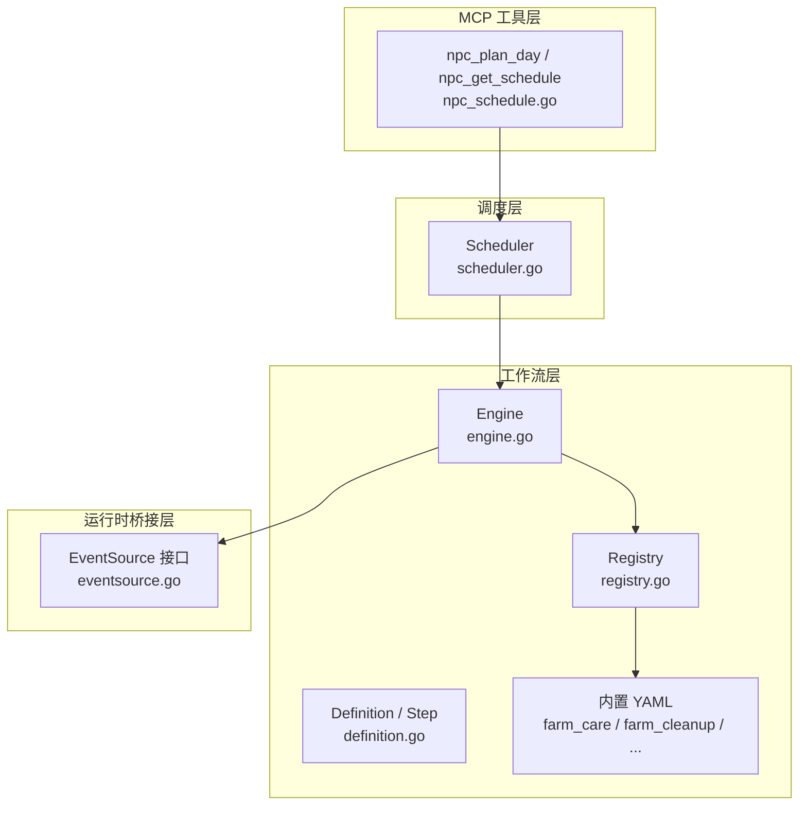
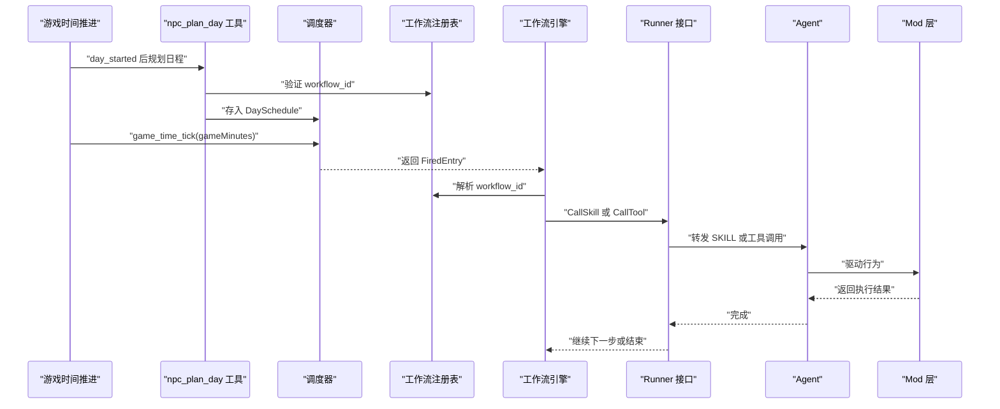
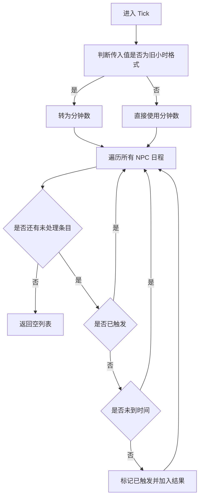
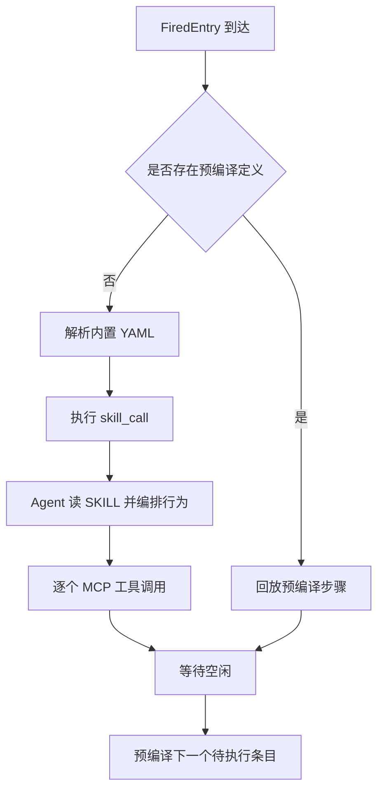
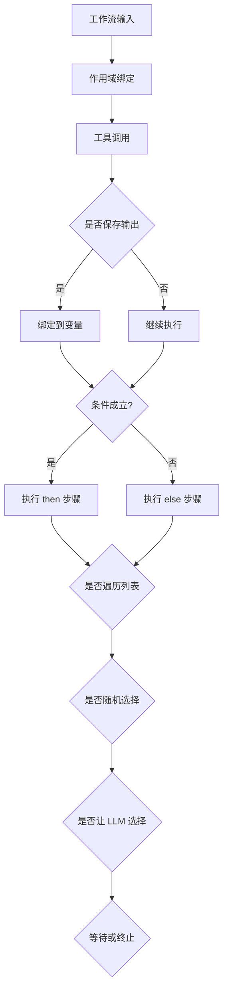
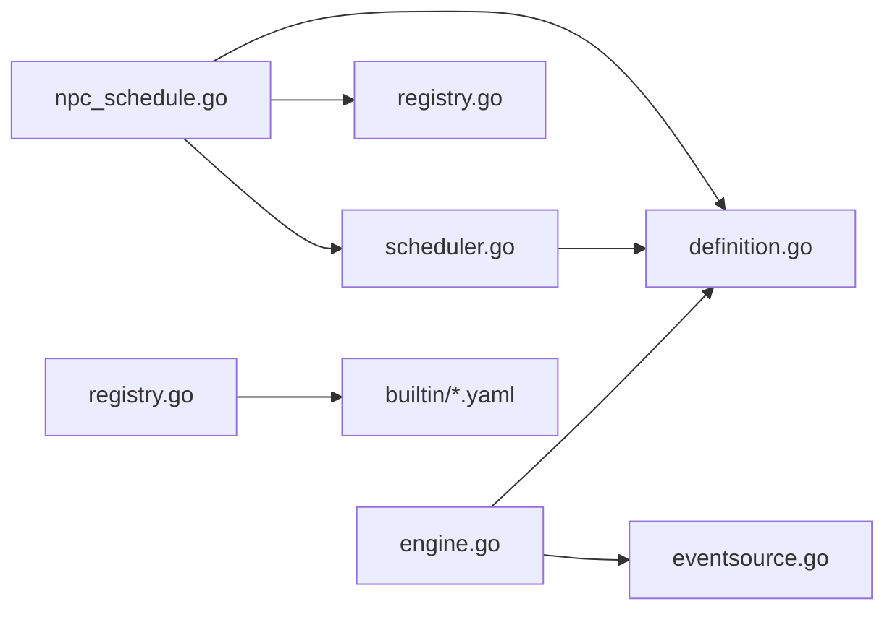

# 日程系统

<cite>
**本文引用的文件**
- [调度器实现](file://SmartNPC/smartnpc-mcp/adapters/stardew/scheduler/scheduler.go)
- [工作流引擎](file://SmartNPC/smartnpc-mcp/pkg/workflow/engine.go)
- [工作流定义模型](file://SmartNPC/smartnpc-mcp/pkg/workflow/definition.go)
- [工作流注册表](file://SmartNPC/smartnpc-mcp/pkg/workflow/registry.go)
- [农场养护工作流](file://SmartNPC/smartnpc-mcp/pkg/workflow/builtin/farm_care.yaml)
- [农场清理工作流](file://SmartNPC/smartnpc-mcp/pkg/workflow/builtin/farm_cleanup.yaml)
- [傍晚收尾工作流](file://SmartNPC/smartnpc-mcp/pkg/workflow/builtin/farm_evening_close.yaml)
- [资源采集工作流](file://SmartNPC/smartnpc-mcp/pkg/workflow/builtin/resource_gather.yaml)
- [日终回顾工作流](file://SmartNPC/smartnpc-mcp/pkg/workflow/builtin/day_review.yaml)
- [日程工具实现](file://SmartNPC/smartnpc-mcp/adapters/stardew/tools/npc_schedule.go)
- [事件源接口](file://SmartNPC/smartnpc-mcp/pkg/agentbridge/eventsource.go)
- [日程系统技术文档](file://SmartNPC/docs/schedule-system-detail.md)
</cite>

## 目录
1. [引言](#引言)
2. [项目结构](#项目结构)
3. [核心组件](#核心组件)
4. [架构总览](#架构总览)
5. [详细组件分析](#详细组件分析)
6. [依赖关系分析](#依赖关系分析)
7. [性能与并发特性](#性能与并发特性)
8. [自定义日程开发指南](#自定义日程开发指南)
9. [故障排查](#故障排查)
10. [结论](#结论)

## 引言
本文件从代码层面向读者解释 SmartNPC 日程系统的完整设计。该系统负责为每个受 Agent 管理的非玩家角色生成并执行全天日程，把游戏内时间推进转化为“触发条目”，再通过工作流引擎把任务交给 Agent 或预编译步骤去驱动 Mod 层的寻路、动画和游戏状态修改。

系统的关键思想是：
- 日程以“分钟级”精度记录，但实际调度使用“每 20 分钟检查一次”的保守策略，避免错过跳过的 tick。
- 日程条目不直接绑定具体参数，而是通过 workflow_id 引用内置工作流，或由 LLM 提供内联工作流定义。
- 工作流引擎支持工具调用、条件分支、随机选择、遍历、技能委托、等待和提前终止等步骤类型。
- 同一 NPC 的工作流严格串行执行，新任务会取消该 NPC 上一个仍在运行的工作流。
- 支持“预编译”机制，让重复性高、环境变化小的任务在触发时零延迟回放。

## 项目结构
日程系统主要分布在 Go 模块 `smartnpc-mcp` 中，涉及适配器层、调度器、工作流引擎、内置 YAML 工作流以及 MCP 工具注册。

**图表来源**
- [日程工具实现:1-200](file://SmartNPC/smartnpc-mcp/adapters/stardew/tools/npc_schedule.go#L1-L200)
- [调度器实现:1-120](file://SmartNPC/smartnpc-mcp/adapters/stardew/scheduler/scheduler.go#L1-L120)
- [工作流注册表:1-120](file://SmartNPC/smartnpc-mcp/pkg/workflow/registry.go#L1-L120)
- [工作流定义模型:1-80](file://SmartNPC/smartnpc-mcp/pkg/workflow/definition.go#L1-L80)
- [工作流引擎:1-120](file://SmartNPC/smartnpc-mcp/pkg/workflow/engine.go#L1-L120)
- [事件源接口:1-40](file://SmartNPC/smartnpc-mcp/pkg/agentbridge/eventsource.go#L1-L40)

**章节来源**
- [日程工具实现:1-200](file://SmartNPC/smartnpc-mcp/adapters/stardew/tools/npc_schedule.go#L1-L200)
- [调度器实现:1-120](file://SmartNPC/smartnpc-mcp/adapters/stardew/scheduler/scheduler.go#L1-L120)
- [工作流注册表:1-120](file://SmartNPC/smartnpc-mcp/pkg/workflow/registry.go#L1-L120)
- [工作流定义模型:1-80](file://SmartNPC/smartnpc-mcp/pkg/workflow/definition.go#L1-L80)
- [工作流引擎:1-120](file://SmartNPC/smartnpc-mcp/pkg/workflow/engine.go#L1-L120)
- [事件源接口:1-40](file://SmartNPC/smartnpc-mcp/pkg/agentbridge/eventsource.go#L1-L40)

## 核心组件
本节按职责划分，说明日程系统中最重要的五个部分。

### 调度器
调度器维护每个 NPC 的当日日程，负责：
- 存储或替换某 NPC 的 `DaySchedule`。
- 根据当前游戏分钟数扫描所有未触发的条目。
- 将到点条目标记为已触发，并返回 `FiredEntry`。
- 写入预编译结果、查询待执行条目、列出有日程的 NPC。

关键数据结构包括：
- `Entry`：一个日程槽位，包含游戏小时、分钟、分钟偏移、动作名称、原因、是否已触发、预编译定义、workflow_id、内联定义和参数。
- `DaySchedule`：单个 NPC 在某天的计划，包含 NPC 名、天数、季节、年份和条目列表。
- `FiredEntry`：调度器向外部暴露的触发结果，携带上下文信息和工作流载荷。

调度器的时间匹配逻辑不是简单相等比较，而是“小于等于当前分钟即触发”，从而容忍 20 分钟 tick 可能跳过某个 10 分钟精确时刻的情况。

**章节来源**
- [调度器实现:1-120](file://SmartNPC/smartnpc-mcp/adapters/stardew/scheduler/scheduler.go#L1-L120)
- [调度器实现:201-305](file://SmartNPC/smartnpc-mcp/adapters/stardew/scheduler/scheduler.go#L201-L305)

### 工作流定义模型
工作流是一个有序步骤序列，由 `Definition` 描述，包含：
- `id`、`description`、`version`。
- 可选输入规范 `inputs`，允许声明默认值。
- 步骤列表 `steps`。

`Step` 是标签联合结构，通过 `kind` 字段区分具体步骤类型：
| 步骤类型 | 作用 |
|---|---|
| `tool` | 调用指定 MCP 工具，支持输出保存、无工作处理策略和超时控制。 |
| `branch` | 基于表达式进行 then/else 分支。 |
| `random` | 按权重随机选择一个分支执行。 |
| `foreach` | 遍历列表变量，每次迭代创建子作用域。 |
| `skill_call` | 委托给 Hermes SKILL，由 Runner 转发给 Agent。 |
| `llm_choice` | 让 LLM 从固定选项中选一个，并保存到变量。 |
| `wait` | 等待运行条件满足，典型值是空闲状态。 |
| `stop` | 主动结束工作流。 |

**章节来源**
- [工作流定义模型:1-200](file://SmartNPC/smartnpc-mcp/pkg/workflow/definition.go#L1-L200)
- [工作流定义模型:200-234](file://SmartNPC/smartnpc-mcp/pkg/workflow/definition.go#L200-L234)

### 工作流注册表
注册表负责加载和管理工作流定义：
- 启动时从嵌入的 `builtin/*.yaml` 加载内置工作流。
- 可选从额外目录加载 YAML，同名 ID 会覆盖内置版本。
- 提供 `Get`、`List`、`LoadDef`、`Validate` 等方法。
- 对未知 step kind、空 steps、重复 save_as、非法 on_nothing_to_do 等进行静态校验。

这种设计使工作流定义可以在启动阶段就发现错误，而不是在工作流运行时才崩溃。

**章节来源**
- [工作流注册表:1-120](file://SmartNPC/smartnpc-mcp/pkg/workflow/registry.go#L1-L120)
- [工作流注册表:120-250](file://SmartNPC/smartnpc-mcp/pkg/workflow/registry.go#L120-L250)
- [工作流注册表:250-376](file://SmartNPC/smartnpc-mcp/pkg/workflow/registry.go#L250-L376)

### 工作流引擎
引擎负责按顺序执行步骤，并维护运行结果、计数、停止原因和失败步骤索引。其对外接口 `Runner` 隐藏了底层通信细节，只要求实现：
- 调用工具。
- 调用技能。
- 让 LLM 做有限选项选择。
- 等待 NPC 回到空闲。
- 预编译技能。

引擎的核心流程：
1. 初始化作用域，绑定输入变量。
2. 逐个执行步骤。
3. 根据 step.kind 分派到对应处理器。
4. 收集工具调用次数、nothing_to_do 次数、耗时等信息。
5. 遇到错误或 stop 时返回。

**章节来源**
- [工作流引擎:1-120](file://SmartNPC/smartnpc-mcp/pkg/workflow/engine.go#L1-L120)
- [工作流引擎:200-350](file://SmartNPC/smartnpc-mcp/pkg/workflow/engine.go#L200-L350)
- [工作流引擎:350-626](file://SmartNPC/smartnpc-mcp/pkg/workflow/engine.go#L350-L626)

### 日程工具
MCP 工具层提供两个主要入口：
- `npc_plan_day`：提交全天日程，支持 workflow_id、内联 workflow 和已废弃的 action 三种形式。
- `npc_get_schedule`：查询尚未触发的剩余日程。

工具层还负责：
- 限制每日条目数量（推荐 5-7，最多接受 8）。
- 将 game_minute 向下取整到 10 分钟边界。
- 将 legacy action 转换为内部表示。
- 在实验模式下自动追加 22:30 的日终回顾条目。
- 支持 npc="*" 批量应用到所有 Agent NPC。

**章节来源**
- [日程工具实现:1-200](file://SmartNPC/smartnpc-mcp/adapters/stardew/tools/npc_schedule.go#L1-L200)
- [日程工具实现:201-453](file://SmartNPC/smartnpc-mcp/adapters/stardew/tools/npc_schedule.go#L201-L453)

## 架构总览
下图展示一条日程条目从生成到执行的完整链路。

**图表来源**
- [日程工具实现:1-200](file://SmartNPC/smartnpc-mcp/adapters/stardew/tools/npc_schedule.go#L1-L200)
- [调度器实现:120-305](file://SmartNPC/smartnpc-mcp/adapters/stardew/scheduler/scheduler.go#L120-L305)
- [工作流引擎:1-120](file://SmartNPC/smartnpc-mcp/pkg/workflow/engine.go#L1-L120)
- [工作流定义模型:1-80](file://SmartNPC/smartnpc-mcp/pkg/workflow/definition.go#L1-L80)

## 详细组件分析

### 调度器时间触发机制
调度器的 `Tick` 方法接收“分钟数”，并对所有 NPC 的所有条目进行扫描。其关键规则如下：
- 忽略已触发条目。
- 忽略还未到达时间的条目。
- 对已到达或超时的条目设置 `Fired=true` 和 `FiredAt`。
- 兼容旧调用方传入的小时值；若传入值小于等于 30，则当作小时乘以 60 转换为分钟。
- 返回 `FiredEntry` 集合，供上层分发到 worker。

**图表来源**
- [调度器实现:120-305](file://SmartNPC/smartnpc-mcp/adapters/stardew/scheduler/scheduler.go#L120-L305)

**章节来源**
- [调度器实现:120-305](file://SmartNPC/smartnpc-mcp/adapters/stardew/scheduler/scheduler.go#L120-L305)

### 任务队列与并发控制
系统对并发控制有两个层面：

1. **调度层**：`Scheduler` 使用读写锁保护内存中的日程数据，保证多线程访问安全。
2. **执行层**：每个 NPC 独占一个 goroutine 和一个 channel，确保同一 NPC 的工作流严格串行。新 schedule entry 触发时，会自动取消该 NPC 上一个仍在运行的工作流。

这意味着：
- 不同 NPC 可以并行执行各自的工作流。
- 同一 NPC 不会同时执行两个动作。
- 如果新任务优先级更高，它可以打断上一个任务，因为上游会 cancel 旧 context。

**章节来源**
- [日程系统技术文档:1-200](file://SmartNPC/docs/schedule-system-detail.md#L1-L200)

### 工作流引擎执行路径
工作流引擎支持两种执行路径：

| 路径 | 含义 | 适用场景 |
|---|---|---|
| 实时编排 | 触发时解析 YAML，通过 `skill_call` 把控制权交给 Agent | 日常运行、需要实时决策的任务 |
| 预编译回放 | 提前录制一次 SKILL，生成 concrete steps，触发时直接回放 | 重复性高、环境变化小的任务 |

预编译产物保存在 `Entry.PrecompiledDef`，触发时调度器会优先使用该定义，绕过 LLM 延迟。

**图表来源**
- [日程系统技术文档:1-200](file://SmartNPC/docs/schedule-system-detail.md#L1-L200)
- [调度器实现:201-305](file://SmartNPC/smartnpc-mcp/adapters/stardew/scheduler/scheduler.go#L201-L305)
- [工作流引擎:1-120](file://SmartNPC/smartnpc-mcp/pkg/workflow/engine.go#L1-L120)

**章节来源**
- [日程系统技术文档:1-200](file://SmartNPC/docs/schedule-system-detail.md#L1-L200)
- [工作流引擎:1-120](file://SmartNPC/smartnpc-mcp/pkg/workflow/engine.go#L1-L120)

### 游戏内时间映射与同步
日程系统使用游戏内小时和分钟作为调度基准，而不是真实世界时间。核心约定如下：

| 概念 | 说明 |
|---|---|
| 游戏小时范围 | 6 到 25，其中 25 表示第二天凌晨 1 点。 |
| 分钟精度 | 日程定义使用 10 分钟步长。 |
| 调度频率 | 系统以 20 分钟 tick 检查触发，因此 06:30 的条目可能在 06:30 到 06:40 之间触发。 |
| day_started | 每天开始时广播，用于重新生成日程。 |
| game_time_tick | 游戏时间推进事件，驱动 `Scheduler.Tick`。 |

昼夜循环、季节变化和节日事件并不由调度器直接建模，而是由上游事件系统注入到 `DaySchedule.Day`、`Season`、`Year` 中，再由 LLM 在规划日程时考虑这些上下文。

**章节来源**
- [日程工具实现:1-200](file://SmartNPC/smartnpc-mcp/adapters/stardew/tools/npc_schedule.go#L1-L200)
- [日程系统技术文档:1-200](file://SmartNPC/docs/schedule-system-detail.md#L1-L200)

### 内置 cron recipes 与工作流
项目没有使用传统 cron 表达式语法，而是采用 YAML 工作流定义。每个内置工作流通常只有一个 `skill_call` 步骤，把复杂行为委托给对应的 Hermes SKILL。

| 工作流 ID | 用途 | 关键输入 |
|---|---|---|
| `farm_care` | 农场日常养护 | `inspect_radius` |
| `farm_cleanup` | 农场清理杂物 | `inspect_radius` |
| `farm_evening_close` | 傍晚收尾、补种 | `inspect_radius`、`target_seed` |
| `resource_gather` | 资源采集 | `inspect_radius` |
| `day_review` | 日终回顾、日记归档 | 无显式输入 |

这些工作流的共同模式是：
1. 定义 id、description、version。
2. 声明 inputs 及其默认值。
3. 定义 steps。
4. 使用 `skill_call` 委托给 SKILL。
5. 通过 `$inspect_radius` 等表达式把输入传递到 SKILL。

**章节来源**
- [农场养护工作流:1-12](file://SmartNPC/smartnpc-mcp/pkg/workflow/builtin/farm_care.yaml#L1-L12)
- [农场清理工作流:1-12](file://SmartNPC/smartnpc-mcp/pkg/workflow/builtin/farm_cleanup.yaml#L1-L12)
- [傍晚收尾工作流:1-16](file://SmartNPC/smartnpc-mcp/pkg/workflow/builtin/farm_evening_close.yaml#L1-L16)
- [资源采集工作流:1-12](file://SmartNPC/smartnpc-mcp/pkg/workflow/builtin/resource_gather.yaml#L1-L12)
- [日终回顾工作流:1-6](file://SmartNPC/smartnpc-mcp/pkg/workflow/builtin/day_review.yaml#L1-L6)

### 条件判断与动作参数
工作流引擎提供了多种条件控制和参数传递机制：

- 表达式变量：通过 `$name.path` 引用作用域变量。
- 工具输出保存：`save_as` 把工具返回值绑定到变量，后续步骤读取。
- 条件分支：`branch.when` 使用布尔表达式决定 then/else。
- 随机选择：`random.weighted` 按权重采样。
- 遍历：`foreach.over` 遍历列表，`foreach.as` 绑定当前项。
- LLM 选择：`llm_choice.options` 限制模型输出到固定集合。
- 无工作处理策略：`on_nothing_to_do` 支持 skip、stop、fail。

**图表来源**
- [工作流定义模型:80-200](file://SmartNPC/smartnpc-mcp/pkg/workflow/definition.go#L80-L200)
- [工作流引擎:200-626](file://SmartNPC/smartnpc-mcp/pkg/workflow/engine.go#L200-L626)

**章节来源**
- [工作流定义模型:80-200](file://SmartNPC/smartnpc-mcp/pkg/workflow/definition.go#L80-L200)
- [工作流引擎:200-626](file://SmartNPC/smartnpc-mcp/pkg/workflow/engine.go#L200-L626)

## 依赖关系分析

**图表来源**
- [日程工具实现:1-200](file://SmartNPC/smartnpc-mcp/adapters/stardew/tools/npc_schedule.go#L1-L200)
- [调度器实现:1-120](file://SmartNPC/smartnpc-mcp/adapters/stardew/scheduler/scheduler.go#L1-L120)
- [工作流引擎:1-120](file://SmartNPC/smartnpc-mcp/pkg/workflow/engine.go#L1-L120)
- [工作流注册表:1-120](file://SmartNPC/smartnpc-mcp/pkg/workflow/registry.go#L1-L120)
- [事件源接口:1-40](file://SmartNPC/smartnpc-mcp/pkg/agentbridge/eventsource.go#L1-L40)

依赖特点：
- `scheduler.go` 依赖 `workflow.Definition`，但不依赖工作流引擎的执行细节。
- `engine.go` 通过抽象 `Runner` 解耦底层 WebSocket、Hermes relay 和 FollowSystem。
- `registry.go` 通过嵌入文件系统加载 YAML，测试和生产共享同一套内置定义。
- `npc_schedule.go` 是 MCP 工具与调度器之间的胶水层，负责输入校验、转换和日志。

**章节来源**
- [日程工具实现:1-200](file://SmartNPC/smartnpc-mcp/adapters/stardew/tools/npc_schedule.go#L1-L200)
- [调度器实现:1-120](file://SmartNPC/smartnpc-mcp/adapters/stardew/scheduler/scheduler.go#L1-L120)
- [工作流引擎:1-120](file://SmartNPC/smartnpc-mcp/pkg/workflow/engine.go#L1-L120)
- [工作流注册表:1-120](file://SmartNPC/smartnpc-mcp/pkg/workflow/registry.go#L1-L120)

## 性能与并发特性

### 批量任务处理
- 每日日程条目上限为 8，超出部分被截断，防止 LLM 一次性提交过多条目造成中继积压。
- 每条工作流通常委托给一个 SKILL，SKILL 内部再决定多个工具调用，避免在日程层硬编码大量步骤。
- 预编译机制可把重复任务从“每次触发都走 LLM”改为“首次录制、后续回放”。

### 内存优化
- `Entry` 不预先锁定具体工具参数，而是保留 workflow_id 和内联定义，让参数在触发或预编译阶段确定。
- `Scheduler` 仅持有内存中的日程，`day_started` 清空全部日程，避免跨天残留。
- `DaySchedule` 和 `PendingEntries` 返回副本，避免外部代码直接修改内部状态。

### 错误恢复机制
- 工具调用返回 `nothing_to_do=true` 时，引擎根据 `on_nothing_to_do` 配置跳过、终止或报错。
- 工作流引擎对每个步骤记录日志，包括 step 序号、kind、耗时、错误信息和停止原因。
- `WaitIdle` 支持超时，避免工作流永久阻塞。
- 工具调用默认有 120 秒超时，重型操作应显式设置更合适的超时。

### 并发模型
- 调度器内部使用读写锁。
- 每个 NPC 一个 goroutine 和一个 channel，保证同 NPC 串行。
- 不同 NPC 可并行执行。
- 新任务可取消旧任务，避免任务堆积。

**章节来源**
- [日程工具实现:1-200](file://SmartNPC/smartnpc-mcp/adapters/stardew/tools/npc_schedule.go#L1-L200)
- [调度器实现:120-305](file://SmartNPC/smartnpc-mcp/adapters/stardew/scheduler/scheduler.go#L120-L305)
- [工作流引擎:200-626](file://SmartNPC/smartnpc-mcp/pkg/workflow/engine.go#L200-L626)
- [日程系统技术文档:1-200](file://SmartNPC/docs/schedule-system-detail.md#L1-L200)

## 自定义日程开发指南

### 新增工作流定义
要添加一个新日程，建议遵循以下步骤：

1. 在内置目录中添加 YAML 文件。
2. 设置唯一 `id`。
3. 编写 `description` 和 `version`。
4. 声明 `inputs`，并为常用参数提供默认值。
5. 定义 `steps`，优先使用 `skill_call` 委托给 SKILL。
6. 如果需要内联逻辑，可使用 `tool`、`branch`、`random`、`foreach`、`wait`、`stop`。
7. 启动时由 `Registry.Init` 加载并通过 `workflow_list` 暴露给 Agent。

注意事项：
- 不要重复已有 `id`。
- 不要在 YAML 中直接引用 MCP 工具 `workflow_run_inline`、`workflow_list`、`workflow_get`。
- 对重型工具调用设置合理的 `timeout_seconds`。
- 对可能返回 `nothing_to_do` 的工具设置明确的 `on_nothing_to_do`。

### 注册新动作类型
如果“新动作”是指 MCP 工具：
- 在工具包中实现工具函数。
- 通过 MCP server 的 AddTool 注册。
- 确保工具返回结构化 map，并在无工作时返回 `nothing_to_do=true`。
- 如果动作需要长时间执行，应配合 `FollowSystem` 的排队模型，返回 `queued=true`。

如果“新动作”是指工作流步骤类型：
- 在 `StepKind` 上增加新常量。
- 在 `Step.UnmarshalJSON` 和 `Step.UnmarshalYAML` 中支持新 kind。
- 在 `Validate` 中增加静态校验。
- 在 `engine.runStep` 中增加执行分支。
- 补充测试用例，覆盖正常路径、空参数、无效值和边界条件。

### 调试定时任务
推荐使用以下手段：
- 使用 `npc_get_schedule` 查看尚未触发的条目。
- 开启 debug 模式，让 `npc_plan_day` 推送计划摘要到聊天面板和头顶气泡。
- 检查工作流日志中的 step 序号、kind、elapsed_ms、err、stopped、stop_reason。
- 对可疑工作流使用预编译模式录制一次，观察生成的 concrete steps。
- 对频繁失败的 tool 调用增加 `on_nothing_to_do=skip` 和合理超时。

### 调试工作流定义
建议使用以下流程：
1. 先写最小可用 YAML，只包含一个 `skill_call`。
2. 确认 `workflow_list` 能列出该 id。
3. 用 `npc_plan_day` 提交少量条目。
4. 观察 `npc_get_schedule` 输出。
5. 逐步增加分支、遍历和随机逻辑。
6. 对复杂变量路径使用 `save_as` 中间变量。
7. 对不稳定 LLM 决策尽量收敛为确定性分支。

**章节来源**
- [工作流定义模型:1-200](file://SmartNPC/smartnpc-mcp/pkg/workflow/definition.go#L1-L200)
- [工作流注册表:120-376](file://SmartNPC/smartnpc-mcp/pkg/workflow/registry.go#L120-L376)
- [工作流引擎:200-626](file://SmartNPC/smartnpc-mcp/pkg/workflow/engine.go#L200-L626)
- [日程工具实现:201-453](file://SmartNPC/smartnpc-mcp/adapters/stardew/tools/npc_schedule.go#L201-L453)

## 故障排查

### 日程没有触发
可能原因：
- `game_hour` 不在 6-25 范围内。
- `game_minute` 不是 10 的倍数，被向下取整后与预期不符。
- 日程已被 `AlreadyPlannedToday` 判定为当天已存在并被覆盖。
- 游戏 tick 没有调用 `Scheduler.Tick`，或传入的是旧格式小时。
- 条目已经被触发过，`Fired=true`。

排查步骤：
1. 调用 `npc_get_schedule` 查看 pending entries。
2. 检查 `npc_plan_day` 的返回消息是否提示条目被截断。
3. 确认游戏侧是否在每天开始和每小时/每分钟推进时调用调度器。

**章节来源**
- [日程工具实现:1-200](file://SmartNPC/smartnpc-mcp/adapters/stardew/tools/npc_schedule.go#L1-L200)
- [调度器实现:120-305](file://SmartNPC/smartnpc-mcp/adapters/stardew/scheduler/scheduler.go#L120-L305)

### 工作流执行卡住
可能原因：
- `wait.condition` 不满足且超时过长。
- 工具调用阻塞，未设置超时。
- NPC 处于长时间任务模式，无法回到 Idle。
- Runner 的 `WaitIdle` 超时返回 false。

排查步骤：
1. 检查工作流日志中的 `workflow: wait start` 和 `workflow: wait done`。
2. 检查工具调用的 elapsed_ms 和 err。
3. 确认 Runner 是否正确实现 `WaitIdle`。
4. 对重型工具增加 `timeout_seconds`。

**章节来源**
- [工作流引擎:350-626](file://SmartNPC/smartnpc-mcp/pkg/workflow/engine.go#L350-L626)

### 工作流定义加载失败
可能原因：
- YAML 解析失败。
- 缺少 `id`。
- steps 为空。
- 存在未知 step kind。
- 存在重复 save_as。
- 存在非法 `on_nothing_to_do`。
- 重复的 workflow id。

排查步骤：
1. 使用 `LoadDef` 和 `Validate` 在启动前验证 YAML。
2. 检查内置目录和额外目录是否存在重复 id。
3. 检查 step 的必填字段。
4. 检查 random 分支是否至少有一个正权重。

**章节来源**
- [工作流注册表:120-376](file://SmartNPC/smartnpc-mcp/pkg/workflow/registry.go#L120-L376)

### 事件源相关异常
事件源接口定义了事件生产者如何接入 agent-bridge：
- `Name()` 返回稳定标识。
- `Start(ctx, sink)` 启动事件流，必须响应 ctx 取消。
- `Sink` 可从任意 goroutine 安全调用。
- `Start` 返回错误会被记录，但不会中止其他 event source。

如果日程触发依赖事件流，应确认：
- 事件源是否正常注册。
- `Start` 是否被调用。
- `ctx` 取消后是否优雅退出。
- sink 是否持续投递 `day_started`、`game_time_tick` 等事件。

**章节来源**
- [事件源接口:1-40](file://SmartNPC/smartnpc-mcp/pkg/agentbridge/eventsource.go#L1-L40)

## 结论
SmartNPC 日程系统以“游戏内时间 + 工作流定义”为核心，把 LLM 的高层意图与 Mod 层的低层执行解耦。调度器负责时间匹配和并发隔离，工作流引擎负责步骤编排和错误处理，注册表负责静态校验，MCP 工具负责对外暴露日程 API。

对于使用者而言，最佳实践是：
- 使用 workflow_id 引用内置工作流，而非手写 action。
- 把复杂行为交给 SKILL，让 Agent 根据实时环境动态决策。
- 对重复性任务启用预编译，减少 LLM 延迟。
- 为重型工具设置超时和无工作处理策略。
- 通过 `npc_get_schedule` 和日志持续验证日程是否按计划触发。

对于扩展者而言，新增动作的正确路径是：
- 新增 MCP 工具或 SKILL。
- 新增工作流 YAML 或内联定义。
- 通过注册表暴露 workflow_id。
- 补充单元测试和集成测试，覆盖解析、校验、执行和错误路径。