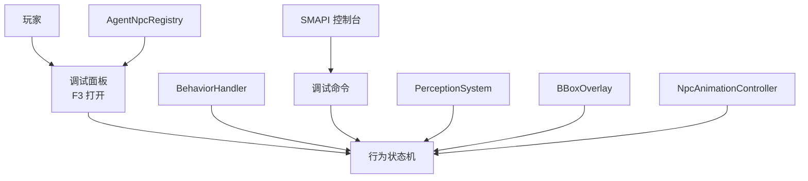
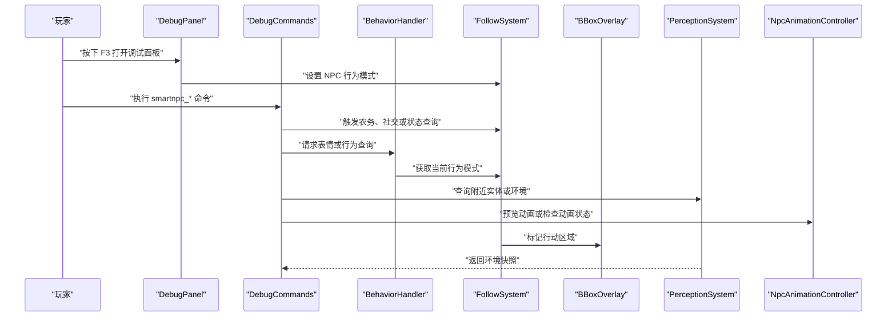
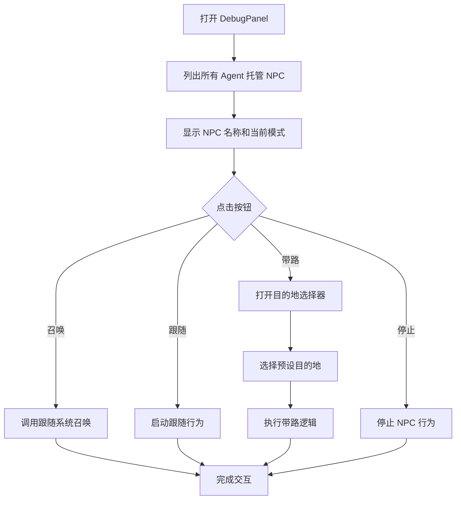
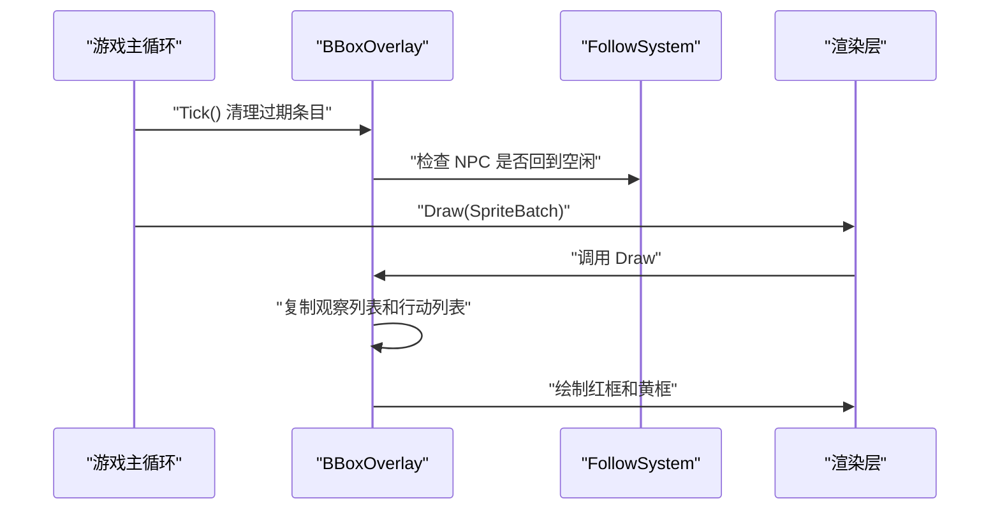
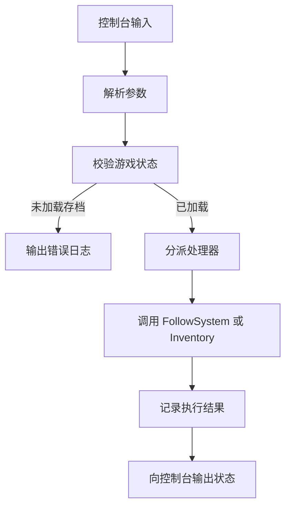
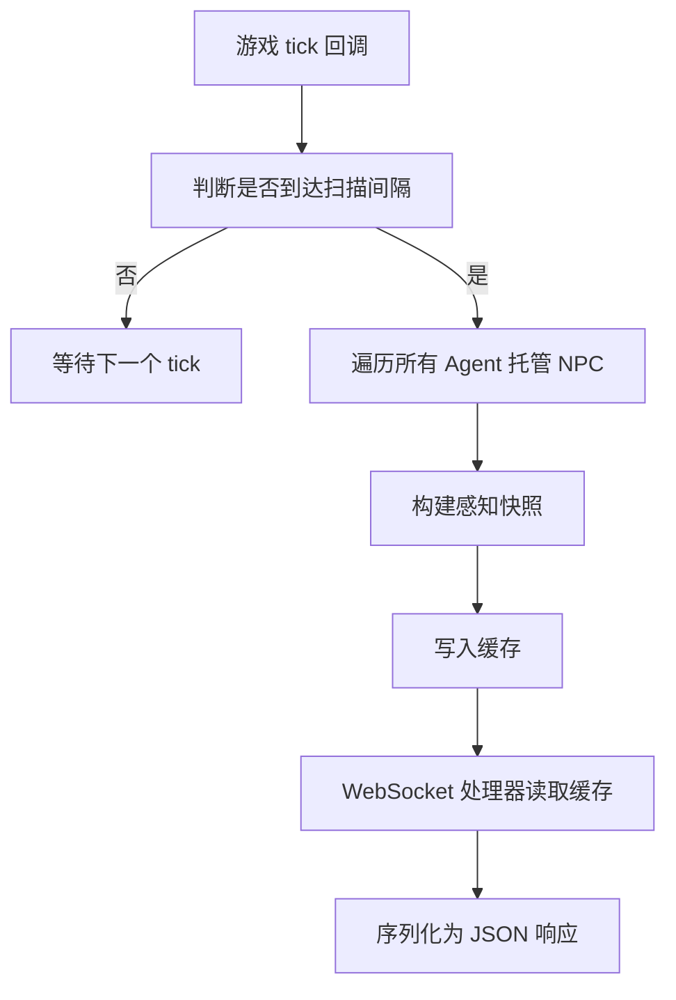
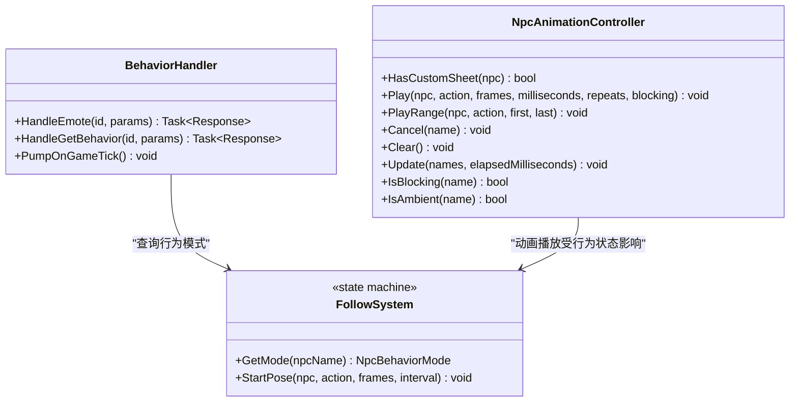
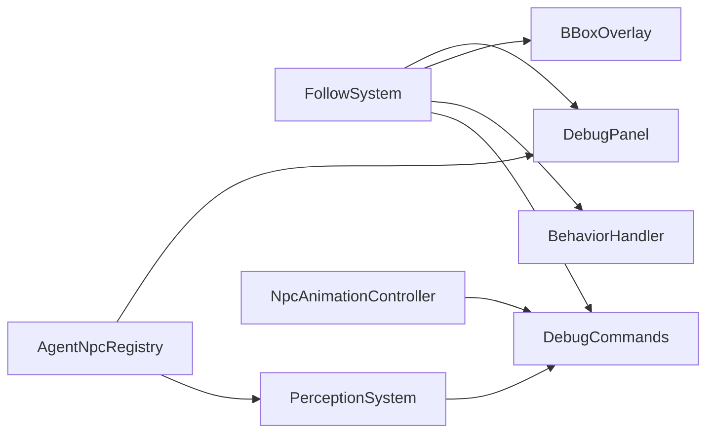

# 调试工具集

<cite>
**本文引用的文件**   
- [DebugPanel.cs](file://SmartNPC/smapi-mod/UI/DebugPanel.cs)
- [BBoxOverlay.cs](file://SmartNPC/smapi-mod/Debug/BBoxOverlay.cs)
- [DebugCommands.cs](file://SmartNPC/smapi-mod/Debug/DebugCommands.cs)
- [PerceptionSystem.cs](file://SmartNPC/smapi-mod/Perception/PerceptionSystem.cs)
- [NpcAnimationController.cs](file://SmartNPC/smapi-mod/Movement/NpcAnimationController.cs)
- [BehaviorHandler.cs](file://SmartNPC/smapi-mod/Movement/BehaviorHandler.cs)
- [FollowSystem.cs](file://SmartNPC/smapi-mod/Movement/FollowSystem.cs)
- [AgentNpcRegistry.cs](file://SmartNPC/smapi-mod/NPC/AgentNpcRegistry.cs)
</cite>

## 目录
1. [简介](#简介)
2. [项目结构与调试入口](#项目结构与调试入口)
3. [核心调试组件](#核心调试组件)
4. [架构总览](#架构总览)
5. [详细组件分析](#详细组件分析)
6. [依赖关系分析](#依赖关系分析)
7. [性能与稳定性考虑](#性能与稳定性考虑)
8. [故障排查指南](#故障排查指南)
9. [结论](#结论)
10. [附录：常用调试命令速查](#附录常用调试命令速查)

## 简介
本调试工具集面向 SmartNPC 的 Stardew Valley 模组，提供运行时可视化、控制台命令、行为控制、感知数据查询和动画诊断能力。其目标包括：

- 通过游戏内 UI 面板实时查看和管理 NPC 行为状态。
- 通过边界框叠加层直观展示 NPC 扫描区域和行动范围。
- 通过 SMAPI 控制台命令快速触发农务、社交、表现动作及系统状态检查。
- 通过感知系统接口查看环境扫描结果、附近实体、地形信息。
- 通过动画控制器诊断自定义精灵帧播放问题。
- 为开发者提供扩展调试功能的结构化路径。

## 项目结构与调试入口
调试功能分布在以下模块中：

| 模块 | 职责 | 主要入口 |
|---|---|---|
| `UI` | 游戏内调试菜单 | F3 打开 `DebugPanel` |
| `Debug` | 世界渲染叠加层、SMAPI 控制台命令 | `BBoxOverlay`、`DebugCommands` |
| `Perception` | NPC 感知扫描与环境快照 | `PerceptionSystem` |
| `Movement` | NPC 行为状态机、动画控制、行为事件桥接 | `FollowSystem`、`NpcAnimationController`、`BehaviorHandler` |
| `NPC` | Agent 托管 NPC 注册表 | `AgentNpcRegistry` |

**图表来源**
- [DebugPanel.cs:1-200](file://SmartNPC/smapi-mod/UI/DebugPanel.cs#L1-L200)
- [BBoxOverlay.cs:1-200](file://SmartNPC/smapi-mod/Debug/BBoxOverlay.cs#L1-L200)
- [DebugCommands.cs:1-200](file://SmartNPC/smapi-mod/Debug/DebugCommands.cs#L1-L200)
- [PerceptionSystem.cs:1-200](file://SmartNPC/smapi-mod/Perception/PerceptionSystem.cs#L1-L200)
- [NpcAnimationController.cs:1-109](file://SmartNPC/smapi-mod/Movement/NpcAnimationController.cs#L1-L109)
- [BehaviorHandler.cs:1-159](file://SmartNPC/smapi-mod/Movement/BehaviorHandler.cs#L1-L159)
- [FollowSystem.cs:1-200](file://SmartNPC/smapi-mod/Movement/FollowSystem.cs#L1-L200)
- [AgentNpcRegistry.cs:1-29](file://SmartNPC/smapi-mod/NPC/AgentNpcRegistry.cs#L1-L29)

**章节来源**
- [DebugPanel.cs:1-200](file://SmartNPC/smapi-mod/UI/DebugPanel.cs#L1-L200)
- [BBoxOverlay.cs:1-200](file://SmartNPC/smapi-mod/Debug/BBoxOverlay.cs#L1-L200)
- [DebugCommands.cs:1-200](file://SmartNPC/smapi-mod/Debug/DebugCommands.cs#L1-L200)
- [PerceptionSystem.cs:1-200](file://SmartNPC/smapi-mod/Perception/PerceptionSystem.cs#L1-L200)
- [NpcAnimationController.cs:1-109](file://SmartNPC/smapi-mod/Movement/NpcAnimationController.cs#L1-L109)
- [BehaviorHandler.cs:1-159](file://SmartNPC/smapi-mod/Movement/BehaviorHandler.cs#L1-L159)
- [FollowSystem.cs:1-200](file://SmartNPC/smapi-mod/Movement/FollowSystem.cs#L1-L200)
- [AgentNpcRegistry.cs:1-29](file://SmartNPC/smapi-mod/NPC/AgentNpcRegistry.cs#L1-L29)

## 核心调试组件
- **DebugPanel**：F3 打开的游戏内调试菜单，列出所有 Agent 托管 NPC，支持召唤、跟随、带路、停止等操作，并提供预设目的地选择器。
- **BBoxOverlay**：在游戏世界中绘制红色观察框和黄色行动框，帮助定位 NPC 的扫描范围和当前行为作用区域。
- **DebugCommands**：注册大量 SMAPI 控制台命令，用于状态查询、时间推进、农务行为、社交表现、物品操作和性能相关诊断。
- **PerceptionSystem**：按固定间隔扫描地图，生成 NPC 附近实体和环境快照，并通过 WebSocket 接口暴露给外部调用方。
- **NpcAnimationController**：管理 XiaMi 自定义精灵帧播放、行走动画切换和动画阻塞状态。
- **BehaviorHandler**：将 NPC 表情和行为查询请求从 WebSocket 线程安全地调度到游戏主线程执行。
- **FollowSystem**：集中管理 NPC 的行为模式，包括空闲、召唤、跟随、带路、漫游、清理、采集、种植、浇水、收割、施肥、放置、情感动画等。
- **AgentNpcRegistry**：维护由外部 Agent 管理的 NPC 名称集合，供 UI 和调试逻辑枚举。

**章节来源**
- [DebugPanel.cs:1-277](file://SmartNPC/smapi-mod/UI/DebugPanel.cs#L1-L277)
- [BBoxOverlay.cs:1-221](file://SmartNPC/smapi-mod/Debug/BBoxOverlay.cs#L1-L221)
- [DebugCommands.cs:1-500](file://SmartNPC/smapi-mod/Debug/DebugCommands.cs#L1-L500)
- [PerceptionSystem.cs:1-380](file://SmartNPC/smapi-mod/Perception/PerceptionSystem.cs#L1-L380)
- [NpcAnimationController.cs:1-109](file://SmartNPC/smapi-mod/Movement/NpcAnimationController.cs#L1-L109)
- [BehaviorHandler.cs:1-159](file://SmartNPC/smapi-mod/Movement/BehaviorHandler.cs#L1-L159)
- [FollowSystem.cs:1-200](file://SmartNPC/smapi-mod/Movement/FollowSystem.cs#L1-L200)
- [AgentNpcRegistry.cs:1-29](file://SmartNPC/smapi-mod/NPC/AgentNpcRegistry.cs#L1-L29)

## 架构总览
调试系统的运行分为三层：

1. **交互层**：玩家通过 F3 面板或 SMAPI 控制台输入指令。
2. **控制层**：`FollowSystem` 作为统一行为状态机；`BehaviorHandler` 负责跨线程调度；`DebugCommands` 解析并分发命令。
3. **观测层**：`BBoxOverlay` 提供视觉反馈；`PerceptionSystem` 提供数据快照；`NpcAnimationController` 提供动画状态。

**图表来源**
- [DebugPanel.cs:1-200](file://SmartNPC/smapi-mod/UI/DebugPanel.cs#L1-L200)
- [DebugCommands.cs:1-500](file://SmartNPC/smapi-mod/Debug/DebugCommands.cs#L1-L500)
- [BehaviorHandler.cs:1-159](file://SmartNPC/smapi-mod/Movement/BehaviorHandler.cs#L1-L159)
- [FollowSystem.cs:1-200](file://SmartNPC/smapi-mod/Movement/FollowSystem.cs#L1-L200)
- [BBoxOverlay.cs:1-200](file://SmartNPC/smapi-mod/Debug/BBoxOverlay.cs#L1-L200)
- [PerceptionSystem.cs:1-200](file://SmartNPC/smapi-mod/Perception/PerceptionSystem.cs#L1-L200)
- [NpcAnimationController.cs:1-109](file://SmartNPC/smapi-mod/Movement/NpcAnimationController.cs#L1-L109)

## 详细组件分析

### DebugPanel 调试面板
DebugPanel 是主要的图形化调试入口。它显示所有已注册的 Agent 托管 NPC，并在每行展示 NPC 名称及其当前行为模式。每个 NPC 行提供四个按钮：

| 按钮 | 功能 | 对应行为 |
|---|---|---|
| 召唤 | 让 NPC 走到玩家身边 | 进入召唤流程 |
| 跟随 | 让 NPC 持续跟随玩家 | 进入跟随模式 |
| 带路 | 让 NPC 前往预设地点 | 打开目的地选择器 |
| 停止 | 停止当前行为 | 回到空闲模式 |

#### 界面交互流程

**图表来源**
- [DebugPanel.cs:1-200](file://SmartNPC/smapi-mod/UI/DebugPanel.cs#L1-L200)
- [DebugPanel.cs:201-277](file://SmartNPC/smapi-mod/UI/DebugPanel.cs#L201-L277)
- [FollowSystem.cs:1-200](file://SmartNPC/smapi-mod/Movement/FollowSystem.cs#L1-L200)

#### 关键实现要点
- 面板高度根据 NPC 数量动态计算。
- 每行背景使用交替灰度提高可读性。
- 行为模式标签直接读取 `FollowSystem.GetMode`。
- 点击处理直接调用 `FollowSystem` 的方法，不引入额外异步层。
- 带路功能使用独立子菜单，显示地图名和坐标目标。

**章节来源**
- [DebugPanel.cs:1-277](file://SmartNPC/smapi-mod/UI/DebugPanel.cs#L1-L277)
- [AgentNpcRegistry.cs:1-29](file://SmartNPC/smapi-mod/NPC/AgentNpcRegistry.cs#L1-L29)

### BBoxOverlay 可视化调试
BBoxOverlay 负责在世界层绘制调试矩形框，帮助判断 NPC 的感知和行为范围。

| 颜色 | 含义 | 生命周期 |
|---|---|---|
| 红色 | NPC 刚刚扫描过的对象区域 | 默认 4 秒后自动过期 |
| 黄色 | NPC 正在执行的行为作用区域 | 当 NPC 回到空闲模式时清除 |

#### 更新与绘制时序

**图表来源**
- [BBoxOverlay.cs:1-221](file://SmartNPC/smapi-mod/Debug/BBoxOverlay.cs#L1-L221)
- [FollowSystem.cs:1-200](file://SmartNPC/smapi-mod/Movement/FollowSystem.cs#L1-L200)

#### 关键实现要点
- 使用单例 `Instance` 避免重复初始化。
- 通过锁保护观察列表和行动列表，防止渲染时并发修改。
- 坐标以瓦片为单位，渲染时转换为像素坐标。
- 观察框有 TTL 过期机制。
- 行动框会在 NPC 回到空闲状态时自动移除。
- 新增行为时会覆盖同 NPC 的旧框，避免视觉堆积。

**章节来源**
- [BBoxOverlay.cs:1-221](file://SmartNPC/smapi-mod/Debug/BBoxOverlay.cs#L1-L221)

### DebugCommands 调试命令
DebugCommands 注册了大量 SMAPI 控制台命令，涵盖系统状态、时间推进、NPC 移动、农务操作、社交表现、物品管理和动画预览。

#### 命令分类
| 类别 | 示例命令 | 用途 |
|---|---|---|
| 系统状态 | `smartnpc_debug`、`smartnpc_status` | 查看 NPC 状态、WebSocket 连接、MCP 健康度 |
| 时间控制 | `smartnpc_tick` | 推进游戏时间并触发日程事件 |
| 移动控制 | `smartnpc_wander` | 强制 NPC 随机游走 |
| 农务行为 | `smartnpc_till_soil`、`smartnpc_water_crops`、`smartnpc_harvest_crops` | 强制执行耕地、浇水、收割等 |
| 社交表现 | `smartnpc_express_emotion`、`smartnpc_dance`、`smartnpc_pace` | 触发表情、舞蹈、踱步等动画 |
| 物品管理 | `smartnpc_deposit_items`、`smartnpc_withdraw_from_chest`、`smartnpc_transfer_item` | 存取箱子、转移背包物品 |
| 环境探测 | `smartnpc_inspect_object` | 让 NPC 扫描周围对象并报告 |
| 动画调试 | `smartnpc_animation` | 预览 XiaMi 自定义动画 |

#### 典型命令执行流程

**图表来源**
- [DebugCommands.cs:1-500](file://SmartNPC/smapi-mod/Debug/DebugCommands.cs#L1-L500)
- [FollowSystem.cs:1-200](file://SmartNPC/smapi-mod/Movement/FollowSystem.cs#L1-L200)

#### 关键实现要点
- 命令注册集中在构造函数中，便于统一查看可用命令。
- 多数命令需要存档已加载且 NPC 存在。
- `smartnpc_status` 会访问 MCP 的 HTTP 状态接口，并输出 WebSocket 连接情况和各 Hermes profile 健康度。
- `smartnpc_animation` 仅对 XiaMi 有效，且要求 NPC 当前处于空闲状态。
- 命令文档字符串可直接在 SMAPI 控制台查看使用说明。

**章节来源**
- [DebugCommands.cs:1-500](file://SmartNPC/smapi-mod/Debug/DebugCommands.cs#L1-L500)

### 感知系统调试接口
PerceptionSystem 提供两个主要调试接口：

| 接口 | 参数 | 返回内容 |
|---|---|---|
| `npc_get_nearby` | NPC 名称、可选半径 | 附近 NPC、玩家、距离、朝向、地图 |
| `npc_get_environment` | NPC 名称 | 天气、时间、季节、位置、朝向、附近对象、计数 |

#### 感知扫描流程

**图表来源**
- [PerceptionSystem.cs:1-380](file://SmartNPC/smapi-mod/Perception/PerceptionSystem.cs#L1-L380)

#### 关键实现要点
- 扫描间隔默认为约 1 秒（60 ticks）。
- 扫描过程只读游戏世界，不修改状态。
- 快照按 NPC 名称缓存，读写分离避免线程竞争。
- 非默认半径会触发即时扫描。
- 附近对象包含放置物体、地形特征和作物。
- 玩家动作会被描述为步行、使用工具、坐下或空闲。

**章节来源**
- [PerceptionSystem.cs:1-380](file://SmartNPC/smapi-mod/Perception/PerceptionSystem.cs#L1-L380)

### 动画调试与行为桥接
NpcAnimationController 专门处理 XiaMi 的自定义精灵帧动画，而 BehaviorHandler 负责把 NPC 表情和行为查询从 WebSocket 线程迁移到游戏主线程。

#### 动画控制类关系

**图表来源**
- [NpcAnimationController.cs:1-109](file://SmartNPC/smapi-mod/Movement/NpcAnimationController.cs#L1-L109)
- [BehaviorHandler.cs:1-159](file://SmartNPC/smapi-mod/Movement/BehaviorHandler.cs#L1-L159)
- [FollowSystem.cs:1-200](file://SmartNPC/smapi-mod/Movement/FollowSystem.cs#L1-L200)

#### 关键实现要点
- 只有名为 XiaMi 的 NPC 才应用自定义动画帧。
- 动画播放会暂停原始控制器并保存翻转和移动动画状态。
- 取消动画时会恢复 NPC 的原始状态。
- 行走动画按朝向和计时偏移设置帧。
- BehaviorHandler 使用并发队列把可能修改 Game1 的操作排队到主线程执行。
- 表情类型映射到 SDV 原生表情 ID。

**章节来源**
- [NpcAnimationController.cs:1-109](file://SmartNPC/smapi-mod/Movement/NpcAnimationController.cs#L1-L109)
- [BehaviorHandler.cs:1-159](file://SmartNPC/smapi-mod/Movement/BehaviorHandler.cs#L1-L159)

## 依赖关系分析
调试工具之间的耦合关系如下：

**图表来源**
- [AgentNpcRegistry.cs:1-29](file://SmartNPC/smapi-mod/NPC/AgentNpcRegistry.cs#L1-L29)
- [DebugPanel.cs:1-200](file://SmartNPC/smapi-mod/UI/DebugPanel.cs#L1-L200)
- [BBoxOverlay.cs:1-200](file://SmartNPC/smapi-mod/Debug/BBoxOverlay.cs#L1-L200)
- [BehaviorHandler.cs:1-159](file://SmartNPC/smapi-mod/Movement/BehaviorHandler.cs#L1-L159)
- [DebugCommands.cs:1-500](file://SmartNPC/smapi-mod/Debug/DebugCommands.cs#L1-L500)
- [PerceptionSystem.cs:1-200](file://SmartNPC/smapi-mod/Perception/PerceptionSystem.cs#L1-L200)
- [NpcAnimationController.cs:1-109](file://SmartNPC/smapi-mod/Movement/NpcAnimationController.cs#L1-L109)
- [FollowSystem.cs:1-200](file://SmartNPC/smapi-mod/Movement/FollowSystem.cs#L1-L200)

**章节来源**
- [AgentNpcRegistry.cs:1-29](file://SmartNPC/smapi-mod/NPC/AgentNpcRegistry.cs#L1-L29)
- [DebugPanel.cs:1-200](file://SmartNPC/smapi-mod/UI/DebugPanel.cs#L1-L200)
- [BBoxOverlay.cs:1-200](file://SmartNPC/smapi-mod/Debug/BBoxOverlay.cs#L1-L200)
- [BehaviorHandler.cs:1-159](file://SmartNPC/smapi-mod/Movement/BehaviorHandler.cs#L1-L159)
- [DebugCommands.cs:1-500](file://SmartNPC/smapi-mod/Debug/DebugCommands.cs#L1-L500)
- [PerceptionSystem.cs:1-200](file://SmartNPC/smapi-mod/Perception/PerceptionSystem.cs#L1-L200)
- [NpcAnimationController.cs:1-109](file://SmartNPC/smapi-mod/Movement/NpcAnimationController.cs#L1-L109)
- [FollowSystem.cs:1-200](file://SmartNPC/smapi-mod/Movement/FollowSystem.cs#L1-L200)

## 性能与稳定性考虑
- **线程安全**：PerceptionSystem 使用快照缓存，WebSocket 处理器只读缓存；BehaviorHandler 使用队列将危险操作迁移到主线程。
- **渲染开销**：BBoxOverlay 仅在启用时绘制，并使用轻量像素纹理填充边框。
- **扫描频率**：感知扫描默认每秒一次，可配置扫描间隔。
- **内存管理**：BBoxOverlay 会清理过期的观察条目；NpcAnimationController 会清理已完成的动画和行走时钟。
- **异常隔离**：扫描失败、泵任务抛出异常时记录警告日志，不中断主循环。
- **网络超时**：MCP 状态查询使用超时和异常捕获，避免控制台命令永久阻塞。

[本节为通用指导，不直接分析具体代码片段]

## 故障排查指南

### NPC 行为异常排查
1. 使用 `smartnpc_debug` 查看 NPC 是否在线、位于何处、好友点数和关系状态。
2. 使用 `smartnpc_get_behavior` 或调试面板确认 NPC 当前行为模式。
3. 如果 NPC 停留在某个农务行为中，检查 `BBoxOverlay` 是否仍有黄色框。
4. 使用 `smartnpc_wander` 测试基础寻路是否正常。
5. 若行为卡住，先使用“停止”或对应停止命令释放行为状态。

**章节来源**
- [DebugCommands.cs:1-500](file://SmartNPC/smapi-mod/Debug/DebugCommands.cs#L1-L500)
- [BehaviorHandler.cs:1-159](file://SmartNPC/smapi-mod/Movement/BehaviorHandler.cs#L1-L159)
- [BBoxOverlay.cs:1-221](file://SmartNPC/smapi-mod/Debug/BBoxOverlay.cs#L1-L221)
- [FollowSystem.cs:1-200](file://SmartNPC/smapi-mod/Movement/FollowSystem.cs#L1-L200)

### 动画播放问题诊断
1. 确认目标 NPC 是否为 XiaMi。
2. 使用 `smartnpc_animation XiaMi water|hoe|all` 预览动画帧。
3. 如果 NPC 正在执行其他行为，命令会拒绝预览。
4. 使用 `NpcAnimationController.IsBlocking` 和 `IsAmbient` 判断动画是否阻塞。
5. 检查动画取消逻辑是否被正常调用，避免残留姿态。

**章节来源**
- [NpcAnimationController.cs:1-109](file://SmartNPC/smapi-mod/Movement/NpcAnimationController.cs#L1-L109)
- [DebugCommands.cs:1-500](file://SmartNPC/smapi-mod/Debug/DebugCommands.cs#L1-L500)

### 通信协议调试
1. 使用 `smartnpc_status` 检查 WebSocket 服务器连接数和 MCP HTTP 状态。
2. 确认 MCP 地址是否正确，默认端口为本地 3000。
3. 查看返回的 profile 健康度、延迟和错误信息。
4. 如果 WebSocket 无客户端，说明外部工具未连接。
5. 如果 MCP 不可达，检查服务是否启动、防火墙和网络配置。

**章节来源**
- [DebugCommands.cs:1-500](file://SmartNPC/smapi-mod/Debug/DebugCommands.cs#L1-L500)

### 常见调试场景示例

| 场景 | 推荐步骤 |
|---|---|
| NPC 不会去农场工作 | 先用 `smartnpc_wander` 验证移动；再用 `smartnpc_till_soil` 或 `smartnpc_water_crops` 触发行为；观察 `BBoxOverlay` 黄色框；用 `smartnpc_get_behavior` 确认模式。 |
| NPC 动画错乱 | 使用 `smartnpc_animation` 单独预览；检查 NPC 是否被其他行为锁定；确认是否为 XiaMi。 |
| 感知数据为空 | 使用 `npc_get_environment` 查看 NPC 位置和地图；确认存档已加载；调整半径；检查扫描间隔。 |
| 性能下降 | 减少感知扫描频率；关闭不必要的调试叠加；检查长时间运行的农务行为；观察控制台警告。 |
| 内存泄漏怀疑 | 关注未清理的动画、行动框、行为队列；确保调用取消或停止逻辑；重启存档后复现问题。 |

[本节为通用指导，不直接分析具体代码片段]

## 结论
该调试工具集围绕 `FollowSystem` 这一行为中枢展开，将 UI 面板、控制台命令、世界叠加层、感知系统和动画控制器串联起来。对于使用者而言，F3 面板适合快速操作，SMAPI 控制台适合脚本化和批量调试，BBoxOverlay 适合视觉定位，PerceptionSystem 适合数据和协议调试。对于扩展者而言，可以基于现有模式添加新的行为模式、调试命令、可视化叠加层和感知字段。

[本节为总结性内容，不直接分析具体代码片段]

## 附录：常用调试命令速查

| 命令 | 简要说明 |
|---|---|
| `smartnpc_debug` | 打印所有 Agent 托管 NPC 的状态 |
| `smartnpc_status` | 查询 MCP 和 Hermes profile 健康状态 |
| `smartnpc_tick` | 推进游戏时间并触发日程事件 |
| `smartnpc_wander` | 让 NPC 随机游走 |
| `smartnpc_clear_debris` | 清理周围杂物 |
| `smartnpc_deposit_items` | 把背包物品存入箱子 |
| `smartnpc_till_soil` | 耕地 |
| `smartnpc_forage_collect` | 采集自然掉落物 |
| `smartnpc_plant_seeds` | 播种 |
| `smartnpc_water_crops` | 浇水 |
| `smartnpc_harvest_crops` | 收割 |
| `smartnpc_pet_animal` | 抚摸宠物 |
| `smartnpc_break_resource` | 砍树或砸石头 |
| `smartnpc_fertilize` | 施肥 |
| `smartnpc_fill_gaps` | 填补农田空缺 |
| `smartnpc_withdraw_from_chest` | 从箱子取出物品 |
| `smartnpc_place_object` | 在地上放置物品 |
| `smartnpc_transfer_item` | 在 NPC 之间转移物品 |
| `smartnpc_express_emotion` | 显示表情 |
| `smartnpc_dance` | 跳舞动画 |
| `smartnpc_react_surprise` | 惊讶反应 |
| `smartnpc_pace` | 焦虑踱步 |
| `smartnpc_shy_retreat` | 害羞后退 |
| `smartnpc_idle_activity` | 预览空闲活动 |
| `smartnpc_text_bubble` | 显示文字气泡 |
| `smartnpc_inspect_object` | 扫描周围对象 |
| `smartnpc_animation` | 预览 XiaMi 动画 |
| `smartnpc_give_chest` | 给玩家一个箱子 |
| `smartnpc_get` | 按名称生成物品 |

**章节来源**
- [DebugCommands.cs:1-500](file://SmartNPC/smapi-mod/Debug/DebugCommands.cs#L1-L500)