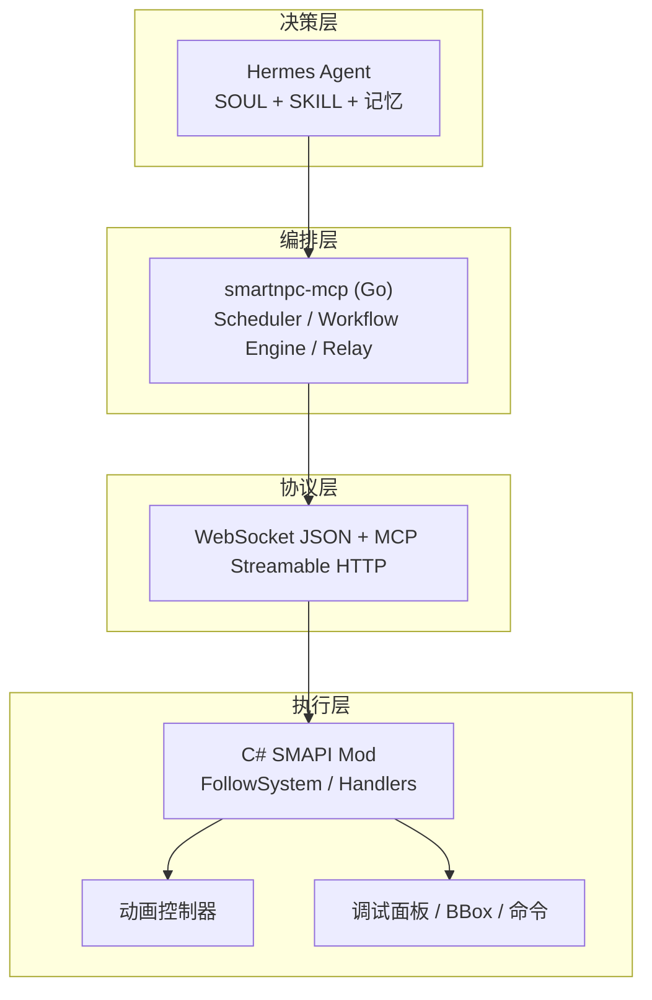
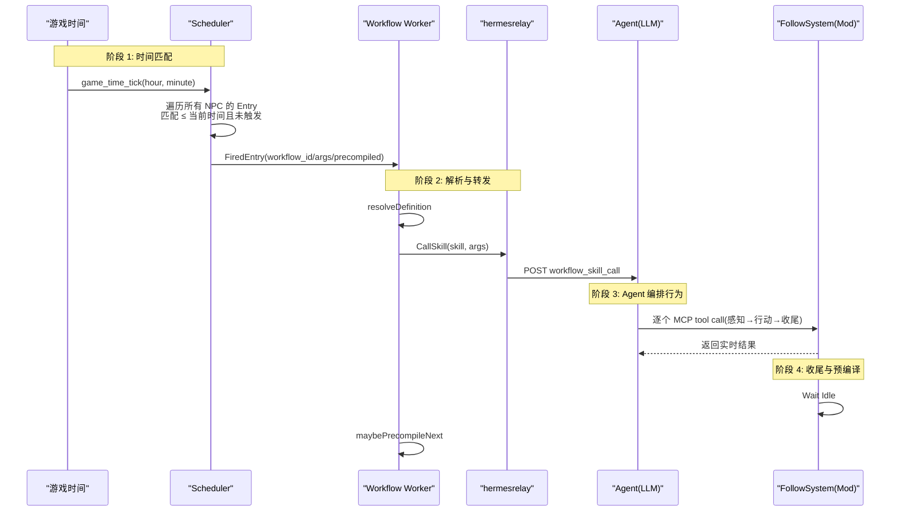
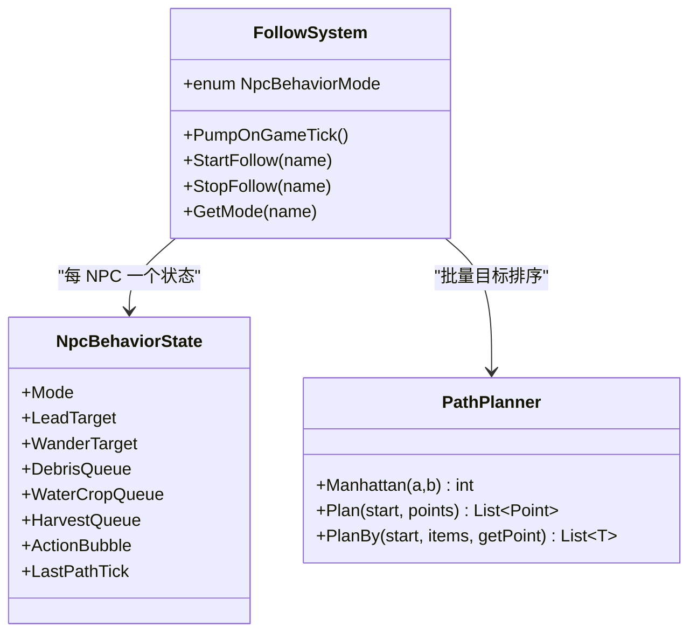
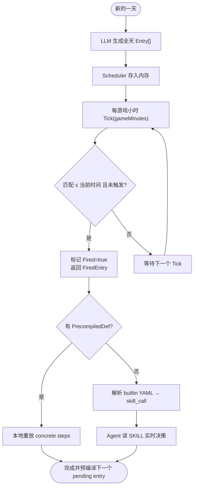
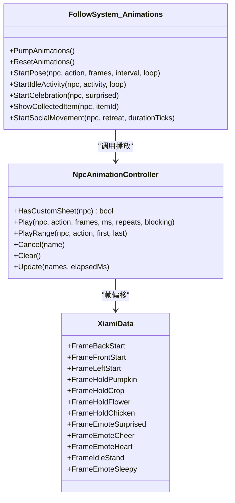
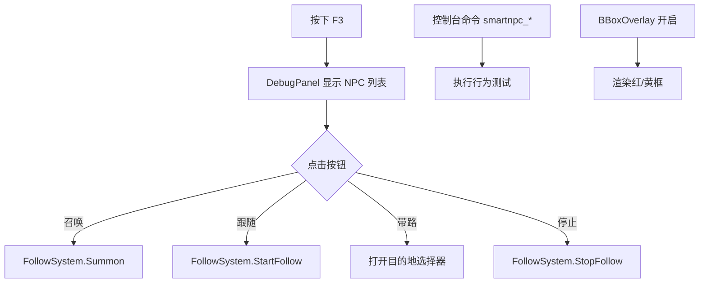
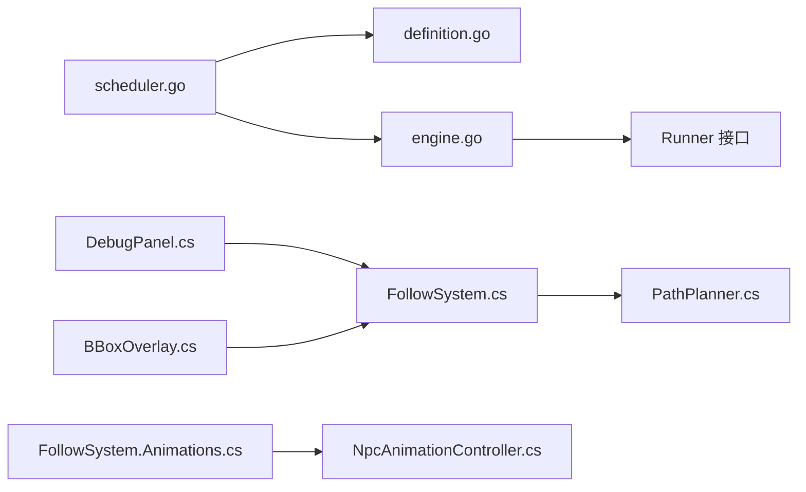

# 高级特性

<cite>
**本文引用的文件**   
- [npc-agent-autonomy.md](file://SmartNPC/docs/npc-agent-autonomy.md)
- [schedule-system-detail.md](file://SmartNPC/docs/schedule-system-detail.md)
- [xiami-animations.md](file://SmartNPC/docs/xiami-animations.md)
- [FollowSystem.cs](file://SmartNPC/smapi-mod/Movement/FollowSystem.cs)
- [NpcAnimationController.cs](file://SmartNPC/smapi-mod/Movement/NpcAnimationController.cs)
- [FollowSystem.Animations.cs](file://SmartNPC/smapi-mod/Movement/FollowSystem.Animations.cs)
- [PathPlanner.cs](file://SmartNPC/smapi-mod/Movement/PathPlanner.cs)
- [BehaviorHandler.cs](file://SmartNPC/smapi-mod/Movement/BehaviorHandler.cs)
- [scheduler.go](file://SmartNPC/smartnpc-mcp/adapters/stardew/scheduler/scheduler.go)
- [engine.go](file://SmartNPC/smartnpc-mcp/pkg/workflow/engine.go)
- [definition.go](file://SmartNPC/smartnpc-mcp/pkg/workflow/definition.go)
- [npc_behavior.go](file://SmartNPC/smartnpc-mcp/adapters/stardew/tools/npc_behavior.go)
- [DebugPanel.cs](file://SmartNPC/smapi-mod/UI/DebugPanel.cs)
- [BBoxOverlay.cs](file://SmartNPC/smapi-mod/Debug/BBoxOverlay.cs)
- [DebugCommands.cs](file://SmartNPC/smapi-mod/Debug/DebugCommands.cs)
- [xiami.json](file://SmartNPC/smapi-mod/assets/xiami/xiami.json)
</cite>

## 目录
1. [引言](#引言)
2. [项目结构](#项目结构)
3. [核心组件](#核心组件)
4. [架构总览](#架构总览)
5. [详细组件分析](#详细组件分析)
6. [依赖关系分析](#依赖关系分析)
7. [性能考虑](#性能考虑)
8. [故障排查指南](#故障排查指南)
9. [结论](#结论)
10. [附录：配置与示例](#附录配置与示例)

## 引言
本文聚焦 SmartNPC 的高级特性，面向希望理解并扩展 NPC 自主行为、日程调度、动画播放与调试能力的开发者。文档覆盖以下主题：
- NPC 自主决策机制、行为优先级算法与冲突解决策略
- 日程系统的定义格式、调度器实现和时间触发机制
- 动画系统帧管理、播放控制和素材处理流程
- DebugPanel、BBoxOverlay 和调试命令的使用方法
- 性能优化建议与常见故障排查
- 实际应用场景的代码路径与配置模板参考

本仓库由四层构成：Hermes Agent 决策层、smartnpc-mcp 编排层、WebSocket/MCP 协议层、C# SMAPI Mod 执行层。高级特性主要分布在 `smapi-mod`（游戏态执行）、`smartnpc-mcp`（Go 编排与调度）以及配套文档中。

## 项目结构
从高级特性视角，关键目录如下：
- `SmartNPC/docs`：NPC 自主性、日程系统、XiaMi 动画的技术说明
- `SmartNPC/smapi-mod/Movement`：NPC 行为状态机、寻路规划、动画控制
- `SmartNPC/smapi-mod/UI` 与 `Debug`：调试面板、包围盒可视化、控制台命令
- `SmartNPC/smartnpc-mcp/adapters/stardew/scheduler`：日程调度器
- `SmartNPC/smartnpc-mcp/pkg/workflow`：工作流定义与引擎
- `SmartNPC/smartnpc-mcp/adapters/stardew/tools`：MCP 工具注册
- `SmartNPC/smapi-mod/assets/xiami`：XiaMi 动画素材元数据

**图表来源**
- [npc-agent-autonomy.md:1-120](file://SmartNPC/docs/npc-agent-autonomy.md#L1-L120)
- [schedule-system-detail.md:1-120](file://SmartNPC/docs/schedule-system-detail.md#L1-L120)

**章节来源**
- [npc-agent-autonomy.md:1-120](file://SmartNPC/docs/npc-agent-autonomy.md#L1-L120)
- [schedule-system-detail.md:1-120](file://SmartNPC/docs/schedule-system-detail.md#L1-L120)

## 核心组件
本节概述高级特性的核心模块及其职责：
- NPC 自主行为系统：`FollowSystem` 管理每个受管 NPC 的行为模式、任务队列、社交移动、行动气泡等；`PathPlanner` 提供近似最优访问顺序。
- 日程系统：`scheduler.go` 维护每日日程表，按游戏时间触发已规划条目；`workflow engine` 驱动步骤执行或委托 Skill。
- 动画系统：`NpcAnimationController` 负责 XiaMi 自定义帧播放；`FollowSystem.Animations` 将动作映射到帧序列。
- 调试工具：`DebugPanel` 提供游戏内交互菜单；`BBoxOverlay` 可视化观察区域和行动区域；`DebugCommands` 暴露控制台命令。

**章节来源**
- [FollowSystem.cs:1-120](file://SmartNPC/smapi-mod/Movement/FollowSystem.cs#L1-L120)
- [PathPlanner.cs:1-120](file://SmartNPC/smapi-mod/Movement/PathPlanner.cs#L1-L120)
- [scheduler.go:1-120](file://SmartNPC/smartnpc-mcp/adapters/stardew/scheduler/scheduler.go#L1-L120)
- [engine.go:1-120](file://SmartNPC/smartnpc-mcp/pkg/workflow/engine.go#L1-L120)
- [NpcAnimationController.cs:1-109](file://SmartNPC/smapi-mod/Movement/NpcAnimationController.cs#L1-L109)
- [FollowSystem.Animations.cs:1-120](file://SmartNPC/smapi-mod/Movement/FollowSystem.Animations.cs#L1-L120)
- [DebugPanel.cs:1-120](file://SmartNPC/smapi-mod/UI/DebugPanel.cs#L1-L120)
- [BBoxOverlay.cs:1-120](file://SmartNPC/smapi-mod/Debug/BBoxOverlay.cs#L1-L120)
- [DebugCommands.cs:1-120](file://SmartNPC/smapi-mod/Debug/DebugCommands.cs#L1-L120)

## 架构总览
NPC 自运转由两条互补链路驱动：时间驱动的日程链路与事件驱动响应链路。

**图表来源**
- [schedule-system-detail.md:120-255](file://SmartNPC/docs/schedule-system-detail.md#L120-L255)
- [scheduler.go:120-305](file://SmartNPC/smartnpc-mcp/adapters/stardew/scheduler/scheduler.go#L120-L305)
- [engine.go:120-300](file://SmartNPC/smartnpc-mcp/pkg/workflow/engine.go#L120-L300)

## 详细组件分析

### NPC 自主行为系统
NPC 自主行为以状态机为核心，围绕 FollowSystem 展开。其关键设计包括：
- 行为模式枚举：Idle、Summoning、Following、Leading、Wander、各类农活与社会行为、Animating、SocialMovement 等
- 每 NPC 独立状态：目标坐标、半径、队列、计数、路径标志、行动气泡、最后寻路 tick 等
- 游戏线程安全：ws 接收端只设置目标模式，实际游戏状态变更在 PumpOnGameTick 中执行
- 冲突解决策略：长时任务串行独占，短时可即时执行；忙状态下根据当前 Mode 决定抢占或入队
- 寻路规划：对批量目标采用曼哈顿距离的最近邻初始回路加 2-opt 局部优化，降低往返折返

**图表来源**
- [FollowSystem.cs:1-120](file://SmartNPC/smapi-mod/Movement/FollowSystem.cs#L1-L120)
- [PathPlanner.cs:1-120](file://SmartNPC/smapi-mod/Movement/PathPlanner.cs#L1-L120)

#### 行为优先级与冲突解决
- 轻量即时动作直接执行，不进入队列
- 空闲或 Wander 状态立即启动新任务
- 其他长时任务入队，按 per-NPC FIFO 顺序执行
- 同一 NPC 严格串行，避免并发执行两个动作
- 社会类移动（如害羞后退、焦急踱步）有边界时长和目标队列

**章节来源**
- [BehaviorHandler.cs:1-159](file://SmartNPC/smapi-mod/Movement/BehaviorHandler.cs#L1-L159)
- [FollowSystem.cs:1-120](file://SmartNPC/smapi-mod/Movement/FollowSystem.cs#L1-L120)

### 日程系统
日程系统分为生成、存储、触发和执行四个阶段：
- 生成：每天开始时，LLM 通过 npc_plan_day 生成全天 Entry[]，包含触发时间、workflow_id、参数与理由
- 存储：内存中的 DaySchedule，按时间排序，day_started 清空
- 触发：Scheduler.Tick(gameMinutes) 遍历所有 NPC 的 Entries，匹配 ≤ 当前分钟且未触发的条目，标记为已触发并返回
- 执行：worker 解析内置 YAML 或预编译定义，调用 hermesrelay 让 Agent 实时决策，或回放预编译步骤

**图表来源**
- [schedule-system-detail.md:1-120](file://SmartNPC/docs/schedule-system-detail.md#L1-L120)
- [scheduler.go:1-120](file://SmartNPC/smartnpc-mcp/adapters/stardew/scheduler/scheduler.go#L1-L120)

#### 日程定义格式
Entry 支持三种形态：
- 引用内置 workflow（推荐）
- 内联 workflow 定义
- legacy 单 tool（已弃用）

字段包括：
- GameHour/GameMinute/GameMinutes：触发时间（10 分钟精度）
- Reason：LLM 记录的理由
- WorkflowID/Workflow/Args：workflow 标识与输入
- PrecompiledDef：预编译产物（可选优化）

**章节来源**
- [scheduler.go:1-120](file://SmartNPC/smartnpc-mcp/adapters/stardew/scheduler/scheduler.go#L1-L120)
- [schedule-system-detail.md:120-255](file://SmartNPC/docs/schedule-system-detail.md#L120-L255)

### 动画系统
XiaMi 的动画系统通过自定义精灵表实现，核心组件包括：
- NpcAnimationController：管理播放状态、帧时钟、方向映射、取消与清理
- FollowSystem.Animations：将动作名称映射到帧序列，支持阻塞与非阻塞循环
- xiami.json：描述源图布局、帧坐标、变换与动画定义

**图表来源**
- [NpcAnimationController.cs:1-109](file://SmartNPC/smapi-mod/Movement/NpcAnimationController.cs#L1-L109)
- [FollowSystem.Animations.cs:1-120](file://SmartNPC/smapi-mod/Movement/FollowSystem.Animations.cs#L1-L120)
- [xiami.json:1-120](file://SmartNPC/smapi-mod/assets/xiami/xiami.json#L1-L120)

#### 帧管理与播放控制
- 仅对 XiaMi 应用自定义帧号，其他村民不受影响
- 行走帧根据朝向选择 front/back/left 条带，右侧镜像 left 条带
- 工作动画阻塞下一项任务直到最后一帧完成
- 循环待机动画不阻塞后续作业
- 暂停、传送、存档重载、标题返回会释放动画锁

**章节来源**
- [xiami-animations.md:1-30](file://SmartNPC/docs/xiami-animations.md#L1-L30)
- [NpcAnimationController.cs:1-109](file://SmartNPC/smapi-mod/Movement/NpcAnimationController.cs#L1-L109)

### 调试工具
调试工具提供三类能力：
- DebugPanel：F3 打开的游戏内菜单，列出受管 NPC，提供召唤、跟随、带路、停止按钮
- BBoxOverlay：在地图上绘制红色观察框与黄色行动框，自动过期或与 FollowSystem 模式联动清除
- DebugCommands：控制台命令用于快速测试行为、推进时间、查询状态

**图表来源**
- [DebugPanel.cs:1-120](file://SmartNPC/smapi-mod/UI/DebugPanel.cs#L1-L120)
- [BBoxOverlay.cs:1-120](file://SmartNPC/smapi-mod/Debug/BBoxOverlay.cs#L1-L120)
- [DebugCommands.cs:1-120](file://SmartNPC/smapi-mod/Debug/DebugCommands.cs#L1-L120)

#### 使用场景
- DebugPanel：手动控制 NPC 行为模式，验证跟随与带路逻辑
- BBoxOverlay：观察 npc_inspect_object 扫描区域与农活作用域
- DebugCommands：模拟时间推进、强制执行浇水/收获/清理等动作，便于复现问题

**章节来源**
- [DebugPanel.cs:1-120](file://SmartNPC/smapi-mod/UI/DebugPanel.cs#L1-L120)
- [BBoxOverlay.cs:1-120](file://SmartNPC/smapi-mod/Debug/BBoxOverlay.cs#L1-L120)
- [DebugCommands.cs:1-120](file://SmartNPC/smapi-mod/Debug/DebugCommands.cs#L1-L120)

## 依赖关系分析
高级特性的关键依赖如下：
- scheduler.go 依赖 workflow.Definition 与 engine.Run
- engine.go 依赖 Runner 接口（由 ws bridge/hermesrelay/FollowSystem 实现）
- FollowSystem.cs 依赖 PathPlanner.cs 进行批量目标排序
- NpcAnimationController.cs 依赖 XiaMi 帧数据与 Game1 图形 API
- DebugPanel.cs 依赖 FollowSystem 与 AgentNpcRegistry
- BBoxOverlay.cs 依赖 FollowSystem.GetMode 与 Game1 渲染管线

**图表来源**
- [scheduler.go:1-120](file://SmartNPC/smartnpc-mcp/adapters/stardew/scheduler/scheduler.go#L1-L120)
- [definition.go:1-120](file://SmartNPC/smartnpc-mcp/pkg/workflow/definition.go#L1-L120)
- [engine.go:1-120](file://SmartNPC/smartnpc-mcp/pkg/workflow/engine.go#L1-L120)
- [FollowSystem.cs:1-120](file://SmartNPC/smapi-mod/Movement/FollowSystem.cs#L1-L120)
- [PathPlanner.cs:1-120](file://SmartNPC/smapi-mod/Movement/PathPlanner.cs#L1-L120)
- [FollowSystem.Animations.cs:1-120](file://SmartNPC/smapi-mod/Movement/FollowSystem.Animations.cs#L1-L120)
- [NpcAnimationController.cs:1-109](file://SmartNPC/smapi-mod/Movement/NpcAnimationController.cs#L1-L109)
- [DebugPanel.cs:1-120](file://SmartNPC/smapi-mod/UI/DebugPanel.cs#L1-L120)
- [BBoxOverlay.cs:1-120](file://SmartNPC/smapi-mod/Debug/BBoxOverlay.cs#L1-L120)

**章节来源**
- [scheduler.go:1-120](file://SmartNPC/smartnpc-mcp/adapters/stardew/scheduler/scheduler.go#L1-L120)
- [engine.go:1-120](file://SmartNPC/smartnpc-mcp/pkg/workflow/engine.go#L1-L120)
- [FollowSystem.cs:1-120](file://SmartNPC/smapi-mod/Movement/FollowSystem.cs#L1-L120)
- [PathPlanner.cs:1-120](file://SmartNPC/smapi-mod/Movement/PathPlanner.cs#L1-L120)
- [FollowSystem.Animations.cs:1-120](file://SmartNPC/smapi-mod/Movement/FollowSystem.Animations.cs#L1-L120)
- [NpcAnimationController.cs:1-109](file://SmartNPC/smapi-mod/Movement/NpcAnimationController.cs#L1-L109)
- [DebugPanel.cs:1-120](file://SmartNPC/smapi-mod/UI/DebugPanel.cs#L1-L120)
- [BBoxOverlay.cs:1-120](file://SmartNPC/smapi-mod/Debug/BBoxOverlay.cs#L1-L120)

## 性能考虑
- 日程调度器 Tick 使用互斥锁保护，遍历所有 NPC 的 Entries，时间复杂度 O(N×E)，N 为 NPC 数量，E 为平均条目数；由于 entries 通常较少，开销可忽略
- 预编译路径（PrecompiledDef）减少 LLM 延迟，适合重复性高、环境变化小的任务
- 工作流引擎每步记录日志，StepCount/ToolCalls/NothingToDoCt 可用于监控执行效率
- 寻路规划器使用 O(n²) 最近邻 + 2-opt，n 通常为数十以内，运行时间远小于 1ms
- 动画更新仅在 world ready 时进行，且对非 XiaMi 角色跳过处理
- 调试命令与 UI 操作走游戏线程队列，避免跨线程访问 Game1

**章节来源**
- [scheduler.go:120-305](file://SmartNPC/smartnpc-mcp/adapters/stardew/scheduler/scheduler.go#L120-L305)
- [engine.go:120-300](file://SmartNPC/smartnpc-mcp/pkg/workflow/engine.go#L120-L300)
- [PathPlanner.cs:1-120](file://SmartNPC/smapi-mod/Movement/PathPlanner.cs#L1-L120)
- [NpcAnimationController.cs:1-109](file://SmartNPC/smapi-mod/Movement/NpcAnimationController.cs#L1-L109)
- [BehaviorHandler.cs:1-159](file://SmartNPC/smapi-mod/Movement/BehaviorHandler.cs#L1-L159)

## 故障排查指南
常见问题与定位方法：
- 日程未触发：检查 day_started 是否广播、Scheduler.ClearAll 是否被误调用、game_time_tick 是否到达
- 工作流未执行：确认 workflow_id 是否存在、builtin YAML 是否正确、skill_call 是否成功转发至 hermesrelay
- 动画异常：确认是否为 XiaMi 角色、是否处于 busy 状态、是否发生 warp/save reload 导致动画锁未释放
- 行为卡住：查看 FollowSystem.Mode 是否为 Idle、队列是否积压、是否有长时任务未完成
- 调试信息缺失：确认 DebugPanel 是否打开、BBoxOverlay 是否启用、控制台命令是否注册

建议步骤：
1. 使用 `smartnpc_status` 检查 ws 连接与 mcp 健康状态
2. 使用 `smartnpc_debug` 查看 NPC 好友度、位置、在线状态
3. 使用 `smartnpc_tick <N>` 推进时间并触发日程
4. 使用 `smartnpc_water_crops/harvest_crops/clear_debris` 等命令复现行为
5. 开启 BBoxOverlay 观察观察框与行动框是否与预期一致
6. 通过 DebugPanel 手动切换 NPC 模式，验证状态转换

**章节来源**
- [DebugCommands.cs:1-120](file://SmartNPC/smapi-mod/Debug/DebugCommands.cs#L1-L120)
- [BBoxOverlay.cs:1-120](file://SmartNPC/smapi-mod/Debug/BBoxOverlay.cs#L1-L120)
- [scheduler.go:120-305](file://SmartNPC/smartnpc-mcp/adapters/stardew/scheduler/scheduler.go#L120-L305)
- [engine.go:120-300](file://SmartNPC/smartnpc-mcp/pkg/workflow/engine.go#L120-L300)

## 结论
SmartNPC 的高级特性围绕“时间驱动 + 事件驱动”的双链路构建，结合 Go 编排层与 C# 执行层，实现了 NPC 的自主决策、日程调度、动画播放与调试可视化。其设计强调：
- 低耦合：调度器与工作流引擎独立于具体工具
- 可扩展：workflow DSL 支持分支、随机、遍历、技能调用与等待
- 高性能：预编译路径与本地规划算法降低延迟
- 易调试：多层面调试工具帮助快速定位问题

未来可进一步优化：
- 增加更多内置 workflow 模板
- 优化大区域寻路规划器的启发式搜索
- 扩展动画系统与更多 NPC 角色适配
- 完善调试面板的状态可视化与日志输出

## 附录：配置与示例

### 日程定义模板
- 每日计划入口：`npc_plan_day`
- 条目字段：
  - `game_hour`：6-25
  - `game_minute`：0-50（10 分钟步长）
  - `reason`：LLM 记录的理由
  - `workflow_id`：引用内置 workflow（推荐）
  - `args`：workflow 输入参数
  - `precompiled_def`：预编译产物（可选）

示例路径：
- [schedule-system-detail.md:1-120](file://SmartNPC/docs/schedule-system-detail.md#L1-L120)
- [scheduler.go:1-120](file://SmartNPC/smartnpc-mcp/adapters/stardew/scheduler/scheduler.go#L1-L120)

### 工作流定义模板
- Step 类型：tool、branch、random、foreach、skill_call、llm_choice、wait、stop
- 变量语法：`$<name>.path`
- 工具输出绑定：`save_as`
- 超时控制：`timeout_seconds`
- nothing_to_do 处理：skip/stop/fail

示例路径：
- [definition.go:1-120](file://SmartNPC/smartnpc-mcp/pkg/workflow/definition.go#L1-L120)
- [engine.go:120-300](file://SmartNPC/smartnpc-mcp/pkg/workflow/engine.go#L120-L300)

### 动画素材配置
- xiami.json 描述源图布局、帧坐标、变换与动画定义
- 支持 flip_x 镜像左侧帧以生成右侧动画
- 帧编号与方向映射由 NpcAnimationController 处理

示例路径：
- [xiami.json:1-120](file://SmartNPC/smapi-mod/assets/xiami/xiami.json#L1-L120)
- [NpcAnimationController.cs:1-109](file://SmartNPC/smapi-mod/Movement/NpcAnimationController.cs#L1-L109)

### 调试命令速查
- `smartnpc_debug`：转储 NPC 状态
- `smartnpc_status`：检查 ws/mcp/hermes 健康
- `smartnpc_tick <N>`：推进 N 小时
- `smartnpc_water_crops/harvest_crops/clear_debris/till_soil/forage_collect/plant_seeds/break_resource/fertilize/fill_gaps/deposit_items/withdraw_from_chest/place_object/transfer_item/express_emotion/dance/react_surprise/pace/shy_retreat/idle_activity/text_bubble/give_chest/get`：对应行为测试

示例路径：
- [DebugCommands.cs:1-120](file://SmartNPC/smapi-mod/Debug/DebugCommands.cs#L1-L120)